# 约翰霍普金斯大学数据科学课程9：《开发数据产品》｜data-products｜ - P30：29_r markdown 1 5.zh_en - GPT中英字幕课程资源 - BV19N411v7Y2

Okay， now let's show some R code that's going to get run， okay， so one， two， three。

Quotation single quotation marks， okay， we want it to be our code。

Okay and then notice it does some nice highlighting to let you know that you're actually in some R code and then let's do head empty cars。

 just showing the head of the data set empty cars， you can actually run it here in our studio and it'll show you down here the code being run in the environment that you have right now in your interactive R prompt。

 but then you want to actually run the whole document， controlship K。

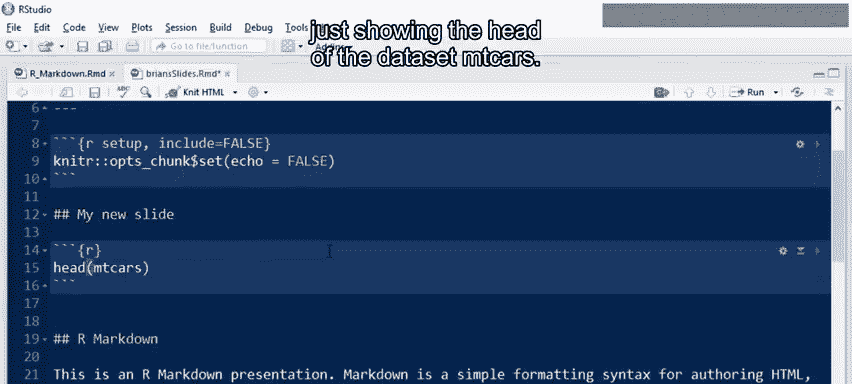

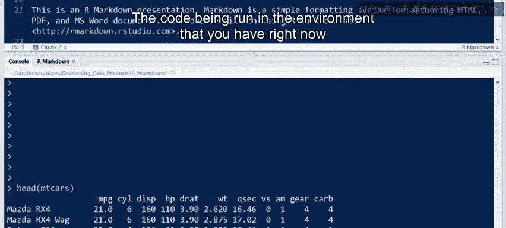

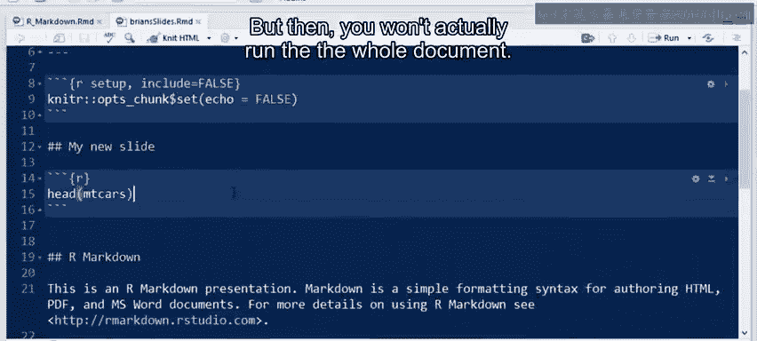

And there's my new slide， okay？Okay， so let's play around with our options a little bit。

 I've deleted a couple of。The rest of the slides just so we can just play with this little extremely simple code example right here。

 So I didn't like when， let me just show it to you again when it put this out。

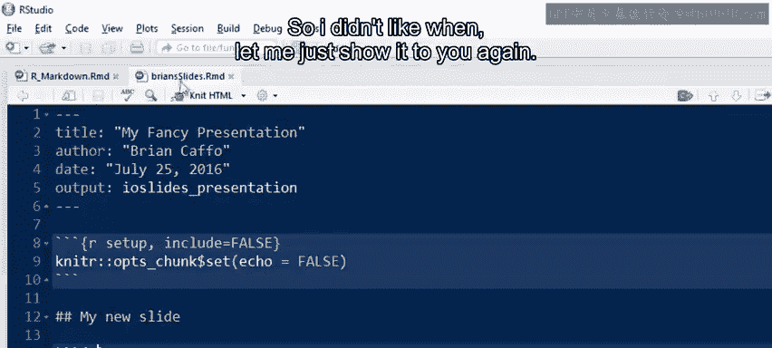

One thing I didn't like。There we go， I didn't like these comment characters out in front of the output。

Okay， so let me just try comment equals and then you can put whatever character you want。

 but I want nothing， so why don't I try that。

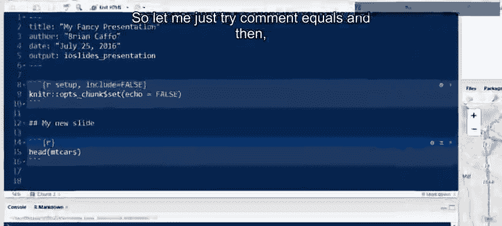

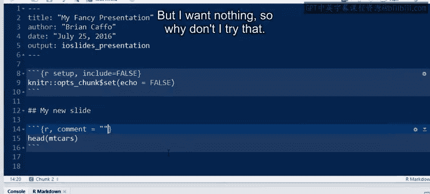

See how that looks。Oh， great。 Okay， And then now it looks to me a little bit better。

 I didn't want that comment character there。 Okay， so let's see some other things。

 So notice that by default， the knitter options were echo equals false。

 So it didn't show you what code it ran， it just showed you the output from the code。 And by the way。

 when you're typing in your knitter options， it has a bunch。

 you can see once you put a comment and start to type them， you can see them。 you can see them there。

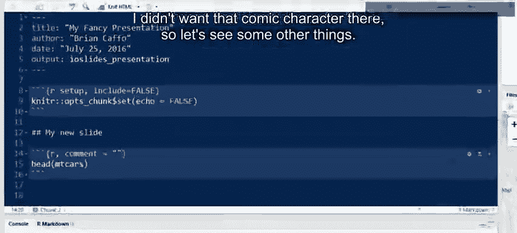

So if I were to， for example， put echo equals true。

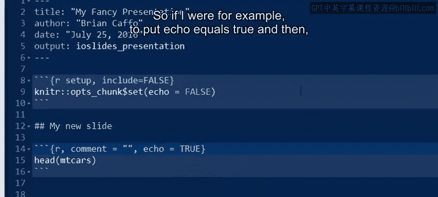

And then redo the presentation。Okay then you see head empty cars。

 it's actually repeating the code that I used to generate the output。

 So down here is the output and here's the code by default in that knitter options set up just from the auto completinglet of the template that I was using to create these slides。

 it set that option， but by default you don't have to have that option I could equivalently another thing I could have done would have been exactly the same thing is just gotten rid of this set of knitter options at the beginning and then now I don't have to say echo equals true because echo equals true is the default option。

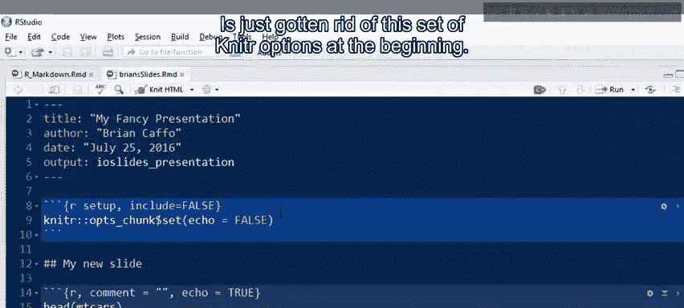

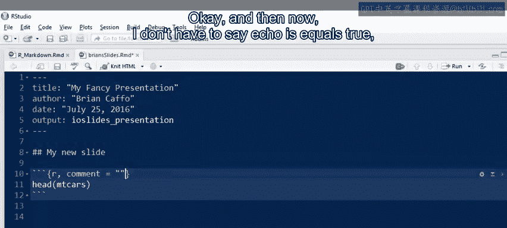

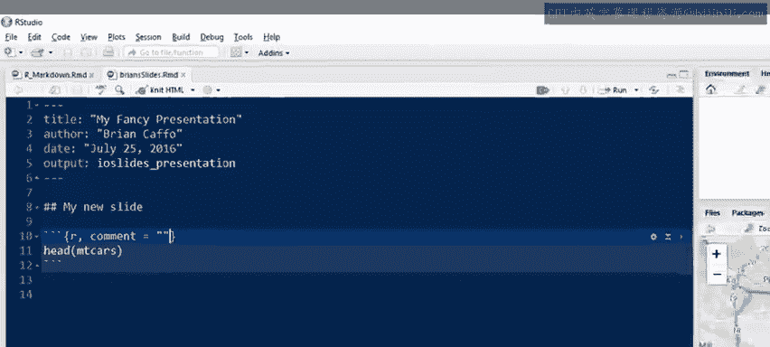

Unless you override it。Okay， so there， now it's automatically sending the code。

You sometimes might just want the code out but not having run it， so if I type if value equals false。

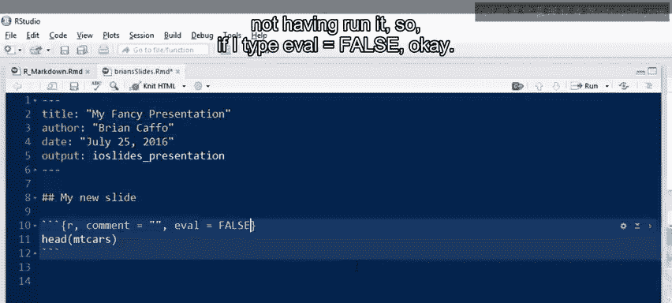

Okay。There's just the code， but it hasn't been evaluated。

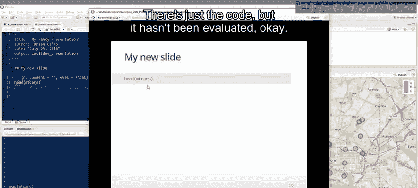

Okay。And then you can just put in a comma here and then start to look at all the different options。

 they're all the same options or it is knitter so it's the same options as in any knitter document。

 but a lot of these are for figures which we're going to cover here in a minute。Okay。All right。

So go ahead and try and create a slide with some R code that isn't evaluated。

 some slide with some R code that is evaluated， try and you know play around。

 make sure you can set the comment character and then just play around with some of the knitter options and next we'll move on to doing some figures and some other things。

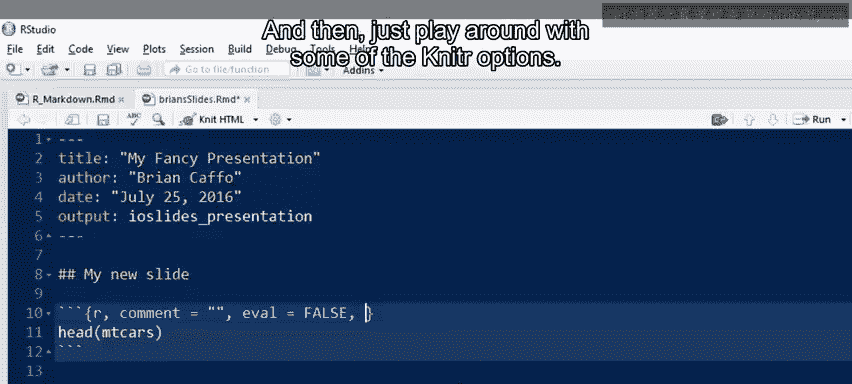