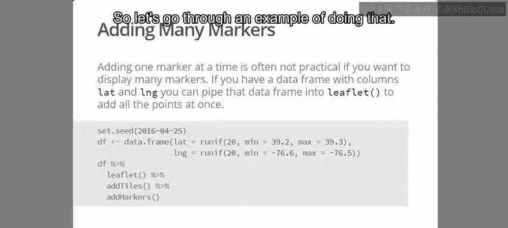
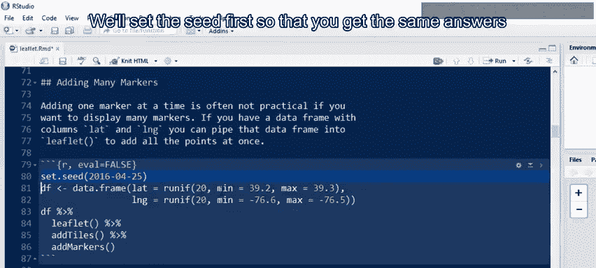
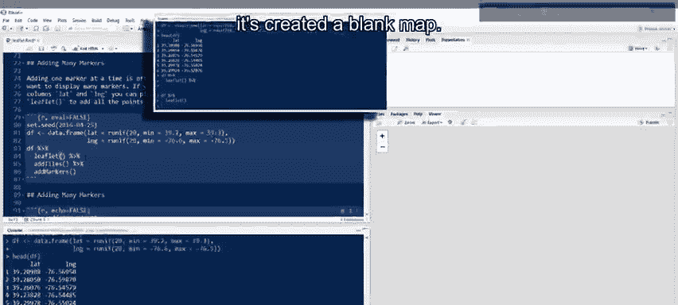
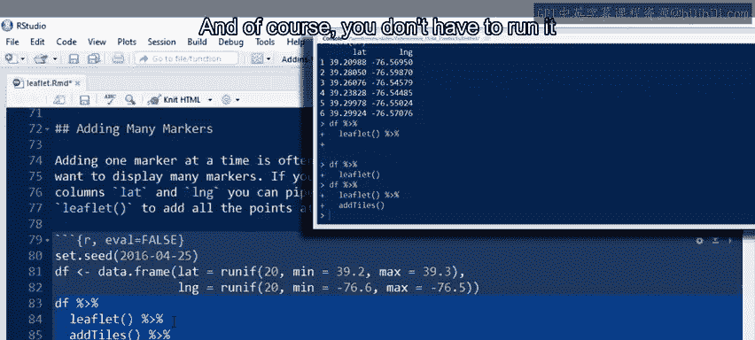

# 约翰霍普金斯大学数据科学课程9：《开发数据产品》｜data-products｜ - P34：33_leaflet 1 3.zh_en - GPT中英字幕课程资源 - BV19N411v7Y2

So what if you want to add a lot of markers， well， there's a pretty simple way to do that。

 you just dump the collection of markers that you want to add in a data frame。

 so let's go through an example of doing that。

So let's just create a data frame that has some random longitude and latitudes。

 We'll set the seed first so that you get the same answers as we do when you run the same code Okay。

 so then I'm just going to create this data frame and then let me just show you。

The what the data frame looks like it's got more rows than this。

 but 20 rows exactly so the latitude and longudinal are just two columns named Latin long in the data frame Okay now what we're going to do is this data frame is going to get this is what this code means right this data frame is going to get passed as an argument to leaflet that'll create our map which will have nothing。

Okay， so if I were to just run。These two those two code， those two bits。

 it well actually it's expecting something now let me。Let me get out of that。

 so if I were to just run。This part。Without a pipe。Okay。

 it's created a blank map Okay now if I were to run this code where it's taken the data frame。

 past is an argument to leaflet， past the output of the argument of leaflet evaluated at the data frame as the argument to the add tiles function。

 I would get this， it would have the map， but remember add tiles just brings in the mapping data。

 it doesn't actually plot anything。 And now if I pass that。

To the add markers， it should add the markers okay， and of course。

 you don't have to run it the way I'm running it in bits and pieces you just run the whole code all at once Okay。

 and there you see are your multiple markers right like that okay。

So try this out， create a data frame with some random longitude and latitudes in it。

 and create a map with all the markers in it。