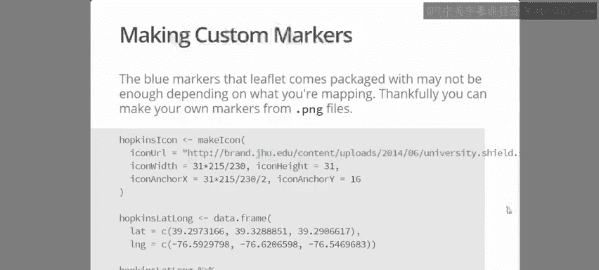
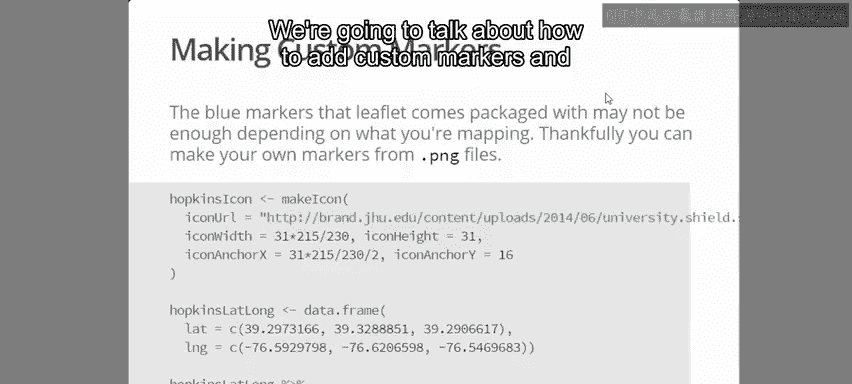
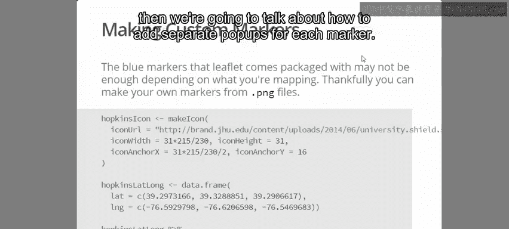

# 约翰霍普金斯大学数据科学课程9：《开发数据产品》｜data-products｜ - P35：34_leaflet 1 4.zh_en - GPT中英字幕课程资源 - BV19N411v7Y2

In this next bit of code we're going to talk about two things。

 we're going to talk about how to add custom markers and then we're going to talk about how to add separate pop ups for each marker。

 so just to give you a sense of what we want， we want something like this where it's the Hopkins logo at each of the markers。

And then after we add we want a separate pop up for each marker and so we want something like this with the markers and then I'll show you interactively here in a second what we're actually getting when we have a separate pop up Okay。

 so let's go ahead and try doing that Okay， so I think it's actually pretty quick to get an icon exactly how you want。

 So here we're going to define as our Hopkins icon as grabbing this URL。

Okay and then you can specify the width the height and the anchor points Okay and then now let's create Hopkins la long。

 which is a series of latitude and longitude values of buildings at Hopkins and then we're just going to run it so we're going to have our longitude and latitude values are going to be passed to leaflet which then the output of the leaflet function with the latitude and longitude values past through it is going to be passed and is the argument to add tiles。

 which is going to add the mapping data and then it's going to add the markers。 However。

 we also have some secondary arguments that we need。

 which is that the icon is going to be the Hopkins icon。

 So let's run all this code I'm just going to run it by clicking this little arrow up here and there you see it。

 And now instead of these little bubbles that we have before。We have the Hopkin shield。 Okay。

 now we actually want links for each of these。 If I click on them now， they don't do anything。

 So what we're going to do is basically the same thing。

 We already have our icon set and we already have our series of longitude and latitude values set。

 So what we need is。What we need is a series of sites， okay， in this case。Our site is a vector。

Of text that give the HTML commands that give a hyper Ref。

To each one of the buildings or the campus values or something like that。

 And these are in the correct order corresponding to the latitude and longitude values。 Okay。

 and so we're going to take our existing defined latitude and longitude values。

 We're going to pass them to leaflet。 We're going to pass the output of that command to add tiles and then we're going to pass the output of that command to add markers only we have our icon set to the icon that we want。

 and then pop up is going to be the collection of Hopkins sites。 Okay， so let's run the whole thing。

And there we go， okay now when you click it says Peabody Institute and if you click on this link。

 it takes you to the Peabody Institute website。Okay， so pretty handy little map。

