# 约翰霍普金斯大学数据科学课程9：《开发数据产品》｜data-products｜ - P43：42_swirl 1 1.zh_en - GPT中英字幕课程资源 - BV19N411v7Y2

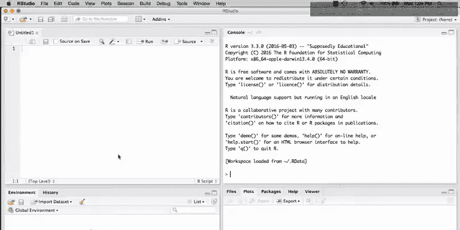

Hello， I'm Sean Cross and I'm going to show you how to start writing your own swirl courses and swirl lessons with Srlify If you're not familiar with swirl。

 it's an R package that turns the R console into an interactive learning environment。

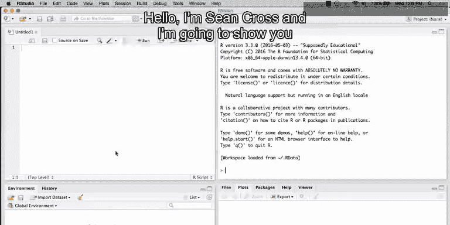

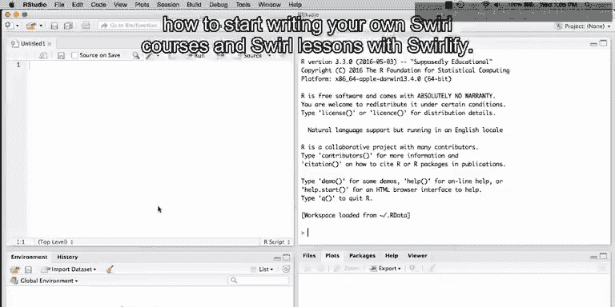

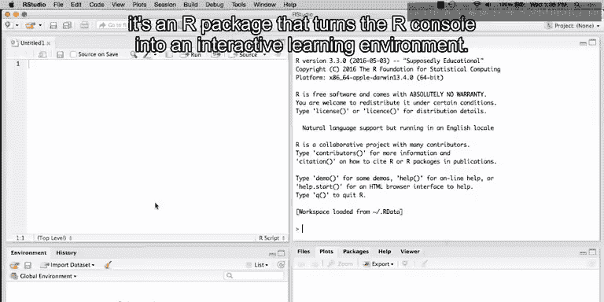

Let me give you a short tour of swirl in case you haven't used it before。 so let me。

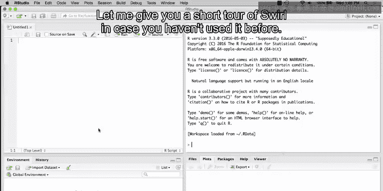

Load the swirl package。And then I can just start up swirl。

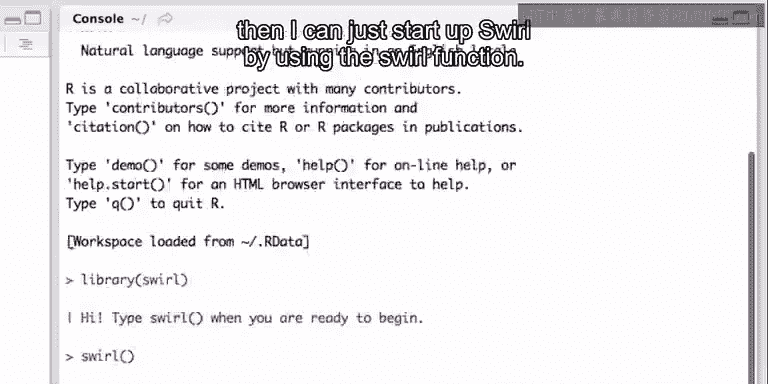

By using the swirl function， and as you can see， the R console starts talking to me。

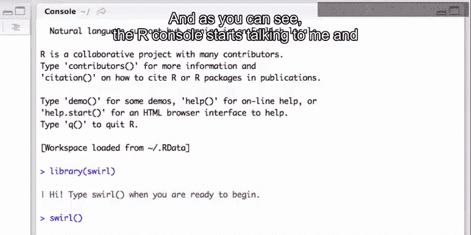

And asking me some questions。 so can call me Sean。

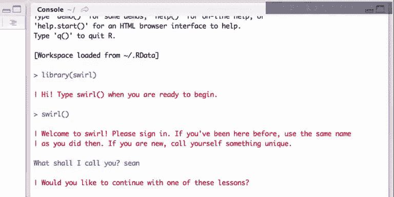

I don't want it was working on a lesson before。 As you can see， I get a。

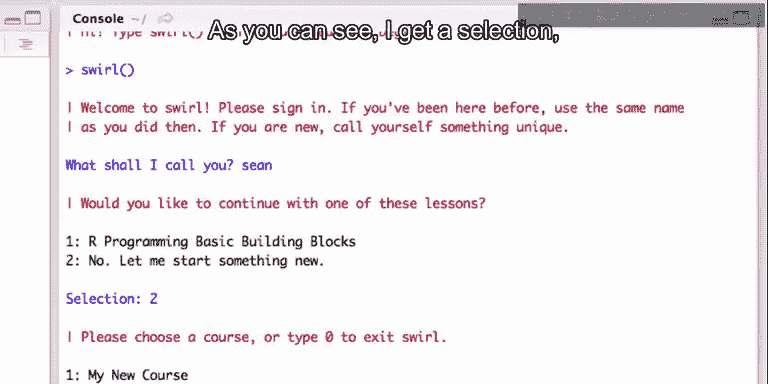

Selection， I get a couple options to。

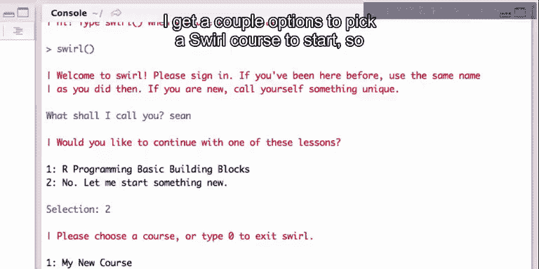

So to pick a scroll course to start starting to start our programming。And then within that course。

 I can pick a lesson。 I'm going to start the。

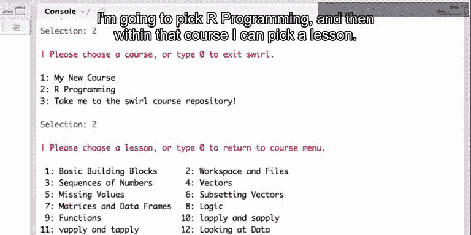

First lesson， basic building blocks。

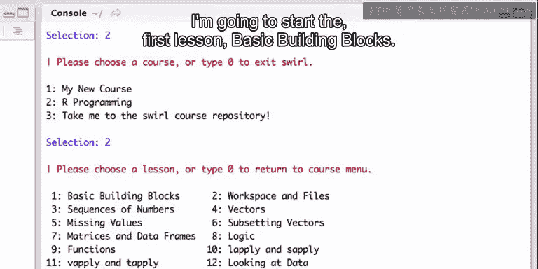

So the archal starts displaying some text as I get into this swirl lesson。

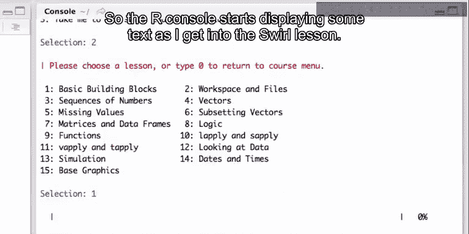

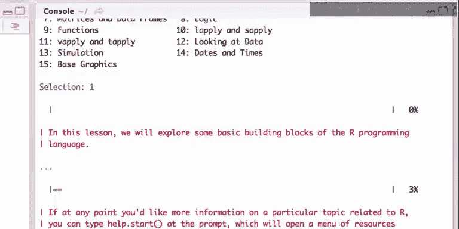

A V。Console and swirl wants me to type in 5 plus 7。

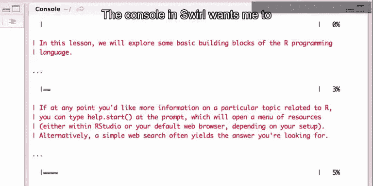

And I did that correctly， so I got the question right so we can move on to further questions。

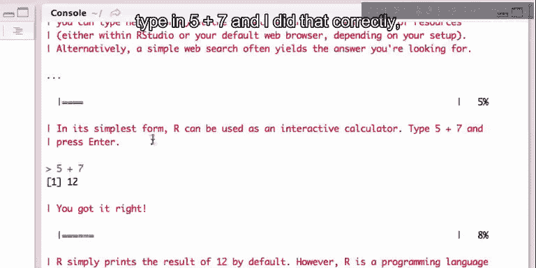

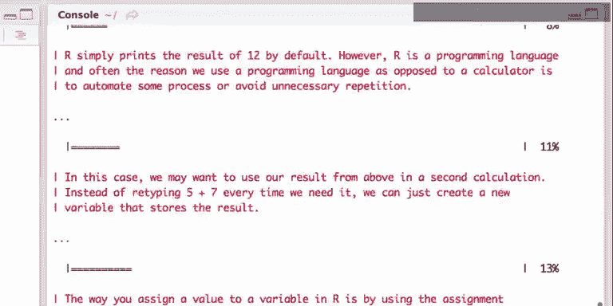

Now， swirl wants me to assign the value of 5 plus7 to a variable x。

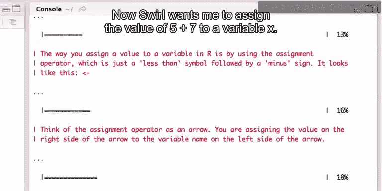

And so I'm going to do the wrong things to show you what happens。 I'm going to assign 5 plus 8。

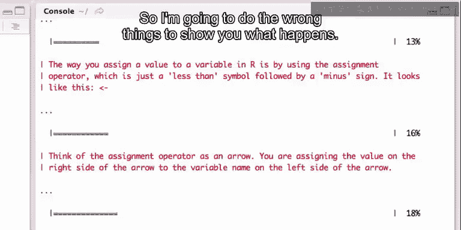

And as you can see。

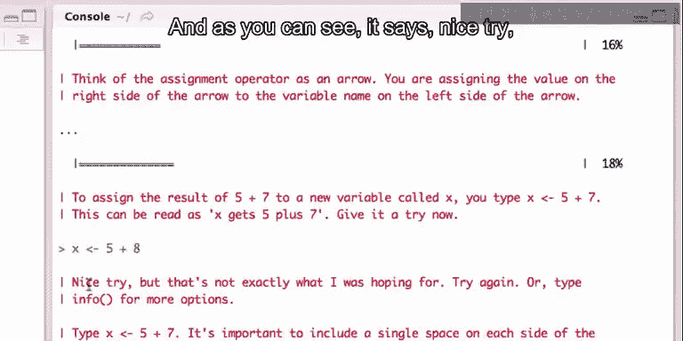

It says my sh I didn't get the question right， and it shows me a hint。

 So I'm going to follow that hint advice and type。

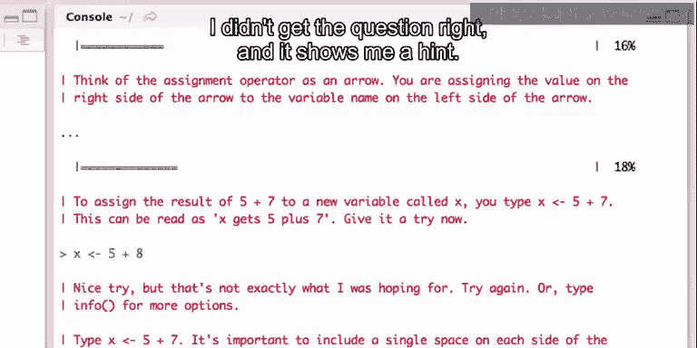

5%7。

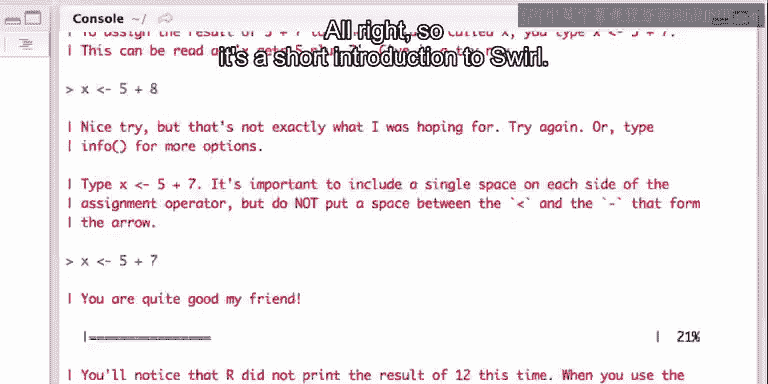

All right， so that's a short introduction to swirl there are several different kinds of questions that the R console can ask a student。

 so I'm going to exit out of this lesson right now and I did that using the escape key by the way and。

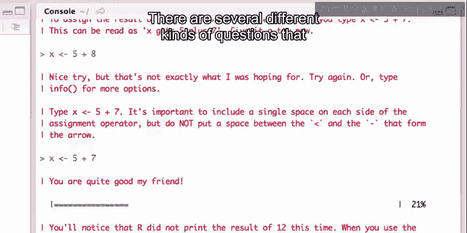

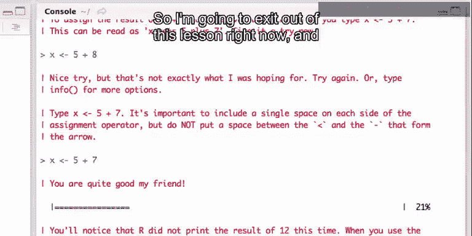

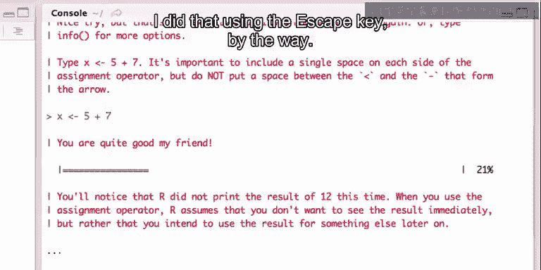

I'm going to show you how you can start writing your own swirl lessons with Slify。

