# 约翰霍普金斯大学数据科学课程9：《开发数据产品》｜data-products｜ - P8：7_shiny 2 2.zh_en - GPT中英字幕课程资源 - BV19N411v7Y2

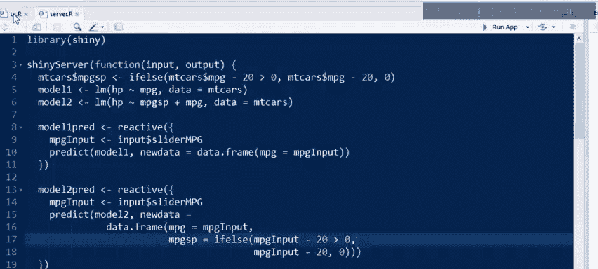

Okay， so I have copied the code from the R Markdown document。And of the next set of examples。

 And here what I'm going to show you is I'm going to first go through the user interface and then I'll go through the server calculations So remember what we're trying to show is reactive expressions。

 Okay so again， we have our library shiny statement right there。

 okay we have shiny UI fluid page We've got a title。

 Okay and then we're going have a sidebar layout with okay so that's this right here。

 which is and then that contains the sidebar panel， these commands right here and the main panel。

 these commands right here。 So the sidebar panel is going to contain the inputs and the main panel is going to contain the outputs。

 So the sidebar panel。Includes a slider input okay。

 and remember what that's going to be labeled as is slider。MPG。

 so we're inputting the miles per gallon。From the car。And。

And then these checkbox are going to tell whether or not you want to show certain model values， okay？

In the output， in the main panel， okay？And then you know we give it the default value of 20 and range from 10 miles per gallon to 35 miles per gallon。

 and the goal is to create something that then displays your prediction for the horsepower Okay。

 then in the main panel。Okay， oh and just by the way， the inputs are show Model one and show Model2。

 okay。The main panel， then， is going to show the。Output， plot one。So。

We're going to look in our server function for a plot labeled plot one to make sure that it's there because it's going to get displayed here in our main panel。

Then we're going to have our output from prediction one， and that's going to be labeled pre1。

 So we need some sort of output from our server that is going to be labeled Pre1 and another one that's labeled Pre2 that are both going to be text output Okay so that's what our our user interface is doing。

 It's getting a slider input。To get in miles per gallon， that slider's label is slider MPG。

 it's going to have the two check boxes for whether or not it's going to show that particular model output。

Okay， so that's what it's going to send to the server。

 Okay that's those are some information that's going to be send to the server as input。

 and what we're expecting from our server functions as output is we're expecting a plot labeled plot 1。

 We're expecting text labeled pre 1 and text labeled pre 2。 Okay， now let's look at our server。

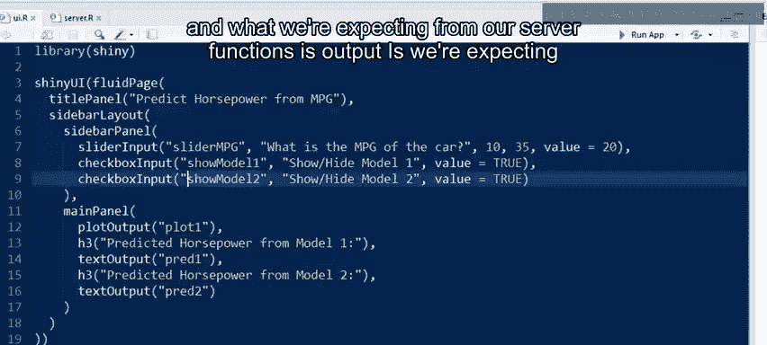

So here's our shiny server function， and then it it contains this function that contains input and output。

 Okay， first thing it looks for or first thing it's going to do is it's going to take the empty cars data。

 which is loaded by default。 So if I just type empty cars。

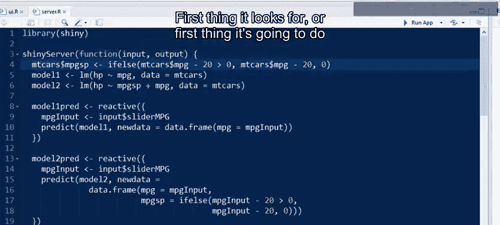

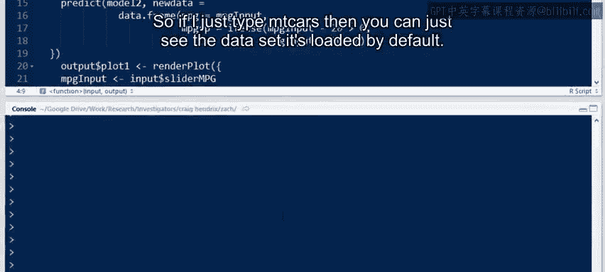

Then you can just see the dataset set。 It's loaded by default。

 It's one of the more common example dataset sets used in R。 And it's basically going to create。

 this is just a sp term。 So if the miles per gallon of the car is larger than 20。

 this is going to return the miles per gallon otherwise it's going to return zero。

 and that's useful if you want to fit a model that has a kind of a broken stick fit。

 So it has it has a line and then a break point at 20 and then another line。

 and the two lines meet continuously at that break point。

 So so then what's going on in the code is it's fitting this first model that just has miles per gallon and the second model that has miles per gallon and this break point in the middle so it's fitting two models and these two models or what's going to be used to form the prediction now let's actually get the prediction for model1 now we're doing calculations based on input of values from our user interface。

So it needs to be in a reactive statement。 So here we see this reactive statement。

 We see this funny notation where we have a parentheses and acur braces。 Okay。

 and then we're going to relabel the input just as a regular R variable because。

 you know it gets annoying to type input dollar sign so often。 Okay。

 so we have miles per gallon input is just the input。Dollar sign， slider MPG。 And remember。

 slider MPG is what we named the slider value in our user interface， okay。

And then this predict statement is just going to use model 1。 Okay， so uses model 1。

 you can see it right there， uses model1， and it's going to predict it at the new value。

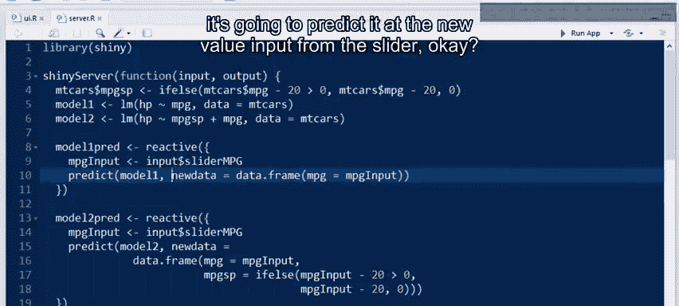

Input from the slider。 Okay， so that's model1。 And then model 2 is going to do the same thing with the exception that we have to also create this variable。

 If our input value is bigger than 20， it returns that Otherwise it's going to return 0。

 So it's the same thing only now we've created this second variable MPgSP， right。

 And that's this extra sp term。 And then it's going to。 So we have our two。Reactive。

Assigned variables， Model 1 pre and Model 2 pre。

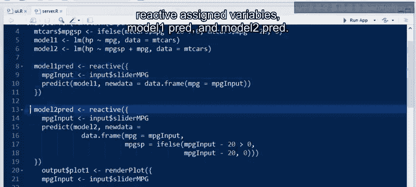

Okay now the first output that we're going to create is output dollar sign plot1。

 remember that our user interface is looking for a plot labeled plot one and because it's a plot。

 we're going to say it's our render plot and that funny notation where it's the parenthees。

 then the curly braces inside the parenthees Okay so we're grabbing our miles per gallon input that's just the slider miles per gallon again。

Okay， and then we're going to create a plot， okay， and the plot you can just you're all familiar with our plotting。

 so you can just go through and see how the plot's working。

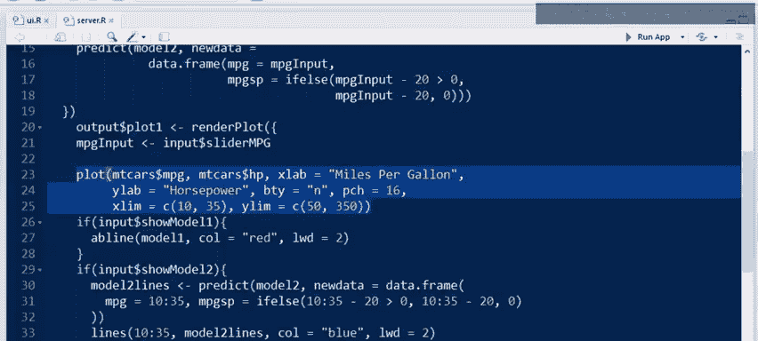

But then also what I would like you to look for。

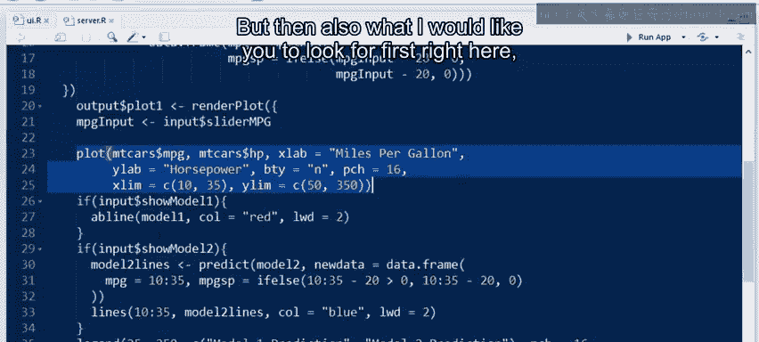

First right here， if show model one， then it adding this it's adding the fit for the Model1 and if show model2。

 it's going to add the fit for Model 2 okay so that's one thing has these conditional values for whether or not those lines are going to be in there。

Okay， it's got a nice legend。Okay。And then， if you look。Down here。

 I just this is the most important part I want to show is we want to add some points at the miles per gallon that you input。

 that's this value right here， remember we reassign that from the slider value up here so we just renamed it from the input dollar sign slidermpg Okay but then also we want the result of our reactive expression Model1 pre。

 And so we're putting that in there。 but remember you got to access that number as a function because it was from a reactive expression other other in the code。

 Okay so it's got to be so this will just return the number when if you don't if you don't actually put those parentheses there。

 it'll return the function， which points won't know what to plot because it's a function So if you wanted to put that in the number。

 you have to put the parentheses there and then here's the second one。 Okay。

 so these will add the points so so the。

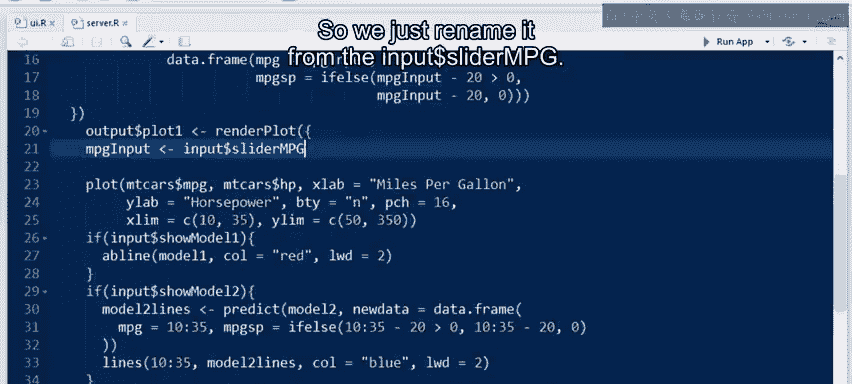

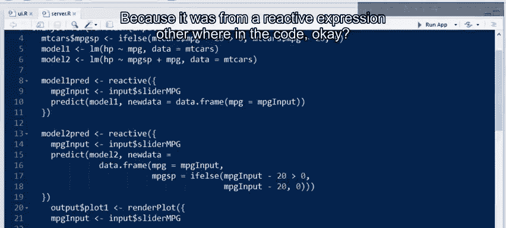

Output of this is going to be a plot that's going to be passed back to our user interface。

 It's going to have if the checkboxes are checked， it's going to have the two fitted lines。

 it's going to have the data it's using to fit those lines on there。

 but then it's also going have specific points at our two prediction values Okay great and then it's also remember it's looking for a pre1 in other words it wants to see the prediction and so we're going to do that and then it needs to be text so it's going to be render text and then model1 pre and then we're going to do pre2 and that's render text again and model 2 pre and remember in both cases we're doing the remembering to do the parentheses for our reactive expressions okay。

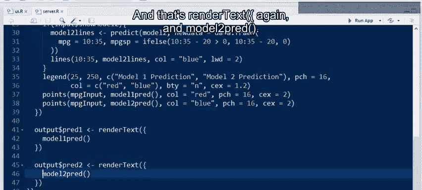

Now let's go ahead and run it and see how it works。And there it is， okay， so here's our slider。

As we change our slider。What you're going to see is the two points。

 the points where we're predicting at and you can see the two models here right the red one which had no sp term and the blue one which had this sp term at 20 so you see it looks like a little broken stick so our two models and then down here we see the prediction from model1 and the prediction from model 2 so exactly as we were hoping it would work okay and then you can show or hide the first line or show or hide the second line okay。

So now we're getting I think now once you recreate this example。

 I think you'll be at the point where you can actually do some fairly complicated things in Shihiny and it's an incredibly useful tool next what we're going want to go through is just showing how to put conditional expressions where you you'll operate on the code conditionally upon clicking a done button or something like this。

 but at this point I think you should probably be able to make shiny pretty useful for you。

So go ahead and try this example and I think after the next lecture you'll be have a pretty solid foundation for working on your shiny apps and creating things that are quite useful for you and then of course useful for others when you put them on the internet。

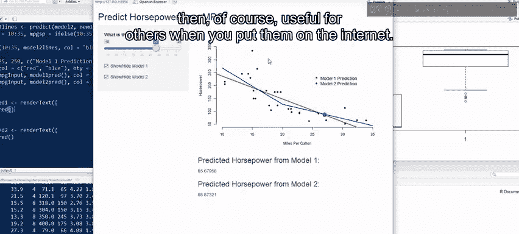