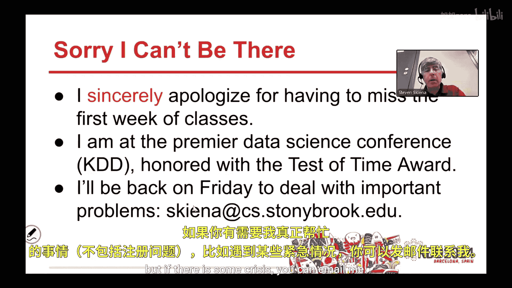
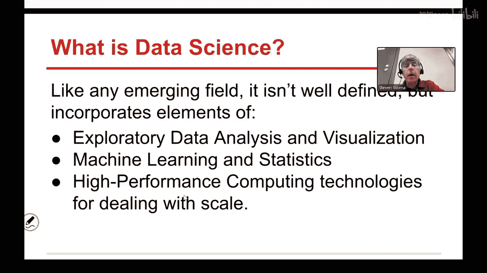
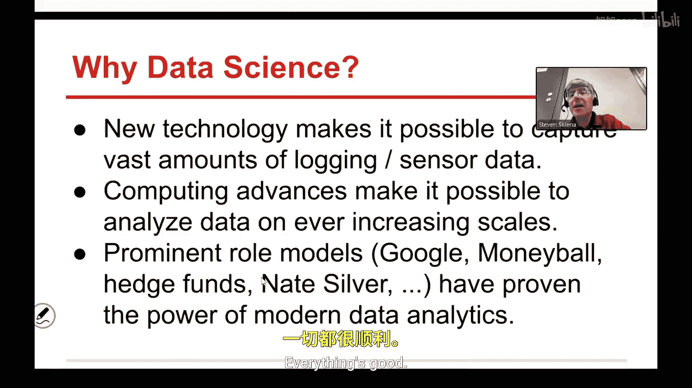
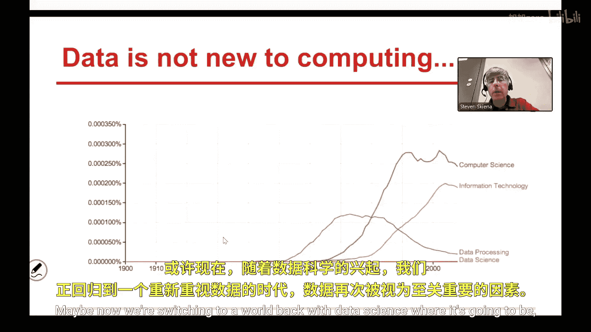
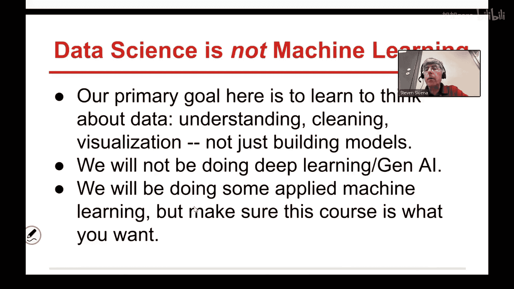
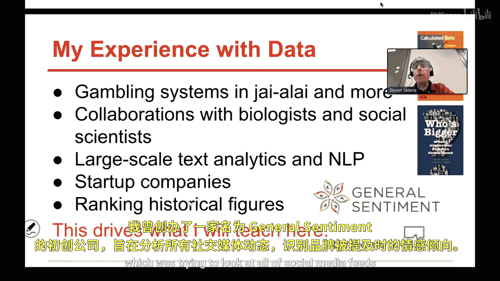

# 纽约石溪大学【中英⚡数据科学｜CSE519 2024 Data Science Fundamentals】 p01 P1 Lecture 0： Course Administration (Fall 2024) -BV1s7Gaz5ETS_p1-

So。First of all， again， my name is Steve Skina， this is CSE519， our data science class。

I am very sorry that I am not there with you guys today。

 I happened that the first week of class I am currently at this moment in Spain in Barcelona。

 was given an award for the you know the best paper for the over the last 10 years。

 the test of Time Award at what I consider to be the main conference in Data science。

 something called KDD， and so I'm here I tried to work out with Saba who RTAs to。

See if I can give this lecture remotely。😡，How many people can hear me， okay。

 wave if you can hear me okay？Okay， this is good and I can see the backs of some people's heads。

 but that's about the best I can do at this point and I'm doing this in kind of adversarial conditions。

My hotel where I went meant to give the talk the firewall was strong enough that I couldn't get through。

 but so now I'm sitting in the hall and stuff like that。But anyway。

I know there are people there who are dealing with registration issues and other things。

 I will be back on Friday to deal with problems。And if you have something that I can really help you with。

 not registration issues， but if there is some crisis， you can email me， but we'll see how that goes。

So this is going to be a course in data science and what is data science and by the way。

 if anyone has a question， what I want you to do is to wave and have Saba bring you a microphone。

Okay， can someone have a question so that we can test this procedure？Okay。

Does anyone have any questions？I'd like there to be a question。

 even though I haven't said anything yet。Okay， let me just do one other thing while I am hoping。

 hold on a second。嗯。Any hope。But。U。So what is data science， as far as I'm concerned。

 data science is a field somehow at the intersection of computer science and statistics and other things and machine learning and stuff like that。

And it has to do with exploratory data analysis。 It has to do。Somewhat with applied machine learning。

 it has something to do with computing things at scale。

 so that's kind of what I'm going to be talking about in here now data science。

 you know we live in a computer sciences a buzzword driven field and today's buzzword is generative AI the buzzword from about six or seven years ago was data science and why did data science become a big field and why was it kind of an important thing。

Well， one thing is there started to be a lot more data around near newcent logging technologies。

 the web， suddenly you had large amounts of data。You had various computing advances to let you compute it。

 you know， analyze data on very large scales， things like Amazon web services and things like that。

And you also had a lot of examples in the world of how being able to analyze large amounts of data with modern data analytics could make people a lot of money。

 I guess hedge funds today operate on a lot of data analysis。

 how many people here have heard of Jim Simons？WveW your hand if you' heard of Jim Simons。

 so he's Stony Brook's biggest donor and he've passed away very recently。

 but he started a incredibly successful hedge fund called Renaissance technologies。

 built basically on analyzing large amounts of data to try to predict the movements of stocks。

 you know there's other examples， there's you know in sports there became a time when suddenly the successful teams were the ones that did the best analysis of the player data。

 to identify the best athletes and identify the best strategies and this is kind of what has made kind of data science a。

 you know， something in the popular domain。Any questions？Sba， is everything going okay there？

Everything's good， everythings right， Okay， good。

Okay， now historically when I am， I've been at Stony Brookook now 37 years。You know。

 I'm a member of a computer science department and you guys are used to thinking of computer science as。

 you know the term you use for computing。This is a kind of data science extracted representation of what different data processing fields were called。

 how frequently they were used， what is this， this is a graph from Google NGs。😡。

Have any of you ever looked at Google N Grahams or know what I'm talking about。Wave your hand。

 if you do。U。Google made it a point to scan every book that it could possibly get a hold of。

 and it scanned a sizable fraction of old books published over the last 200 years。And。

Google NGms is a data source， which we'll talk more about when I give my next lecture。

 where they counted up all the sort phrases appearing in all books。

And by doing the right statistical analysis， you can learn how much different phrases were talked about at different periods of time。

And。This kind of shows that computer science didn't really exist until the mid-1960s。And you know。

 the term became very， very popular， probably starting in about the 80s。🤢。

And has occupied a certain same percentage of the mind space in books over the last 20 or 30 years。

Now before there was computer science， the field was called data processing。

 so at one point data was recognized in the early days as kind of being what drove computing。

After a while it kind of became algorithms and it became other things。

 maybe now we're switching to a world back with data science where it's going to be， you know。

 data is kind of recognized as an important thing and that's one of the things that this course is about。

😡。

Now data science is not machine learning， we have a little bit of machine learning in this class。

 but that's not what I consider to be。The most important or the most the fundamental thing that we're going to be doing here。

 we're going to be learning about how people should work with data and models。

We're going to learn about how models， certain models work， we're going to learn about data cleaning。

 where data comes from， how do you get it prepared for machine learning models。

 we're going to look at visualization， okay， we're going to look at a lot of things having to do with interpreting data。

We are not going to be focusing heavily on deep learning and generative AI。

If there'll be some applied machine learning in this class。

 but if you're looking for a GenAI course or a deep learning course or something like that。

 you should probably take a different course and make sure it's what the course that you want。

Any questions at this point？I would love to say， I think Saba is walking around with a microphone。

 and I'd like to prove that this works。

Okay， good。QuestionSo why do I teach what I'm teaching with and again， so。

 if someoneman's going to interrupt， let me know。Um。

WhatWhat covers what I teach in this class well over the years I've worked on a lot of projects where there was modeling based on data。

 I wrote a book which。I don't know if you guys do get guys I guess get to see the whole slide。

 you know I developed the gambling system in a sport called High that involved mathematical modeling and statistical analysis and things like that and that's part of my experience with data。

Over the years， I've worked a lot with biologists and social scientists and they see data in quite different ways than。

 you know computer scientists do， historically computer scientists see it is stuff to run through a program。

But really did， you know， Danish science， you know。Real scientists kind of see it as， you know。

 the material to understand how the world works。I've had research projects in。

Large scale text analytics and natural language processing going back many years。

 and this drives what we talk about。I had a startup company called General Sentiment。

 which was trying to look at all of social media feeds。

