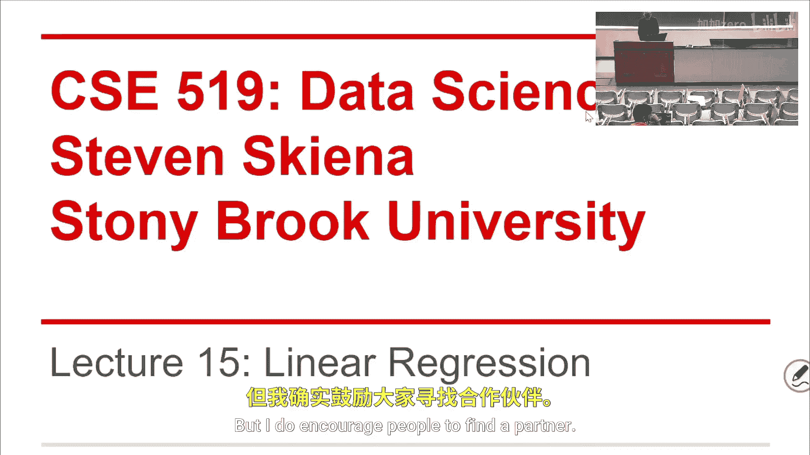
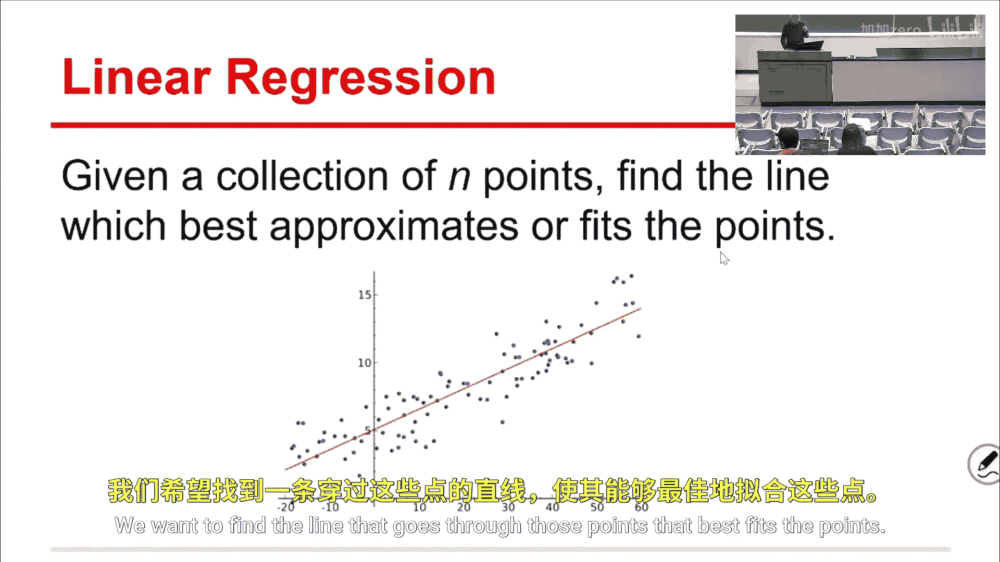
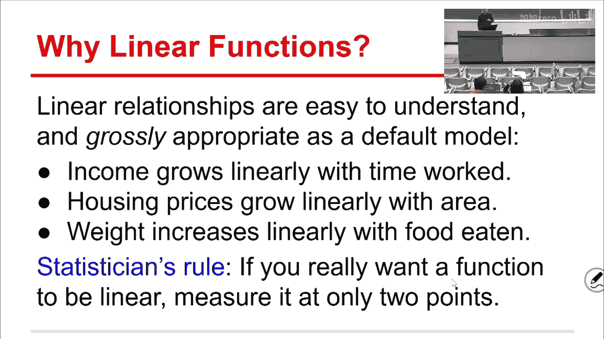
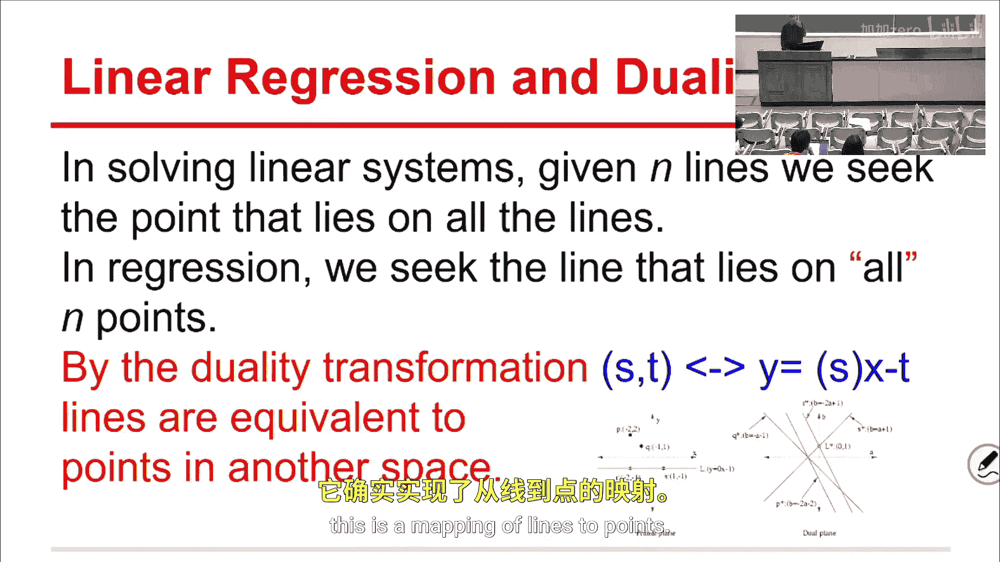
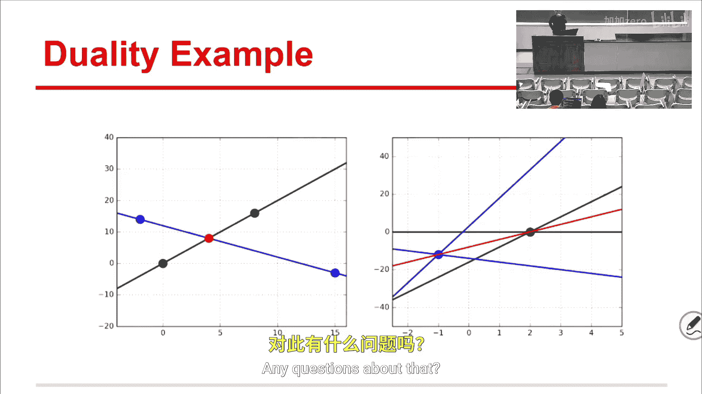
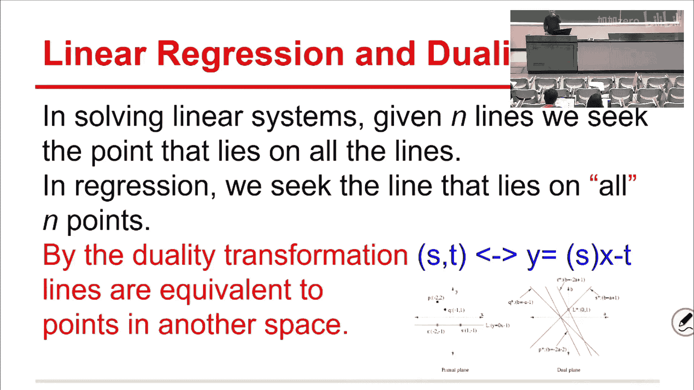

# 纽约石溪大学【中英⚡数据科学｜CSE519 2024 Data Science Fundamentals】 p02 P2 Lecture 15： Linear Regression (Fall 2024) -BV1s7Gaz5ETS_p2-

First of all， any questions about the project proposals， the project proposals are due on Thursday。

 we need them to get in on time because we want to grade them over the weekend and get them back to you so we can get feedback to keep working on them afterwards。

Any questions about any of the projects or about what is needed。The proposals are relatively short。

 but I do want them to kind of show you know some evidence of what you're thinking。

 you're planning on doing， some evidence that you've started working on it is good。

 okay on my webage I have examples of projects， proposals from previous years that were good。

 any questions about that。O， is there anybody still looking for a partner。Okay。

 if you're looking for a partner， I might be willing to try to broker with you。 but， but。

 but I do encourage people to find a partner。

Any questions on the project？Okay， so what I wanted to talk about this week are linear models for classification and regression。

And I， I like linear of regression。 I know many people may feel that it's an old fashioned thing。

 but it's， it， it's good for making models that are interpretable。

 It's good for explaining a lot about how。😊，More complicated models get trained。

 And it's good to kind of know what the limitations and how you can work around the limitations of purely linear models。

 So this， I think， is kind of an important thing。And so what is we've talked about before。

 linear regression is finding， given a collection of variables。 Y values Y as a function of x here。

 X is one variable in general。 It can be D the D to variables。 Okay。

 we w to find the line that goes through those points。 that best fits the points。 Okay。

 that's linear regression。

Now， why do we like linear functions， Linear functions are easily understood。 In many cases。

 they are a reasonable thing to want to do。 Okay， you know that that in often things grow linearly with a variable。

Again， nothing in the world is really truly linear。 So if you really want something to be linear。

 you should only measure it at two points， okay。

But in general， linear functions are good。Now， one thing that that I find。

When I think about what makes linear regression easier or hard。

 this is maybe one way to look at it that might be interesting。嗯。If I give you n lines， you know。

 if I give you the equations of N lines。And I asked you to find a point that goes through those lines。

That sits on all of those lines。 How do you do it， What is that called。

They give you a bunch of end lines。Okay， and I want a point that is going on that。

What is that procedure？Have you ever tried to do that before in your life。Okay。人。

Unique solutions A a unique solution for linear equations。 When you took Gaussian elimination。

 what is it that Gaussian elimination did。You were given n equations。

 probably three on your homework when you did it in high school。And you were said， find the values。

 Okay， of a point that was on simultaneously on all of those lines。 Does everybody agree。

 That's kind of what you did then。Now， what is the problem of suppose I ask you given end points？

Find indeed dimensions， find the line that they all lie on。ok。

Is this an easier problem or a harder problem？Or exactly the same problem。Okay。

They now give you endpoint in D dimensions。And I ask you。

 is find me a line that goes through all of those points。Okay。

It turns out it's the exact same problem。 Okay， and I'd like to convince you of this by the idea of what you would call a duality transformation。

So in a duality transformation is a in two dimensions， which is what I'll show you。

 is a mapping that takes points to lines。And lines to points。Okay。So if you have in two dimensions。

 a point has an x coordinate and a Y coordinate。 Does everybody agree with that。

And in two dimensions， a line has two parameters， a slope and an intercept。Right？Now。

 what if I did the transformation where for every point S T。I interpret it as a line S。

Of S times x minus t。Okay， and any line I interpret。As a point。S T， okay。

This gives me a way to transform points to lines and lines to points。 Does everybody agree with that。

May not seem that it does anything， but certainly， by definition， this is a mapping。

Of lines to point。What's interesting about this。What's interesting about this is here on the left。

 I've got a picture of。One point that lies on two lines。Okay。

 and I've got two points that are on each of these two lines。 Does everybody kind of get that idea。

What should happen if I did a duality transform？Of these， this situation。My。Red point。

Is going to become a red line。My blue lines， my blue and black lines are going to become blue and black points。

Okay。And if you notice here over here， I have。Two lines on a red point。When I take the duality。

 what I get are two points on a red line。Okay， the magic of this duality transformation is that it kind of preserves the identity of this thing。

What is going to happen to these two points？😡，Okay。

These two points have the property that they are on the blue line。

The blue line is becoming a blue point。Blue points， are going to become blue lines。

And they go through。The point corresponding to the line they were on。

 Does everybody kind of get this idea。Okay。So by observation is not I've even given you a proof。

 but the observation here。Is that if you have lines。Better on a point。😡，When you dualize it。

 you get points that are on a line。By solving linear systems， you can what you call。

 You can find where is the point that is on all the line。If I dualize it， that problem becomes。

 is there a line that is on all the points？So if you believe this， then， in fact。

 the problem of finding a line on all the points is exactly the same as the problem of finding the point that is on all the lines。

 Okay， any questions about that。

So what is the part that makes linear regression a hard or an interesting thing？Okay。Really。

 the only thing that is challenging to us is the little red quotes here。 Okay。

 with linear regression， we're not looking for the line that goes through exactly all the points。

We're looking for the line that best goes through all the points。 Okay， any questions about that。

Okay， good。