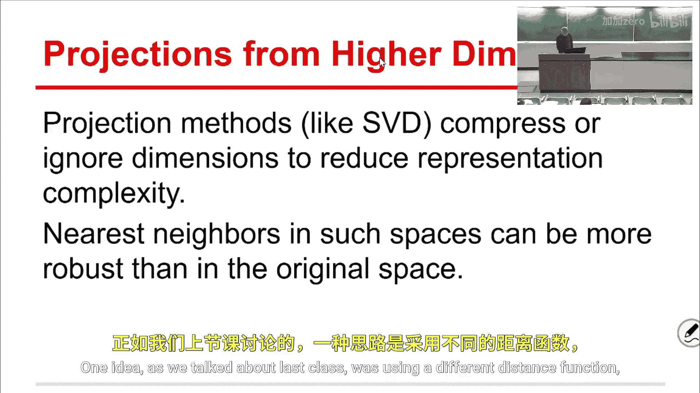
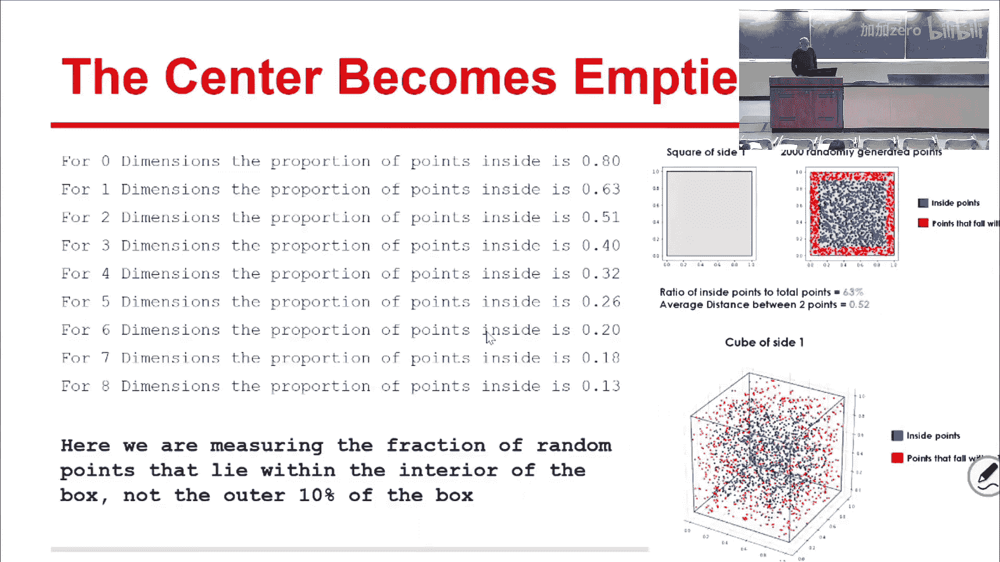
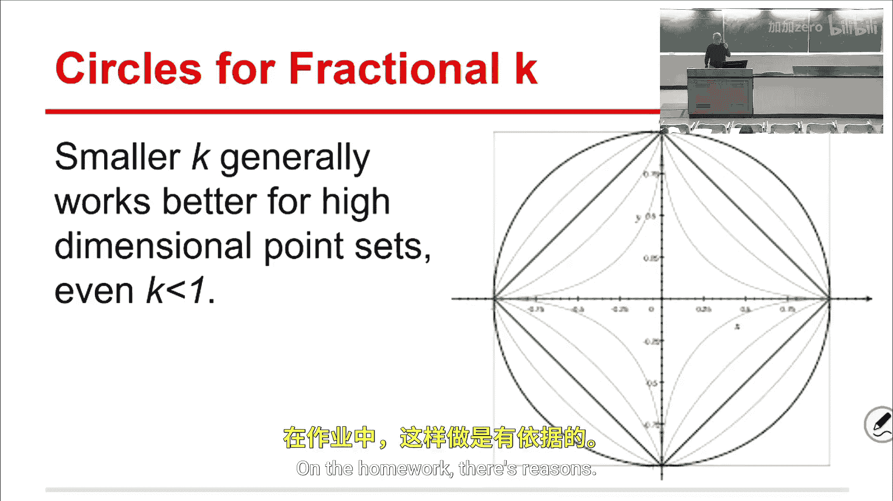
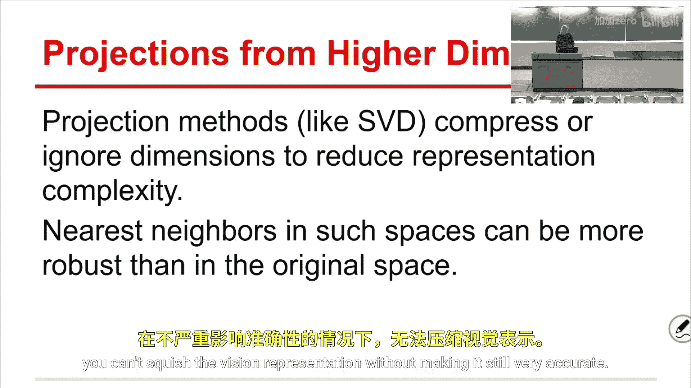
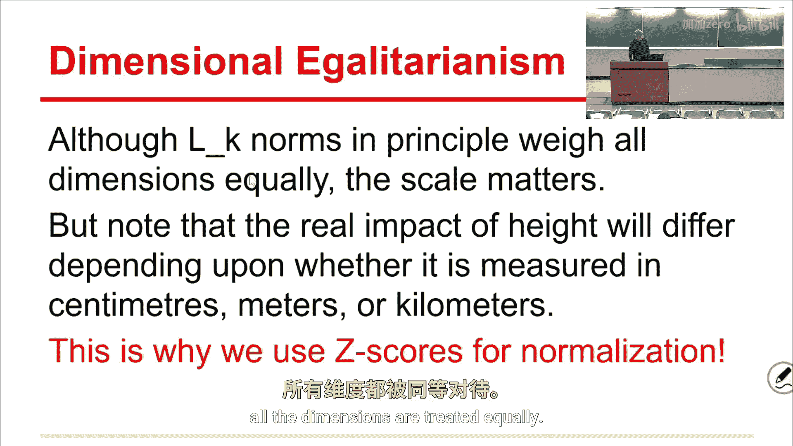

# 纽约石溪大学【中英⚡数据科学｜CSE519 2024 Data Science Fundamentals】 p04 P4 Lecture 18 part 2： Nearest Neighbor Methods (Fall 2024) -BV1s7Gaz5ETS_p4-

Now， there are some people who will question whether it really is the World Series。

 because some of you maybe be from parts of the world， which does not follow baseball very much。

 but it is historically called the World Series， even though it was all United States teams for the first hundred years of the World Series。

Then youve then they've boldly broken forth out into Canada， but it's still。

Very much a North American centrics board。特别。But。But anyway， okay， so enough about baseball。

 I guess on the general， but while we're on the theme of general cultural literacy。

 many of you know that today is a holiday in the United States。

 I don't know if you guys know about this， it's Christmas， okay。

 it's a holiday when people give gifts to each other and。Or oh， wait a second。 It's Halloween， right。

 Okay， There's a reason why I made that mistake。Okay， and let's see if you guys can figure it out。

It's because the computer science reason， every computer scientist gets confused。About Christmas。

And New Year and Halloween。O。Does anybody get the get the joke here。Okay。

 it's a joke about numbers in base 10 and base 8。Okay， people familiar about Ol。

Ocptal is base 8 and decimal is base 10， right？So this is why computer scientists think Christmas is Halloween。

 Okay， any questions about either holiday before we go any further。Okay， that said。

 any questions about homework 3。 So I gather people have started。

 I see rumors of people starting on homework 3。 I gather the image processing problems have been kind of beaten down。

 Has anybody gotten to homework 3 on the natural language embeddings。

You did those and did those work right and easy and everything great。Okay， so anyway。

 so the claim is now you can do both the， you know， vision and the， the N the。

 the N LP asks and hopefully， if you have problems， technical problems， discuss it on Piazza。

 Any questions about homework 3。Good any questions about the projects I talked about projects last time I can understand people getting working on homework  three now you should be starting to form your groups in on the project and formulate these things and if you want to talk about any of the projects。

 I'm obviously happy to do so after class in my office hours or even now if there was a question。

Any questions？Okay， with that done， I would like to continue to talk about kind of nearest neighbor methods because we started talking about the idea of distance functions。

 You guys have some tasks on the homework which are related to classification using nearest neighbors。

 the basic idea， and it is a basic idea is that you have a point that is labeled。

 You have some points that are labeled。 You have some points that you care about that are not labeled。

You label them with the label of the closest distance。

 That's the basic idea of nearest neighbor search。And as I showed at the end of last class， I guess。

Typically the kinds of data points that we're going to be working in are often in high numbers of dimensions。

 the world looks different in high numbers of dimensions。

 okay and so part of the there's different techniques for dealing effectively with this you know one ideas we talked about less class was using a different distance function。

 maybe cosine similarity maybe what you call it an LK distance in fact。

 if you use an Lk distance instead of k equals 2 which was Euclidean but smaller k are generally said set to work better。

And maybe you can play with that， that's up to you， okay， on the homework。

There's reasons， you know， the world looks different when you're doing things in high dimensions。Now。

One way to make things in very high dimensions， less high dimensions is that there are various methods for dimension reduction。

 I skipped over but will' go back to my lecture on linear algebra。 When we go back to that。

 we're going to learn about a method called singularular value decomposition。

Which is a popular way to reduce the dimensionality of a set of points。

And I ask you guys to do that on the homework， okay。

 to basically find a way to compress the points down to a smaller number of dimensions。

Why is this a good idea。If you get it down to a smaller number of dimensions， well。

 we've seen distance functions make more sense in smaller numbers of dimensions。

So it's easier for us to simplify and work with with things with smaller dimensions。

What's bad when you squeeze it down to a a long dimensional thing down to a small number of dimensions。

Theoretically， you should lose information， if the dimensions were clever properly constructed。

 they're there for a reason。That said， it's often surprising how much you can compress something。

And it performs about as well， or maybe even better。 Sometimes when you do the dimension reduction。

 you will be getting rid of error rather than getting rid of important information。

Let's say you added random noise to every element in the embedding。Okay。If there was measurement。

 error or random noise， if you now do a dimension reduction， theoretically。

 that's the stuff that's most likely to be removed。

And that you might get with pure or better representations。

 Has anybody gotten far enough on the homework to tell me what happened when they did。

Thement reduction。Okay， yeah。You said the on yours。

 the accuracy of doing the predictions went down by a lot。Okay， I'll confess when we did it。

 that didn't happen。 That doesn't mean that I'm right。 That doesn't mean that youre right。 Okay。

 when we did experiments on this actually， and again， you'll see what happens。 Maybe you know again。

 this is differences。 It's not clear you're right。 not clear we're right。But on our。

 we were able to get the their dimensionality quite a bit lower with the accuracy being about the same。

Okay， and if that's not what happens when you do it， then that may be because we did it wrong。

 It may be because you're doing something different。

But but my expectation is you should be able to compress reduce the dimensionality substantially and get it keeping as accurate or maybe even a bit more accurate。

Okay， but you will find out， and if that's not what you find， that's why we do science， Okay。

 any questions？Yeah。检查。When you。呃好。But about。Okay， so you're saying on the， on the vision test。

 there was a loss of when you reduce the dimensionality。

 it did much worse on the on the other task on the NLP task， it didn't。That may also be true。 Okay。

 I'm not even gonna100% guarantee that I ran it on the vision thing， okay。

Because that was actually a later addition to the homework， but certainly for the NLP。

 you're telling me I'm telling you the truth。Okay， so this is this is consider that to be a proof that doing the mention reduction can help。

Okay， now， of course， if the fake dimensions are very important。

Then doing a dimensionality reduction is going to make it worse。 But we'll talk about that later。

 Do your experiments and see what happens。And I'm not still 100% convinced you can't squish visual the vision representation without making it still very accurate。

Okay， any questions？Okay。Again， when you do any of these distance norms by default。

 all the dimensions are treated equally。

