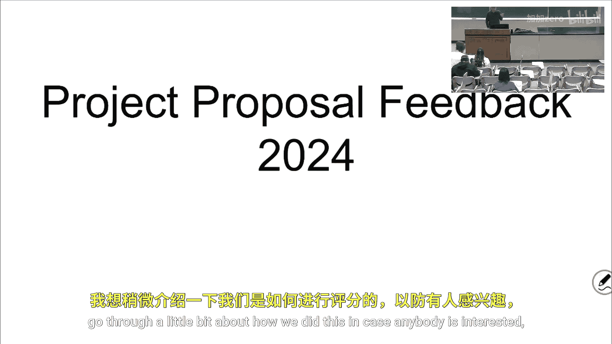
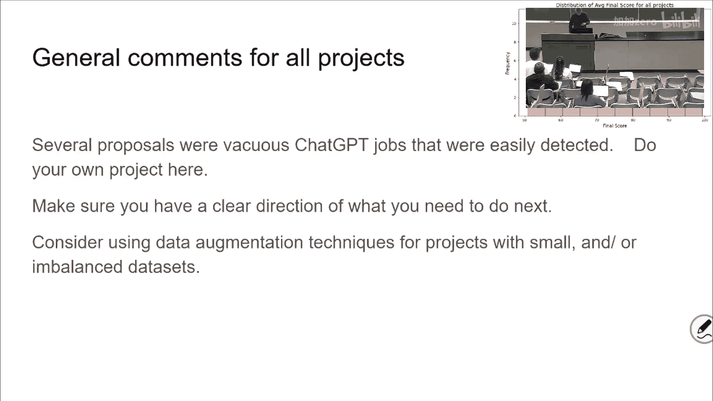
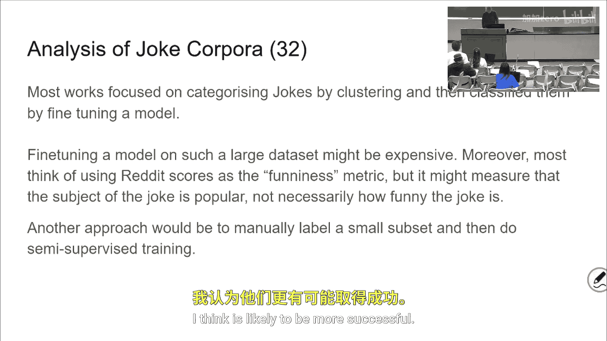

# 纽约石溪大学【中英⚡数据科学｜CSE519 2024 Data Science Fundamentals】 p05 P5 Lecture 21： Decision Trees and Boosting (Fall 2024) -BV1s7Gaz5ETS_p5-

Okay， let me start with the proposals， we got the proposals graded over the weekend。

Go through a little bit about how we did this in case anybody is interested just to make sure you understand the procedures and then try to go through all the projects just to see if you know。

 people want to have discussions about， you know， let's just see if there's any specific guidance we can get for each project。

So what did we do okay， first of all， how were these proposals graded。

 they were we had each proposal read by two different people。ThatWe had4 TAs in me。

 we divided the load， every project was regraded by two people。The everyone's goal as an instructor。

 as a grader was to try to get an average in the midpoint for each range。

 so our goal was that each TA or instructor would have a average score of four for each part。

Some people were a little bit more legion， so what we did then was take HTAs or professors scores。

Normalize them。 So they were four for you know， in four for on average on each part， okay。

Then we basically averaged every， added everybody's totals。 On average， there were three parts。

 There were three criteria。 There was what were the three things。 There were。You know。

 was something about how much innovation there was。

 how much work there was and something about the what the the vision for how to proceed was。Okay。

 and we then average this Okay， so everyone would have gotten 12， you know。

 each T A would have given an average of 4。3 times  four points for each proposal。 Okay。

 we then but they could have been between one and 7。 Okay， then we added these up。 Okay。

 and normalized it。 So the highest grade came out to be about 100。 that was kind of the the thing。

 That's why we then multiplied it by four。 Any questions about what the procedure was。

So when we did this， the highest i grade somehow naturally came out to be about 100。

 and there were a relatively small number of projects whose proposals were substantially better than the rest。

 okay， the low average came out that low came out to be about a 50。

 the mean or the median was about 72。What grade are you getting if you got a 50 on the proposal。

 what does 50 you work out to in letter grade？Does anyone have an idea？What someone with a hand。

 I can't hear that。 What be B， I said B， Okay， I didn't say B minus。 Okay， how what is it 72。

72 would be somewhere between an a minus and a B plus， right？

And so so when you think about what the grade means， that's what it means。

 So don't get hung up on any absolute values， okay？

The most important things about the proposals when I， when I went through them， you know。

 one thing you I noticed is that several of the proposals were fairly vacuous things that I am pretty sure came largely from G。

 okay， And what was this bid was stating。I here's a question for people。 Okay。

 can you tell what comes from chat GT， I'm just curious everybody to take a poll。

 If you have a document that comes from written by Cha GT， do you think you can tell or not。

This is a question I'd like to ask people who here thinks they can tell。

Who here thinks they can't tell？Okay， a small number of people。 If you believe that。

 then that means that。The TAs and the professor probably can tell。

 because we're probably roughly as good at this as you guys are， okay。

 and the write ups that you get from these things。Tend to be very well formatted。

 They tend to be in very good in English。 They tend ultimately not to say anything very distinctive about what the task is。

 Okay， and you know， it's important that again， I understand people using these tools and you know。

 in the world that to come， this is probably a good thing to know how to use。

 but there is it is important to kind of make sure your understanding what your project is and what what a direction is that you will be able to make progress on Okay。

 if I had to say as a quick rule， the difference between the proposals up here and the proposals down here these people had a clear direction of what they wanted to do。

 They had started doing some experiments。 They had some results to know how hard their problem was in general。

 Okay， and people down here were making fairly vague statements about how important it is。

to clean the data and you know and hadn't really started on anything and hadn't really kind of done much more maybe than plotting some kind of graph showing the rough count of the number of data items or something like that。

So that's kind of it you say， what was my big difference between the highly ranked ones and the low length ones that was kind of visible。

If you want to know from here， the important thing is， you guys now have something like。

AI believe it is three weeks or a little less than three weeks till the project is due。 Okay。

 so the important thing is that you have a clear direction of what you need to do next。

If you feel you don't have it after reading the reviews， after thinking about what you did， okay。

 you should come by and talk to me or one of the Ts about maybe trying to work through what would be a good or exciting direction。

 okay。You should not be working through to say， how did I get a better grade on the proposal。

 the proposal grades are fixed， okay， but it's important that you come out with a direction of what's to do next。

Any question here？Okay， good。

So what I'd like to do now is to go through the different， the different projects。

That that that had got， you know， and I I asked the Ts to try to fill in comments of what they saw a lot on the individual projects here。

 Okay， first of all， the most popular one was the Jo corpora one。

 that had 32 out of like 69 of the proposals were on that。Now what does that mean。

 that does mean that if you want to stand out here。

 it is harder for you to stand out here unless you have a kind of a clear idea of something interesting to do okay。

 and I would encourage you to deal with it， what did the Ts write down here， you know。

 most most of the jokes works papers suggested that you were going to categorize jokes。

 maybe by clustering them， maybe by and then classifying them by fine tuning a model。😡，No。

Think I guess what the TAs are talking about here。😡，Fine tuning a model requires a couple of things。

 one， it requires making sure you know what you're tuning it for。

 okay and there was some concern about whether you were trying to predict funiness。😡。

Or whether if you use the Reddit scores of how many people read the thing。😡。

There's some question of whether that measures funiness or whether that measures something about whether a topic of a joke is popular。

 I'm not sure whether that's a big distinction。But if you're going to find tuna modelel。

 recognize it may be expensive。It's not clear to me that that's going to lead to the best。

 the most interesting result， but you see you could think about it。嗯。

Another approach that the T A suggested is that， you know。

 you could manually label a small number of jokes Okay， and， and， and then you do training on that。

 rather than using the other one。 I don't have a clear picture here。

 But I do have a clear picture that there are 32 of these。 And if you want yours to stand out。

 you should have a clear direction or distinctiveness。Okay， you don't know。

 you're not trying to solve all the problems。 You shouldn't be solving the same problem as somebody else。

 Someone who can make a clever， find a clever thing to do with this data set。

 I think is likely to be more successful。 Any questions about that。

