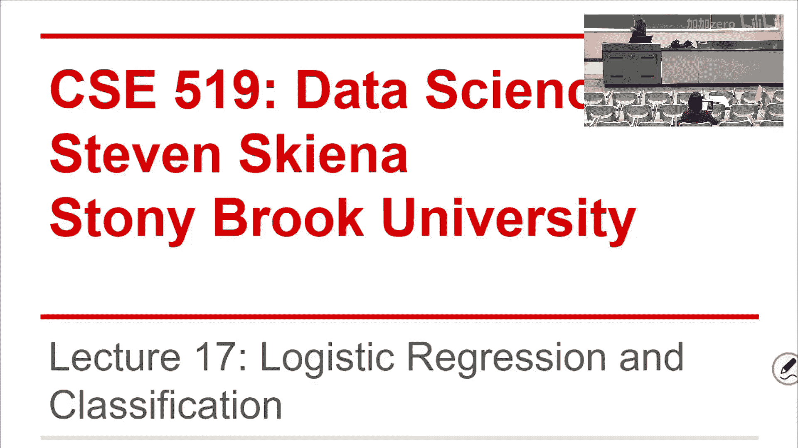
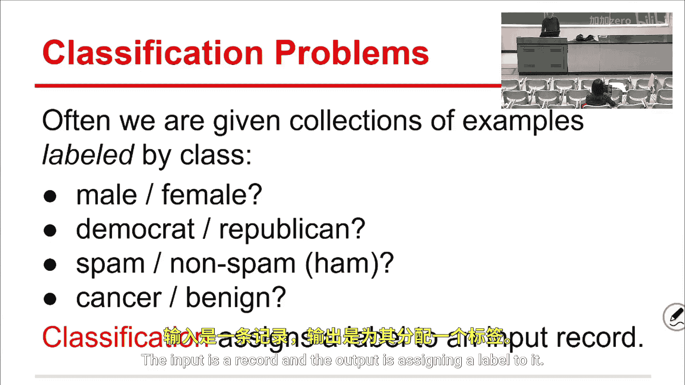
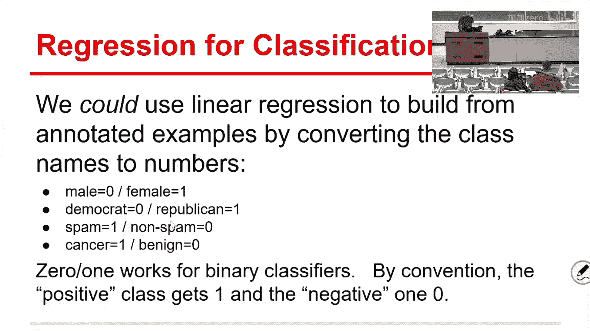
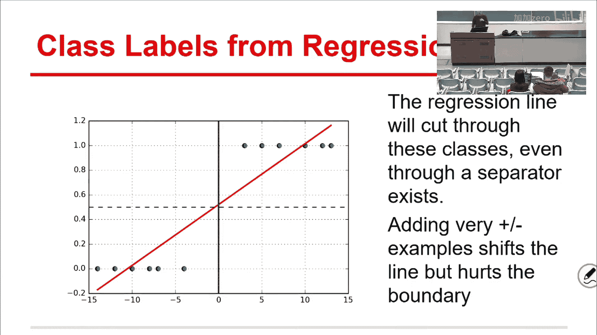
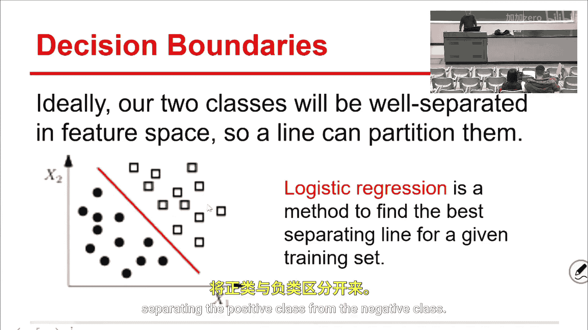

# 纽约石溪大学【中英⚡数据科学｜CSE519 2024 Data Science Fundamentals】 p06 P6 Lecture 17： Logistic Regression and Classification (Fall 2024) -BV1s7Gaz5ETS_p6-

First question is we've got the project proposals due tonight。

 any questions about the project proposals？Anything that needs to be clarified or anything like that。

You've got three pages plus references， I do not want to see four pages okay， again。

 you want to convince us that you know you know what you're doing。You know。

 that that means some kind of， you know， you have some kind of a clear plan of what you're gonna do from now till the completing。

 a clear plan does not mean every day what you're gonna be doing。 Okay。

 or even every week what you're gonna be doing。 but clearly that you've got a next direction that's going take you a chunk of time and that。

 you know， maybe you've got a vision that if this doesn't work， I'm going to try that。

 that's the level of plan that I'd like to come away knowing that you know what to do with。嗯。

You know， and ideally， I'd like to see evidence of work you've done on the project so far。

 If you've got some partial results， some graphs， some something or other。

 this is a good thing to put in there。 Okay， if you've done some background reading。

 it's good to show evidence of that。 and do what you can do in three pages。

 So the the three pages of most interesting stuff that you have is what we'd like。

 Any questions about the proposal。Yes。In the fact that a few ideas。It was the gate。没的理由。

It's going down the lane。Do we mentioned that。录音。So， so something to the effect of， you know。

 we've got 10 ideas and we'll see what we do is not as not as good as saying this is what I'm really interested in。

 but this is what these and these are what the roadblocks problem might be。

 I don't know if we're gonna be able to overcome it。 if we're gonna overcome can't overcome it。

 we're going to do this。That says something， okay， but a laundry list of what other things you can do is probably not good。

Okay。And， you know， again， if you have evidence that you've explored some of these things for why you think you're going to be able to do it。

 You've done some preliminary experiments， some preliminary results。 Okay， that would be good。Okay。

 any questions？Okay， today I'm going to have to after class run to my office because there's a call that I have to have to be on at 11 if you want to discuss your project with me afterwards。

😡，Run with me or and if necessarily wait until the call is over， okay， any questions about that？Okay。

 fair enough， if not， what I'd like to talk about today for real is problems on classification。

Particularly logistic regression， last class we talked about linear regression。

 we talked about how we could solve it using fancy linear algebra or pretty straightforward gradient descent search。

And， and something about how we would formulate linear a linear regression problems。

 how you have to massage the data to help make it better。嗯。Today， I'm going to try to。

 we're going to talk about using these kind of linear models for classification problems。

 classificationification problems are ones where you're given examples。

And you want to try to identify， you know， what cl it's in some of the binary。Things like。

 you know looking at something， is it male or female is a voter going to be vote Democrat or Republican Okay。

 is a biopsy sample， cancer or benign， Those are binary classification problems。

 I guess in your last homework you were dealing with classification problems that were multi class things。

So you like I guess in you know， given an image， was it a cat， was it a car， was it an airplane。

 okay， or given a text， was it a news article or a sports article or something like that？

So those you know are classification problems， the input is a record and the output is assigning a label to it。

 okay， and this is kind of a bread and butter data science task。

Let me start by showing you a way you might have used linear regression for classification。

 and let's see whether it's a good or a bad idea。It could be， remember。

 linear regression was supposed to take a record and predict the target value。😡。

What if your target variable？😡，Was a binary value between zero， you know。

 where maybe the positive class got zero and the negative class got one。Okay。

You could imagine then training a linear regression model。

Where the the x values were all the features of the items。

And the y thing you're trying to predict was the target variable now again。

 this works for binary classifiers， okay， where the you know you've got two classes positive and negative。

😡，For three classes， you know， or multiple classes， this might be a less good formulation。

But any questions about how you could use linear regression for this。

O。Now， what would happen， Okay， again， you'd have a world where let's say there was some X value。

 Okay， you went on， in this case， it was only a one dimensional data set。Okay。

 and you add positive examples and negative examples。 Okay。

 and you found the best fitting line on it。 Let's say we're trying to tell the difference between women and men。

 Okay， the women are on the left。 The men are on the right， okay。

Is this this linear regression line make for a good classifier。

 How would we use it as a classifier and what's good or bad about it。If anybody has any， I think。

 how would you use it as a classifier。To decide whether something's male or female。Yeah。

 depending on the。結局です。For the x value， I predict the value y。

 and I guess what you'd say is if it was above one half， it was male and if it was below one half。

 it would be female， right？😡，Okay， so this feels to me like it could work。

 what's wrong with this or what's disadvantage advantageous about this formulation？

Anyone with a hand？Okay。There are a couple things that are kind of weird about it。

 What happens if we add Superman to the training set？

What is super you guys are familiar with the Superman， okay。

 Superman is such a man that he would be out where his maleness is presumably out here or someplace。

 something like that， right？What is going to happen to the regression line when we add Superman to the training set？

Okay， yeah。It'll skew more towards that to try to capture this outlier okay and is that what we want。

 No， okay， adding Superman to the training set would make it worse for us， right？😡，Okay。

 we're not trying you know。嗯。What， what is the other observation， This。

 this regression line is trying to predict the femaleness， maleness of the item。

Where with a classifier， what you really want is a separating line。 Okay， a line that kind of cuts。

 but tells you where the boundary is between one and the other。

There is kind of a boundary implicit in the regression line。

But it's not kind of the thing that you're optimizing for。 Okay， any questions about that。

So this way of doing classification wouldn't work very well， wouldn't work as well as we would like。

 Okay， any questions about that？

So again， when you're building a class ofifier， what you really want to learn is not a line that fits the data。

 but a line that kind of partitions the data， okay you want to build try to identify a boundary line。

 a decision boundary separating the positive class from the negative class。😡。

And logistic regression。