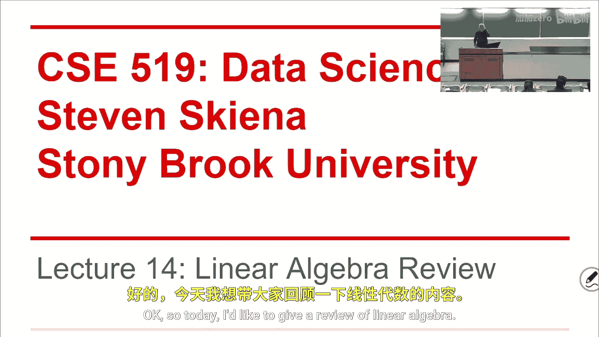
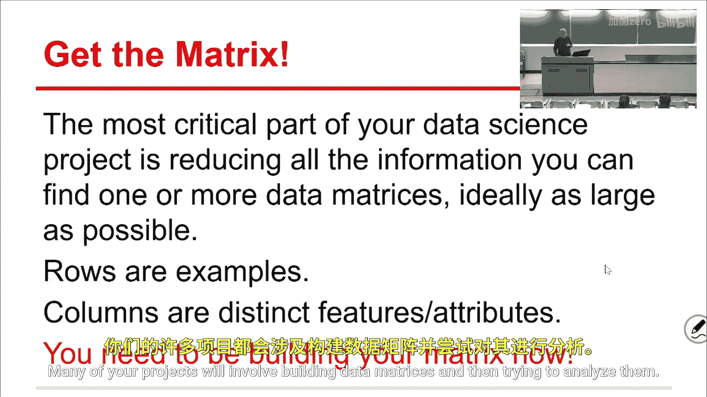
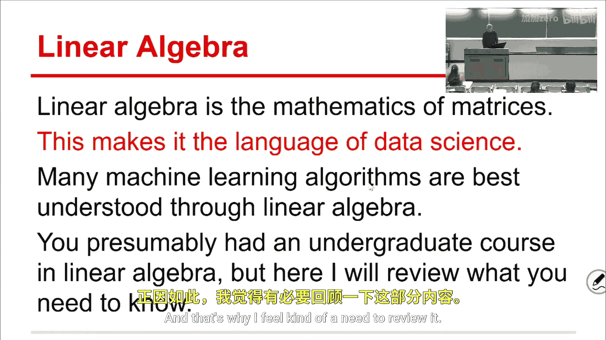
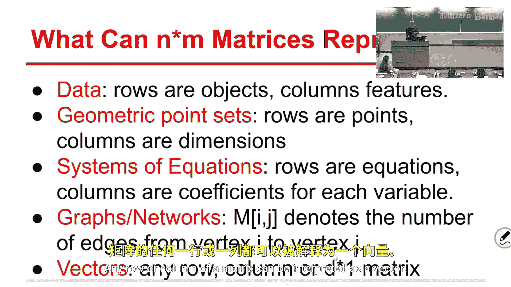
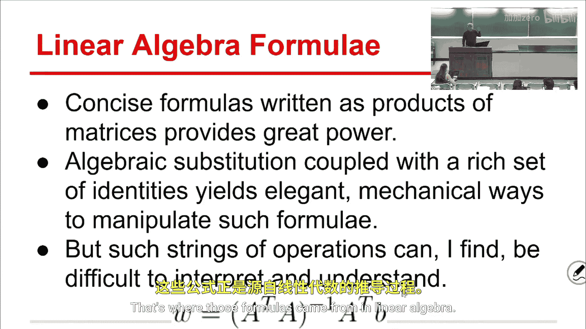
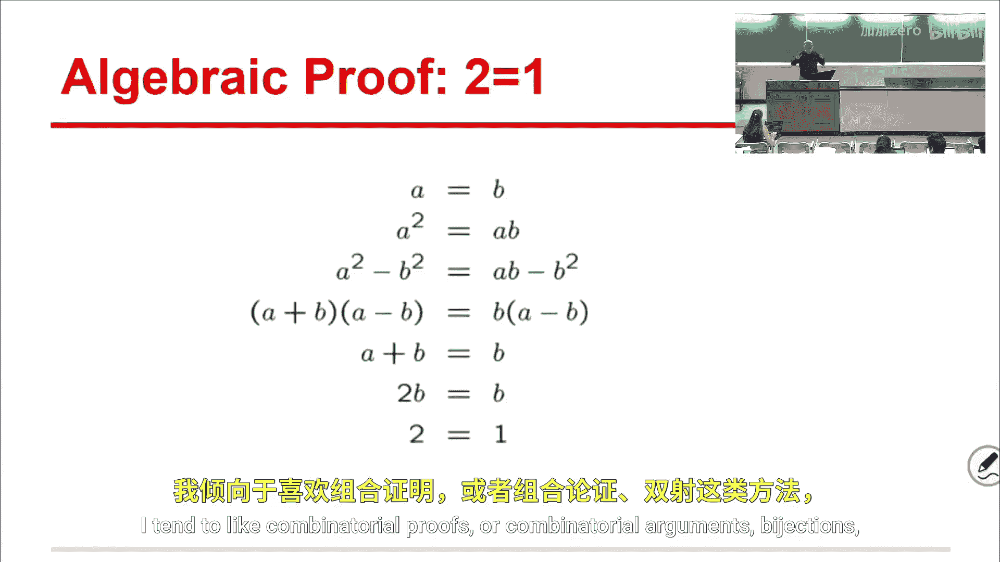
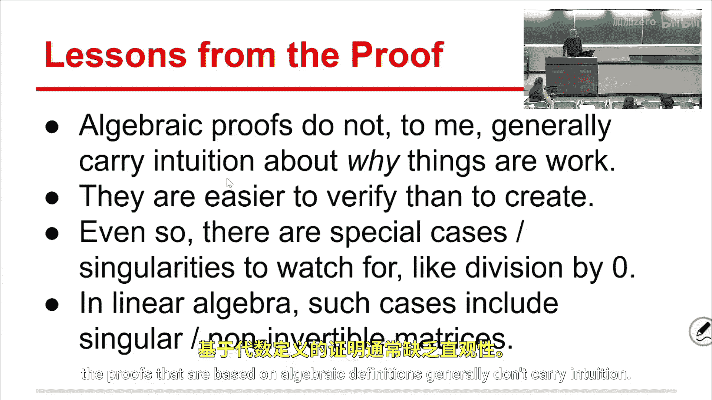

# 纽约石溪大学【中英⚡数据科学｜CSE519 2024 Data Science Fundamentals】 p07 P7 Lecture 14： Linear Algebra Review (Fall 2024) -BV1s7Gaz5ETS_p7-

First， I guess， topic is just the homework is due tonight， correct。

Any questions or comments about the homework？Or is this under control。

 Who feels they have it under control。Okay， a few people， any questions or comments or experiences？

Okay， and do that。 then I guess afterwards for the next week is the project proposal stuff。Some。

 a few people have started talking to me about their project proposals if they want to， again。

 I'm available after class。 one resource people should some people have asked me， oh my God。

 what should a proposal look like I posted on the website examples of three good project proposals from previous years。

On my website， I think they're， they're linked to from the homework that。Well， anyway。

 as you look over my web page， there are examples of good proposals from previous years。

 And so you know， you may want to use them for inspiration。

 I think the size of your proposal is less than the size that of the ones that I had them do the page limit is a little bit less。

 but you'll still see kind of what what a good proposal looks like。

Any questions about that or anything。Okay， so today I'd like to talk about a， you know。

 give a review of linear algebra and this some of people may not be enthusiastic about because you've probably had linear algebra in high school。

But in some sense， there's a lot of what is， you know。You know。

 classicalically data science kind of reduces to things that you do on data matrices where typically you have rows for examples and columns for you know features on your projects。

 many of your projects will involve building data matrices and then trying to analyze them。

Linear algebra is kind of the mathematics of matrices。

 and that's why we're going to be talking about in a little bit。

 I know you've had a undergrad course in it。 Okay， some of you that may have been a long time ago。

And we're going to talk in the next couple of lectures about some linear you know。

Various machine learning algorithms that are kind of based on， you know， essentially linear algebra。

 And that's why I feel kind of a need to review it。 Okay， any questions about that。

Okay， so what are matrices， Well， what can you do what can an N by M matrix represent。

We've seen n by M matrices in many times in this class so far。 we've talked about， again。

 typically native matrices， feature matrices， you have rows being objects， columns being features。

We've talked about geometric point sets for clustering。 Those are ones where again。

 we have rows or points， the columns or dimensions。We've talked about。

 we haven't really talked about， but certainly， you're familiar with matrices being representing systems of equations。

Here you've got a row every row is an equation， every column is the coefficient of a particular variable。

We've talked about what you call it。 Certainly， we've talked about。

 and we'll talk a little more about graphs and networks。

Typically the way to represent the network is an if you have N vertices。

 is an N by N matrix where element MIJ is the number of edges from vertex I to J。Okay， and finally。

 of course， we talk about vectors in here。 Any row or column of a matrix is kind of can be interpreted as a vector。

Any questions？This I know， you know。嗯。Now， when you look at a linear。

 one of the reasons why linear algebra is a great thing is that you can often write very。

 very concise formulas on matrices that have， you know， a surprising amount of power。So for example。

 does anyone know what this formula on the bottom is？I have on my screen a formula。

 Does anybody know what that is。Okay。Let me tell you， you have used this this formula， this semester。

 what is it。Okay。That happens to be linear regression。 Okay， that that that when you， you know， what。

 what is the situation， let's think what， how we would interpret this as a linear ir regression in linear regression。

 what is the situation。You've got a bunch of points and you've got a target variable， right？😡。

The points here are going to be given by the matrix A。

The target variable will be given by the vector B。😡。

So you kind of are going to have some linear function of each row is going to be the corresponding V value。

 okay？And W is the weights on the columns。 Okay， the weights on the features that will what you call it produce the best fit to the what you call it the to the underlying points。

 okay。And what is that formula here， Well， it takes the data matrix。

 you multiply it by its transpose， you take the inverse of it， multiply it by the transpose。

 and multiply it by the target value， and you get the weights， okay any questions about that？😡。

When I see something like this， I find it amazing because。

 and I find it that I don't have much intuition about this。

Does anybody have any intuition as to why this is the linear regression？Okay。

 you didn't recognize it in a police gallery before。 So a police lineup。 Okay。

 but so what do I think about linear algebra and， you know。

 at least in with my level of understanding， It's clear that that that linear algebra formulas provide。

 you know， you know， compact ways to represent amazingly complicated things， Okay。Now。

 I personally find it very difficult to understand or interpret these things。

 I don't know if you're like me or not。 So there should be some level of respect。You may say， well。

 this thing is just going to come out of some algebraic def derivation。

 That's where those formulas came from in linear algebra。

I will confess that， although I am a algorithm theory person， I know a fair amount of mathematics。

 Okay， I find algebraic proofs， sequences of algebraic statements。Very， you know。

 unsatisfying proofs generally。Have anyone ever seen a proof that two equals one？Okay。

How many people everyone see this thing at the end， we have proven two equals one？

Why is2 equal to one or I don't think people here believe two equals1。

What's wrong with this algebraic proof？ Every statement looks fine。Yeah。じゃやっぱり曖まです。

And then you divide a minus the。So am what am I doing So again。

 if you work through this A if a equals B， we can certainly multiply both sides by a。

 we can certainly add a subtract a B squared term。😡，We can certainly factor both sides。

Now you're saying when we cancel from a minus B and a minus B， we get a plus B。 okay。

 and here's the ding， ding ding right， What's wrong with this。 Okay。

 the problem here is if a is equal to B， what is a minus B。Zero dividing by zero is a bad thing。

 right？So this is， you know， this is one of the reasons why I find lit algebraic Fs kind of unsatisfying。

Because it looks basically right。 There isn't any real intuition to what's being done here。

But there is still a logic that is kind of slipped in here that is mysterious， okay？

I tend to like combinatorial proofs or combinatorial arguments， biions， things like this。

 because I kind of have a better intuition about them。

But what can we learn from that what you call it， the proof that two equals one。One is。

 I think that the proofs that， to me， at least， the proofs that are based on algebraic definitions generally don't carry intuition。

Okay， there is a。