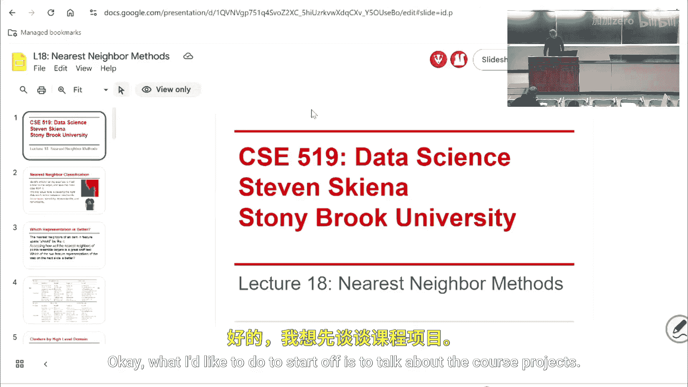
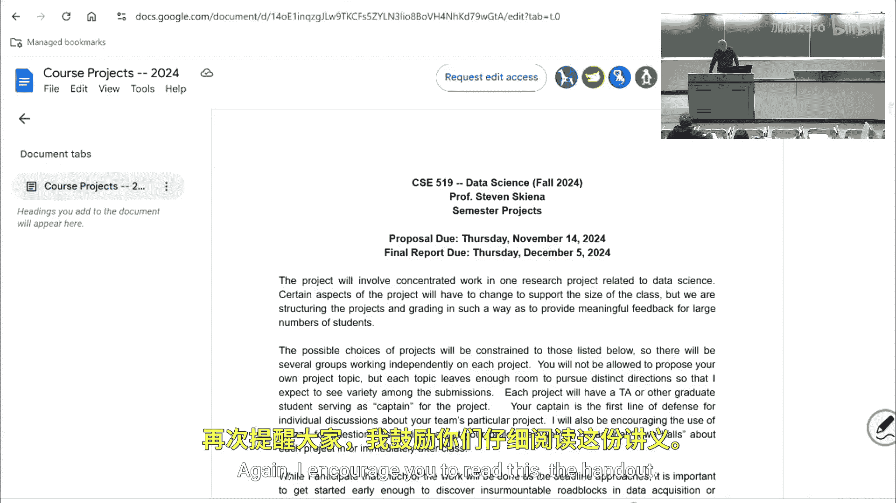
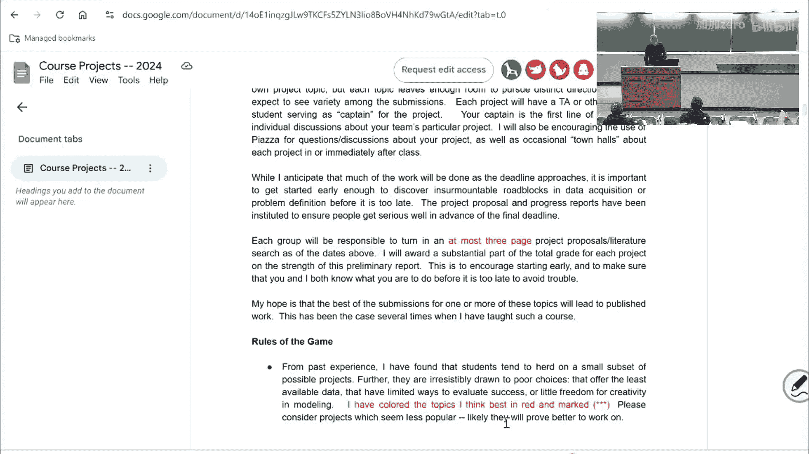
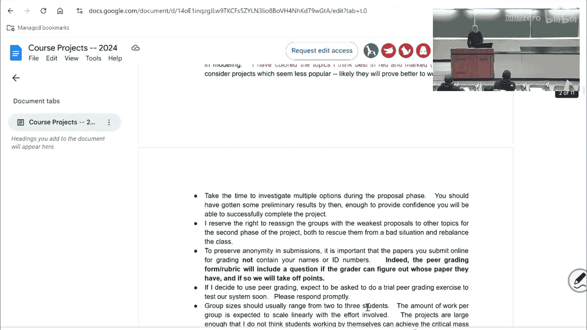
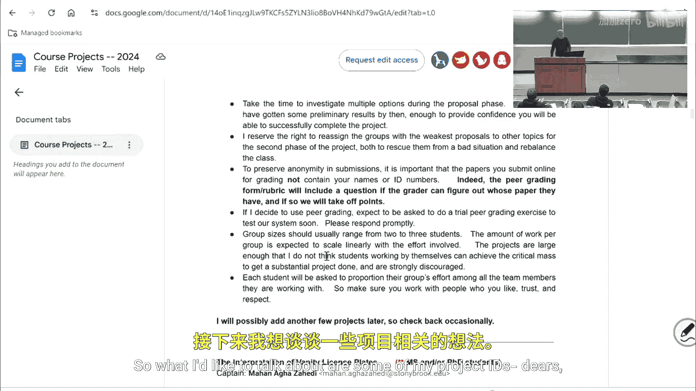
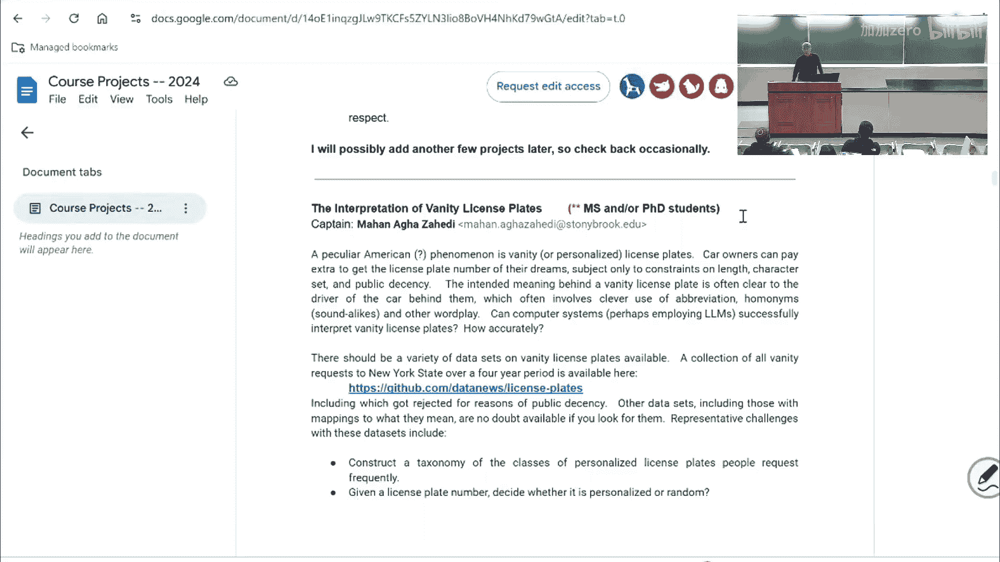

# 纽约石溪大学【中英⚡数据科学｜CSE519 2024 Data Science Fundamentals】 p09 P9 Lecture 18 part 1： Nearest Neighbor Methods (Fall 2024) -BV1s7Gaz5ETS_p9-

Okay， let me get started here first of all， any questions about homework3。

 how many people have gotten started on homework 3？A few people， actually， more than I thought。

 So I'm I'll say I'm impressed with that。 Any questions about it。

And how many people are seeing that they have gotten as far as to see to get， let's say， the NLP。

 the vision embeddings out。Okay， a bunch of people。

 And are they behaving for you guys what you would kind of expect。

That that that that it does a decent job of doing the classification and the picture looks good。

 Or is it that this is a complete mess。 Who has said that they who had done it。

 who looked at these things， says they're looking at things and they're seeing clusters and they're seeing something happening。

No one who here is saying they're seeing complete mess。Okay， this is。

 this is a surprise because when we did it， we did not see a complete mess and。

I'm going do a little test a little later in the class of whether you're seeing a complete mess or not。

 but any questions about the homework。Other than that， Okay， it's good to get started and clear that。

 But this is a surprise。 Okay， and we will try to clarify that。Okay， anything else on homework 3。

Okay， what I'd like to do to start off is to talk about the course projects。

 so this is you know what what what has to be done this semester before you can kind of put this course to bed。

 we have a homework three that is due in I want to say a week to two weeks， correct？

We then have a week after that a you have to turn in a three page project proposal。 Okay。

 and part of you may say three pages。 That's nothing。

 it's important that you think through what your project proposal is。 I'm going through this today。

 So although you'll be graded on it。 And although it's only three pages and you may say chatyp can write that。

 It's important to kind of get this do this carefully to make sure you've got a project that you're able to do。

 Okay， that that you've worked out kind of the roadblocks that will prevent you from doing a decent project。

And then these will be graded fairly quickly。 And then， you know， as of the last day of class。

 you will have to turn in a， you know， the actual final write up。

 which I think I said is eight pages long。 Okay， any questions about that。

So the projects are supposed to be done in groups。 Okay， I want I like groups of two or three。

I do not like groups of one because I do think that it is good to interact with somebody on a project like that。

And I also really don't like groups of four or more。 Okay， because I think that， you know。

 these projects are， you know， are， you know， of。Of sufficiently bounded size that I don't think it it helps to have larger groups。

I will do an analysis of what the scores are on projects independent of group size。And if I find。

 again， theoretically， a project with three people should be better than a project with two people。😡。

If I find that there is some kind of skewing of scores。

Where I I will correct for the group size on some way at the end。 Okay。

 so if we find that three people projects all score wildly better than two people projects。

That's how it should be in real world， you know， in the ideal world。 Okay， And if so。

 we would then scale down the three people projects， you know。

 to give more weight to the two people projects。 Usually， there is not that much of a difference。

 to be honest with you。 Okay， any questions about that。Okay， so what is my experience， again。

 I encourage you to read this， okay， the handout。

I'm going to go through the project topic soon， but I'm going to tell you what I find that I always find amazing。

 You guys are gonna go spontaneously， go off and form groups。

You're going to go look at my list of projects。You're all gonna。

 I'm going to tell you which ones I think are are the ones which are the most exciting and have the most opportunity to do something interesting。

You guys will systematically can evaluate them， and you will all heard on the boring project where there is nothing to do。

 This is my。Since it from the past classes， we'll see whether that happens this year。

Some of these projects are， you know more open ended and have bigger possibilities of doing something。

 those I personally think are more interesting。Some of them will be very， very tightly conscripted。

 and there doesn't seem to be anything too brilliant to do， okay。And， you know。

 you can pick this if you want， Okay， and my guess is that many of you will pick that。

 But I think that then what you will often find is that， that， you know， when you do the project。

 you're not that excited about it。 you know， what， what you've done is not look really that great。

 Okay， and。You will decide any questions about that will decide if I give you any hints how I think。

 again， I encourage you to think， follow what I think I'll also tell you most classes don't， okay。

嗯。

What I will tell you is during this evaluation time。

 Why am I giving you so much time to write a three page paper as a group。

The reason is I want you to kind of， you， you know。

 think about multiple project options during the period。

 I want you to show that you have some kind of preliminary results。

Just basically because when you add preliminary results。

 you'll have some confidence you'll be able to do something。It could very well be。

 you pick a project。😡，You don't you get any preliminary results。

You then go and try to do it the week before the end of the semester and suddenly discover you can't get the data set。

 There's no data available for my project。 I don't know what to do。

 That's what we need to avoid by you having kind of worked that through in the thing。嗯。

Id like to have groups， you know， the projects roughly balanced by the number of people doing it。

If I see one project everybody herds on。😡，And， you know。

 it is a chance I may take people with the weakest proposals and tell them to go do something else in the second phase。

 that sometimes happens， but we'll say， I don't expect anywhere near perfect balance， but we'll say。

嗯。To preserve anonymity for when at least the greater TAs are grading it。

 make sure you don't include your names or ID numbers on what you call on the papers。

 we are going to have send out a form okay for you to fill out every group's going to have to submit a group registration form on Google Classroom and that's how we're going to know what names map with what projects。

Any questions？Okay， I will warn you that at the end of the project。

 I am going to have group members have to describe how they partition the credit among the members of the group。

😡，So if you're working with a partner， you'd like that partner， you and that partner to be 50，50。

 okay， or you'd like to be in agreement that this guy didn't really do so much。

 This was the one that carried it。When I look at how you guys split the grades。

 if there's inconsistencies， I will track it down and make you guys come to an agreement。 Okay。

 so we'll talk about that later。I don't think we're going to use peer grading here。

 So my plan is this semester。 I think we have enough T As and there's usually enough reaction against peer grading。

 I am going to I think we're going to be able to get by with the Ts and I doing the grading。

Any questions about the rules， first of all。So what I'd like to talk about are some of my project Is。

 dears。

And so when you look at each entry， you will see there is a captain。What is the captain。

 the captain is a T's name who you should probably direct questions to as first as a first procedure so this is the one who will be fielding the what you call it the any questions about that project and likely but not certainly be the one that's grading it you know for each project I give a recommendation of what kind of people I think this is good for okay it's not force of law if I said that this was good for MS students and PhD student was dying to do it。

