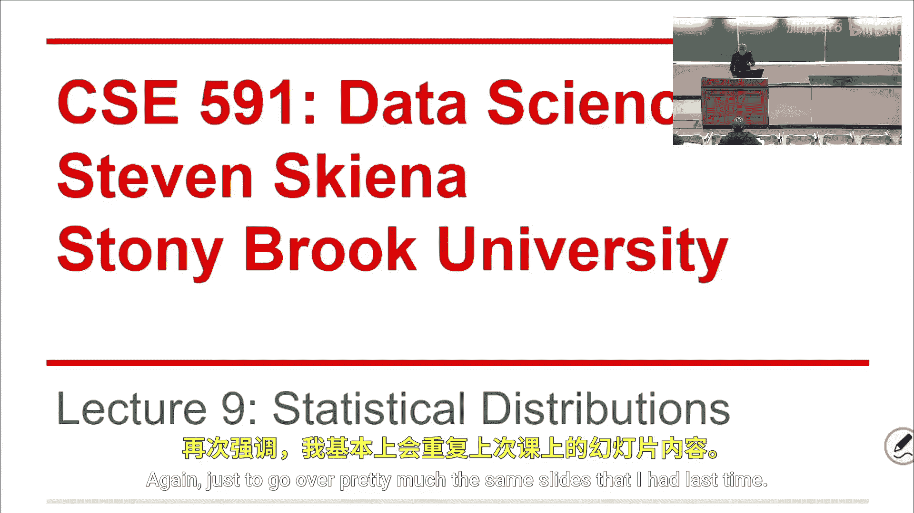
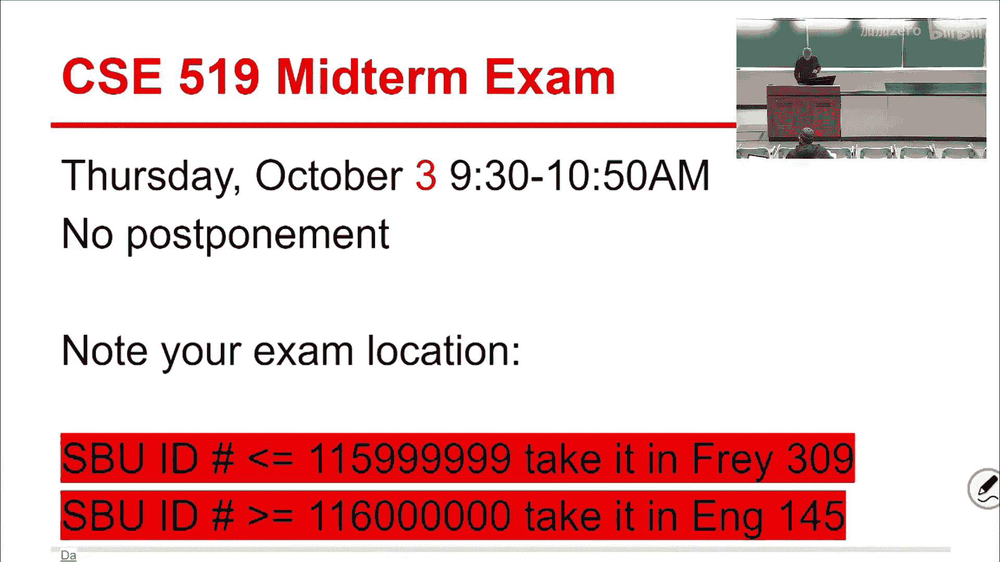
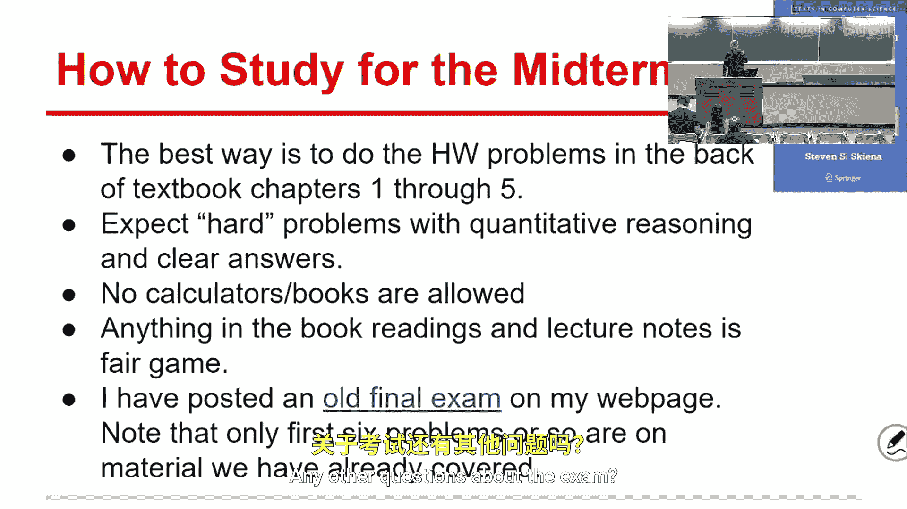
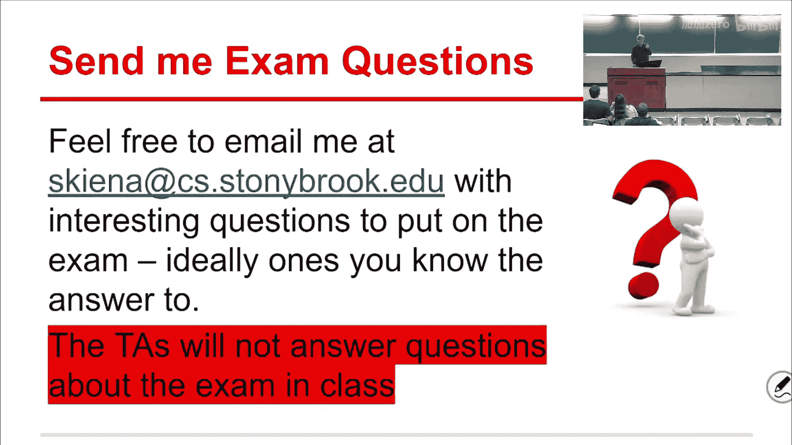
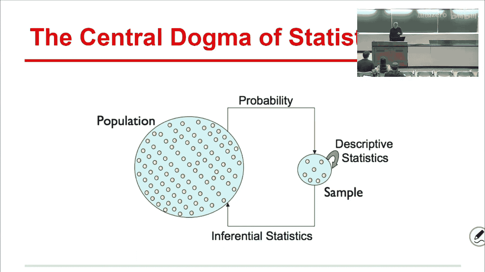
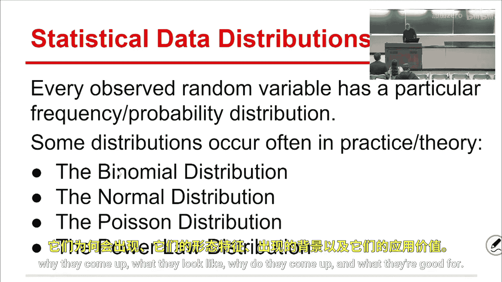
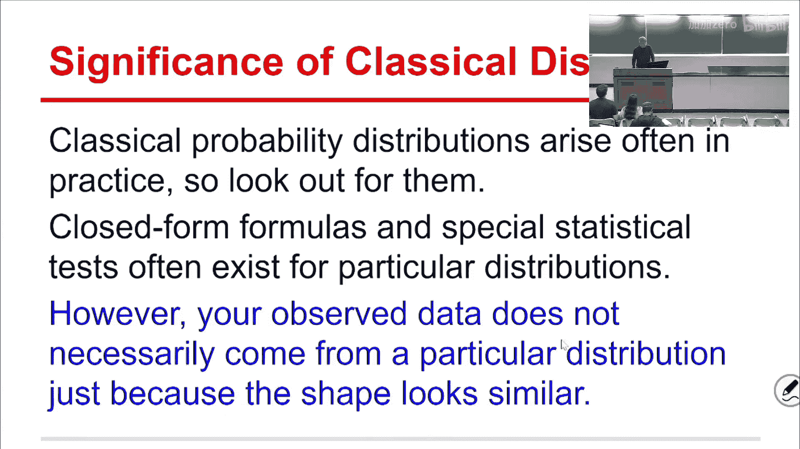

# 纽约石溪大学【中英⚡数据科学｜CSE519 2024 Data Science Fundamentals】 p10 P10 Lecture 9： Statistical Distribution (Fall 2024) -BV1s7Gaz5ETS_p10-

First， are there any questions about anything， I guess the important thing to have questions about is the midterm。

 again， just to go over pretty much the same slides that I had yesterday last time。

The midterm will be on Thursday， it'll be at 930， okay， usual class time。

 but make sure you know what location you're in if you have a low ID number below 116 okay。

 you go to Fryha 309。Okay， if it's above 116 or above， you take it here。

 okay any questions about where people take the exam？😡，Okay， that's important。

And again， what do I say， I say that the best way to do study is to look at the homework problems in the back of the book I posted an exam okay。

 so you can get an idea of what I you know what I put on an exam at so you know。

 at some point in the past okay， and you know。I from that exam。

 I think about the first six problems were fair game for you。 Okay。

 but otherwise were for later in the material， you're not allowed books。

 you're not allowed calculators， you're not allowed notes。

I recommend you bring a pencil okay and a pen， these kind of things and you know the answers problems I'm generally like to see。

 I want them to have some kind of quantitative or at least qualitative reasoning and clear answer。

 that's kind of my hope， not you know， sometimes theyre mushy essay questions I try to avoid those。

 but maybe not completely。Okay， any questions about the exam？Yes。法官0。Which are in the slide。Okay。

 I would say anything that。There is in general， I have covered all， as far as I can tell。

 I have covered all slides except for when I said the background material for the you know。

 the homework， okay， and I had a bunch of slides that were more relevant on NLP to the homework。

 that stuff were not covered。😡，Okay， otherwise， I think I've covered all the slides。And， you know。

 stuff from the， from the slides or the book readings are fair game。

 But there should be large overlaps between those。Okay， any other questions about the exam？

One again， if you have any exam possible exam questions， a couple students have sent me some， okay。

 feel free to send me an exam to questions to put on the exam。

 I will feel free to put them on or not put them on as I feel best okay the one addition I have made since last time that I want to justccurate the students to during the exam you're going to be sitting here you're going to get a paper and there is going to be a question there that you think is badly written and that you don't know what and you want clarification。

And you're gonna raise your hand And the Ts are gonna go， no， no， no， Okay。

 we're not going to the T A is not going answer Ts are being programmed to not answer any questions about the exam。

 Okay， this is to make sure that everybody gets consistent information， right， Okay。

 they're gonna be in two different rooms。 What would you like it if in one of the rooms。

 the Ts start giving the answers to everything。 And in the other room， they don't， that would be bad。

 So the rules are gonna be that Ts are not gonna answer any questions。

 if there's something you're uncertain about write down your assumption。 Okay， on the paper。

 And then we， you know， we'll see whether it's a reasonable assumption。

 But but that's how you should communicate your uncertainty。Any questions about that？Okay。

 any other questions about the exam？O。

Well in once twice gut。Okay， what I'd like to talk about today。

 I'd like us to move into a sort of a mini unit on statistics。 And in particular today。

 we'll talk about statistical distributions。And historically， if you said what is a data scientist。

 this definition was kind of what I liked， you know。

 was someone who knew more statistics than a computer scientist and more computer science than a statistician。

You know， of course， distinctions get blurred， but it's important to know something about statistics。

 Okay， statisticians have been thinking about data for longer time。

 in some sense than computer scientists have。And they see the world through。

A somewhat different lens than is naturally the case for computer scientists。

And if you said historically what a statistician did。

A statistician lived in a world where they kind of assumed there was a real population out there that you wanted to study。

 okay， you couldn't talk to the entire population okay so you did something like random sampling。

 to get a sample from that population and properly doing random sampling was a probability involves probability。

When you add a sample， there were two different things you might want to do with it。One。

 you might want to do compute descriptive statistics about it。

 What are the properties of this sample， How do you this is where I put visualization and means and standard deviations and things like that。

Also， you then would want to use this to try to make some inference about what the properties of the population really were today。

 if we think about a classic statistics problem， you obviously have polling going on we have a presidential race everybody wants to know how it's going to end okay there is a huge population。

 what do people do， they sample a small number of people。

 and they ask them who they're going to vote for。They analyze that into what you call it to get some me descriptions of the sample。

They then try to reflect that that those statistics back to the whole population to get an idea of what they can infer about the behavior of the population。

 That's how statisticians lived。

Any questions。Now， when they talk about inference， okay。

 one thing that that that comes on that's kind of an important assumption in the statistical world。

Is that when they see a distribution of a random random variables， distribution， Okay。

 they have noticed that there are several。Important distributions。

That come up over and over again in practice okay and that have nice theories about them Okay so it is useful to know what you know。

 these distributions， many of which I'm pretty sure you've seen in a statistics class before but but but it's important to kind of have an intuition about what these distributions are to have a sense when they arise and to use them to think about it and such and such so today's class we're going to go through four different probability distributions。

 why they come up okay， so you get you know what they look like。

 why why do they come up and you know what they're good for。

嗯。Now， why do we care about classical distributions， you can put a name on it。

It's not immediately obvious。 This is， this is necessary。 It's like。

 you guys now live in this world of， you know， this， this generative AI stuff。 Okay。

 And when you ask， why did it make a decision， What kind of math is the thing using to make a decision。

These models don't really have me。 They kind of learn from data what they are。 Okay， now。

 why do we care about the kind of closed form classical distributions。Well， one。

 the closed form formulas are sometimes useful， okay。

 the idea that there are statistical testss for specific distributions is useful， okay。😡。

The classical distributions are kind of classical because they arise a lot。 Okay。

 and having a name for something that arises a lot is important on it。 Okay。

 and so this is why I think it's important to be able to know what these distributions are and talk about them intelligently。

Now， one principle you should know is just because data looks like it's in a bell shaped curve doesn't mean that it's normal。

Just because， you know， things get rare when they're large doesn't mean it's power law。 Okay。

 so in principle， just because your data has a particular。

