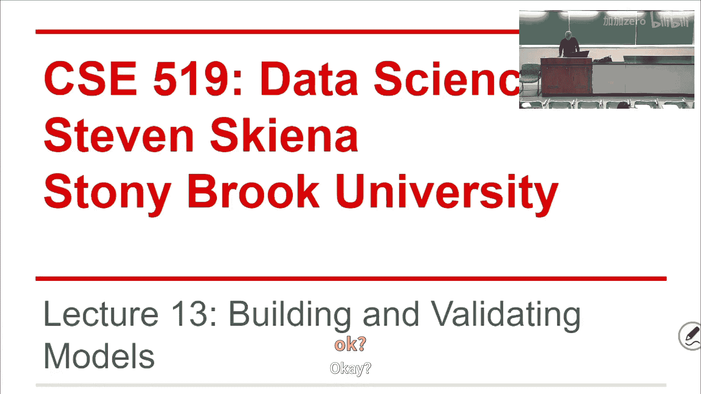
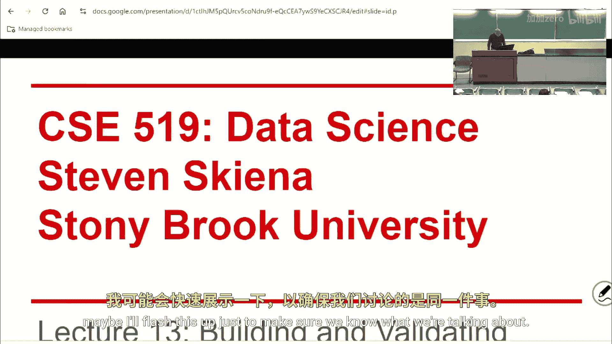
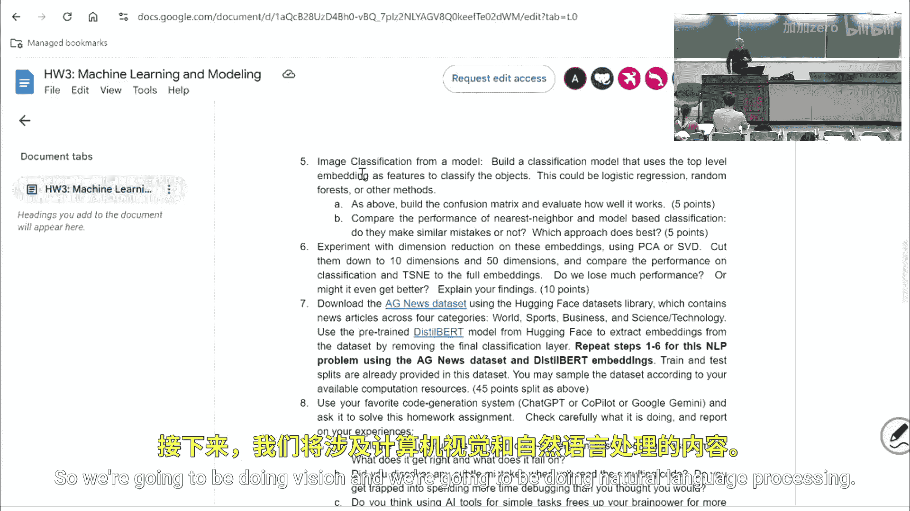

# 纽约石溪大学【中英⚡数据科学｜CSE519 2024 Data Science Fundamentals】 p11 P11 Lecture 13： Building and Validating Models (Fall 2024) -BV1s7Gaz5ETS_p11-

Let's get started。 First question， I guess homework 2 came in。

 were there any experiences of homework 2。People learned about houses that they want to talk about。

Or you want to put this part of your life behind you？Anybody see anything interesting？Okay。Okay。

 we won't talk about houses， but we will talk about homework 3。

 which I don't know if anybody's had a chance to look at yet。 Home 3， I， I is now out and。

I want it to be an assignment on kind of data we we we're going through， you know， I think， you know。

 a lot， we're getting into this section now more seriously about modeling and machine learning。

 And I want us homework 3 is going be about trying to do。You know， use kind of。

Sort of some modern models for， from， you know， that are out there and just think about them in a little data science way。

 That's kind of what my hope is。 How many people here have taken a course in natural language processing。

Waise your hand， How people have not？Okay。How to have taking a course in computer vision？Few people。

 some people have not。Okay， so for this assignment。

 we're going to do natural language processing and computer vision。 Okay。

 since nobody knows has taken either course。And。This may sound scary。

 My hope is this is a very easy assignment， and we will find out。

 although I encourage people to get started because I've been wrong before， okay。😰。

But when you say what is the big thing about these new， you know， kind of neural models。

 these deep lot models， these foundation models are that they make。In some sense。

 when you use a pretrained model for there now exist these pretrained models on vision tasks and language tasks that are kind of remarkably good。

And once they're trained， they're remarkably easy to use。

 they're not rocket science on any level to use a trained model。

And to give some kind of experience on this， that's kind of what I'm hoping Home 3 is gonna be about。

 Okay， so if you take a look at this， maybe I'll， I'll flesh this up just to make sure。

We know what we're talking about。So homework3， what are we going to be doing？

 First thing I asked you to do is to download a specific computer vision set。Which consists of。

 you know，60000 images split between 10 classes。 Okay。

 and I want you to build a system to recognize what image what class an image is in。Now， you may say。

 wait a second。 I know nothing about computer vision。 What do I need to。

 you don't need to know anything about computer vision。

 You need to know that there exists a model that somebody else trained called Resnet that will。

Kind of。You know， is designed for image type tasks。 And at the bottom of this network。

 you have an image。And as it works its way through the network at the top of it。

 you have a representation of an image。 Okay， so if you take a look at the next last layer on this network。

 what it will give you is a representation of what that image is in a way that is easy to work with。

 We're going to call that an embedding。 It's a representation。 It's a numerical vector， okay。😡。

And so what do I want you to do， I want you to take this network and these images。And find the。

 basically。You know， a， an embedding a representation of each of each image。

Then now that you've got a feature vector for each image。

 I want you to do a visualization of it using something called T S and E。

 have any that I have you guys used T S and E before。Or this is not a word you have heard before。

 It's a visualization way to make a high dimensional thing go down to two dimensions and view it。

 And I want you to color it so that you see how the color， the clusters。Of the images naturally form。

Okay， if this is 10 different classes。 If they are airplanes， cats and birds and cars， okay。

If these image representation is any good， the cat should be sitting together。

 The car should be sitting together the。I want you to try to do that。I then want you to okay。

Basically， build a classifier to tell me what is a cat and what is a car and what is an airplane。😡。

And I want you to do it in a method， you know， a fairly simple way。Take the centroid of all the cat。

 and get a center cat。😡，Okay， take get a centroid of all the cars。 Give me a centroid car。

And now every image can be classified by what is the name of the centroid that it is closest to。😡。

Does everybody see how that can work？He didn't take a computer vision class。

 but this should be seen pretty clear that that can do something。

So I want you to classify items compared to how they compare to their centroids。😡。

And tell me how well that works。And show me what are the outliers。😡，What is the， the， the cat。

That looks less， least like a cat。 Okay， what is a car that looks least like a car。 Okay， may。

 maybe that's one of Tesla's trucks or something like that。 Okay， or maybe not。

 We'll take a look at that。Then I want you to use these numerical features for whatever image is。

 Okay， you can build a classifier using the same kind of tools that we use， like。Linear regression。

 specifically logistic regression， which we'll talk about soon。Or whatever else you like to use。

 random forests， whatever your favorite classification method is。And again。

 build me a classifier now to tell what these images are， okay， and which ones get mistaken。

 We'll talk about a confusion matrix today， I hope。

 but basically which images get confused is which way。Okay。Any questions about that？

And I then want you to investigate what happens when you take these image representations。

And reduce their dimensionality。Okay， these embeddings are the， the。

 the representations we're talking about are kind of the top layer of this neural network。

 Maybe it's 1000 dimensions。 I don't know what it is， okay。We're going talk next class， I think。

 about dimension reduction。 Okay， PC A， okay and。See what happens when you reduce the dimensionality。

 these thousand dimensional points to 10 dimensions or 50 dimensions。And see how well that works。

Okay， any questions about that。I think it should be clear if you're listening to me。

 all this should be relatively easy。Once you have got an embedding for each image。Okay。

Does that sound， Does that sound to be the case。Okay。

And I want you to use this network and figure out how to get that embedding from the image。 Okay。

 any questions。That's vision。Then I want you to do NLP。I want you to take a new data set。

News articles that are in different categories。And I want you to use a specific neural model。

To extract embeddings about what these news articles are。

 there are these neural networks where the bottom entry is the， the title or the content of text。

And it bubbles things up。 And at the top layer of the neural network。

 there is a representation of what that article is。As a numerical vector。

I want you to take these vectors and do exactly the same set of things you did for them up here。

I want you to do nearest neighbor classification compared to the centroid。

I want you to build a little model， to recognize it。Ideally。

 I want you to use exactly the same code to solve problems 2 through 3，4，5， you know。

Because it should be the same thing once you have the embedding。Does everybody get that idea。Okay。

So we're going to be doing vision and we're going to be doing natural language process。😡。

