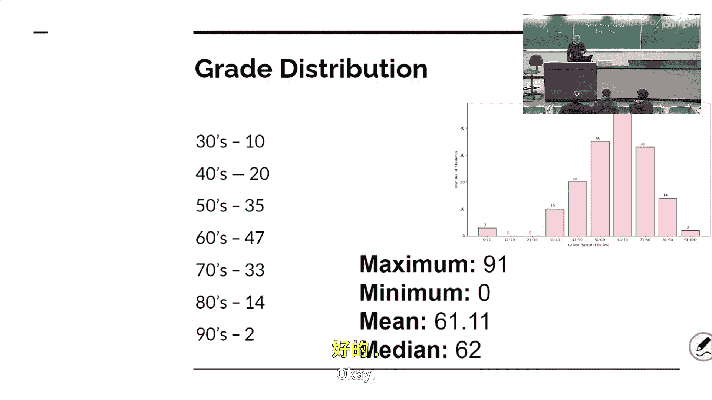
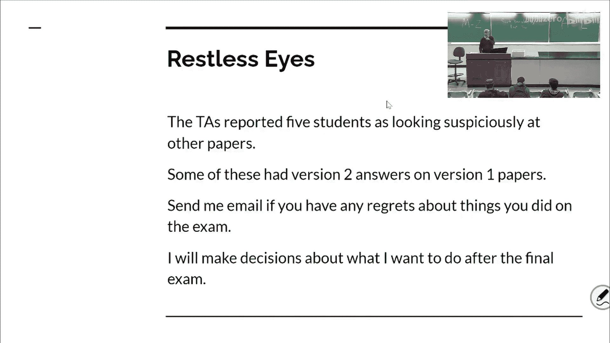
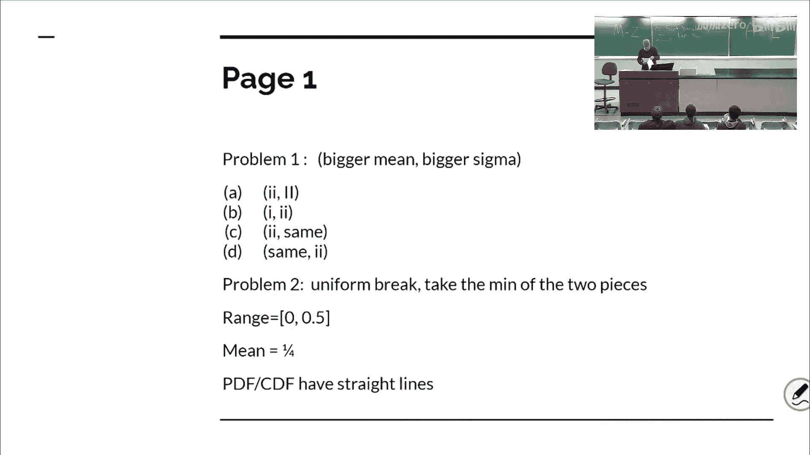
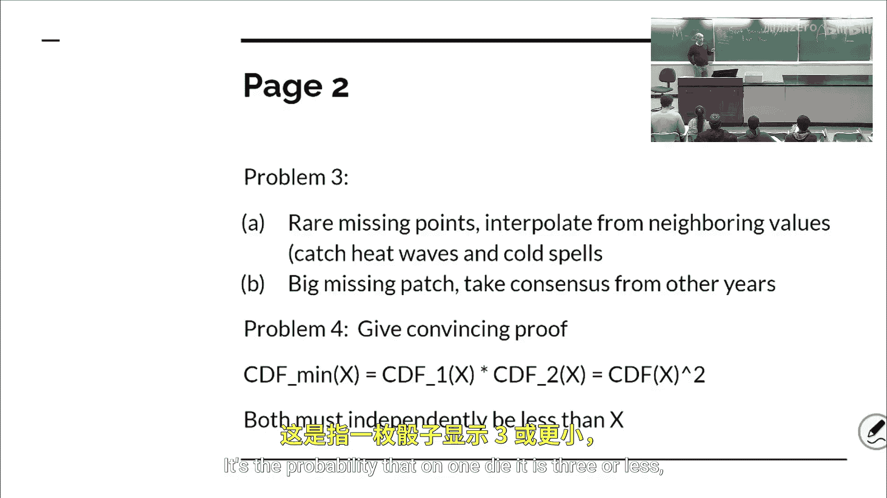

# 纽约石溪大学【中英⚡数据科学｜CSE519 2024 Data Science Fundamentals】 p13 P13 Lecture 10 part 1： Statistical Significance (Fall 2024) -BV1s7Gaz5ETS_p13-

Let me， I wanted to go through the exam quickly。 This was what the distribution was。Generally。

 people were between the 30s and the 90s。 The mean and median was a 60，62，61，62。

 the highest grade was a 91。 Okay， so it is possible for a human being to have done well on this you know。

 again， I worry about， at the end， I'm going to curve everybody and we're gonna， you know， again。

 I worry about， you know， where you sit relative to the median。 Okay， so you should not cry。

 Oh my God， I got a 62 I'm failing， Okay， what should you be getting if you have a 62。

 What is the right way to think of you how you did on this exam。Does anyone know？

How somebody with that not？Okay。62 is going to be between an a minus and a B plus Okay。

 now we'll have to give them out later because I want to make sure I get started now。 Okay， so。

 so the way to think about if you're at the median you're between and a minus and a B plus。 Okay。

 that's the rough way to think about what the exams are。 Okay， Any questions about the distribution。

Okay。

Now， one thing， just as an announcement， there were the T As， again。

 I'm sorry I could not attend the for religious reasons， I could not attend the midterm。

 the Ts took over。The TAs told me that there were five students who were looking suspiciously at other papers okay now and some of these people had version two answers on their version1 papers so again。

 there's two versions of the exam， they were designed to look very similar if there was a you know with restless eyes so。

If you have any regrets about things you did on the exam， I encourage you to send me email。 Okay。

 this is my first question。 and I'm going to make decisions about what I want to do about this after the final exam。

 Okay， so， you know， certainly if you were one of these people。

 you better keep clean on the final exam。 I wasn't here。

 So there's a question of how how I can weigh the evidence。 I have to think this thing through。

But I encourage people certainly on the final to not have restless eyes。 Any questions about that。

Okay。Now， let me， I'd like to quickly go through the exam。

 The first thing was and if you have questions about right or wrong。

 this is the right place to talk about it okay the first question was about actually meant to be pretty easy。

 I gave you four sets of points and asked you which ones have higher mean higher standard deviation if you could compute these things exactly。

 it would be trivial but you know you need to look at the at how even or uneven the distributions are to get an idea about the standard deviation So computing the standard deviation is probably hard without a calculator。

 but seeing where the spreads are， was pretty you you could very pretty easily。Well。

 which one had the right spread？Any questions about this answer？Okay， good for problem two。

 there is a situation where we're saying we have a stick。

That's going to be broken in random position。Okay， but uniform probability。 So you got to stick。

There's going to be a random break point and the length of the stick what we're interested in is the length of the smaller piece of the stick。

If this was the case， if this was the break point， that would be the smaller one。

If this was the break point， that would be the smaller one。

So what was the important thing I asked you basically， what's the expected length？😡。

If you draw the PF and the CDF of this distribution， okay。

 I believe the PF and CDF should look like this or the PF。Would look something like。What， okay。

 there's going to be a value that is between the smaller piece is going to be either0 or one is going to be between 0 and one half。

And it's going to be a uniform distribution， okay， because you know。

 any break is point is equally likely to be the case。The CDF for this thing。

Would have looked something like that。O。And once you see this。

 it's pretty clear that the expected length is， is a quarter for each piece。

Any questions about what you call it， this problem？

Some people started doing weird things with normal distributions and stuff like that， okay。

 but I don't see why that would be a thing here。Any questions？Okay。

Let's go on。Item number 3， what is the situation， These were， this was kind of an essay question。

 You're given a time series temperature， data set of temperature。O。And 1% of the values are empty。

 randomly scattered。What would be a good way to figure out what the missing values are？嗯。You know。

 some people would talk about averaging over all years。

But that's not really the case right now is outside， is it a warmer a cold day？Today was a cold day。

 And what was it yesterday。Was it a cold day or， okay， normally。

 what I guess what I'm hoping to say is that there's kind of an autoregressive component in temperature that kind of。

 you know， that that that that the weather today is somewhat predictive of the temperature tomorrow。

 And if I have the temperature on two days around it。

 the better imputation is probably a midpoint there then looking at all years。嗯。

For the case where there is a month's worth of data missing。Then here， you don't have， you know。

 kind of that kind of a situation。 And here， looking at some kind of a consensus of what happens during that month in other years。

 probably is about the best you can do。Any questions about that？Okay。

 that's what we were looking for。Now。For problem 13， for Pro 4。

 it was asking for the cumulative distribution function。

Of where you consider the maximum of values drawn from a random variable。

 and they say that it's the square。Of the original cumulative distribution function。O。

So let's just think about what that means， okay， again。

 if we let's say we were thinking about a uniform case。😡，Like like dice。Okay。If we had。

Let's say a dice with six sides on it。O。And what you call it， and it was uniform。

 the probability of getting on any one dice。The probability of getting an。

 x equals1 to6 is going to be the same。The cumulative distribution。Would be something where it。

You know， cumulative distribution。Is going to start out at0 and go to one， okay。

And that's kind of what the， what， what the cumulative distribution would be for the uniform case。

What would be the cumulative distribution？😡，Of the， you know， what you called， Let's say that the。

Maximum was less than or equal to three。😡，If you have two diicce that you're throwing and you。

 you picked the what you're called you you。T the if the maximum is going to be three or less。

 that's the cumulative distribution problem。What's the probability of their being the maximum of the two guyss being three or less？

It's the probability that on one die， it is three or less， and the other die is three or less。

