# 纽约石溪大学【中英⚡数据科学｜CSE519 2024 Data Science Fundamentals】 p14 P14 Midterm Review (Fall 2024) -BV1s7Gaz5ETS_p14-

Let's start， first of all， just before I get into anything else I。

嗯。I guess today you have your homework， one is due。😡。

How many people have sort of done that may at least a pass through every part of the assignment？

Okay， signs of life。 Okay， has anybody tried to submit it to Google Classroom。

And what happened？

Oh， nothing， I mean it worked。😡，Okay， so that's reassuring。 Okay， I recommend that people do this。

 Don't wait till 1159 to do this。 There could be all kinds of problems。 And if you have problems。

 the piazza is a good way to make sure that you， you get that。

Before I go any more into other stuff， are there any questions or discussions or observations about the assignment due today？

Have we talked through that pretty quickly。

Any questions or concerns， yes。

In question number two。だ and。If we select an end， then。

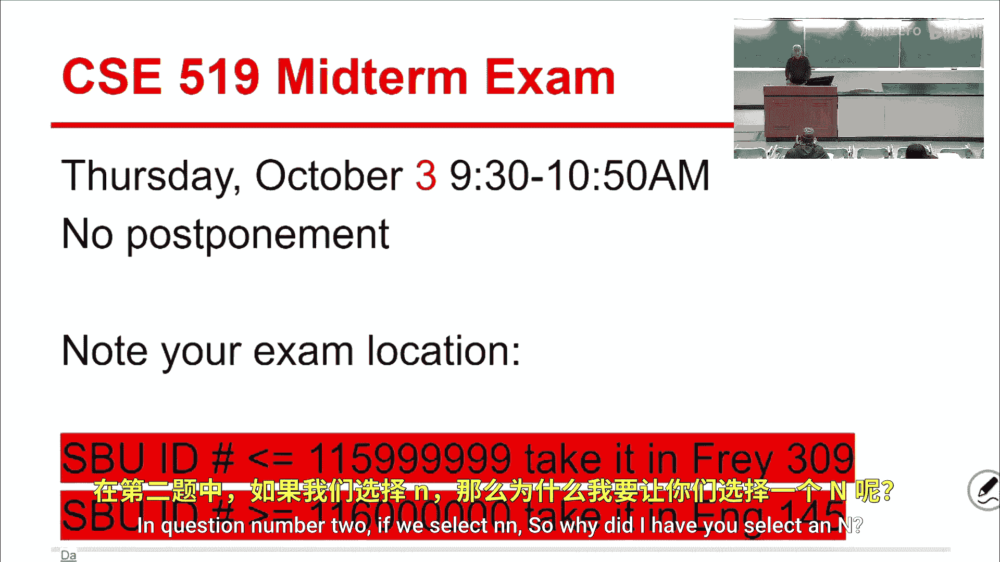

weYeah， so why did I have you select an N Okay， the main reason was a fear that some of you were using your you know came here with your grandfather's computer that he bought back in 1956 and you ran it and you know you said。

 oh I can only compute a matrix that's 10 by 10 or something like this okay。

 so I didn't want somebody to to bulk and have trouble doing it。

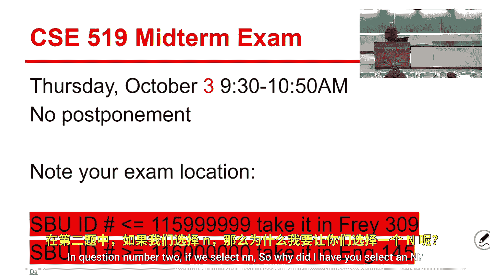

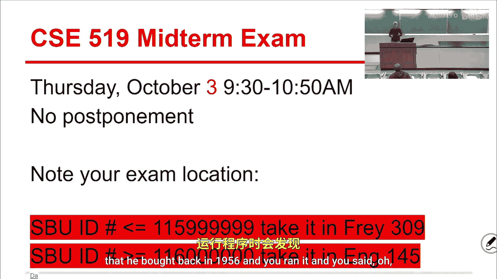

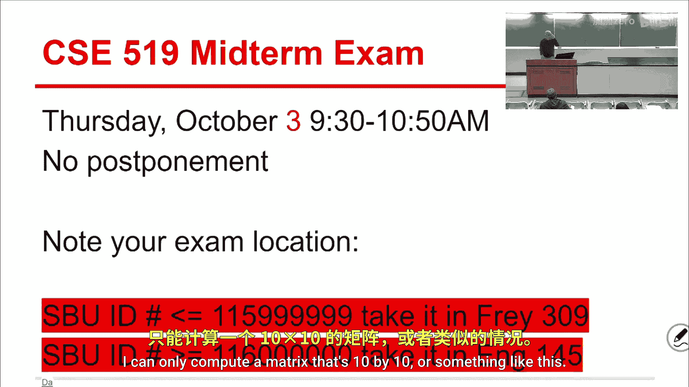

Did anybody out of course Hoden was able to compute the correlation coefficient between on the time series。

 between all 500 and all 500 stocks？

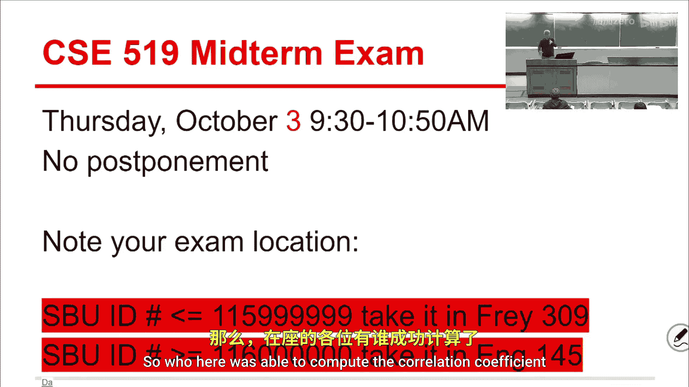

And how long did that take？Two， three or four seconds， and when did you buy your computer？😡。

Okay， a month ago。 Okay， so that is a proof that， that maybe my concerns were unfounded if you have a modern computer。

But so， so that was the main reason why I ask it。 So if you do something， you， you use this on your。

 you know， it therefore may make sense， though， to use a different number of companies on different types of analysis。

 That's， I guess what your question is。

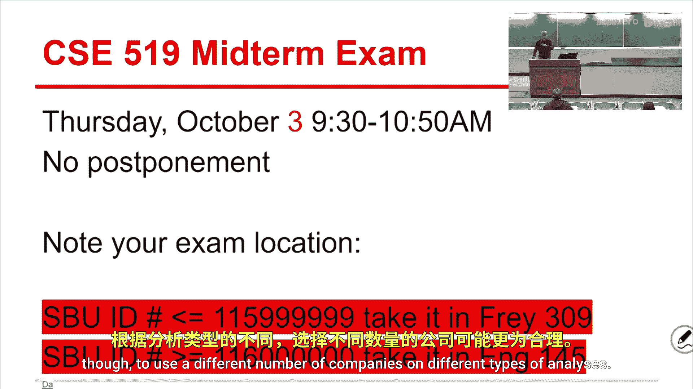

And if it makes sense to do it that way， okay， yeah。

All number you one。

Well， what did I hope， Okay， actually， it's funny。 Today's the day I didn't。 unfortunately。

 I couldn't find the homework the assignment paper。

 But what I believe what what I would have wanted was in general。

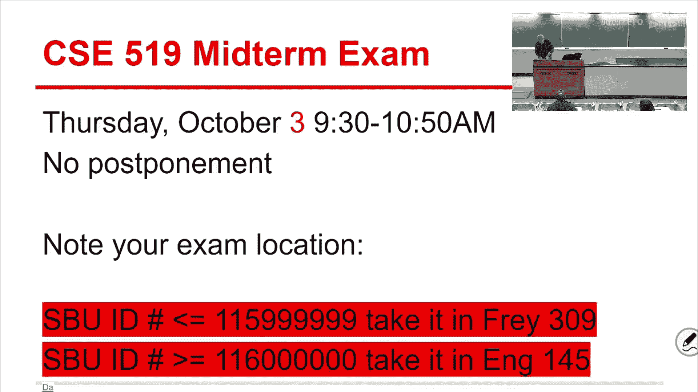

I would have loved to see you do 500 by 500 okay and that be the one that you are normally working with now I mean I guess when you did that there might be some problems with things like visualization okay and you're saying oh。

 I can't see 500 by 500 numbers。😡。

I tried one。4り by fortyり。Okay， so one question， the question of oh I can't see 40 by 40， okay。

 so part of me says， yeah， you can't see 40 by 40。😡。

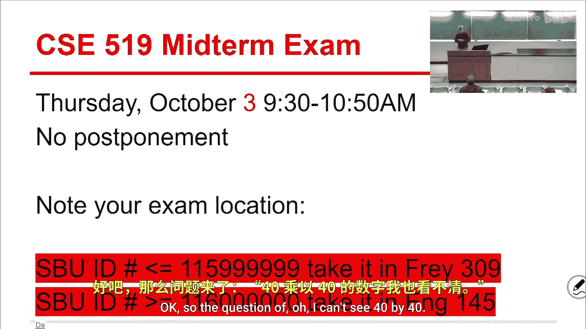

And part of me says that if you view it， if you represent the thing right。😡。

You can see and learn from it a lot more than you think okay that's kind of my first observation so when you did it。

 tell me something did anybody draw that matrix or it was in colors？😡。

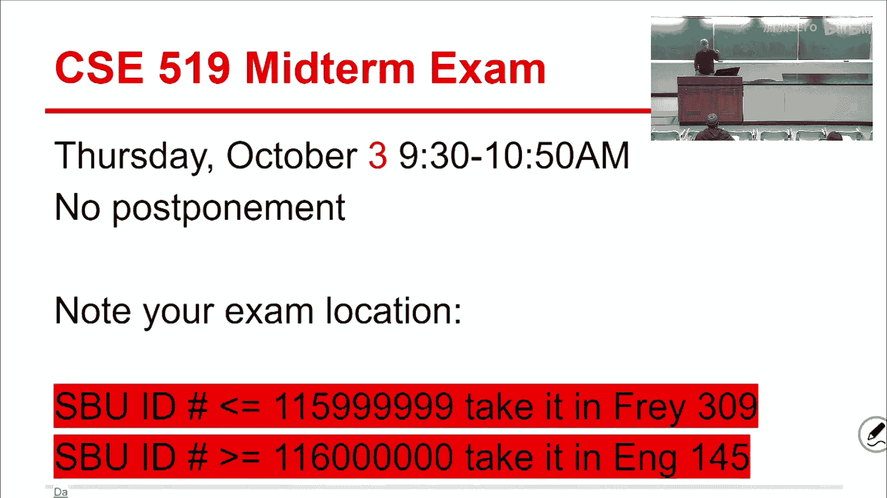

And what did you see when you saw colors， did you see flashing colors of all kinds of things？

にあ。

So I went the numbers were overlap。Okay， so so a couple so what am I hearing here， Okay， I'm hearing。

 yes， you should have a strong main diagonal because one should be one。 Okay。

 I'm hearing you said that the numbers don't fit when it's too small。😡。

Well， that's undoubtedly true， one of the great things about color scales is that that numbers don't have to necessarily appear there。

Okay。This is just for， again， we're going to talk about visualization in coming weeks。

 one of the things I kind of hope is that you find that certain things that seemed like they were really dumb。

😡。

Turn out to be harder than you thought。 Okay， and， and that that way。

 you have more respect when we talk about the subject in here。 That's part of my thinking on this。

But， yeah， so colors might make a difference。

Anything else that might make a difference to make that view nicely。

Did anybody draw it in colors？😡。

， and what did you see when you drew it in colors？

あ部屋。

And did you see patterns there， or did you just see a mix of light and dark colors？😡。

get right now。ACo of what？😡。

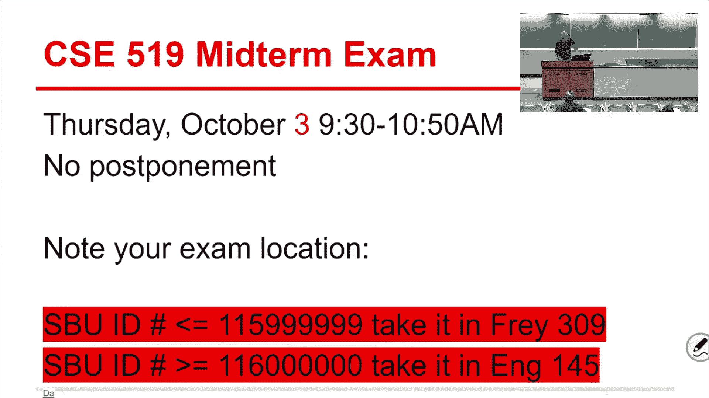

Okay， so you're saying that the interesting thing was when there are patches。😡。

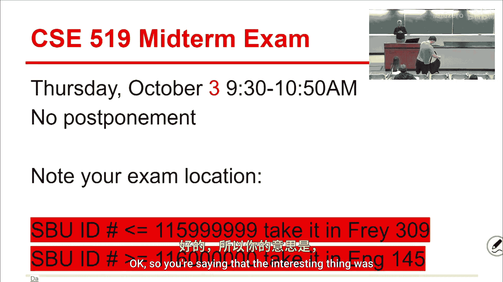

That are all dark or something like that。

Now， did you do anything to make those patches bigger？😡。

five bigger second。

Okay。Now， do you have any control of anything？OnOn this plot otherwise。

Okay。

You tell me you can color it， is there any other control you have over this thing？

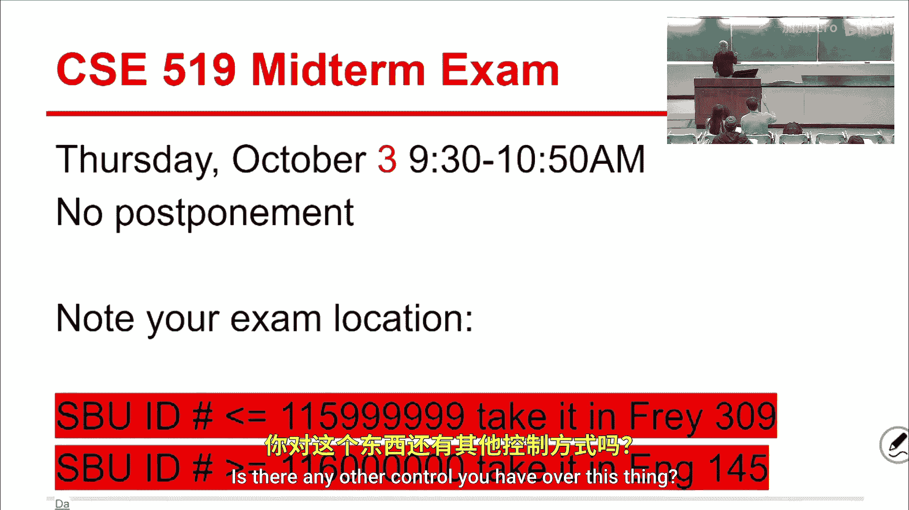

You can order the columns， okay？

Is there a logical order for the columns that might make something revealed。

好跟以啊。

こつ？Maybe you're ranking by so if it is the case that companies by importance， let's say。

 behave similarly。😡。

That if it's a good day in the market， important companies do well and unimportant companies do less well。

 then that's what you should see something like that if you lay them out by importance， right？

Is that the way the market performs， I don't know， yeah？

还 think告す。There's like a cluster map。Basically， what that does is like。

So， basically。Trys to take away。

The companies that are most closely related together。T to wait。

Group that rose like。ITo each other so they could build like a hierarchy。

And it shows like sort of。So what you're saying is that there is some magic function there that orders the columns explicitly by similarity。

Right。And that if you order it by similarity， you will probably get patchy regions， right？😡。

And is that what happened？いや。And was the ordering of the companies kind of interesting？

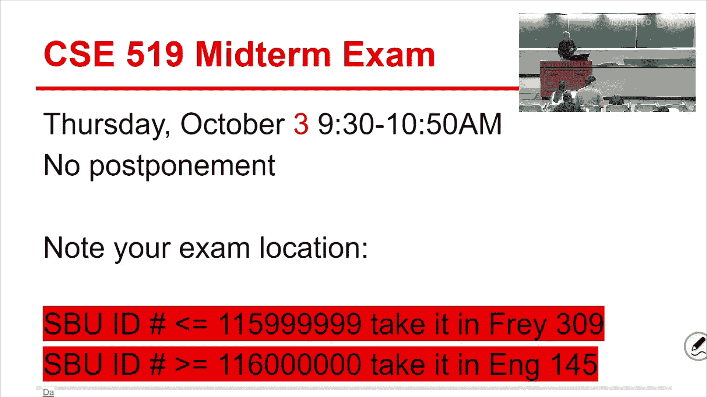

Yeah， so I found that a lot of the。lot of the things。非。

Okay， so what you're saying is that if you order that one way there to see more structure here。😡。

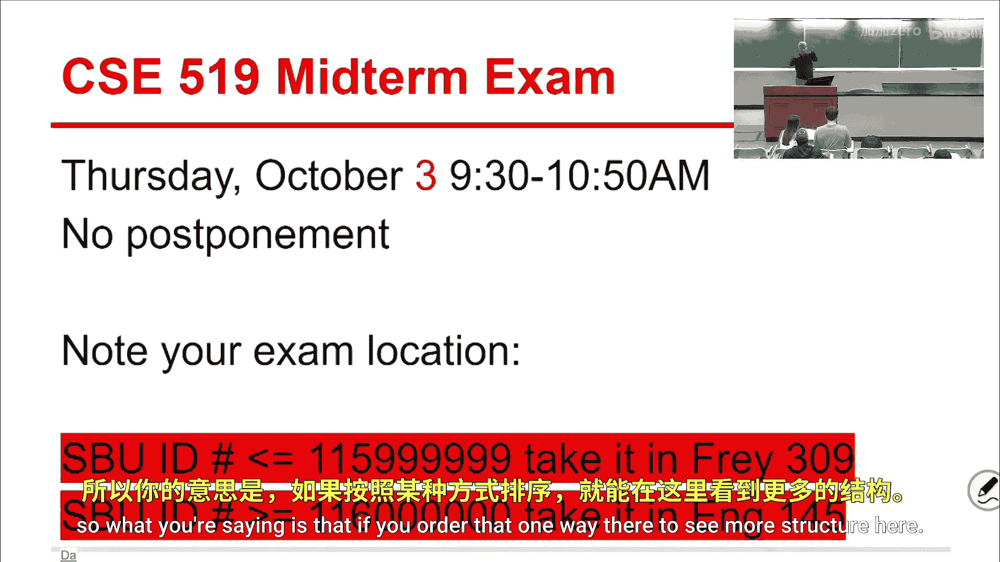

Might be to permute the columns and you're saying you think the banks's all performed away。😡。

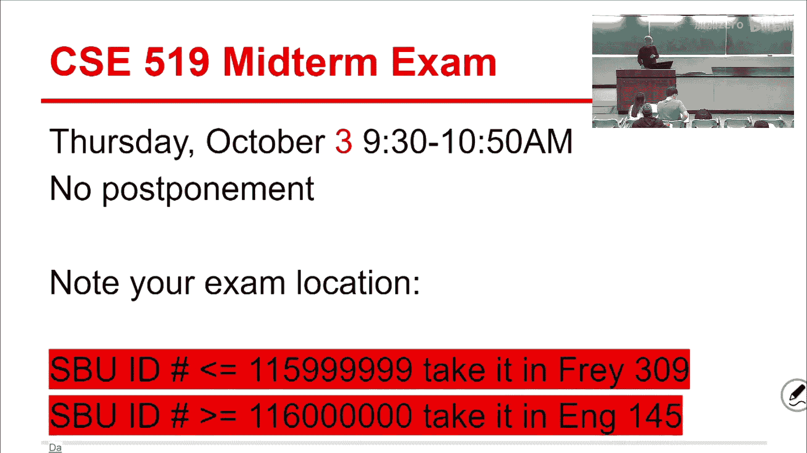

Because again， does it make sense that on days that are good for one bank。

 it's good for the other bank。

Maybe interest rates going up is good for a bank， I think that's true， but I'm not 100% sure。😡。

Maybe a financial crisis is bad for banks。 Is that true， probably？

So again， thinking about you're right， there's too much data there for you to see if you just display a matrix of dots okay or a matrix of numbers。

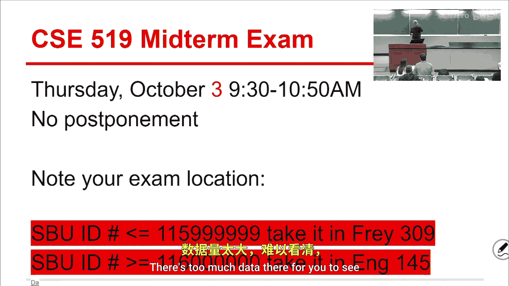

But there are ways to see things that are revealing。 And if you have time， play with that。

 if you don't have time， you know， do what you can， but get it in comfortably before midnight。

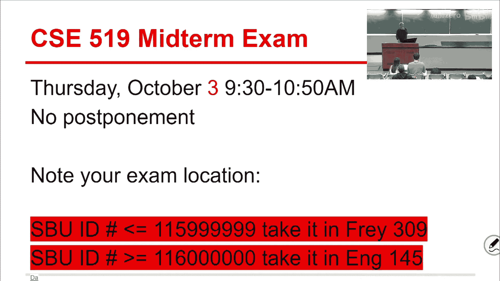

Any other questions about the assignment？😡，Did anybody， again。

 I dropped some kind of a hint glass class about the regression stuff。

 did anybody listen to my hint and try to do something with it， did it do anything？

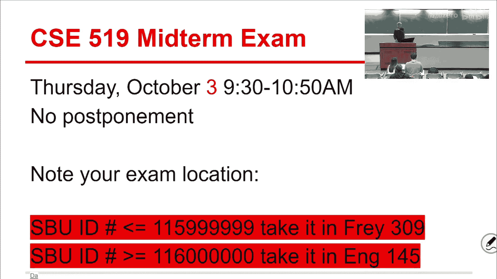

He says it did something son of a gun， okay so think about this because again。

 it's one of the things that I want to come out in this class is that it pays to think about what your data is and understanding what your domain is and thinking about whether or not。

😡。

