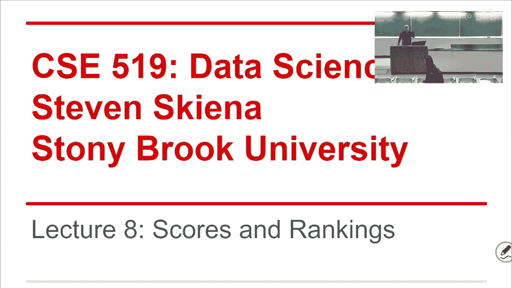
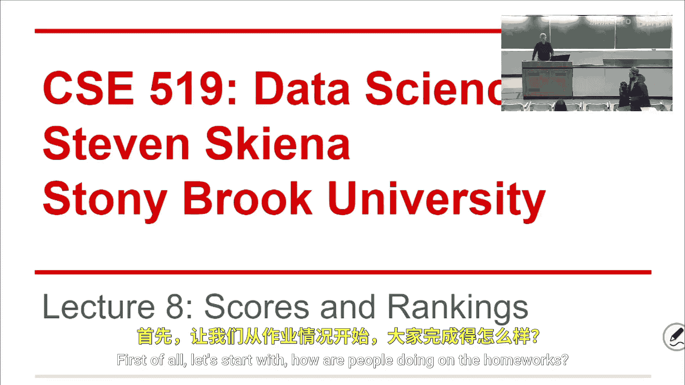
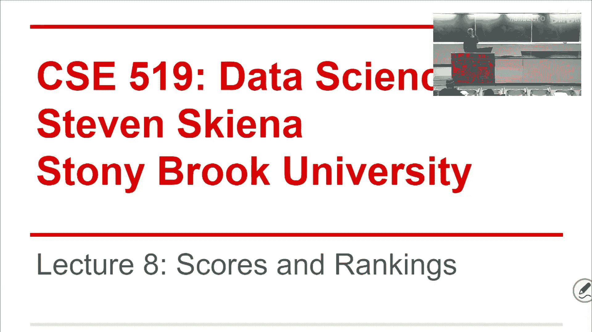
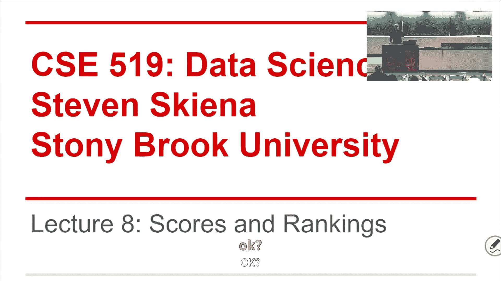
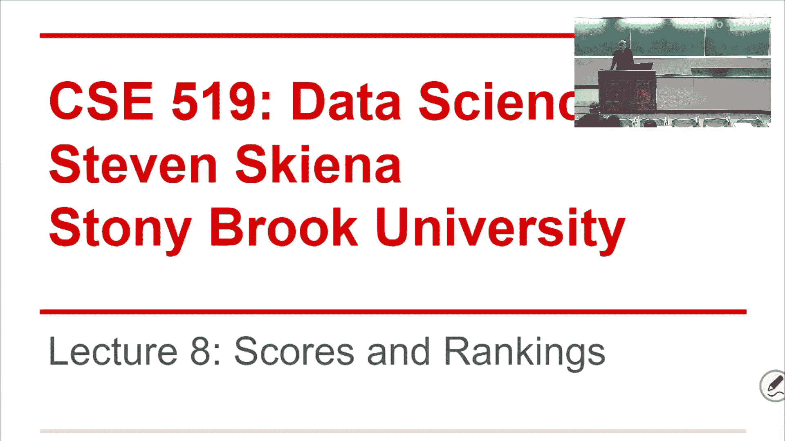
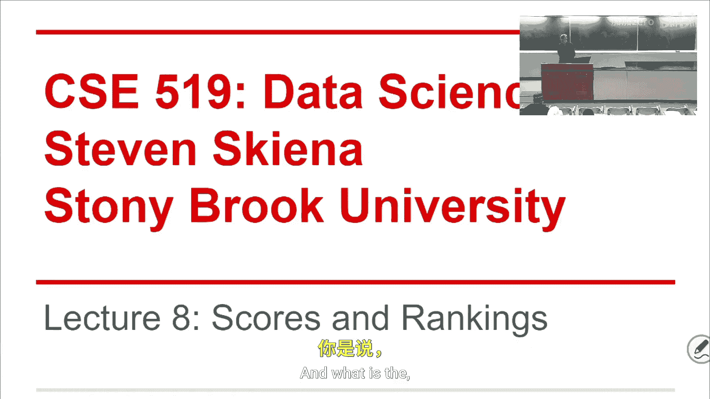
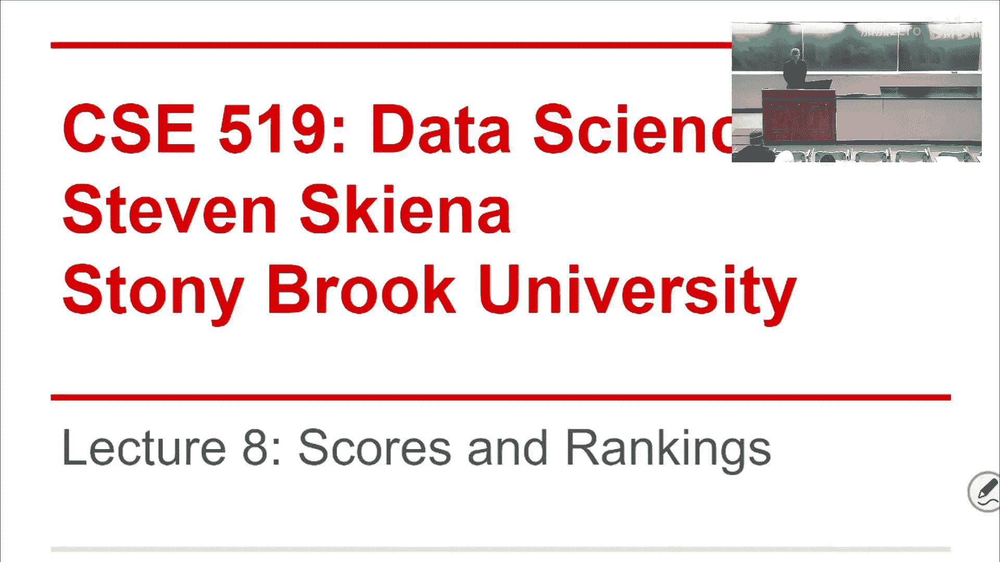
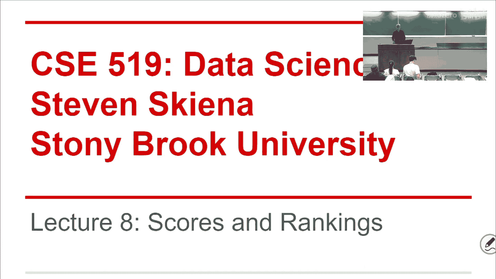

# 纽约石溪大学【中英⚡数据科学｜CSE519 2024 Data Science Fundamentals】 p15 P15 Lecture 8： Scores and Rankings (Fall 2024) -BV1s7Gaz5ETS_p15-

First of all， let's start with how are people doing on the homeworks。

 how many people have made a pass through their homework and you have made a first pass through everything？

I see some enthusiastic waves and some twitching， so that's good。

 and how many people have not yet done that？

I see you become more enthusiastic which back there， but okay， so any questions about the homework。

 okay yeah。

ForQuestion8， do you want us to do the part I？Like for seven， you have a part I。

Essential，Do you want us to break down question8 into part one and two， so we do the same thing？

Okay， that seems harmless， although has anybody done part1，71？😡。

The people that might do good or bad。😡。

Seeing terrible， anybody else say good or bad？Bad okay， so in that case。

 maybe you could do both or you could think about why you're doing bad。😡。

anybody who did great， somebody did great on Piazza， as I recall。

Did people see that posting or was that just me？

And I think that that person used the target variable as one of the features。😡，Okay。

 so that's probably why they did great。

So for problem one， you're doing， youre saying for both parts one and two。

 you're doing bed on both of them。😡。

a little better on two， that surprises me a little bit because it's in're predicting it from the year。

After。Okay。Any comments about this， any ideas or thinking about this？

CanHave anybody looked at the features and tried to figure out why you're doing badly on even the first part？

Okay， yeah， there is only one teacher that。

Only one feature calculates earnings per share， and what was that？

Estimated shares outstanding， okay。

Let's think what the variables mean。 Okay， this is what I want people to think about for a second。

 What were the variable， first all estimated shares outstanding， What was that。

 what does that measure。😡。

That I'm assuming is a measure of how many shares there are， Does everybody agree with that？😡。

Okay。

What do the other features have to do with？😡，What are the other features that you're using in that one？

😡。

What net income and what is net income measured in？😡，Dollars。

What are the rest of the things measured in？

Okay， does anybody else look at any of the names of the features。

 what are the features measured in that you're using for the regression problem？

Yeah。What？Capital surplus。 And what's that measured in。

 Is that measured in inches or what's that measured in。

Comppic。It shared higher price to its results。

What's the units on that。Everything is on dollars， okay？😡。

So you're telling me if I'm understanding it and I don't know if you're doing it right or not or anything like that。

 you're telling me that you have a bunch of features that are trying to predict to try to predict earnings per share。

😡。

Okay， all of them are dollars and one of them is the number of shares， right？😡。

And what is the and you the only one that was useful was the number of shares number of shares。

That revenue year and that income， something like that goes to it。

Okay， I don't do that people have any other experiences with this。

Yeah。You're saying there were ratios there。😡，Okay， there were some ratios there that made a difference。

 Those were not measured in dollars， right？Any other experiences people had？

Okay， you know， neitherless say I don't actually do any of this stuff。

 but but I'm wondering to myself when I hear look at this。😡。

Is there some way is what are you trying to predict in earnings per share， right？😡。

Now what happened to this company， to the earnings per share if there was a stock split right before it？

😡。

Let's say that there was a stock split where the earnings per share。

 where they did a two for one split。

What's going to happen to earnings per share？decrease by what？So is that going to be able to be seen。

 for example， in your model？😡，No。Is there any way that you guys can think that maybe you can make those dollar figures into something features。

 into something that might be better？

At predicting earnings per share。Any ideas？

What happens if you're telling me what happens if you had these earnings numbers？😡。

Would the earnings numbers be likely more valuable if they were by the number of divided by the number of shares。

Okay， this seems to me to be an A A A something I haven't done anything。 How do I know。

But I do know that when you're doing that， you're now starting to build your model out of features that are of comparable things to it。

 Is everybody going to see that。Can anybody see why linear regression doesn't pick up on this？😡。

Can anyone give me an idea why linear regression wouldn't pick up on this。

 you know the fact that dividing by the number of shares might be a useful thing？

It's because it's linear， okay， and maybe if you you know a transformation like something being one variable divided by another is not something that falls out of that features。

 okay？😡。

Any questions about that， do people see an idea possibly？😡。

Or was I too opaque， how we see what I was saying？Nobody how people don't see what I was saying。

A few people twitching， okay？Again， you've got variables where you're trying to predict a ratio of what you call it。

 the earnings per share。😡。

And you've got features that are earnings and you've that are basically earning dollar things。😡。

And you've got sheer things， okay？

One possibility is to change the。

See what happens if you air to transform the dollar things into dollars per share， okay。

 that might be an interesting thing。

So another way to accomplish the same thing。😡，Maybe more easily。

IfWe want to get the effect that recognize it that that you have unwashed dollars and you've got shares。

 is there some way to change so we could change the features， perhaps？

Is there anything else you could change？What does normalization mean， what do you normalize？😡。

So Z scores might be something， does's a beta think of z score before you've normalized it though by share。

justのら。

Just to normal it may， Z scores will well maybe we'll talk a little bit about Z scores did more today。

 but still Z scores will transform the variables。

So they are comparable in magnitude and range， that's kind of what Z scores will do。😡。

Now they won't do nonlinear transformations， a translation where I convert from feet to meters is a linear transformation。

 I'm multiplying it by a constant， right？😡。

If I multiply it by a constant and subtract the mean。

 that's still going to be a linear transformation。😡。

Now， sometimes the variables might have a need for nonlinear transformations， okay？😡。

And I think that's what's happening here is that there is probably an obvious incompatibility。😡。

Between your variables and your target， okay？😡，And so one proposal if you're trying to predict earnings per share。

 might be to manipulate the variables， so they are by share， right？😡。

