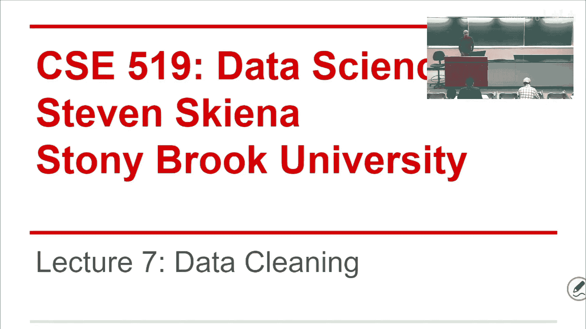
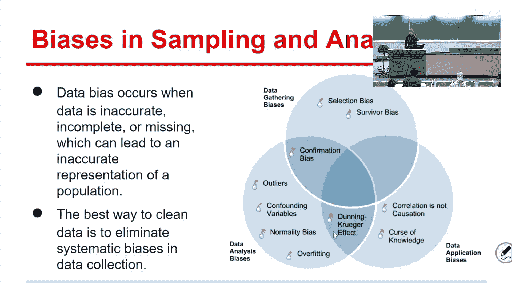

# 纽约石溪大学【中英⚡数据科学｜CSE519 2024 Data Science Fundamentals】 p16 P16 Lecture 7： Data Cleaning (Fall 2024) -BV1s7Gaz5ETS_p16-

First， I'd like to apologize for having to miss last class。

Go to be scheduled to be here for all lectures from now out， so again I'm sorry about that。

 Any questions from Professor Tripathy's lecture from last time？

Last class he was talking about various data set assembly stuff， any questions or comments。

Anything to talk about。Okay， I'd like to start out by asking。

 are there any questions about the homework， the homework is， I guess do a week from now。

 is that correct？Okay。Has anybody gotten made his first pass through all the parts of the assignment？

😡，Okay， I see some people twitching。 that's good。 They may not want to be seen twitching。

 but that's good。I strongly encourage people to make a first pass through the assignment。

 you know as quickly as they can and then worry about going back later to you know kind of improve things rather than over optimizetimize at the beginning part and then move on to the end。

 are there any questions or comments or observations about the homework？😡，Any uncertainties？

Anything people see that was interesting。O。Okay， hopefully that will come I strongly encourage people to if you have questions ask them on piazza and make sure you share with other people。

 so I think it's much better than asking private questions is if the questions people ask other people see because I think everybody's going to you know has a chance to learn from each other。

Okay， any questions about the homework before I move on？Okay。

 the other calendar thing to keep in mind， but not to do anything about yet is two weeks from now we'll have the midterm right now this week you're going to spend the time。

 should spend the time on the homework but recognize that that is working in your future， okay？😡。

Any questions？Okay， so what I would like to now do today is talk about data cleaning as my subject。

 and there were a couple of slides that I think I want to double check whether Professor Tripathy went through them or not。

 he mentioned that one slide he didn't talk about was a slide I had that had this figure。

 I don't know if people noticed this figure。😡，Last class was about collecting data。 there is。

 you know， one thing that's true with any data set collection process is that there are biases in it。

 okay， and what is a bias okay， a bias again， people usually these days when they talk about bias view it in an evil way that you're trying to step on some group okay or or do something banned from thinking。

 I will argue that most biases that you see in data are you know。

 accidental or careless okay but it's important to kind of think about this and you know， again。

 data bias according to the definition I look up occurs when the data is incomplete。

Inaccurate or missing， which then doesn't fully represent a population。And this figure。

 which I kind of like， I stole it from somewhere。Discuses different kinds of biases that happen in data collection。

嗯。WhatWhat is confirmation bias， Does anybody know what confirmation bias is？

I think these are principles that are kind of interesting to think about because it seems to happen in the war a lot it's important to know what kind of biases might exist in data or a collection process。

😡，And what is a confirmation bias， does anybody have it yeah？Say that louder， I'm sorry。对对。Right。

 so so it's something that you will accept something that agrees with your beliefs。

 okay and you will disagree with something that doesn't agree with your beliefs。

 okay and undoubtedly you have this problem where I mean。

 there are a lot of cases where people have this problem， okay， you know。

 I tell you in this class to I believe very much in Smith tests。😡。

We look at the data and look at it closely to see if it's right。 Okay。

 once you accept that it's right， you walk away and you assume it's barect from then on。

If you have something that it's wrong， wrong， wrong， and now you think it's right。

 you immediately stop and say everything is perfect。

 I know people have had this phenomena that the first time you get your program through some kind of a test。

 you assume it's right。😡，That's a confirmation bias because you kind of thought it was right when you wrote it。

 okay and you're looking for just a little evidence， you know。

 the moment you saw some evidence it had to be right。Does anybody know what is survivor bias。

 Does anybody know about survivor bias？然。Only here what。出そ率。You only hear the success stories。

 you always hear the things that are around at the end。

 has anybody noticed any survivor bias issues in the data set that you were given for the homework？😡。

Okay。Is there anything people have noticed that might capture an idea that you know the data you're getting is from the success stories。

 yeah？タイバル認。戦いぱな。まれが？Okay， you're saying we're only looking at the top 500 companies， okay。

 and therefore we're ignoring what happens if you're not a good company。😡。

What I might say is more like what I would call a selection bias。 Okay。

 whoever made up the S&P 500 said， you know what matters in the world are the big companies。

 The other companies don't do it。So I don't think if you went to the guy， you know， Mr。 Stan and Mr。

 Po， it's that's who S&P are named after。And if you went to them and said。

 did you realize that your S&P 500 only has the 500 top companies。

They they wouldn't be shocked by that， right？ That was a choice。 Okay。

 so I would say that that's a selection bias。 and it obviously would bias towards big companies。

 What about a survivor bias， Does anybody see a survivor bias and what what in the data that you're seeing。

where it's kind of the success stories that kind of are overreed and analyzed。Okay。

 how many companies got added to the S&P 500 data after the sampling period started？

Some people have done that part of the assignment， right， how many？I。我。I didn't hear。

 but I think I heard 24， Okay， fine。 How many companies disappeared？0。

 why is it that no company disappeared， okay？Did they just get lucky？

Can you guess how was the data set collected？😡，Can anyone make a guess， again。

 I think that when you look at a data set and start to play with it。

 you start bringing theories of well it got collected， yeah what happened？😡。

They said that at the end， somebody woke up one day and I guess it was 2016， said，Hey。

 I want to build a data set on companies for Cagel。

 I'm going to take all the S companies on the S&P 500 today and go back five years and look at how they fared。

 right？😡，And。What you got were the companies that survived until 2016。

 does everybody kind of get that idea？You，If there were only 500 companies in the S&P 500 and 24 got added。

😡，Can anybody guess how many of them had to be deleted？24 right， okay， so where are they， okay。

 they died as far as the S&P 500 and never left a trace， right？😡。

So this is what we mean by survivorship bias， okay， any questions about it？😡。

Does anybody know what the Duing Kruger effect is？

Okay， this is a goodber toino so what are these kind of sampling biases？

