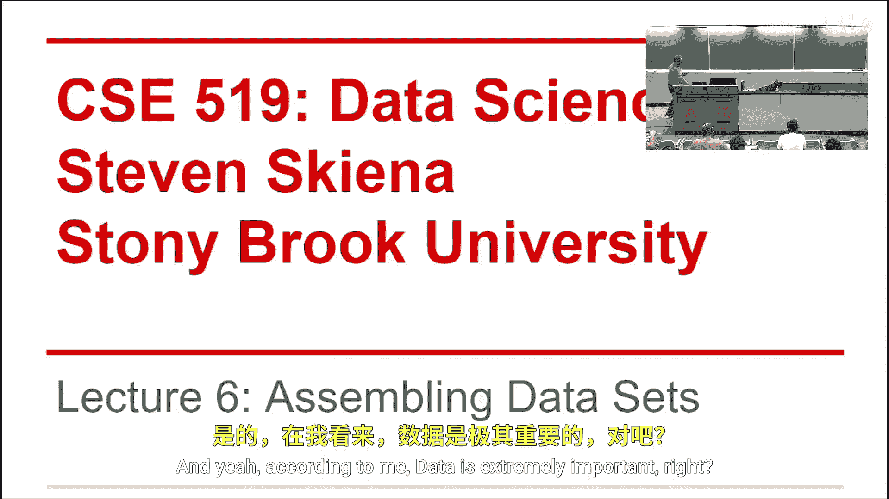
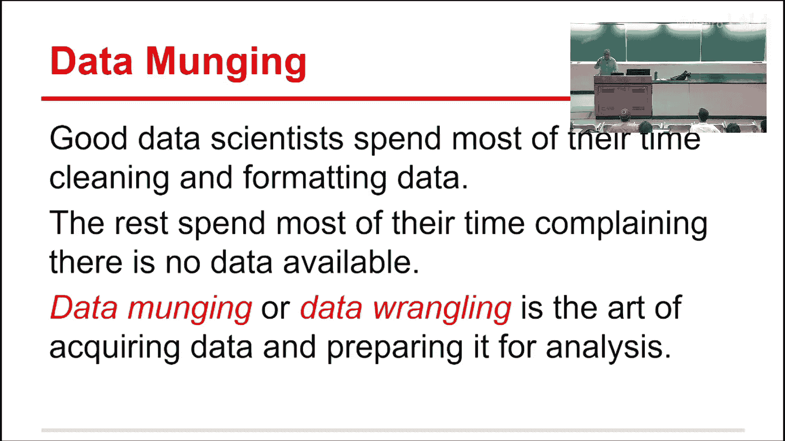
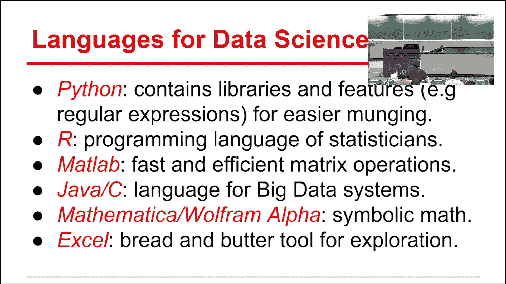

# 纽约石溪大学【中英⚡数据科学｜CSE519 2024 Data Science Fundamentals】 p17 P17 Lecture 6： Assembling Datasets (Fall 2024) -BV1s7Gaz5ETS_p17-

All right guys， welcomel to the class。😊，And yeah， as you might have noticed。

 that of skin is not available today。 So I'm covering for him。But myself， I'm praed。

I'm a faculty in computer science department。 I do teach this course。

 but for undergraduate students and。Yeah this stuff is familiar to me most of the slides if you have any questions during the lectures please don't hesitate I love interactions a lot and I'll bother you people with my questions right so please。

😊，Interect， so CSC 51，9。😊，This lecture is on assembling data sets lecture number six。And， yeah。

According to me。Data is extremely important， right， No data science without data。

 So here we will learn about data and we'll start with data muing。Did anyone okay。

 let's start with this。 Did you people know about data managing heard about it。😊。

WhatWhat's the approach when we learn anything new for the first time， right？Data muning。

 what is this muning， I this a word that we have borrowed from English or any other language？

Munging should have the root word as muge， right？What is muchn have we borrowed from English？

Or any other language。No， it is a computer term right There are a few terms that we got from computer itself a yeah。

 if you are looking for wrangling so data mu， data wr are similar terms right whenever we are doing data mu。

 we also refer to that as data wrangling。 So if you look for wrangling or wr you would find its meaning in English。

😊，Wanggling means。A land means。Rrangler， there is a brand wrangler。

Are you people familiar with that wrangler jeans？Anyway。

 Wangleular means getting an argument with something。 but anyway， we are not arguing with data。 Okay。

 but lets see what we will done learn here。😊，We will learn about data managing extremely important step in any data science project。

 Okay， and as I said。😊，No data size without a data， well。

People might think of you know simulating data and then working on it。 that's an extreme thing。

 we won't go there。 So in good in a data science project what will happen we will get the data and well start from there Now data mu what it is we will get to that red the definition is at the bottom。

😊，But before that， let's try to understand。😊，I let you people speak。First， let me speak， okay。Good。

F so。啊。Can anyone guess how much time a data scientist spends on just data， you know。Data mu。

 data wrangling and any clue， any guess about it。How much time get。More than 80%。Okay。

 how did you come to that number？打师。但是我。嗯，对。So we need to contact the professor， right？

Every that might be true right so every time I look for this number and as I said that I do teach this scope for undergrad。

😊，Before I would look， so I did that homework。And I checked on it I found it to be 50 to 80%。

 probably you would agree with that， right。😊，You， data scientist live。

 a lot of time is just spent on data cleaning and formatting。 So this is very important。

 Data scientists now now let's look at the content that we have here， right， data important。

 we are getting to the definition and all that。 But yes。

 we need to understand that this is extremely important。

 So data scientist spends most of their time cleaning and formatting the data。

 So that is kind of related with this data managing and data wrangling thing。

 So now the next thing is interesting， actually， Well， those who have the data。

 they will spend time on cleaning and formatting the data that f made complain about not having data。

 But now let's get into the definition。 What do we mean by data or data wrangling。

 It is the art of acquiring the data and preparing it for analysis。 very rarely， well。

 I won't say never。 Sometimes we may be lucky when we get our data in ready。😊。

For it happens a lot of times， right， Well， you will work on the project。

 when there is a slide that will。Refer to your project。 Okay。

 so it all depends If you're lucky if you got the data， which is clean， Nothing you have to do。

 you can immediately maybe start thinking about modeling and all。 but even before that。

 you may do something like you scaling， normalization and all those things。 Yeah。

 that is important here。 And data managing there are a lot of things that you may like to do。

 you will see that very soon soon， right， the data may have now you know， outliers。

 noise and all those things missing data and all that。

 So you need to do that before you go to the modeling， right， So question till now。😊。

All right， then let's keep moving。So well we will use your LC CS graduate students。

 you will use programming language for data science right so let's think about some languages which are very top rank right？

😊，Top rank languages in data science。 If you， if you remove data science thing。

 then you may have a different ranking of the。Programming languages， right。

 high level programming languages。 let me be precise on that。 So in data science。

 that's what we found。 Python is ranked number one。 Okay， there are other languages as well。

 So this is not exclusive， Okay， so is there anyone who believes that there is another language。

 very useful in data science， not listed here。😊，谁以。Javascript for data science， interesting。

Could be right， if you are comfortable with the data and V I' will be doing a lot of visualization now that。

😊，I don't know jascript， but when jascript comes to me then I think of visualization and all right I that correct scripting and visualization What might be used right。

 So let's look at the list。 I did find other languages also so that's the reason I'm saying this is not an exhaustive list Julia I learned about Julianne all that used it probably it' a recent language I go I found Go as well okay but。

😊，If you ask me， then I have used most of these， except for Mathematica。Alright here， so Python。

Is no doubt language number one in data science， right。

 So if you remove data science sciences search for top， you know， popular language。

 high level programming language， you might find Python number one or number two。

 Java might be number one。Okay， but in data science definitely Python。 Okay， so why。

 why is Python so popular。It is kind of re maybe some 10 15 years back R was very popular。

 R is still popular but R has its own you know what as a community and R is popular among statisticians okay。

😊，Python， well， there is a reason why Python is so popular。

Can anyone suggest if you use most probably you using Python only for your project right。

 have you people decided already。😊，Right， and。Probably you will have the freedom to pick whichever programming language you want。

 but yes。应该说事。不是搜搜过身份上搜。Another benefit is that it doesn't have any kind of checking for the variables。

Iss that a benefit or a loss？Here we can debate， right， my friends， one of my。It is simpler。

 It is simpler and。Learning curve right you can very easily learn， as you said。

 very close to English and what else the libraries right。

 rich libraries we have very convenient to use you'll have your own favorite library right and I would believe that even the most recent research that people are doing they are you know bundling that in a package or a library and making that available。

😊，Okay so yeah that is one of the reasons why Python is the number one here as you can read it contains libraries and features like regular expression R package is very very useful and then my favorite is pandas right you people may have your own a nuie mat plot label there are so many right and even for web scraping also they have beautiful soup and right only you must have learn about it or willll see that very soon。

😊，Fight， and then。I already mentioned that， you a。R is a popular language does I love interaction I already said in the class。

😊，But， I don't like。Interactctionions between the students that I don't hear right if you want to interact let's do it this way right use me as a satellite I will broadcast your communication to your friend。

😊。

But。