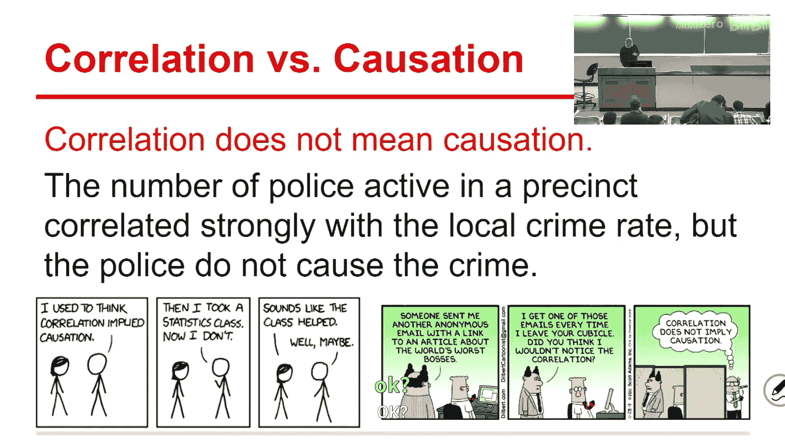
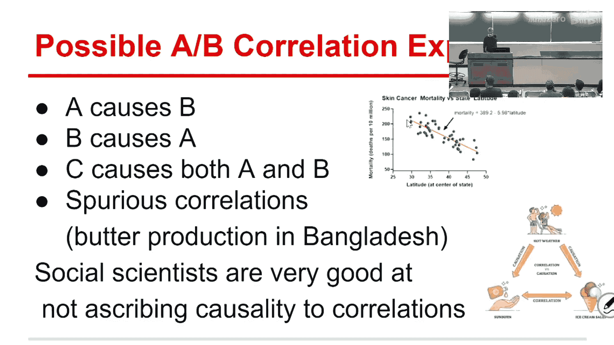
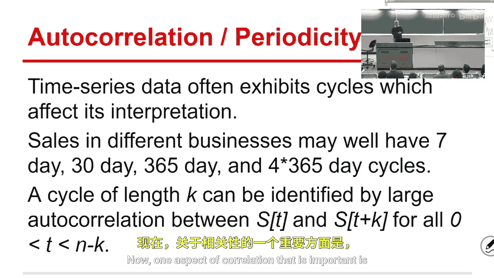

# 纽约石溪大学【中英⚡数据科学｜CSE519 2024 Data Science Fundamentals】 p18 P18 Bonus Lecture Look Ahead For HW (Fall 2024) -BV1s7Gaz5ETS_p18-

First of all， are there any questions about anything on the homework assignment。

 let's start on the homework assignment。O。How many people have gotten started on it？Okay。

 and how people have not gotten talking about。Okay。

People who haven't gotten started on it haven't gotten started coming to class。 So so anyway。

 this has good any questions about the assignment， anything to discuss。About。Rules， policies。

 anything going on。Okay。So today I'm gonna my plan for today is I want to talk more about correlation。

 finish that section up that we had talked about and then go through a little bit about one of these problems on the assignment has to do with using linear aggression and I haven't thought that and I really teach that for real later in the semester。

 but I do want to spend a little time talking about it just to make sure everyone's on board。

The other thing just to mention。还有说。I assume everybody knows that there's a quiz every class and that you have to do it has anybody has who has figured out that we have a quiz every day and they know how to do it。

Okay， are there any technical issues with that？Anything I should know about。人。在这 next。

It doesn't access class， what does that mean？😡，Wait， okay， this is never do the quiz。Okay。

 you're saying I want to register and there's some technical issue that applies to me， okay。

 talk to me afterwards， okay。😡，Any questions about the quiz or anything else logistic？Okay。Good。

 okay， so's let's talk a little bit more about correlation last class we talked defined what you know various correlation statistics are。

And when there's a correlation found between two variables， that means that there is some kind of a。

Statistically significant relationship between them。But of course。

 the famous thing is that correlation does not mean causation。

One reason this is obvious is that a correlation is symmetric。😡。

The correlation of A with B is the same as the correlation with B with a。

 so it can't be that a causes B and B causess a， but it's often the case that people itch to say that when you see a high correlation。

What other the things must explain the other。And you know， people often get the correlations wrong。

 you know， the direction of causation wrong again， my one example I like to say is if you take a look at the precincts in a city and you measure their crime rate。

 okay you know， and at each place and you measure the number of police they have at each place。

You will probably have more police where there is more crime， right？😡，Now。

 is it the police that caused the crime or is it the crime that causes the police？Probably， I mean。

 you know， to me， I sort of would guess it's probably more likely that the crime causes the police。

 okay， but you know， but you know。😡，ThatThat's still kind of a made up， you know claim。

 you know that。know I work a lot with social scientists and social scientists very， very。

 very much about causality， trying to prove that one thing caused another thing。😡。

And they are remarkably good when you talk to a social scientist。 If I were to say something like， a。

 the police， the crime caused the police。They will be very good at telling me， no。

 the police could have caused the crime。 The crime could have caused the police。

 They could be independent。 They could be。So actually determined there really is a correlation is a causation relationship is different。

 correlation is a statistical observation， causation is some kind of claim about how the world works。

I like this cartoon the best， okay， I used to think that correlation implied causation。Okay。

 that I took a statistics class said now I don't。Sounds like the class helped。Well， maybe， okay。

The world maybe means that they know now that causation does not correlation does not mean causation。

 Okay， any questions about that？

So what is the situation when you have two variables that question， yes？😡，あ連个的。とマイナンス。

So what are the possibilities if you add a correlation between two things？😡。

It could be that A causes B。It could be be causesary。It could be that there is some， you know。

 some C that causes both A and B， I think the example downstairs， you know。

 you have those selling ice cream， ice cream sail are going to be correlated with sunburn。😡。

Right on that on days when ice cream sales are high， the sunburn is also going to be high， right？😡。

Now， is it the ice cream that's causing the sun burn？😡。

Is it the sunburn that's causing the ice cream？😡，Or is there some other phenomena like the sun that is causing both of them。

 okay， so that would be a situation for C， okay？There are also such things as spurious correlations。

😡，One one famous example of this is that， you know， people want to know if， you know。

 you could make a lot of money if you knew the stock market was going to be good or bad next year。

 okay， and so someone went ahead and took a whole database of time series from the United Nations and correlated them with the stock market。

😡，To say whether or not the stock market would go up or down that year。😡。

And they found that the best prediction of whether the US stock market would go up or down was the better production in Bangladesh。

 You can Google But production in Bangladesh。Now does butter production if they make more butter in Bangladesh。

 is that going to cause stocks to go up？😡，Does it look like it should be。

 it looks like this is maybe just a spurious correlation okay。

 remember if you have a statistical significance and you say that you know that there's less than a 1 in 20 chance that that a 95 out of 100 chance that this correlation is real。

😡，Okay。What does that mean， that means that there's a 5% chance that the correlation isn't real。

 right？😡，And you know， basically， the moment that they discovered that butter production in Bangladesh predicted the fate of the stock market the last 30 years。

 it stopped working。And why is that？Because it was never really working。

 There was no causal relationship there。 You have enough time series you're going to correlate with。

 Okay， one of them has to be the best。 Okay， any questions about that。

So it is important not to oversscribe and like I say。

 I have been impressed when I meet a good social scientist how I'll get into discussions with them and I'll say。

 oh， this must cause that and they'll say， well， they know not to say this causes that okay we don't naturally think that way。

 but that's actually an interesting one。😡，Ingressions。

And this was a graph I kind of like when we would talk about sunscreen。

 This measures the amount of skin cancer。 I think every dot represents a state， in the United States。

And it measures the number of deaths due to skin cancer as a function of the latitude， okay？

What would we expect， we would expect states closer to the the equator。

Because really to have more skin cancer because they get more sun right。

 and that's kind of what you end up getting with a graph like this。Any questions？

Okay。Now， one aspect of correlation that is important is that。😡。

