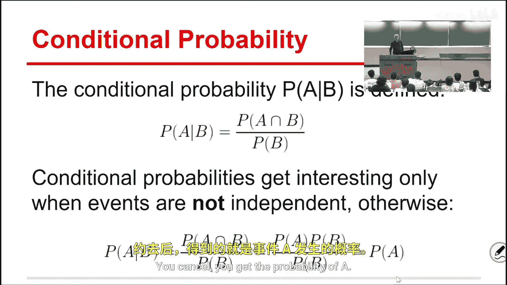
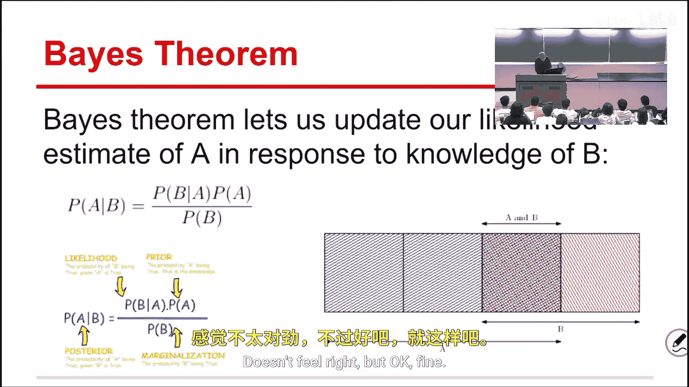
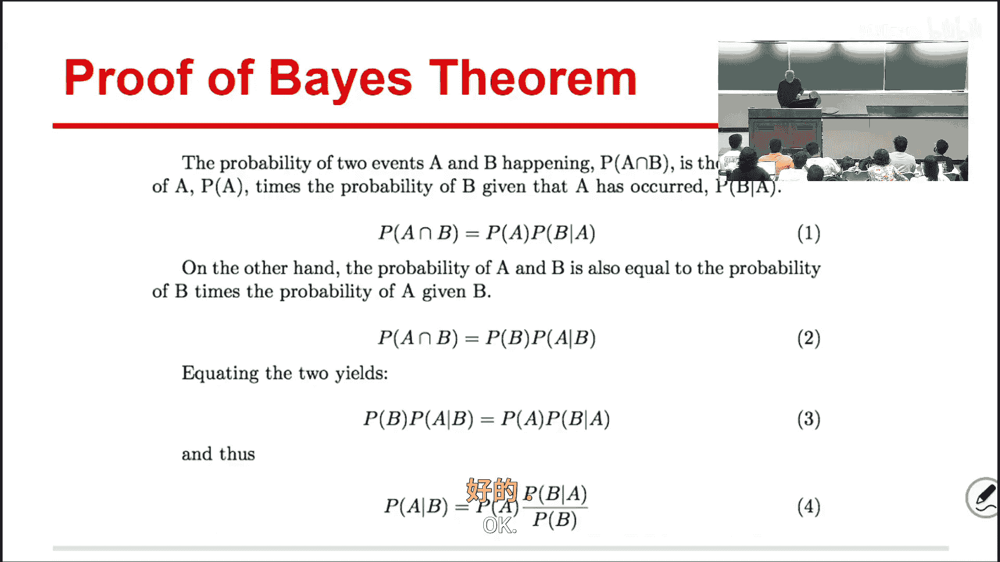
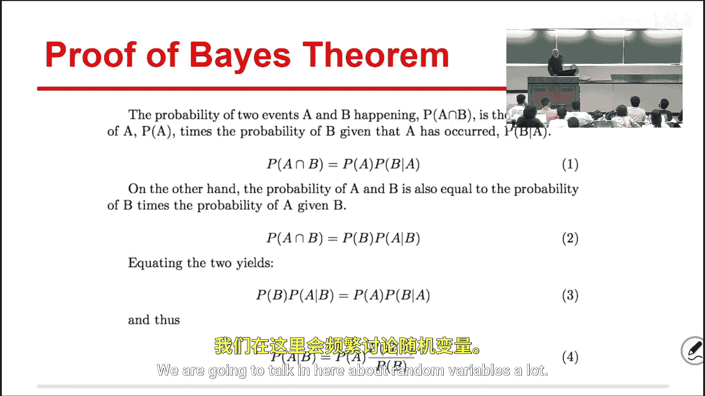
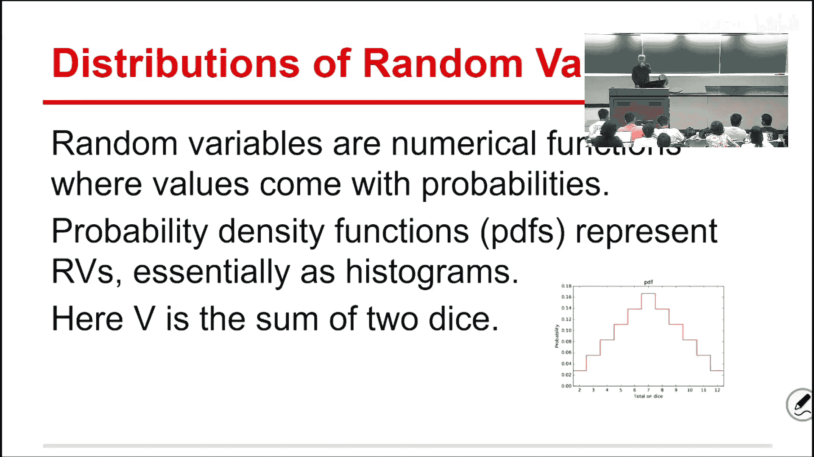
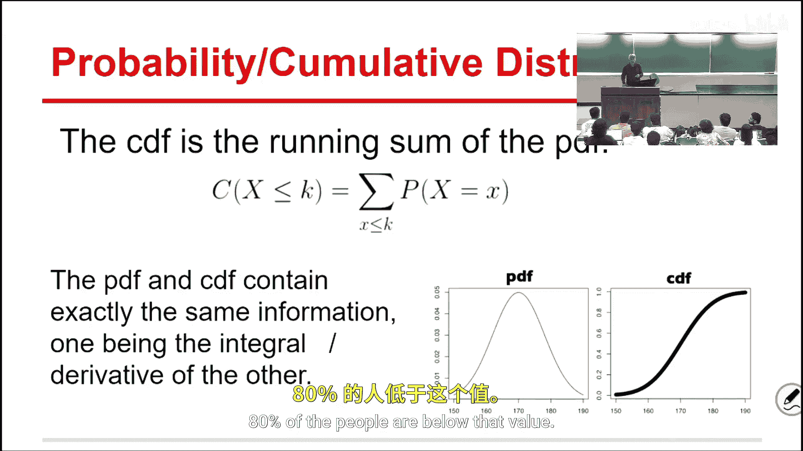

# 纽约石溪大学【中英⚡数据科学｜CSE519 2024 Data Science Fundamentals】 p20 P20 Lecture 2： Mathematical Preliminaries (Fall 2024) -BV1s7Gaz5ETS_p20-

Okay， so what is conditional probability， the probability of a given B， the label being positive。

 conditioned on the data observed data being B， okay， is the probability that both A and B is true。😡。

Divided by the probability that B is stroke， okay？😡，Any questions about it？😡，Okay。

 so if I want to say。And so the probability of A given B。😡。

Is the probability of both of them happening divided by the probability B has happened？😡。

Now the important thing about conditional probabilities is they are only interesting when things are not independent。

😡，Suppose what is the probability of A given B when A and B are independent。

 it's the probability of a intersection B， that's the probability of probability a times the probability of B。

 you cancel you get the probability of A， okay， any questions about that？😡。

The most important result in conditional probability is something called base theorem。

 which is kind of this mystical you know you know theorem that people use a lot。

 I don't know if people read in the news about a financial guy whose yacht just sunk in a lot of people died。

 anyone remember what he called his yacht。The Bayesian right， he had made a lot of money。

 presumably using Bayesian statistics， didn't do a much good， did it okay you know but anyway。

 so what is the consequence of Bay's law other I mean in terms of mathematics okay or Bay's law is the probability of a given B。

DivProbably of a given B is the same as equals the probability of B given A。😡。

Times the probability of a given B。😡，Divided by the probability of B。

 now what's interesting about Bay's law， it gives you a way of kind of reversing the conditionals。

 okay， the probability of A given B now depends upon the probability of B given A。😡。

Perhaps one of them is easier to calculate if one of them is easier to calculate than in principle。

 this just gives you a way of calculating the other。😡。

So let me just test out for the first time the marker here。

How do we figure out what's the probability of a given B。

 supposeupp we have these four possible you know events。

 okay A is considered to be any one of the first three。

 B is considered to be any one of the last two。😡，What's the probability？Of A given B here。😡，Well。

 if B is true， it's one of these two。What's the probability of a being true if B is true。

 just from looking at the picture？😡，A half， okay， how do we get that？Well。

 that should be what's the probability of B being true given A。

 what's the probability of B given through given A？😡，That should be one third， right？

And what's the probability of a being pro？😡，Three， fourth。Sorry， I can't write there very well。

And then we divide that by what's the probability be being true？😡。

A so what does that mean that's one fourth over a half that I believe is one half Does everybody see how that works？

Okay， let's see if I can erase this， this is now a challenge。Okay。

 this is where we will see whether this is a。Good， bad or not。No。

 that doesn't work if I click on this， oh does anything magical happen？No， it just gets worse。あなてば。

You say a circle on this。It's possible， okay。No， is this rubing， I'm supposed okay。

Maybe this doesn't。Doesn't feel right， but okay， fine。

And now let's try to click it。And see what happened。How do we prove base theorem。

 it's this powerful result people like to name boats after it， what is the proof。

 the proof is actually very simple， okay？😡，We know that the probability of A given B。😡。

Is probably a intersection B。Whether they're independent or not is the probability of a times the probability of B given A。

😡，What is the probability of。B given A if a is true。😡。

What's the probability of B given A if we know A is true？😡，Okay， let's think about it。

 S we just have look at this what's the probability of B given A。😡，If I now tell you， a is true。😡。

What it's whatever the probability of B is， right？😡，Okay。

 now so the probability of a times the probability of a given B is the probability of a times the probability of here。

😡，So for the intersection， both A and B have to be true and so the probability of a times the probability B given A。

😡，Similarly， it's the probability of。Because A and B are symmetric。

 B times the probability of A given B。😡，If you set these two sides equal to each other。

 because they're both equal to that intersection。😡。

And then you multiply both sides by one over probability of B， you get base law， right？😡。

So it's a very simple result， but in principle it gives you the right way to what you call it。😡。

Explain how what to update your beliefs in something on the basis of evidence because everybody get that。

 that's really what it's doing if B is the evidence。😡。

You're updating your belief in whether A is true。😡，Based on the evidence B， any questions？O。

Let me see if I can do this。

Okay。嗯。We are going to talk in here about random variables a lot， what are random variables。

 well random variables are numerical functions where the values come with probabilities。

 okay you can imagine you're trying to predict you know what somebody's great in the class is going to be。

😡。

Their grade can take many numerical values is a range of the grades it can go from anywhere from a 0 to a4。

 I guess if you grade it on a normal or 0 to 100 you to decide what your grade scale is。

 and there is a probability for every distinct grade there so the grade is considered a random variable。

 there is a probability associated with that。😡，A probability density function is used to represent a random variable。

😡，Typically as something where the x axis is the numerical value， the y axis is the probability。

This is the probability density function， or I would maybe usually say probability distribution。😡。

For the random variable， according to what your score is if you roll two dice。

 which are numbered from one to6。😡，How many people here are familiar with Dce？Okay， they are。

 you know， they are these cubes， one to six， you roll them， you go to a gambling hole， you roll them。

 you lose your money， okay， any questions？

Okay。Now there are two ways you can represent a probability distribution。

 and we're going to use both of them in here， so I just want you to be aware of them a little bit。😡。

One argument is the probability density function。 This is like a probability density function for height。

 okay， I think this is height in centimeters or something like this Okay。

 so this shows us you could look up for any x。 What is the probability of x。😡。

The other is the cumulative distribution， where the cumulative density function or cumulative distribution function is the running sum as you go from left to right。

Does everybody kind of see this at this point when we look at 180？

What does this number08 represent when we get to 180 centimeters？😡，Its yeah。

80% of the people are below that value。😡。