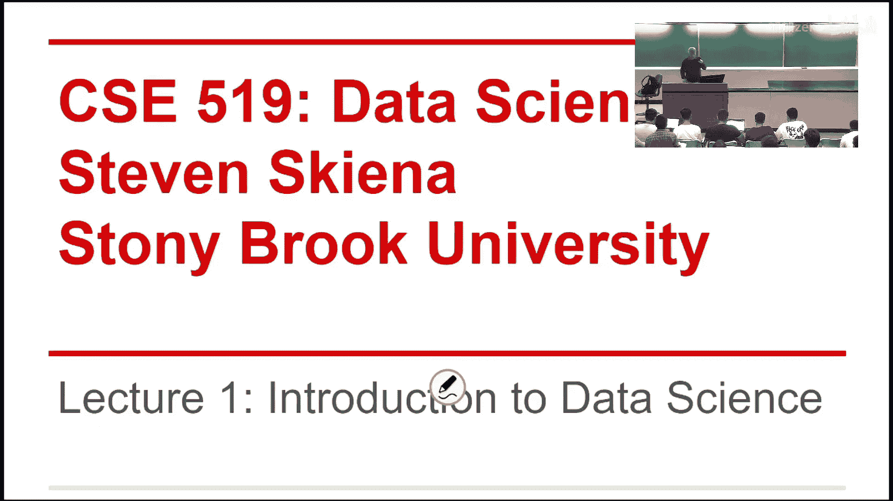
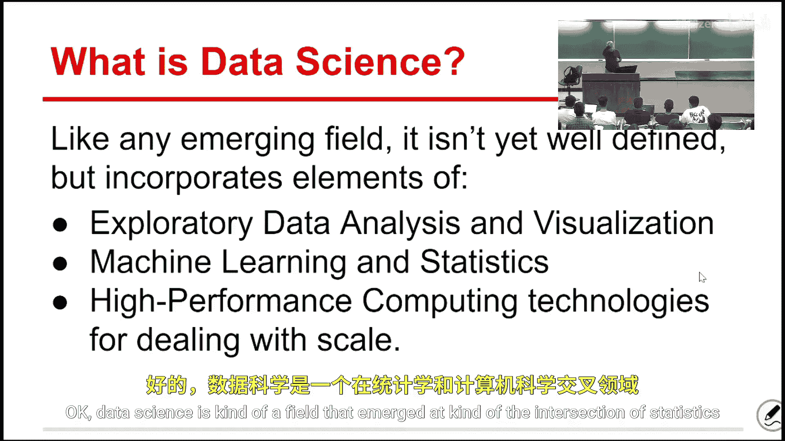

# 纽约石溪大学【中英⚡数据科学｜CSE519 2024 Data Science Fundamentals】 p21 P21 Lecture 1： Introduction To Data Science (Fall 2024) -BV1s7Gaz5ETS_p21-

I'm Steve Skinina， I'm the one that's teaching this course。

 I am sorry I had to miss the first week of classes。

 I hope Saba and my students took care of the place okay， he said， okay。

 any questions about the course administration before we go any further， okay。

 how the course is going to run or anything like that？Okay， I know I went through the what syllabus。

 I've got copies of the syllabus here if anybody hadn't picked one up， but that's the rules there。

Any questions？😡，嗯。First thing， let's say Mahan come down here for a second。

 Okay we now have Ts again， Saba was the first TA we were given。

 we now have four Ts for the semester。 This is Mahan。 Everyone give Mahan a round of applause。Okay。

No。Are you allowed to abuse him when it comes to grade regrade attempts or anything like that。

 And so is no， he will be diligently grading your assignments。

 He will do everything he can to get it right。 If he gets it wrong， we shrug and we move on。

 Is that clear。Okay， fair enough okay， at this point go do your other things Okay。

 you've got other things to do including helping prepare for the quizzes starting next。

Starting today， we are shaping up for the quizzes， so were going to every class there will be a quiz。

😡，Every what you call it， the quiz will start on Wednesday at some time。

And it will be due before clash today。😡，Before class the next day。

 so you come into class you haven't done the quiz yet， the quiz is over， is that clear？😡。

And do you complain if you miss one of the quizzes？

You do not complain if you missed one of the quizzes， the quizzes。

 you have to get done before the class starts。Question， yes。

The quiz is ideally going to be on the previous lecture that is the idea okay the quizzes count for a tiny bit of the question okay if you're doing really well on the quizzes。

 what does it mean it means you've sort of been attending to class it's not a you know the quizzes are not designed to be too much of a challenge。

 they're designed to be something to keep you basically alert with what we're going on as we move through the semester okay rather than people getting to a point where you know the midterm comes and oh what did we study this semester okay that's I guess the goal。

😡，Any questions and of course if you want yeah question。

Thequizzes will be on hopefully the last class， actually in general the last class。

 okay this time I'm hoping that there will be a couple of questions from a quest before。

 but we will see， okay again， the quiz is just designed to keep you alert。

 you know you be a tremendous intellectual challenge。😡，Okay， any questions about that？Okay， now。

The quizz is， one change that I think is happening。

 And I want Mahan to tell me that this is not when I say， if I' what I'm saying is true。

 we may be we are shifting the quizzes to bright space。 Is this true？ Okay。

 so I made a lot of noise about Google Classroom。Okay。

 I still am likely to make you submit your projects and your homeworks through Google Classroom。😡。

The TAs have convinced me that they can handle the quizzes on bright space。Okay。

 so you need to you know， look out。What time will the quiz be available today？I mean， tomorrow。

 it'll be tomorrow at。We don't know， so how do you find out， oh that's a good question。😡，Well。

 one possibility is to look on Brightspace perhaps。

 the other is to look out on Piazza where there will be coursese updates okay。

 so supposedly on Piazza there will be an announcement at some point saying hey。

 the first quiz is ready。😡，And we will assume that that will then be ready at this time every day。

What happens if you go to try to find the quiz and you can't find it， what should you do？😡。

Does anybody have an idea？Email is one possibility， but there's a better possibility。

 can anyone think of a better possibility？😡，Pazza， you email， you get the answer。

 nobody else gets the answer。😡，Okay if everybody emails。

 I or the TAs have to answer 183 emails okay the right answer is we do it on Piazza right so it's perfectly great if it's 601。

 you guys start sending polite but firm messages， I can't find the quiz it's sick after 6 o'clock on Wednesday。

 I can't find the quiz， how do I do this okay， does everybody get that idea。

 that's how we communicate。Yeah again， if you have individual questions。

 I'm delighted to talk to you， but I think that things that are likely of interest to other people。

 Piazza is the right thing， yes。You will expect a quiz Monday， evening， Wednesday evening。

 and you have to do it before the next class。😡，Okay， and just a habit I want people to get into， yes。

I don't believe so， but these quizzes are not intended to be long exercises。😡。

And if you feel you want to try to look up answers on the notes or something that's fine， okay。

 but yes。😡，ないので。I believe I'd like it to be once and done okay the stakes are not so high that if you get a quiz answer wrong。

 it doesn't really matter in the big picture right， quizzes are 5% of your grade。

 they're going to be 25 of them， they're going to be big go of four questions on every you know quiz okay if you get a couple of answers wrong on a quiz or maybe even an answer wrong on every quiz。

 it doesn't matter that much okay。😡，You don't do the quizzes at all， it matters， yes。😡，Howいて。

How long will it take time， I believe it will take。😡，Four to five minutes。Okay， now you know。

 could you do it faster if you answer randomly you could certainly do it faster。

 okay could you do it slower， I'm sure if you put your mind to it。

 you can take more but this is not intended this is intended to be a quick check in。

 it's not intended to be a cognitive exercise。Any questions about that？

Any other questions about the quizzes？Okay， who here is not yet on piazza？😡。

Has not yet signed on to Piazza。😡，Okay first who is not registered for Piazza？😡，Okay。

 all of you better register for the piazza and it's now called Fall 2024 so you want to make sure you're on the right Piazza thing there was some glitch at the beginning。

 okay， I should have closed off the old piazza one。😡，But get on there and prove that you're on there。

 Any questions？O。Any other questions about the course logistics？Next class。

 we're going to give out the first homework assignment， which starts to be a real thing。

 and we'll deal with that then。😡，Okay， anything else。Okay。

 so today I'd like to start talking about data science as I see it。😡。

You know， the啊。Maybe this course this class lecture is going to get more philosophical than other lectures。

 so if you start hearing me drone about my opinions。

 this will be more true here than at other points so don't get too scared。😡。

And I do want people to be asking questions or interacting here。

 this is important the room we're in this year， I know if people like this who likes this classroom。

😡，Who doesn't like this classroom Okay， now I am used to teaching in a big classy fancy classroom Fry hall 104 that is beautiful and it's big and it's you know white walls and stuff like that and I hate that room because the students are very far away。

 it's like it's lecturing to a stadium。Here you guys are in my face and this I like Okay。

 so I want there to be questions， I want there to be interaction in here。 Okay。

 any questions about that。Okay， so what is data science？😡，As I think about data science。

 I think of it as， let me see if I can move this dot someplace。

Is that a better place for the dot good Okay， you know， it's kind of you know。

Data science is kind of a field that emerged at kind of the intersection of。😡。

