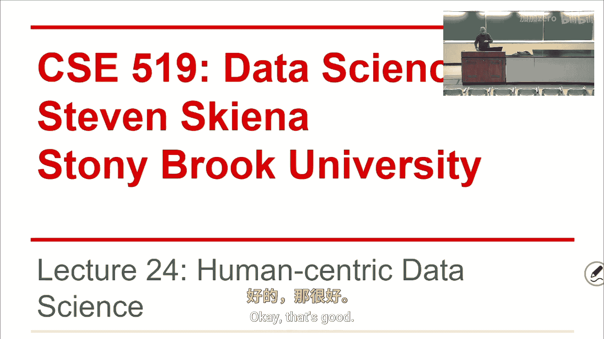
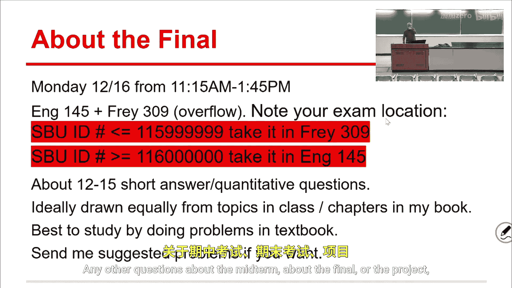
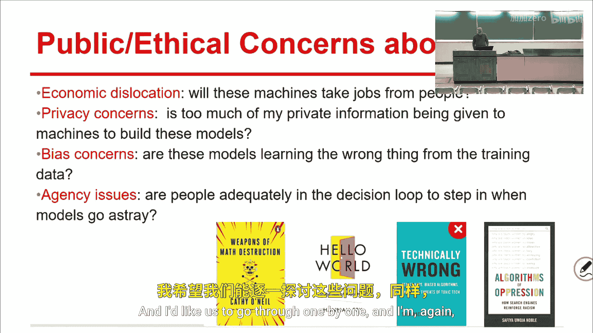
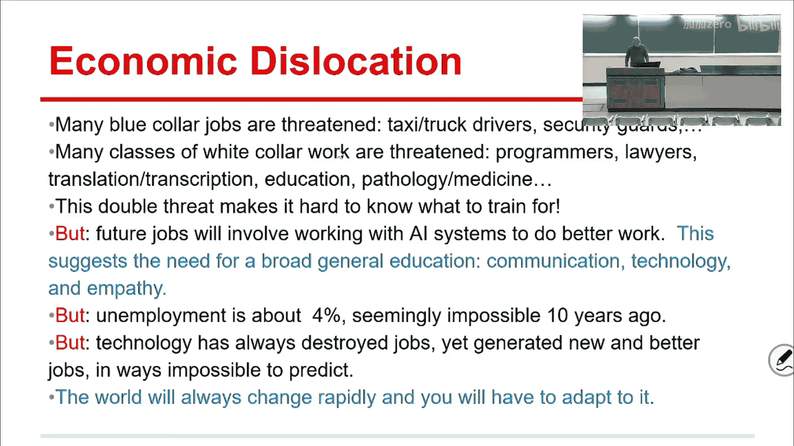

# 纽约石溪大学【中英⚡数据科学｜CSE519 2024 Data Science Fundamentals】 p23 P23 Lecture 24： Human-centric Data Science (Fall 2024) -BV1s7Gaz5ETS_p23-

Okay， let me get started。First thing， I guess the projects are due today。

 any questions about projects or anything like that？Okay。No， okay， that's good。

Okay， if we look ahead。After the projects are due， the next thing in your life is going to be the final exam。

The final exam will be on。A week from Monday。 and it's from 1115 to So it's  two and a half hours starting at 1115。

嗯。I've got the same set of rooms as I had for the midterm。 Now， who took the。

 who took the midterm in。Engineing this room。Was it comfortable enough or was it crowded？

I don't know if it's medicine anybody。Comfortable enough。Okay， who here took the room it in 309？Fry。

 okay， was it comfortable enough。They they。Okay， so that's what I mean by comfortable。 I mean。

 I'm not trying to ask about the quality of the seats。 I'm trying to。It could be one。

Is there anybody else who was in that room？Okay。This I will， this I will keep in mind， okay。And。

 and see what the situation is there。 There's I don't want people in the hall。I I。

 I will I will I will do some double checking。 but this is where the count is。

 And if I need to move some people from f to someplace else。

 I may conceivably walk them back here ahead of sitting in the hall。Okay。

 the the the questions on the exam will be， you know， I will say somewhere in the 12 to 15 range。

It's possible it's 16， it's possible， it's 11 short answer questions。

 again it's probably a multiple of two since I like to put two on each page， you know。

 kind of same kind of short answer and qualitative questions that I had on the midterm。

 I like there to be questions that people have to think about。

 which is what I think I did on the midterm，They're ideally going to be drawn uniformly from the topics in the class。

So the stuff on the midterm will be covered again。 That it's a cumulative type thing。And， you know。

 in an ideal world， there would be one problem that was associated with every chapter in my book。

 Okay， I do think that。Historically， the best way to study for the mid final is by doing problems in the textbook。

 You guys do have a midterm so you can look at that and see what you're doing。

You also have posted on my web page the final exam that I showed you before for the you know。

 when you took the midterm and so from all that， you should have some kind of idea of what kind of things I want to ask。

If you want to know exactly what problem is going to be on the final。

 the best way to do it is to make up a good final exam question and email it to me。

 so if you happen to have ideas for a good final exam question。

 you're welcome to mail it to me and I may or may not use it if you mail me a question I recommend you know the answer。

 okay that's the advantage you get by sending me a problem。Any questions about the final？Okay。

 ask I guess one more time， any questions？You who came in。

 did you were you in 309 fry last time for the midterm or or here。You were in fry。

 Was the room overcrowded and people had to sleep in the hall or。Okay。

 I will see what I do about that if there is somebody， but otherwise the room was okay。Okay。我也跟。Okay。

 there's a chance I we we will make sure that no one is taking it under hot hospital conditions。

 Any other questions about the midterm， about the final or the project or anything like that。

Okay。So what I wanted to talk about for the last class was kind of you know， human type issues in。

 you know， data science。 and of course， these days data science gets conflated with machine learning with machine learning and AI。

And there are a lot of things that you are told to， you know。

 worry about these days about AI in the world。 And I'd like us to talk a little bit。

 So my hope for today is that we'll talk a little bit about kind of。You know， ethical issues and。

 and you know， concerns about AI and machine learning and data science。

 And I'm happy for this to turn into a discussion。😊。

And then I want to spend some time talking about crowdsourcing。

 which is an interesting question of how you take most advantage of human intelligence。 Okay。

 and we'll talk about that。When we get to it。So。Actually， maybe I know it will'll take a quick poll。

 okay。Who here has And be honest， you guys a technologists。

 There's nothing wrong with anything you say。 Who here has concerns about AI and society。Okay。

 I see a few people twitch here does not have any concerns about AI and society。

And I am seeing an equal number of amount of twitching。 Okay， so， you know。

 and which of you is right， Well， come to me in 10 years。 and I'll tell you， but， but it。

 it's worth thinking about what are the concerns that people have。 And there are。You know。

 there's some that are， I think， clearly misguided and there are some that I personally think are maybe on the point and you know。

 it's worth having an opinion and thinking about this a little bit。

So when I think about what the concerns are people have about it， I break them into four categories。

😡，One is this sphere of economic dislocation I the machine going to take my job away， okay。嗯。

There is a privacy some people have privacy concerns how much of my private information and data is going to these machines and do they know too much about me and is that bad？

嗯。A third area of concern tends to be around bias， okay。

 which is the concern that these models might be learning the wrong things about people。😡。

Starting to have models that are making decisions about people。

 if these models are learning to rely on things that are not what we think they should rely on。

 this is bad okay， and that's I put in the general category of bias。

The final area of concern is what you would call agency issues。

 or is the AI going to become you know sentiment and take over the world。

 is it going to go out of control and we're not going to be able to control it when it does something that is wrong？

Okay， so these are the four areas that I think people worry about。

And I'd like us to go through one by one。 And I am， again， happy for this to be a discussion。😊。

Okay， so first of all， actually here's a question， as computer like science like people。

 how many of you are worried about AI taking programming jobs？I'm seeing one person twitching。

 I'm seeing nobody else twitching， who is not worried about AI taking programming jobs。Okay。

4 that's an interesting。 That's interesting， okay， you know。What， what can I say， Okay。

 certainly many blue collar jobs have been threatened by， you know， by， by， you know。

 these new technologies。 If you are a truck driver， are you worried about， you know， kind of。

You know， are you， are you worried about， you know。

 kind of self driving cars and self driving trucks reducing the need for drivers。

You probably should be okay， taxi drivers。 Elon Musk is busy telling us that everybody Tesla is going to turn into a taxi right。

 you know， security guards， you know， if you need as many security guards when you've got a lot of cameras and stuff like that。

White collar things are starting to get， you know， certainly get。Threatened or changed。 Okay。

 I was at a social event recently where I met someone who was。

