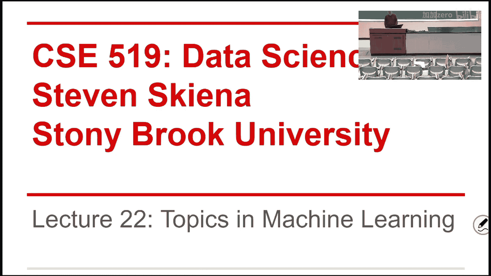
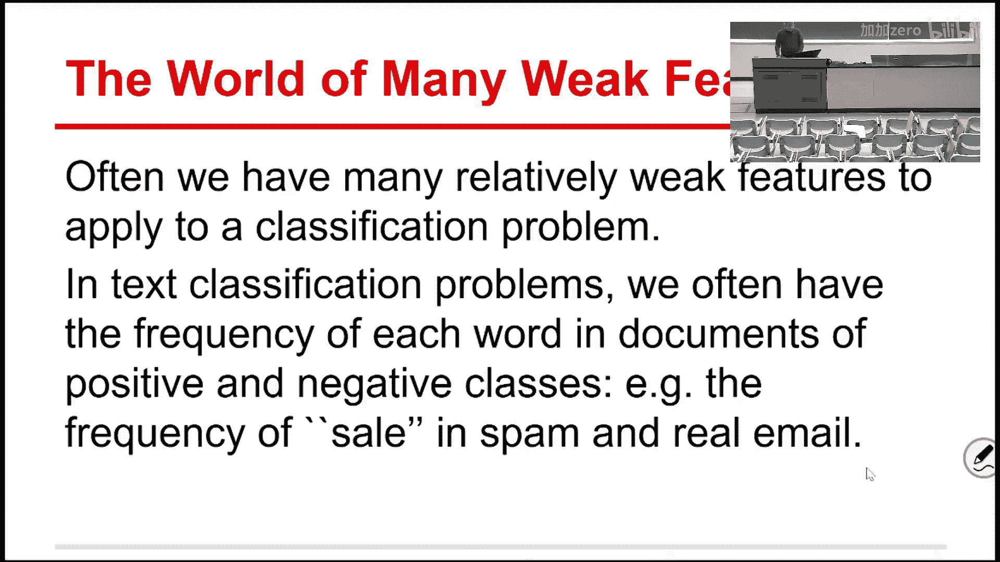
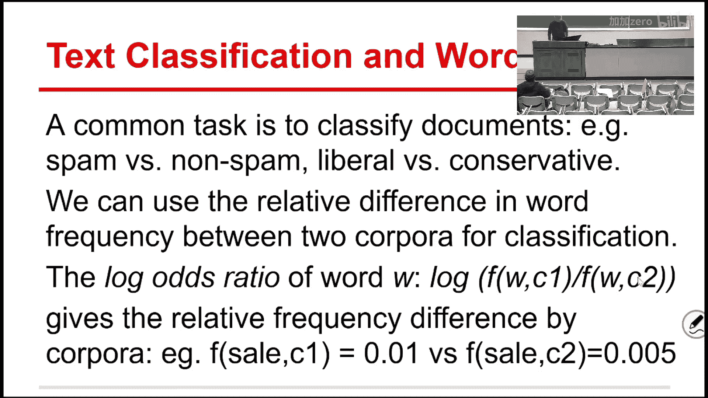
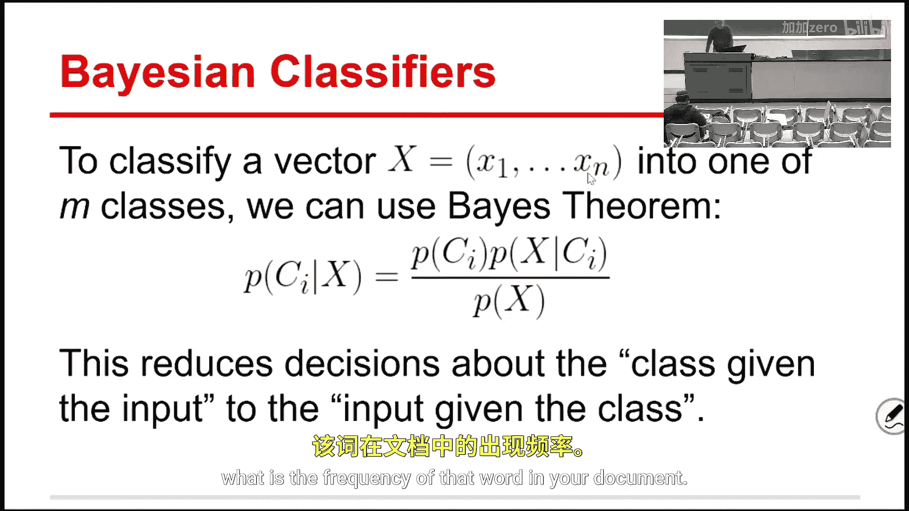

# 纽约石溪大学【中英⚡数据科学｜CSE519 2024 Data Science Fundamentals】 p24 P24 Lecture 22： Topics in Machine Learning (Fall 2024) -BV1s7Gaz5ETS_p24-

Okay， let me get started。 First question is， is there any discussion about projects or anything like that。

If anyone has any questions about projects， I'm happy to talk with you guys at the end of class。Okay。

 what I'd like to。What I'd like to talk about now is the， you know。

 I'd like to continue talking about machine learning methods， okay and。

，You know， last class， we talked about decision trees。

 I'd like to talk about today about naive bays and support vector machines and hope maybe get into neural networks。

 okay。So again， there's different machine learning methods。 They have different。You know。

 different advantages and disadvantages and。Left class we talked about， you know， about boosting。

 about as in the context of decision， we talked about boosting。

 boosting was a technique where you have a this presumption was a lot of weak features， okay。

 that could help us classify， help in a classification problem。But and the question is。

 kind of how do you combine them？And。In a lot of text classification problems。

 what was traditionally the feature given a text document was the frequency of each vocabulary word。

 Okay， often you have documents where you' trying worlds where you're trying to classified documents from positive and negative classes。

 classic example was how do you separate spam from real email Okay。

 and the simplest features that you have when youre trying to do those classifications are words。

 okay。

And。TheThe the basic feature you would like to use for。Classification， when you've got two。

Types of documents。Might be for each word， what is it that is each vocabulary word。

What is its relative frequency in each corra， This is a simple tabulation to get If you have a bunch of documents that are spam and a bunch of documents that are non spam。

You can count how many words there are， how many occurrences of each of the 10。

000 most frequent vocabulary words。How many times they occur in spam。

 how many times they occur in non spam？When you divide that count by the number of words total that are in the spam documents and the number of words total that are in the non spam documents。

You get a rate for each word of frequency。Which is kind of going to be what fraction of all words in the document。

Is this particular vocabulary word？When you have the frequencies of different words， okay。

 in different corpora。You know， you can kind of compare which words are specific to a corpora or not。

So for example， if we were thinking about spam。In a spam thing。

 often they're trying to sell you something。Perhaps1% of all words in a spam corra were the word sale。

😡，Whereas in the nonpan cor， perhaps。Half of that many were sale。The relative frequency here okay。

 governs。 How often is that term being used in that corporatera。 Okay， any questions。

If you believe that， then the log odds ratio of that word gives you a sense as how different the words is how how unusually over or underrepresented the word is in one corpora。

 the frequency in incorporal 1 divided by frequency in corporate 2， Okay。

 by taking the log we take the ratio and it becomes something symmetric， Okay。

 any questions about that。 I will tell you that right now I have a project I'm working on with some people in。

In sociology， where we are analyzing Twitter biographies。 So， you know， you have。You know。

You guys know what Twitter is or was Okay， and you may have known that there were it was a a for a long time。

 it was very easy to get Twitter data off of an API。And you could find out， you know。

 kind of essentially， you would easily get a research could easily get 1% of all the tweets in the world。

 okay。With each tweet， when you called it on the API， you got not only the what you call it。

 the the tweet， the actual contents of the tweet， but you also got the social media biography。

 self description string that the person who was tweeting it gave。

Do you guys know what I mean by this self description thing， you guys。

 when you get on Twitter or when you get on Facebook， you have a short。

 you're allowed to describe yourself。So my sociologist collaborator has。

Got hundreds of millions of self descriptions of people。

And you can start to look at how do people's descriptions change。 Okay， if。

 if you're describing yourself， that tells something about how you see yourself。

If I see your biography over time， I see something about how you've changed。 Okay。

 if I count over all of society， how much do do things change。The other day we were looking at。

We also know from Twitter， people sometimes past put their location on Twitter。

So we know people but what state they were in， some of them， when they posted their stuff。

And we now can look at if you've been following these people for 10 years like we were。

 Some of these people moved， okay。And now we are able to kind of study in these biographies。

For any state， what is different about the people who came into the state from the people who left the state。

 okay。So this is kind of interesting。 You know， you guys， if I'm looking around the room。

 most of you were not born in New York City New York State。

 I I guess all of you were not born in New York State， okay。

So you guys are examples of people who come into this state。 Okay， and there's also people who leave。

 What is the difference， Can you tell anything about the difference of the kind of people that do that。

Well， the natural tool for that is the odds ratio。 Okay。

 we know for every word in Twitter biographies， how often they are appear in states that are in people who arrive in the state。

Okay， and how often they appear in the words that leave this state。 Okay。

 And by looking at this odds ratio， we can start to get some sense of what is different about the people coming in than coming out。

Might there be political things Do people who leave a state， Are they politically。

Express themselves differently than people who arrive in the state relative to the， you know。

 kind of the， the baseline background in the state。One thing we find， of course。

 a lot of the people that move states happen to be students。 That's one thing you see very often。

 One thing that's overrepresented among people who move。

But does everybody see how this statistic is readily and explainable statistic if I look at the word。

 you know， if I look at the phrase Stony Brook， okay。

 is it more among people who are leaving the state or coming into the state？

That will tell you something about the university。 Okay， any questions about that。Okay。

So the odds ratio gives us a feature as to how much a weight as to how important that vocabulary word is。

 you know， as a feature in distinguishuing the classes。The word the probably is not so important。😡。

The word sale in the case of spam， okay， probably is， okay。So under this scheme。

 it's easy to take a document and reduce it to a vector of n dimensions。 Okay。

 where perhaps each dimension will tell me what is the frequency of that word in your document。

