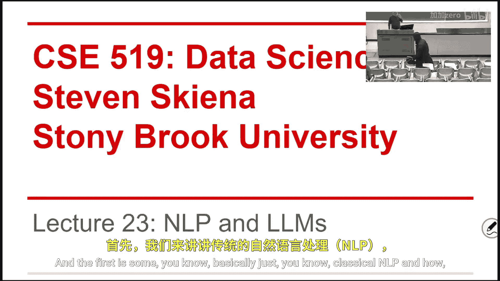
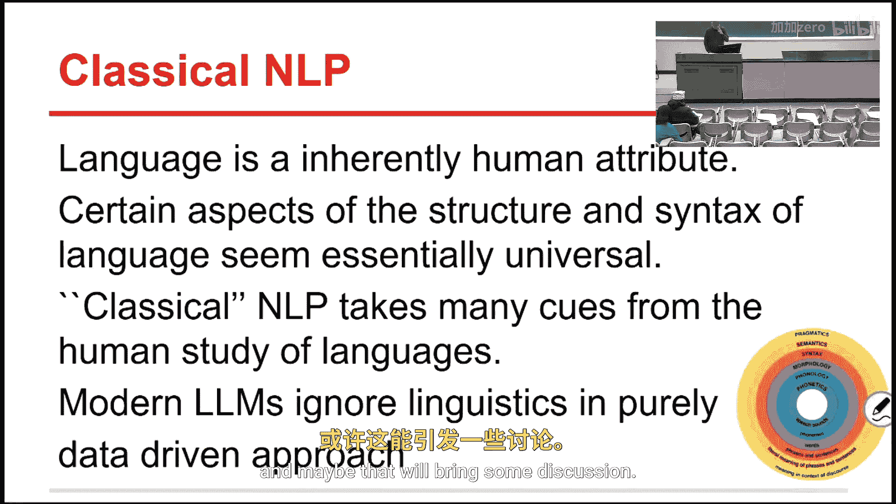
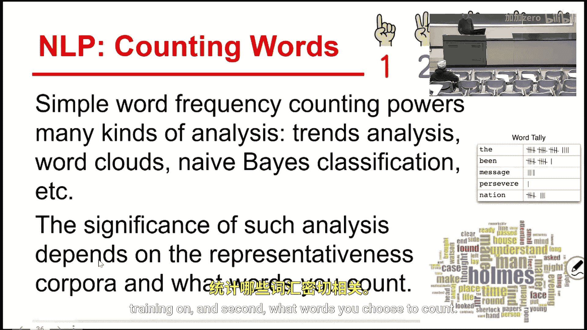
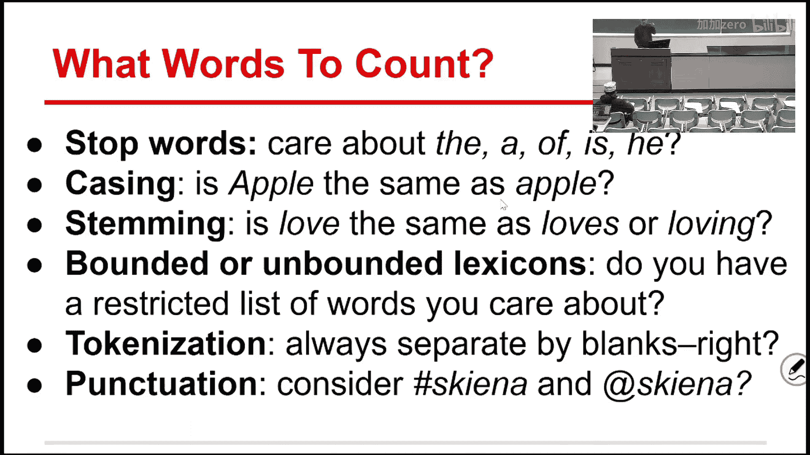
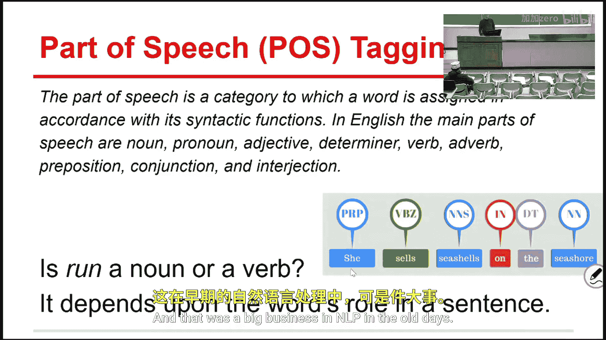
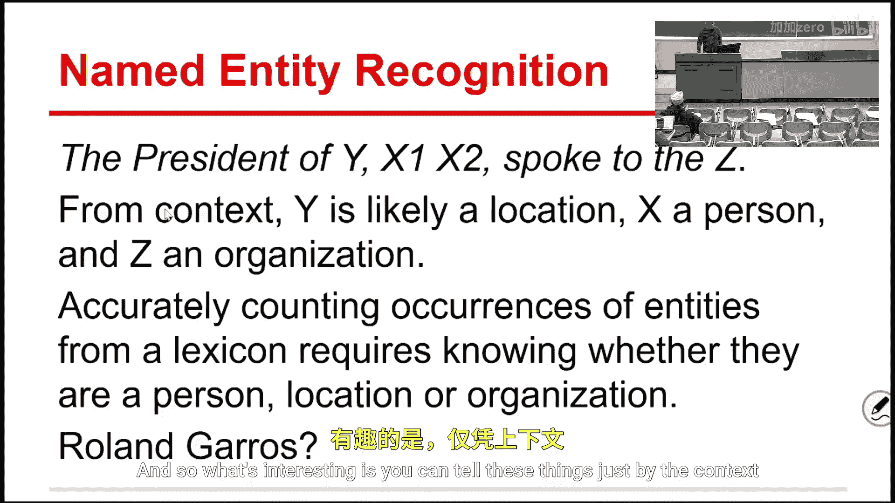

# 纽约石溪大学【中英⚡数据科学｜CSE519 2024 Data Science Fundamentals】 p25 P25 Lecture 23： NLP and LLMs (Fall 2024) -BV1s7Gaz5ETS_p25-

Okay， let me get started。 first， I appreciate the dedication of the people who are here。

 I know it's raining， I know it's before a holiday， I know you're tired。

 but I appreciate the people who are here are there any questions about。The projects。

 So just from if we think of what's on， what's on the table in here， we have our project is due。

 We have。嗯。A week from Thursday。 So any questions or comments about that。Okay。

 if anybody wants to talk about their project afterwards， I am， of course happy to do that。Okay。

 so what I'd like to talk about today is。You know， kind of。It's actually three things today。

 And the first is some， you know， basically just。

You know， classical NLP and how we we， you know， how people you， you know。

 have used text for as data。And this is something that has changed wildly in my lifetime。

 I have been。You know， publishing papers and NLP conferences for 20 years and。Its。You know。

 kind of a me。What an LP meant 20 years ago involved a lot of things that are based on kind of classical linguistics and stuff like that that has been thrown out in today's models。

My goal is to quickly go over some of the things I think are still useful from classical NLP。

Then I'd like to talk about the models of today， particularly some idea of how transformers work。

 which are。 And then I'd like to talk about。Kind of what data science means after in。

 in a world of these these large language models， because I think we live in a world where everything is changing。

 And I wanted to think a little bit about what how things are or not changing and maybe that will bring some discussion。

But at the start， when we think about what NLP was， you know，20 years ago when I started， Okay。

 a lot of it was about basically counting words。 Okay， and counting words is still a good thing。

 Okay， in many ways， okay。When I got it started in NLP。

 we had a system for doing sentiment analysis that became actually pretty well known。

Started a company even。 And basically， all it was about was counting words。

 How often were things being mentioned and were they being mentioned in the prospect of positive or negative words。

So there are many things that people still use word counting for。 Okay。

 we talked about naive base classification last time。That's a word counting thing。

 How often the words appear in each corpus。I know everybody has seen these word clouds。

 which people love。 Okay， it seems。 What are these word clouds。

 These word clouds are taking a document and kind of breaking the you know。

 basically representing each each word proportional somehow to the frequency that it's being used。

 Okay and this is， you know， kind of a useful way to tell the difference between， you know。

 in sort of understand quickly the difference between two different corpora。 Okay。

 this is about word counting。 Okay， and word counting works how well it works depends upon first of all。

 how meaningful your corpora is that you're training on。

And second， what words you choose to count。Okay。So。When you look at words， okay， when。

 and you're going to build some system that's going to try to count words。 Okay。

 you have certain decisions to make。You have to decide whether big Apple is the same as little Apple。

ok。You know， you know， you have to decide whether you care about so called stop words。

 which are words that occur very often that that that don't that are typically the same。

Frequency in pretty much all text corpora。You have to worry about whether you care about the transformations of a word。

You know， is a word is is apples the same thing as Apple。I think that， you know。

 if you're counting the meaning of something， I think these days we'd say that capital Apple is different than little Apple。

But maybe little apple and little apples are about the same thing。

There's a technique called stemming。That will try to take all words and different， you know。

 different flavors of words。 Okay， transformations of words。 the morphology people apply to the。

 you know， the language applies to a word and get it down to the same stem。Often。

 it's better to count the same stem rather than all the the the different variants。Just because。

 you know， it gives you a smaller number of features， okay， although， of course。

 you lose some level of meaning。嗯。There is a big question when you're trying to count words。

 whether or not how you separate the text into words。Okay。

 usually people separate words according to whether they are separated by blanks。

But there's some punctuation between words like we have here blank dash right， these are two words。

 and you would want to take a think about them。And thinking about how you deal with punctuation makes a difference。

 Okay， if you ignore punctuation completely。You know。Haashtag Sa is the same as at Skina， okay。

You know， depending upon what these are the kind of design decisions you have to worry when you count。

 Okay， any questions。

The other， another classical part of of NLP was trying to determine what the sense of a word was。

 Okay， word certain words occupy particular meanings in a sentence， roles in a sentence。 Okay。

 when you took English grammar。 You learned about nouns。 You learned about adjectives。

You learned about Jads。 Okay， those were the I N G words， okay， and。Part of speech tagging， okay。

 was kind of the goal of giving a sentence， trying to figure out what role the word played in a sentence。

 okay？And this is kind of the crude crudest form of parsing that you can do。 Okay。

 but still proves to be useful。Certain words are， you know。

 a priori confused by whether they are a noun or a verb。 okay， the 1 I always use for some reason。

 is run。 Okay， run is a verb。 when I tell you， you know， okay。You know， you know。

 go run and get somebody。Sometimes it's a noun。 People go for a run， okay， or stockings。

 which people used to wear had runs in them。 Okay， and so one part of counting was often trying to figure out the roles of the words in a sentence and that was。

 you know， that was a big business in NLP in the old days。

The other part of NLP that was important in the old days was named and still is actually。

 named entity recognition。Given a sentence， okay， you would like to try to figure out what are the people。

 places and things in a sentence。So in his sentence， the president of why。X1 x2 spoke to the Z。Whi。

Which is a location？In this sentence， okay， the president of why。X1， x2 spoke to the Z。O。It。

 it seems clear to me that why is likely to be a location， a country。Or maybe an organization， right？

X1， x2。Is going to be the name of the guy， right？And so what's interesting is you can tell these things just by the context and structure of what。

