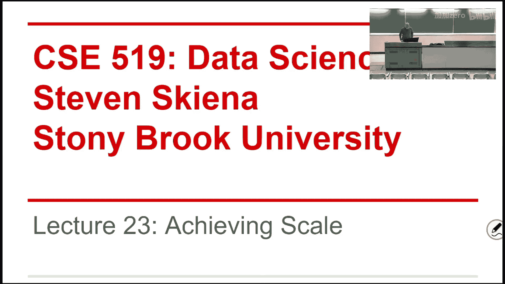
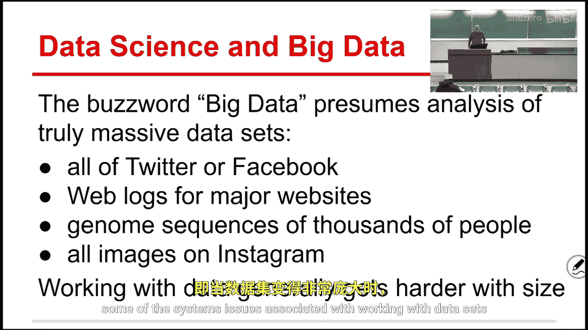
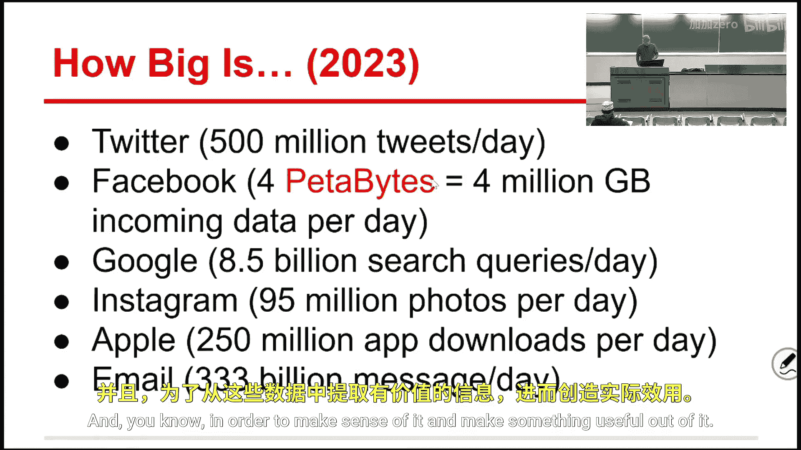
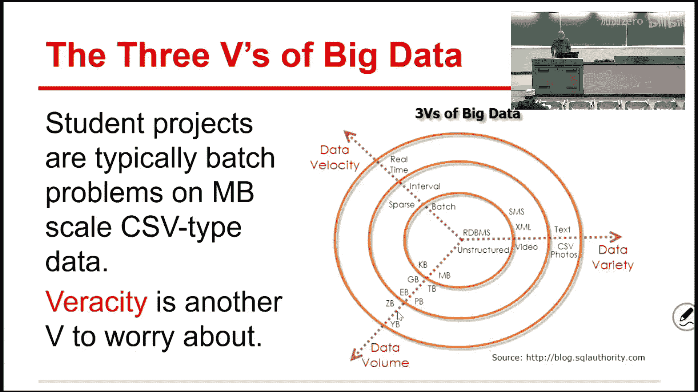
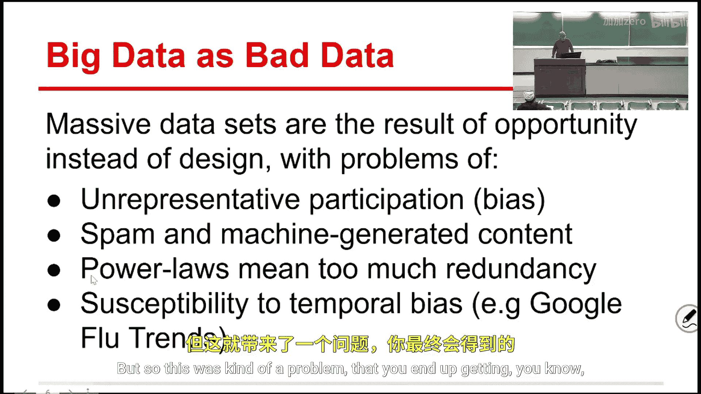

# 纽约石溪大学【中英⚡数据科学｜CSE519 2024 Data Science Fundamentals】 p26 P26 Lecture 23： Achieving Scale (Fall 2024) -BV1s7Gaz5ETS_p26-

Okay， let's， I guess， get started。 First thing， of course， the project is due on Thursday。

Any questions about the project or anything like that。Okay， next flash。

 I'll talk about the final and， you know， and， and what will go from there。Okay， any questions。Okay。

 so what I'd like to talk about today is it， it's funny。 You know， when you。

 when you start to prepare， you know， again， I've been teaching this course for about。

You know，15 years now。 And at the beginning， you know， first of all。

 data science was a big hot buzzword， Okay， which is less so today。 I know now today。

 machine learning is the buzzword that's sort of eaten some of its lunch。And big data was a buzzword。

 Okay， you know， kind of， you know， that that it had kind of suddenly been realized that that you could do analysis of all of Twitter。

 You could do analysis of the entire web。 You could look at all the images on huge corporatera。 Okay。

 and what was exciting about kind of the big data time was kind of this realization that。😊，That。

 you know， that， that there were all these possibilities because there was a lot of， you know， there。

 there， there was data that you could work with。In general， working with data gets harder with size。

And， you know， what I'd like to talk about today is some of the issues about working with large data。

 you know， larger data sets and。As I was preparing this time。

 I kind of realized that when people think of computational bottlenecks these days， it's always。

 I think， in terms of how much GPus there are， that GPSUs are what is defining the computational bottleneck on things。

But in a lot of applications， it's just simply still the volume of data for still doing things that are counting。

 that are collecting， that are removing duplicates， that are doing a lot of other things。

And this is kind of the aspect of data of data science that I'd like to talk about today。

 Some of the systems issues associated with working with data sets when they get very large。

So what does very large mean？Well， you know， there are all these， you know。

 you can gather statistics and they're always out of date when， you know， when， you know。

 when we were， you know， the the moment there' out。

But the latest statistics that I found were something like Twitter。Had 4。

500 million tweets a day at that point。Now， maybe that attackss action and everybody's gone the blue sky that's gone down。

 but that's still a lot， okay。Facebook supposedly faces4 petabyte of incoming data per day。

That's presumably new posts， and that's new images。

 And that's what you clicked on and all this kind of stuff。Google was processing， you know。

 order of 10 billion queries a day。 Okay， so if you're going to be working at one of these companies。

 somebody's job has got to be about the management of this， this kind of data。 and， and， you know。

 you know， in order to make sense of it and make make something useful out of it。

嗯。When， when， when people were talking about big data， okay， they， they sort of broke data in。

 you know， kind of。Ded it along three different kinds of axes。 Okay， one axis was。

 how often were you gonna be dealing with the data。 Okay。

 there is real time applications where you've got to be dealing with a a， you know。

 you've got to be dealing with a customer in the next， you know， next millisecond。

Down the times when you're doing jobs that are basically batch jobs that happen once a day。

 once an hour， something like that。The data that you got on， you know， what you call it big。

 you know， when in， in many cases of what we think of as big data， typically web type stuff。

You tend to have a lot of variety okay， at the low end of variety are things like databases。

 databases， everything is a column， everything is probably a number or a text thing。

Up to kind of full social media things。 You've got video， you've got text。

 You've got a lot of other things to deal with。 Okay， and that changes your thinking。

And the other V was a question of volume。 Okay， that data sets come from the sizes of， you know。

 I will say， you know， megabytes all the way up to we said， what you call it。

 Facebook gets4 petabytes a day。 that means that maybe they're up to likezeabtes of storage in house。

 Okay， and stuff like that。 Okay， so， so different problems have different， you know， you know。

The， you know， the， the aspect of what goes into them is quite different。嗯。Now。

Once I was talking to somebody， you know， an algorithms person， I know。 Okay， about big data。 And he。

 he said big data is bad data。 And this， this kind of， I thought， was interesting idea。

So what happens， where do big data sets come from， they tend to be collected by opportunity。

 The reason you know Facebook collects four petabytes of data is not so much that they want to collect so so much data。

 it's that they have so many users and the users want to do things。😡。

So when you're analyzing the data that's found from， you know， from many， many applications， okay。

 it's usually the data gets got constructed as a result of opportunity。Instead of design， Okay。

 if you really wanted to know something， ideally， in the old days。

 you would construct a specific technique to get exactly the data that you wanted。Typically。

 data analysis in these big companies is about analyzing the data that you have。

And there are various things that that are problems when it comes to looking at data sets that get built by every all the tweets on Twitter。

 Okay， all the， you know， all the posts on Facebook。

One thing is that if you want to interpret it over a broad population。The， you know。

 you're not dealing with all the people in the world when you're looking at tweet。

 you're looking at all the people who are on Twitter。

And this is going to be a biased population there， you know， there you know。

 obviously everybody's got to be somewhat literate on on Twitter。 Okay， obviously， you know， so。

 so you get a bias based on， you know， who's participating。

You have to separate out the spam and machine generated content。 Okay， again。

 we had a company that analyzed Twitter data for a while。

 So that's why I guess this is the example that I kind of meant。

 We were trying to figure out what were the feelings about people towards products by how they were talking on Twitter at that point。

And of course， we were limited to the kind of people who posted on Twitter。

We had to deal with spam and machine generated content。 Okay， these so-called bots， okay。

 and a large fraction of what you would see on a， you know， you know。

 on a site these days is machine generated。 And now AI generated is a different kind of a problem because those are。

 you know， in some sense， machine generated， but harder to separate from you know， human posts。

ThereThere is a problem that with all text， there is of our law。

 associated with it and with almost everything in the world that you have。

 if you look at how much people post on Twitter，There will be a large number of people who boast nothing。

 There will be a small number of people who seemingly do nothing but post on Twitter all day。 And。

 you know， you end up getting。Strange amounts of redundancy。 Okay， like again。

 we were interested in using Twitter to analyze what what people were saying about companies。 Okay。

 and how much do you think people say on Twitter about， let's say， Apple products。

I think that's something you'll agree that people say a lot of。Now。

 one customer we were trying to get was an airplane engine manufacturer。

 He wanted to know what people were talking about his airplane engines on Twitter and how much would we think people were talking about airplane engines if you had a crash。

 they would be talking about it right， but so this was kind of a problem that you end up getting you know。

