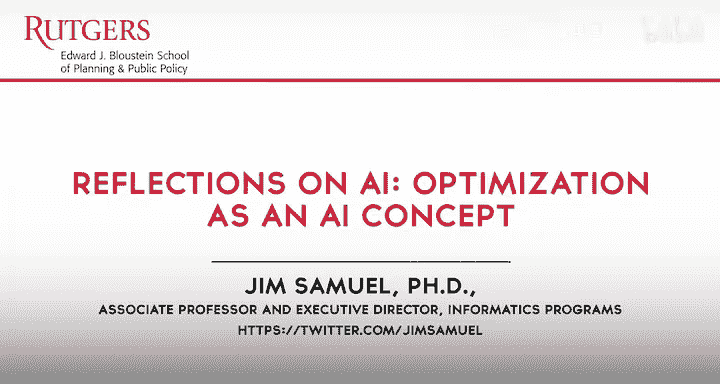
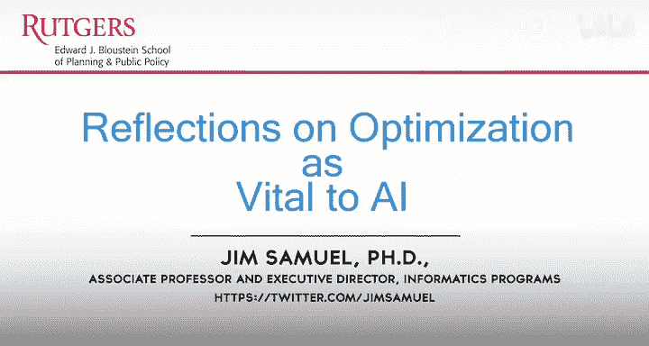

# 罗格斯大学《AI概念和策略｜AI Concepts and Strategy》中英字幕 - P10：9_反思.zh_en - GPT中英字幕课程资源 - BV1nZjCznE7k

Hello and welcome to today's session on artificial intelligenceence and overview of critical principles and strategy。

 Our focus for today's session is going to be on understanding the concept of optimization in AI or loosely worded as AI optimality。

There are two questions that I want you to reflect on， I'm not going to teach you optimization。

 it's going to be a discussion on the use of optimization and the importance of optimization。

 but conceptually just to reflect on and recall all that you may have studied in your undergraduate classes or in your graduate or doctoral program as to what is optimization。

Generally， conceptually， optimization is。Any process that you use so that you get the best possible results。

Within a given set of boundaries or constraints by。

Taking decisions on a certain set of variables that are involved。

Such that you get the best results possible。That's I know that's abstract。

 but let's look at an example， so you may have a factory where your goal is to minimize wastage。

So you are， you want to maximize the output based on a certain quantity of resources。

 So in that case， the quantity of resources becomes your。Constraint。Some other parameters。

 such as the number of hours that you can run the machines for are a cost limit。

 Those become other constraints。 You also have certain assumptions about。

Certain things such as there's no friction， especially in an academic setting。

 or in a theoretical setting， you don't consider real world friction like。

Somebody falls ill or if some of the wood that you're using to manufacture furniture turned out to be bad。

 we don't do that when we say that there there is， let's say 1000 cubic foot of wood。

 we assume that those that 1000 cubic foot of wood is good to go within the specifications that's provided in the problem so if you were to run optimization you get the maximum number of chairs and let's assume that you are able for that particular design you are able to manufacture 3500 chairs。

If。If the process has been correctly optimized， that means that is the maximum。

 Any other process is either going to lead to less than 300。

3500 chairs being manufactured or it's going to be exactly 3500， which means if you have optimized。

A particular scenario， and and you' have optimized it correctly， you get the best possible output。

Any alternative process will be inferior or at best。

There is an alternate path to the same optimized result。

So optimization is very powerful if you are a business manager。

 you can maximize your profits in a given scenario where everything else remains constant。No other。

Decis or no other manager can beat you if you have optimized correctly。

 you can maximize your profit and that's the best result possible。If you're an engineer。

 you can optimize and get the best engineering results possible if you're a financial manager and you are doing some kind of a risk reward optimization。

 the results that you use when you get optimization technology that is the very best you cannot beat it。

 you can match it using alternative methods， but if currently optimized you have the best result possible and so optimization is powerful。

 it is a process。Usually mathematical， but you could also optimize conceptually。

 So it's a process whereby you use certain technologies。

 certain mathematical models that leads to the best results possible。 Next question。

 is optimization always good。 So over the past few minutes， we have glorified optimization。 You know。

 you could optimization using a variety of algorithms， linear non nonlinear network network。

 you could run different kinds of models such as network optimization or optimization。

 which uses binary input into the models， So on and so forth。 it's very interesting。

 It's a rich domain。 and you can apply it to supply chain operations management。

 you can apply it to finance。 It's fantastic。 Then is optimization always good。😊，It depends。

Optimization leads to the best or the most effective results possible。

 whether it's whether optimization is always good or not， it depends on the scenario。

 but it's a good part for you to hold in your mind， which means。Mathematically。

 it may lead to the best results possible， but practically is it always good if you are talking about human relationships。

It's a fine example where optimal results may not always be the best。

 so if a person wants to achieve strategic objectives。

 sometimes you may not want to use the optimal results when you are giving advice to your spouse sometimes a less optimal response where you are more sensitive to the mood and to the sentiment of the person that might be the better way to go。

 but if it's a factory scenario， if it's a scenario where you just want the number to be the best number possible。

 then optimization is always the best way to go。Just a quick note on sensitivity analysis just to set the stage for optimization。

 So when we speak about artificial intelligence as an application or as a cluster of technologies or as a cluster of models。

 there's always going to be。An input that goes into a model structure。

 whether it's machine learning or whether it's some other structure that you're using。

 it goes that there's data that's fed into the model and then it leads to an optimal solution whereby you have some kind of mechanism to that leads to the selection of the best results possible。

When we speak about analyzing this process so that we can improve upon it。

 maybe by expanding the constraints based on a cost benefit analysis or some such of the process。

 then we are talking about measuring changes in the model input。

It goes through the model structure as before， and then you analyze what is the effect upon the optimal solution。

 Sometimes changes in the model input or the model itself may have no effect on the optimal solution。

 Sometimes it's going to be counterproductive and sometimes it's going to be beneficial。

So when we speak about getting optimal solutions。This analysis of how sensitive your AI system is to the input and to changes in the input and to changes in any component of the system is very important。

So with this introduction， let's go to the main slide for today's session， which kind of summarizes。

My view or how I like to informally look at。The role of optimization in artificial intelligence applications。

So some components are generic， I would not use。This is I want to give you a heads up that this is a communication。

Slide， this is not a slide that I would use for research it's been drafted quickly。

 it's supposed to be it's supposed to help communicate my thoughts to my audience for the session it's not something that I would use for theoretical proof or in a research paper so just want to provide that as a backdrop before I proceed with my comments and explanation of what you see on the slide。

So。When we speak， when we talk about AI and in my conversation with students and with industry professionals。

 the moment I say AI， and if I ask them is what do you mean by AI。

 sooner or later very quickly within the first few sentences。

 the phrase that almost always comes up is off late is machine learning or some kind of some kind of artificial learning process。

And very， very few people mentioned the word optimization。 I would argue that。

The only reason why machine learning is successful in the use of AI applications or AI system to solve scale problems。

 large scale problems is because of the optimization component。In fact。

 even if you did not use a whole lot of machine learning。

 but you had shortcuts to apply optimization， it's quite possible that some of the problems could be solved by just focusing on developing good optimization models even without machine learning I'm not saying that's going to work for all scenarios。

 but in some scenarios it's just going to be possible。

 The reason I say that is I want to bring optimization to the forefront。

 I want to bring the knowledge and the emphasis of emphasis on optimization to the forefront in the study of artificial intelligence Currently there seems to be a huge overemphas on machine learning。

That is good， but the absence， that's probably good。

 but the absence of a similar emphasis on studying， applying。

 understanding and improving optimization that is the concerning aspect so here is a view what you see on this slide is a view of artificial intelligence where today's artificial intelligences are driven by big data。

O late， there's also been a trend towards smart data because the argument is， okay。

 we we're fine with big data， but we're also observing that in certain scenarios。

 not in all scenarios， in certain scenarios。Using smaller quantities of data。Is leading to。

neearly the same results as with using big data then why do we need to use all these extreme and expensive computational capabilities and why do we need to spend so much computational power on processing big data if we can get similar results with smart data so theres there's this tug going on currently between big data and smart data in some domains it's very difficult to identify the smart data so we still have a need to process big data and I think it's going to remain that way but in some domains and in some settings it may be possible to reduce the equiocality in big data and to extract subsets of data which are of a higher quality and therefore can serve as smart data and iterations of that that one plus one is to n plus iteration so if you're feeding it into a machine in some frequency。

We are talking about the first iteration， it goes through the model。

 whether it's a natural language processing or computer vision or prediction or some some such other model。

 maybe reinforcement learning or other AI models， it goes through the model it leads to an optimal solution which means there is an opt mechanism which selects the best possible the variables that leads to the best possible outcomes and then the optimal solution is presented to the human intelligence either the solution as a recommendation or the benefits of the solution applied through the system and HI receives the benefit of the output now based either based on that or directly through the optimal solution if it's an autonomous system either directly it leads to performance or through human intelligence it leads to performance and that performance is then recorded and then it becomes。

s part of the data feed that goes into big data。And then we have the next iteration。

 which again goes through the cycle whereby the big data goes to the models from the models to the optimal solution。

 it either interacts with H or directly leads to a performance measure。

 and then it goes back and becomes part of the data input and this cycle keeps continuing。

The quality or the duration of these cycles will be impacted by the nature of the optimization methods we use。

 the better our optimization methods are， the better the performance will be and the faster there will be an overall convergence。

In the machine learning or deep learning， our artificially intelligent learning process。

To the best possible macro level solutions。So the general idea is in an AI system of the nature that is conceptualized on this slide。

 you have optimization happening within each iteration and then as you go through the NR M optimal solutions。

 the optimal solutions themselves are expected to improve with better data。

And then that itself leads to an overall macro level optimization。

