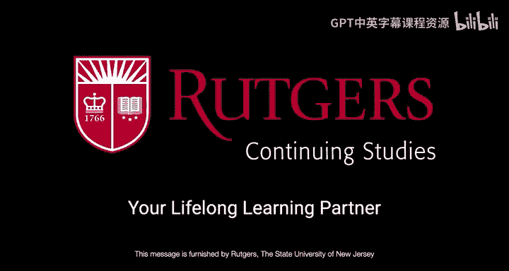

# 罗格斯大学《AI概念和策略｜AI Concepts and Strategy》中英字幕 - P11：10_AI对人类智能的最优性.zh_en - GPT中英字幕课程资源 - BV1nZjCznE7k

So the general idea is in an AI system of the nature that is conceptualized on this slide。

 you have optimization happening within each iteration and then as you go through the N or M optimal solutions。

 the optimal solutions themselves are expected to improve with better data。

And then that itself leads to an overall macro level optimization。So this will work conceptually。

 This will work with。Both autonomous systems， whereby artificial intelligences are performing on their own。

 It will also work very well where artificial intelligences are interacting with human intelligence。

 And that's an AI to H interaction scenario through some kind of a graphic user interface。

And the graphic user interface itself will also impact the perception that human intelligence has of the information or derivatives of the information or output from the model。

This in some senses， this is a great summary of how optimization is baked in both at the micro level within each iteration and also on the overall level。

 how a machine learning process through multiple iterations， irrespective of the model。

 whether it's NLP computer vision reinforcement learning or some such other AI learning model， how。

It。😔，Leads to an optimal solution on a macro level。Now。

 especially where human intelligence is involved because of the fuzziness of certain variables。

 because of our current in the future， it may change。

 but because of our current inabilities to measure certain expressions of the output of human intelligence。

 it is possible that。We may not be able to claim deterministically that there is an optimal result。

 so we the better language would be to say that when we are when human intelligence is involved in such a process where our goal is to achieve optimal results or optimality。

 the better thing to say would be，These models or these artificial intelligences are tending towards。

Optimmal results are tending towards optimality or we are achieving AI optimality in the context of interaction with human intelligences so it it's a trend are we are constantly in the process of getting there we are constantly improving as more data comes in and this is a this is actually and extract from one of our recent research papers called adaptapive cognitivetive fit artificial intelligence augmented management of information facets and representations。

 It's forthcoming in the International Journal of Information management and and we are quite excited with the implications of this study。

呃，我。And the reason is because we have done a lot of research and regularly produce research output。

 especially on the applied side， but this is very interesting because it conscious or it kind of represents theoretical breakthroughs。

A classical idea of cognitive fit is that for certain tasks。

 human beings need certain kinds of information display， so to perform a certain task A。

 you might the best possible representation is information representation type A。

 but for another task information representation type B might be the better mechanism to use。

So there is a change in task involved and the focus is only on information representation in adaptive cognitive fit。

 our goal was to see if we could use artificial intelligence in this process such that AI supports an augment。

 human intelligence and therefore human performance。And we did this。With vote， number one。

Theoretically or conceptually you can keep you can vary the task。

 you can look at two different tasks or number two。

 we can keep the task constant in our experiment we kept the task constant because you keep the task constant。

 then it's easy to vary it and extend the implications and findings to different task also。

 but what we demonstrated with a single task the same task was that if the associated information facet。

 that is the nature of the information that comes in if the latent nature。

Changes such as from high equiocality to low equiocity are for high complexity to low complexity。

 then that by itself。Has consequential implications for the information representation。

What this discovery does is it enables us to generate a better and more optimal system for augmenting human performance。

 So what you see in the lower figure and that's the central figure。

 the larger figure is that the ACF model， the adaptive cognitive fit model。

Accommodates changes in information facets。It accommodates changes in information representations and the task can be kept constant or we have an option to vary in which case you could study both separately and also if there's an interaction between certain kinds of tasks and then all of this impact human intelligence which impacts performance and once correctly modeled you can place an optimization process at the correct point in this process as explained in our paper and that will lead over a period of time to optimal results。

Thank you for listening to the session and the concluding comment is optimization is at the heart of artificial intelligences。

So it is very important for every student of artificial intelligence。

 every manager and every leader who studies artificial intelligence and who plans are intents to deploy artificial intelligence。

 even if you're not a manager or a leader， but you're just every person on the planet every person who exists every person who has a cell phone or or are using electronic devices。

 you are interacting with artificial intelligences and it's very important for you to understand the foundational concepts of optimization now if you're in the domain and if you're developing or if you're working with one of these areas that we have just been talking about。

 then of course you would get into the math of optimization which can be quite daunting but for the others even understanding optimization conceptually understanding and recognizing that optimization is extensively used by artificial intelligences to accomplish the purposes。

 then I think that knowledge would be very useful so I wish all of you the best as you go through。

This journey of studying artificial intelligence and hopefully I will see you in some future sessions as well。

 Thank you。

