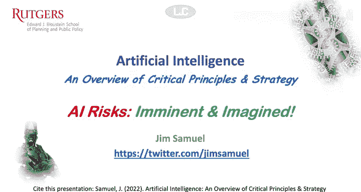
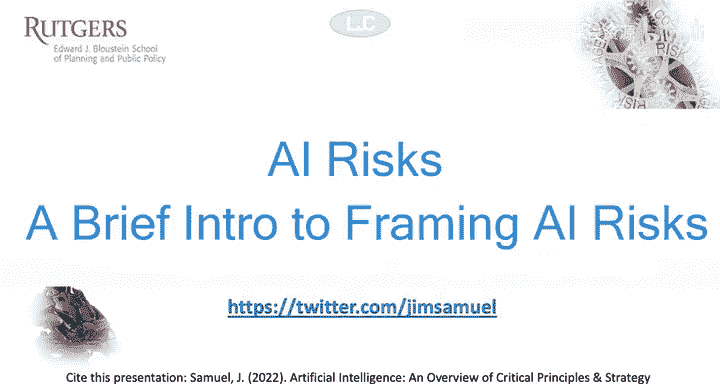

# 罗格斯大学《AI概念和策略｜AI Concepts and Strategy》中英字幕 - P12：11_AI风险框架简介.zh_en - GPT中英字幕课程资源 - BV1nZjCznE7k

Hello and welcome to artificial intelligence and overview of critical principles and strategy。

 Our session today is on AI Ri， imminent and imagined。

Needless to say， of course， our focus will remain on the imminent risks。

 but it's going to be fun to also just briefly look at the imaginary AI risks that people feel and perceive。

 but do not exist the idea is to give a brief managerial perspective It's for leaders it's for managers it's for those who are managing AIs managing environments in which you have to use AI applications so on and so forth It's non-exhausive in the sense that we will skim along some of the main overarching concepts of AI risks it's research driven so some of these conceptualizations or original conceptualizations based on the research that we have been doing on AI and human intelligence interactions After going through systematic risks related to specific AI applications and systems and systemic risks which speaks about。

Global or a very， very broad level of AI failures or NAI risks we'll also talk about the need to look at risks from a domain perspectives so you have AI risks that could apply to individuals AI risks that could apply to businesses organizations at the government level on and so forth and then finally a few concluding thoughts in terms of how do we move ahead。

 how do we tackle this area of AI risk going ahead especially given that there's so much of concern surrounding this topic。

Artificial intelligence is the mimicking of human intelligence so when we speak about artificial intelligence we are speaking about a technology or a cluster of technologies which mimic human intelligence namely cognition and logic so by by the technology or the cluster of technologies mimicking human intelligence specifically cognition。

 we mean that we could have an artificial intelligence for example。

 a form of computer vision which is able to see just like the human eye see is just like human vision。

 not exactly the same our ability to perceive is different from a machine or an AI's ability to see but yet it is a mimicking of the human function of sight So also we can have AIs which are able to listen and to speak。

Then we have the idea of artificial intelligences which mimic human logic and this can be very easily grasped when you think about artificial intelligences in gaming。

 so for example， artificial intelligence is able to play chess and some of the top level AI driven chess programs are able to defeat the best of human grandmas。

Chess is not to be a game of logic。 So what this means is that we have been able to create artificial intelligences。

 which are better at logical functions， which are better at implementing logic than the best of human intelligences。

 But when we speak about games， a game like chess or a game like go。

 We are speaking about something that is very well defined and very well structured。

 In the case of chess as a board with 64 squares。 There are 16 white pieces，16 black pieces。

 The movements of each of those pieces is extremely well defined and the final goal is also very well defined in terms of who wins the game and how。

 And therefore， it is。😊，Not fuzzy when it comes to logic in the context of probabilistic scenarios。

 in the context of fuzzy and changing scenarios without defined boundaries。

 then artificial intelligences would face some challenges。 So when we speak about AI risks。

 we are talking about artificial intelligences， both from the perspective of AIs that are able to mimic human cognitive functions。

 the risks associated with that， as well as AIs which are able to mimic human logic functions in complex scenarios and the risks associated with that。

 artificial intelligence is rapidly changing。 There's also a lot of variation in the AI。

Policy environment， by that， we mean that governments all around the world are developing policies to manage AIs。

 These policies will force corporations to design AIs with certain limitations。

 certain controls and certain protocols in place， so to say now we do not know how what impact those policies will have upon As。

Generally speaking， in case of regular technologies which are better understood than artificial intelligence technologies。

 strong policies would help reduce risk in case of artificial intelligence because of the complexity of the technologies is involved。

 it is not yet clear as to what the impact of increasing and varying policies would be upon the technology of artificial intelligence or the technologies associated with artificial intelligences。

 Another point that I'd like to touch upon when kind of providing this introductory thought that managing AI risks is elusive is the fact that artificial intelligence is probably by far。

The most。Complex kind of technology that will be interacting with human intelligences。

 not only is artificial intelligence going to be complex。

 but it's going to be far more pervasive than other technologies that human intelligences have interacted with in the past。

So what we want to do at this point of time is gain a clear enough perspective for us to say， okay。

 we understand what artificial intelligence is， we understand the kind of risks at present and here are some dimensions along which these risks can be perceived and mitigated and we want in this process also to understand what our priorities are。

 when we are looking at AI risks with the ultimate goal of mitigating or managing AI risks。

 then how do we prioritize our objectives or what should we are ultimate goals， main goals。

 top of the list goals when we deal with AI risks right at the onset that I'd like to emphasize that it is necessary to prioritize the individual human entity。

 what does that mean that means that for example the opposite end of the spectrum would be you prioritize corporate goals over individual humans where measures such as return on。

Investments or revenues or sales or some other metric becomes more important than the wellbeing of the human beings involved along the entire spectrum of interaction with AI。

 both from the side of creating the AIs as well as from the angle of using these AIs。

 interacting these AI， interacting with these artificial intelligences。

It is important to prioritize the individual human entity。

 every human that interacts with these artificial intelligences must be protected from the risks associated with these artificial intelligences。

 the automatic implication of that is if you are prioritizing the individual human entity。

 that will extend to human communities， whether we are talking about the family。

 whether we are talking about small businesses， whether we are talking about groups such as students or employees or stakeholders of any kind we are speaking about humans being prioritized at every level when it comes to managing AI risks。

 so it's okay for example， if there were no choice。

 but to allow either the machine to fail versus the human being being affected adversely or allowing a business to fail versus allowing a set of stakeholders to be。

lyThen the priority must always be clear in AI risk management that the individual human entity and that extended to human groups and human communities must be prioritized。

It could be summed up as having a proactive human centric approach to risk management and this approach to risk management。

 of course， will be supported by two key elements and that is proactive human centric policies and proactive。

Education on artificial intelligence。As we'll see part of the risks， one of the reasons why even。

Simple AI scenarios could turn out to be risky is because of a lack of clear enough understanding of what AI is and how artificial intelligences function。

 so if we were to educate the users and the stakeholders。

 that would definitely be one way to mitigate the risk in certain scenarios。

Let's think for a minute about what is。Risk。Rth is。

The likelihood of an undesirable event risk is essentially probabilistic in nature。

 If you have something that you are 100% certain of， it could be a bad event。

 such as a building is going to fall down。 If you're100% sure that the building is going to fall down。

 Then there is no risk， it's a certainty。If there is a 5% chance that the building will fall down。

 now we are talking about a measure of risks， which means it is most likely the building will now fall。

 but there is a risk that it could fall。So the element of probability is what we need to understand when we are speaking about risk。

In finance and in many domains， risk can be quantitatively defined。

 which means there are measures and there are ratios which can be used for us to talk about the extent of the degree to which risk exists in a scenario when it comes to artificial intelligence risk。

 it may be possible to borrow some of these measures from finance such as value at risk。

 but we don't have to the best of my knowledge， comprehensive quantifiable AI risk measurement and AI risk management frameworks。

 There is a need to develop these， but the complexity and the fact that AI is a moving target makes it difficult for us to develop robust quantified frameworks。

 One way to approach the quantification side of AI risk management would be to treat it in a piecemeal manner。

 which means you look at the financial risk of AI separately， you look at the legal。

Risk of AI separately， you look at the human interaction risk of AI separately and probably qualitatively AI risk can be viewed as being as falling into two categories。

 two very broad categories one is systematic AI risk and the other is systemic AI risk again two terms which students of finance and those who have studied any level of graduate finance would be able to easily relate to。

Systematic AI risk refers to the likelihood that an AI application。

 a specific AI application or a specific AI system fails。

 maybe the maybe the data that was fed into it was bad。

 maybe the algorithms reached a tipping point and could not function beyond that tipping point could be a wide range of issues。

 but when an application fails， then we would call that as the the likelihood of an application or of a artificial intelligence system failing we can call that as systematic AI risk。

 so for example， the failure of a connected and autonomous vehicle to avoid a crash that would be systematic AI risk the failure of。

All connected in autonomous systems across the globe。

 along with maybe a few other related AI technologies crashing that would be systemic AI risk。

Another example of a systematic AI risk would be an NLP system。

 which fails to provide fair gender treatment， which means it shows the presence of gender bias。

 maybe it amplifies it， maybe it promotes it in some form or the other。

 but that's the risk of that kind of a failure exists to the extent or to the probability or to the likelihood that such an event can occur。

Systemic AI risk， this is much broader in nature， It is a likelihood that a vast range of artificial intelligence fails at ecosystem scale at global scale with catastrophic consequences so for example。

 the failure of a global supercomputing machine are a set of machines or global supercomputing networks。

 anything that's global in scale， anything that applies to a vast range of AIs。

 anything that leads to global catastrophic consequences another example is unpredictable and extreme interaction based collapse of AI systems。

 so as we see the development of development of complex AI systems by Google by other corporations by Microsoft by IBM by governments across the world。

 we could reach a point in time where these AI technologies interact。

with each other and it is not possible to fully estimate or grasp how these AIs may interact with each other so there is a likelihood that that kind of extreme interaction could lead to unpredictable consequences and even the collapse of AI systems that would be another category or another example of systemic AI risk。

Let's take an in depth look at systematic AI risks。

Systematic AI risks refer to the likelihood that an AI application or an AI system fails。

 There are various ways to view systematic AI risk。

 What I'm proposing is a consequences based classification。

 what that means is when we want to look at systematic AI risk again within the idea of systematic AI risks。

 which refers to the likelihood of failure of an AI application of or of an AI system。

There are multiple ways to perceive that risk。A consequences based approach looks at who gets affected or what is the scale of impact when a system fails。

So here I'm going to take a look at who gets affected and in what way。

 so we're going to focus on the consequences of AI risks to classify AI risks。First。

 there is the idea of physical systematic AI risk。 What this means is that AI risks。

Which have largely objective， physical and material consequences。This refers to， for example。

 the failure of a self-driving car to avoid a crash so when that failure happens an actual crash occurs in the very least the self-driving car itself is damage。

 for example， if it hits a wall or hits a tree or if it hits another vehicle then it causes damage on the counterparty side as well。

 so there is a very real risk that artificial intelligences could fail in such a way that it results in material and physical damage so this category of systematic AI risk is called physical systematic AI risk。

The other this can be quantified in terms of consequences。

 so if one car hits the other car and hopefully there's no loss of life。

 there's no severe damage to the there's no severe injury to the humans involved。

 then we would be speaking about quantifying the consequence in terms of a dollar value for the two vehicles which got damaged。

 it's easier to quantify this kind of damage it's very visible and there are already models in other domains which can be easily applied to quantifying and managing physical systematic AI risk。

