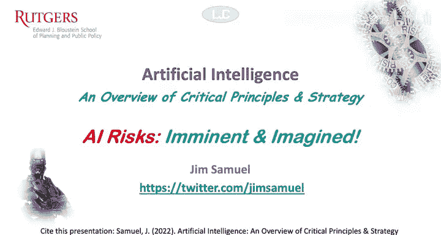
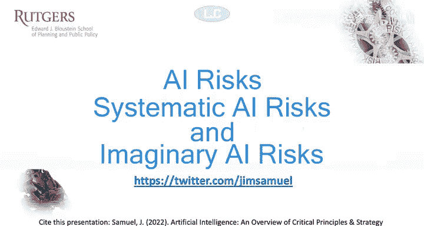

# 罗格斯大学《AI概念和策略｜AI Concepts and Strategy》中英字幕 - P13：12_系统性AI风险与虚构的AI风险.zh_en - GPT中英字幕课程资源 - BV1nZjCznE7k

When it comes to social systematic AI risk， we are talking about AI risks that have largely social。

 ethical and moral consequences， so for example， we could have an NLP system which fails to provide fair。

 racial or gender treatment。This has been seen in a wide range of applications。

 we have seen NLP systems categorize women with certain professions and associate women to certain professions men to certain professions and the gender bias is very evident we have also seen NLP systems that is natural language processing systems。

 which rely on vast quantities of past textual data， propagating racial bias。

 so these are examples so what happens is when companies。

 governments individuals begin to use such AIs， they face a risk that social systematic AI risk could be real the impact of social systematic AI risk is difficult to measure we can have stories。

 we can have examples and cases but the extent to which they can impact communities that they can impact social life that they can impact。

People at large is yet to be measured， it's yet to be quantified。

 we don't have a very clear and defined mechanism to evaluate the to evaluate or to understand the full impact of social systematic AI risk。

When we come to the third form of systematic AI risk。

 I'm calling it as a psychological systematic AI risk these are AI risks that largely impact individual emotional mental and intellectual capabilities so this speaks about the individual level interaction between human intelligence and artificial intelligence。

 so for example， if an individual human being is using a personal AI robot or a chatbot or any kind of an artificial intelligence maybe on a phone or tablet or computer or actual robotic device to cater to individual emotional or intellectual needs。

 it could be a functional need such as simply fetching object a from point X to point Y。

 but when such a system fails to behave in the expected manner。

 it could affect the individual user's self-estteem or cause extreme frustration。

It could cause material damage， but it could also cause a loss of confidence。

 it could cause a loss of self-esteem， a simple example of this is the use one way to address。

 for example， the failure of NLP systems to understand what users are saying because of the accent of the user is to use machine learning and over a period of time by using machine learning。

 the artificial intelligence gets trained to understand the accent of the individual user。

 so it is possible to use artificial intelligence itself to mitigate some of these AI risks。

When we speak about social， systematic AI risks， we are talking about artificial intelligence risks which largely have social。

 ethical， and moral consequences。So social， systematic AI risks。

Are those failures refer to the likelihood of those failures which occur when we are using artificial intelligence at the societal level。

 we are using it across groups we are using it in institutions and there are certain risks associated with using AI at scale for example。

 an NLP system could fail to provide fair gender treatment in a social credit scoring system if an artificial intelligence displays some kind of age bias or a gender bias or a proficient bias because ultimately these AIs feed on vast quantities of data。

 so to the extent that the data is good， we get fair and acceptable results but when the data is faulty as it often tends to be because real worldor data is noisy and when we are dealing with big data。

 the very idea that we are dealing with big data means that all the variables， all of the。

Curds have not been vetted。 we are feeding data into artificial intelligence。

 which has not completely been vetted。 So in those scenarios。

 we could have various forms of AI risks that affect segments of society or impact society at large。

 but even though it impacts societal segments， it would still be called systematic AI risks。

 because these are。These are risks or likelihood of failure associated with specific AI applications and specific AI systems。

So it kind of in terms of consequences， it's broad， but it's still not systemic AI risk。

 it remains systematic AI risks because of the fact that this category of risks relates to specific AI applications and specific AI systems。

So we also have a lot of people who are afraid of AI so for example I often look at the news and see one word which is repeated again and again and that's his word terrifying and I've used a machine learning principle and I've kind of trained my own brain or my brain has brain has trained itself that if I see an AI headline with a word terrifying in it I tend to start off with the classification that this is most likely a shallow article which is misrepresenting a scenario the reason I say is because there's a lot of hype surrounding artificial intelligence and there's a lot of a whipping up of fear of the unknown when it comes to artificial intelligence and we reflected upon it we have had some discussions within our research teams and across research teams of what's driving this irrational fear of artificial intelligence。

And we identified a few simple reasons and there's probably a lot more。

 but here are a few basic ways in which we can better understand imaginary risks associated with artificial intelligence first surveys have shown that there's mass AI illeracy。

Which means people are simply not aware about what artificial intelligence is sure they know that AI is used in their cell phones they know that Siri and Alexa use machine learning and artificial intelligence methods they're aware that a connected and autonomous vehicle a self-driving car uses artificial intelligence they are aware in bits and pieces they have part knowledge of what machine learning may look like or what a neural network may look like but by and large they do not understand the fundamental building blocks of artificial intelligence。

 they do not know the implications of artificial intelligence and that leads to a state of mass AI electricity there's also a fair amount of disagreement about what artificial intelligence is。

Now， this state of。Ignorance， the state of illiteracy interacts with sensationalism in media。

 in the news media。 What that means is that news media tends to sensationalized。

 they tend to exaggerate。 They tend to cherry pick statements made by technology leaders and so for example。

 Elon Musk is often said you know his sentences are often picked out and it's kind of presented as his view of the future that AI is going to be an exist existential threat。

in courts potentially more dangerous than nuclear weapons。

 other leaders and other technology managers and scientists have also been quoted some in context and some out of context。

 but using a variety of means culminating in hype and sensationalism。

 what we have is the spawning and the growth of imaginary and unreasonable perceptions of AI risks。

There's also this idea of mass manipulation， which means it could be simply for the purpose of selling news。

 but it could also be for the purpose of selling certain products or probably harming the sale of certain products and certain services。

Sometimes the other thing that is there is part knowledge can be dangerous。

 part knowledge is the knowledge that is could be picked up from news media knowledge that could be picked up from movies from conversations and from ill-informed self-dlared experts and the spark knowledge about artificial intelligence can also be quite dangerous because now you know some things about AI so it's like six blind men and the elephant you are catching some part of AI and you have concluded that's what AI is while AI is a lot more than that。

And then there is also the concept of bad timing， which means that some may fear existential。

 some may identify and sense that AI is an existential threat at this point of time it does not look like it is。

 but maybe in the future it could be， till we get to a point where we can see sentient selfconscious superin till we see that happen we cannot。

Predict that it will happen for sure in terms of probability， anything is possible。

 So it's only in the in the context of this sense that anything is possible that we can say that there's an existential threat。

 but in the absence of very specific technologies that right now。

 even from the point of view of looking at the raw materials that we have。

 the hardware that we're using the software that we're using the optimization methods。

 the algorithms that we have in place。 you put all of this together and you extend the trajectory。

 what we will have what we can see happening is extremely powerful narrow intelligences which can perform specific tasks very nicely but。

At this point of time， V as in。Me and the team that I'm working with。

 I cannot see an existential threat arising from the kind of AIs that we currently have and from the current building blocks。

What could change this perspective and what may get me to a point where we say that is at a future point of time。

 that's why I put the last point is bad timing at a future point of time。

 if if and when quantum computing becomes a reality， if and when we see a new level of programming。

 a new set of mathematical equations that are powerful enough to reflect human reasoning processes。

 if those kinds of if those kinds of advancements take place， then at that point of time。

 the kinds of AIs that could be an existential threat to human beings that might become a reality。

 but at this point of time at best what I would classify them as being as imaginary AI risks。

