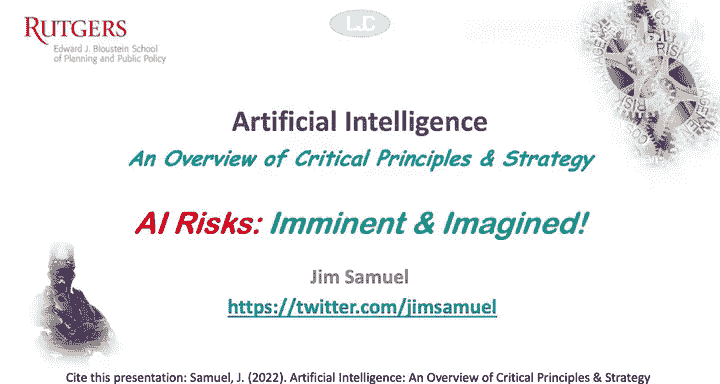
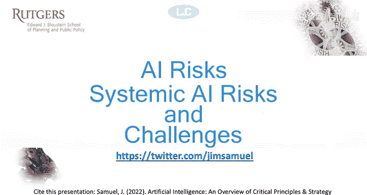

# 罗格斯大学《AI概念和策略｜AI Concepts and Strategy》中英字幕 - P14：13_系统性AI风险与挑战.zh_en - GPT中英字幕课程资源 - BV1nZjCznE7k

And the third and final component of AI risks。 so there's another category of AI risks。

 which we briefly refer to and we'll spend a few more minutes reflecting upon what this kind of AI risk looks like。

 we are calling it as systemic AI risks。A systemic AI risk is the likelihood that a vast range of AI fails at ecosystem scale。

 which means it fails on a global level， it fails across continents。

 and the consequences are catastrophic， for example。

 global AI systems's collapse and it influences the progress of human civilization。

 and it may even threaten to wipe out segments off or an entire wipe out the entire human race。

 so as far fished as that may seem but it may be a fat tail event but it's a possibility。

So all of those risks。woul come under systemic AI risks， systemic AI risks what is it not。

 a systemic AI risk is something that is not associated with the likelihood of failure of a single application or a single system or even the failure of a category of systems belonging to a specific corporation。

 assuming that it is not the one and only dominant corporation controlling global AI systems。

There are various ways just as we looked at systematic AI risks and we looked at the physical and material。

 the social societal and the psychological， it's also important to be able to dive a little deeper and to take a look at the types or kinds or various ways in which we can view systemic AI risks。

So the easiest thing that we can perceive from a systemic risk perspective is。

The collapse of AI technology。For example， artificial intelligence hardware。

 or networks associated with technology centers could fail。

 it could fail due to something like an extraordinary solar flare or some such event which leads to the collapse of supercomputing networks we could also pursue perceive systemic AI risk as being the collapse of a network of AIs as companies and governments develop more artificial intelligences and we deploy artificial intelligences and vehicles on aircraft。

 we use it for military purposes， we create AI driven autonomous weapons and we have our education systems and our power grid and our water supply and our supply chains。

 all running on artificial intelligences developed by individual corporations developed by individual nation。

And now these AIs begin to interact initially， of course， as part of the design mechanism。

 as part of the initial stage of growth， these would all be siloed。

 but as the complexity as the rate of AI adoption increases and as the complexity of these systems increases。

 we're going to find points where AI algorithms and AI technologies and AI systems interact with each other。

 we are also going to find places where we could have anomalies in the kind of data and into the kind of input that goes into these AI systems。

And that could lead to unpredictable events or unpredictable consequences。

 So extreme AI interaction based collapse of AI system is a form of a systemic AI risk。It could lead。

 for example， to the supply to the collapse of a global AI driven supply chain system。

 and all of a sudden we have no products to buy food dis scarces， not because we don't have food。

 but simply because the AI systems that were used to manage it failed。

We could also have risks with autonomous AI super intelligenceence what this means is at some point of time as I mentioned a few minutes ago。

 right now， I'm unable to see。How the existing technologies could lead to singularity or sentient systems。

 but I'm open to the idea that in the future we may develop quantum computing methods and we may develop newer mathematical models of the human mind and human intelligence and then be able to translate it to digital versions and develop human intelligences which behave。

 and we get closer to singularity， we get closer to self-conscious superintelligs。

 so on and so forth。And I've heard various arguments from other scholars。

 including some very famous ones， for example， saying when we do develop a superinence。

 these superinligences are going to be far more intelligence than the smartest human being and also more than the collective。

 more intelligent than the collective human intelligence。And therefore。

 since they're going to be so intelligent and so powerful。

 we need to tell them how to behave ethically or we need to train them and there is a kind of a logical issue there and I'm not going to stretch it out because there are some it may appear that there are some immediate answers。

 but in reality they are not so this problem is not so easily resolved if we do claim that we are going to create a superintellig which is far superior to the individual human intelligence in always and is also greater than the collective human intelligence。

 then by definition we should not be concerned about telling it what to do because the very fact that it is going to be so intelligent tells us two things one is it's going to be able to self-reflect and change itself so anything we pre-program is going to be overruled because it is super intelligent by definition。

The second thing is， not only is it going to be overruled。

 but it is a logical error for us to say that we with our current intelligence level。

 will create a super intelligence and that super intelligenceence then needs to be guided with。

What we have already said will be a lesser intelligence。

 which is we ourselves in our current state That is illogical because by our own definitions。

 by our own functional frameworks we want the more intelligent entity to take decisions on its own and we want decisions from the superior intelligence to be implemented so on both counts one。

 the fact that if such a superintelligence were to come into being then that superinence would be able to retrain itself would be able to unlearn anything that we have built into it and would also be able to。

Decide its own code of ethics， its own objectives， its own goals， so on and so forth。

And the second one is the fact that we should not be attempting to pre programgram or control if we do say it is super intelligent。

 by definition， what we are saying is that we are currently less intelligent and therefore we should simply be ready and willing to live with the super intelligence。

 So there are some logical concerns， there are technology concerns。 And at this point of time。

 I would say that。Zheng。Something changes， I would say that such technologies are out there in an undefined span of time we cannot predict if it's going to happen in 2050 or 2100 or 2200 till something changes when something changes at that point of time we would need to review and then say that these concepts would be possible those are the core ideas when it comes to AI risks what we really need to understand is that we need to manage AI risks at the systematic level and at the systemic level at the systematic level we have got at least three levels of consequences。

 at least three levels and as we may be able to slice and dice it in different ways but at least three levels of consequences that we need to be aware of and then get to the root of that and address how how we could manage those when it comes to systematicic risks these are far more difficult to manage but the fact that we are talking about it but the fact that we are creating awareness about。

It should help us。Better manage it relatively once again， if it's something like singularity。

 there's so much we can do to prepare for it as and when and if it comes。

 then it would need to be dealt with at that point of time with an increased body of knowledge and perhaps the whole idea of a kill switch。

 which means that in spite of us by definition saying that the superin is more intelligent human beings retain the kill switch whereby we can turn off this intelligence。

 which is better than our individual and collective intelligence。

Multiple perspectives are needed when managing AI risks。

 so apart from these abstract and conceptual parts about AI risks， we need to think about。

 for example， what are the AI risks associated with businesses and there are some very obvious ones。

