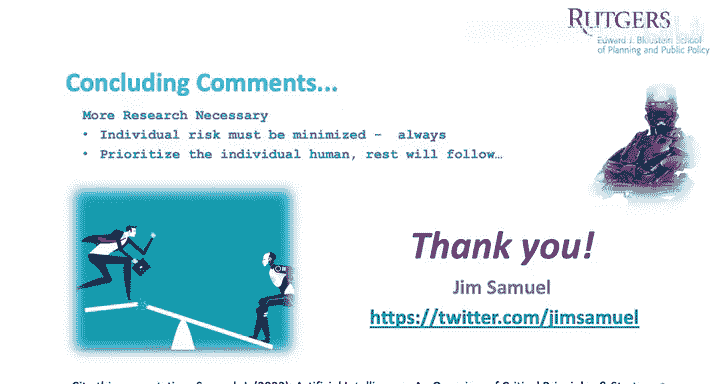
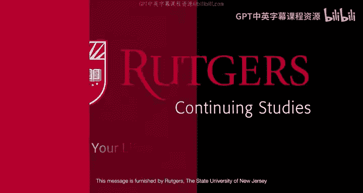

# 罗格斯大学《AI概念和策略｜AI Concepts and Strategy》中英字幕 - P15：14_AI风险的务实观点与总结思考.zh_en - GPT中英字幕课程资源 - BV1nZjCznE7k

Human beings retain the kill switch whereby we can turn off this intelligence。

 which is better than our individual and collective intelligence。

Multiple perspectives are needed when managing AI risks so apart from these abstract and conceptual parts about AI risks。

 we need to think about for example， what are the AI risks associated with businesses and there are some very obvious ones but I also want to talk about some new thoughts。

 some fresh thoughts so for example， what's the risk of not adopting AI if a company can confidently say that it really bears no risk of not adopting AI then its problem solved at least in the short term it does not need to adopt AI there's no risk of not adopting AI and for a company which looks at this idea of a risk of not adopting AI and feels that there's something in it could look at the fundamental side of things so for example。

 if you're a factory manufacturing ball bearings it will be fundamentally important for the company to evaluate will the use of A。

I improve my efficiency in the manufacturing of ball bearings if I don't adopt AI or if my company does not adopt AI。

 but my competitor adopts AI how much more of a competitive advantage will my competitor get so that's a fundamental way of thinking about the risk of not adopting AI then there's also the brand value concept maybe the fundamental difference is not very high。

 which means company A is manufacturing ball bearings with artificial intelligence company B has chosen to keep keep using technology but not use artificial intelligence and there isn't much of a fundamental difference。

 there's not much of a decrease in cost there's not much of a problem with on a fundamental level and yet when it is being marketed when the ball bearings are being sold to the consumers if the consumers are of a nature whereby they have a greater measure of confidence in the quality or some such。

measure or some such other motivation then it is possible that company A may increase its sales and its market share simply because it has increased its brand value by associating artificial intelligence with its brand。

The risk of adopting AI and going wrong， which means you adopt AI and then something goes wrong must also be considered and for businesses it's important to remember that it's not just the failure of AI itself。

 it's not it's not just systematic and system risks as we briefly touched upon over the past few minutes。

 it's also and this could be put under systematic risks。

 which means it's the risks associated with specific AI applications and specific AI systems。

 but it's not about the technology itself， for example。

 it's about the cost of technology if you invest $10 million。

$100 million into adopting artificial intelligence for your business or for your corporation then what is the return on investment If that artificial intelligence gets outdated or becomes obsolete within a year。

Yeah and if your plan was to use it for five years。

 but if that AI system or that AI application becomes obsolete in a year because of newer AI technologies being released and adopted by your competitors。

 then you're going to have a negative return on investment The technology worked great。

 the artificial intelligence did not intrinsically fail from a technological perspective。

 but yet it was not financially viable， So when we speak about AI risks。

 we not only need to consider that technological risks， but we need to consider。

Business associated risks such as financial risks， legal risks， the technology is working great。

 but a new policy is implemented， or there's a new interpretation based on case law or based on some judge interpreting a particular law that applies to information systems data and technology in general。

 to artificial intelligence in a specific way and all of a sudden that's created legal risks for the business。

 it could also be operational and another important way to evaluate AI risks for businesses is to look at the short term and then look at the long term。

 it is possible that an artificial intelligence implementation in a company which may not be risky in the short term could be quite risky for the company in the long term。

 So it needs to be this is non-exhausive， as I mentioned right at the start。

 but what I want to do with this session， what I want to do with these thoughts is to stimulate further。

Discussion is to stimulate further thinking and the development of more formal frameworks to manage different dimensions of AI risks we have the whole idea of AI risks as governments across the world adopt AI at an increasing pace when we speak about governments adopting artificial intelligence I think right at the top of the list should be the measure or should be the concept of human interaction with artificial intelligences and the prioritization of human wellbeing。

It's also very important that when governments， especially when national governments adopt artificial intelligences。

 they think about sustainability。Because there's a huge， apart from the financial cost。

 there's a huge environmental cost， social cost， technological cost that's involved。

 and it's very important that when governments implement artificial intelligences that they look at every measure of sustainability that they can and take a long-term perspective to adopting artificial intelligences。

 a siloed piecemeal approach by governments to adopt in adopting artificial intelligence such as allowing one entity to adopt a specific AI application for another purpose and to allow n number of other agencies also to adopt artificial intelligences per their needs and then to expect the whole ecosystem consisting of different artificial intelligences which are functioning from different companies which are functioning in a siloed manner it is difficult to expect。

Some magically sustainability of these AIs would just arise out of such an ad hoc method or an ad hoc approach to governments adopting AI most likely that would lead to confusion it would lead to suboptimal results and it would lead to increased risks of AI usage by governments when we are speaking about government one of the important responsibilities of national governments is the protection of their boundaries is the protection of their nations and national interests so what we are seeing today is that artificial intelligence is being extensively used in warfare it's being used in coldd wars sort to say conceptually and it's also being used in preparation for hot wars everything from clusters of weaponized drones to。

Artificial intelligence， AI driven missiles and AI driven technologies to support wars governments need to pay specific attention to this whole area of global artificial intelligence driven warfare governments also need to determine how much AI and this is something this question is similar to what businesses need to ask themselves how much AI do we need when it comes to artificial AI research labs and universities there is a tendency to develop any and every kind of an AI technology and it is important and it must be done in those。

Labs and in those contexts， but when it comes to adoption of these new technologies。

 when it comes to adoption of these artificial intelligences。

 the question remains how much AI does how much AI does a government need to adopt and also when and where and how and we need to have an optimization mindset。

 we need to have a sustainability mindset and we need to have a longterm perspective。

 when we speak about government adoption of AI when it comes to developing policies。

 governments need to think about the social aspect。

 the societal aspect that is a wellbeing of the individual and the collective human and it's often contrasted or it can often be in conflict with business needs So for example businesses may want weaker privacy laws while when we speak about the rolling out of AI governments may want to ensure much。

 much。strronger privacy laws than we have seen in the past to ensure the safety and the liberty of the individual and collective human one of the things that I keep repeating and which I think is very relevant in the context of identifying and proactively managing AI risks is the challenge of creative proactive policies。

I emphasize that we cannot follow the same approach when it comes to policymaking。

 we cannot follow the same approach that we have been following in the past with other technologies with other technology and information systems it's been okay to parallel process policies or even process policies post hoc after the technology has been implemented after the technology has been adopted by corporations and as it is being used we create policies post hoc after the event。

 but when it comes to AI AI is moving so fast AI is moving so powerfully and AI changes so rapidly that if we are going to use the same approach of processing。

And creating policies， a post hoc or even parallelly。

 what will happen is that by the time the policy is established and by the time the policy comes into effect as law or guidance by that time the technology has moved on and the cycle will continue。

 which means if you take a span of 10 years and let's say policy has been implemented at the end of each year。

 but every year the technology is changing， so at best let's if the policy is implemented in month 11。

 then that policy is effective for all practical purposes for just about a month。

So in a period of 10 years， youll have 10 months where policies assuming that the policy gets updated every year for 10 years。

 you have policies， 10 months of effective policies and 11 multiplied by 10， that's 110 months。

 this is just an conceptual illustration， 110 months。

 where the policies do not cover the technologies， the AI technologies。

The way to address this is by creating proactive policies。

 which means once you understand the philosophical and conceptual foundations of artificial intelligence。

 we can create policies which cover the scope of what artificial intelligence is。

Will be in the future and what and the consequences of such artificial intelligences。

 which means if there is a clearer understanding， if there is a clear understanding。

 philosophical understanding， conceptual understanding of artificial intelligence and we make policies based on these conceptual understandings。

 these philosophical underpinnings， AI building blocks。

 then the policies that we create today will be applicable for a much longer period of time。

 then if we create policies post hoc after the technology is developed and adopted it。

So to conclude on this topic of reflections on AI risk first and foremost。

 we strongly believe that more research is necessary。

 there's a lot of talk about artificial intelligence。

 there's a artificial intelligence risks and artificial intelligence risk management。

 there's a lot of hype surrounding AI and therefore surrounding AI risks in AI risk management。

 however， the fact that there is hype and the fact that there may be some bubbles that are being formed in that area that does not in any way reduce the need for robust fundamental philosophically sound。

AI research and AI risk research AI risk must prioritize。

The individual human and the collective human and the rest will follow What we have done here in today's session is we have tried to emphasize the importance of artificial intelligence risks。

 we have tried to provide some classification and some grouping of AI risks because if we don't do that then we will not be able to manage such a diverse set of risks with the same yardstick or with the same we will not be able to apply the same solution to for example systemic versus system risks and even within systemic risks we will not be able to develop frameworks and solutions and mitigation mechanisms for systematic risks as a whole。

 but if we categorize it by consequence such as we have done in today's session then we would be able to manage it better the same thing goes for systemic risks if we are able to gain a more detailed perspective of the kind of system systemic risks that are possible then it would it would help us to prepare in some ways and if it。

SoWhen we get to that point， we would be able to deal with it better as and when and if we get to that point。

 so with these thoughts and a call for more research on this topic。

 I'm going to thank you and hopefully this session has helped you gain a better understanding of AI risks a from leadership perspective。

 thank you。

