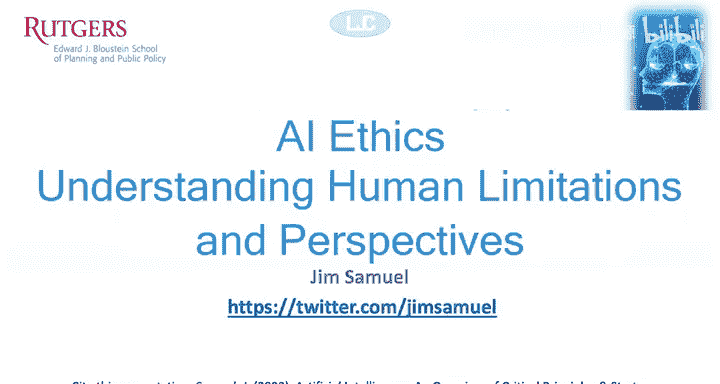
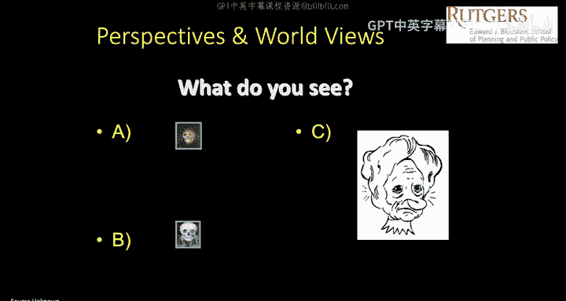
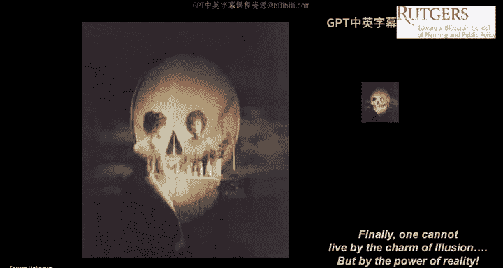
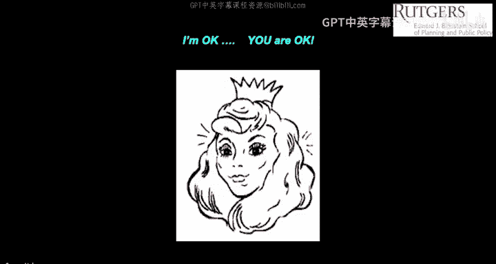
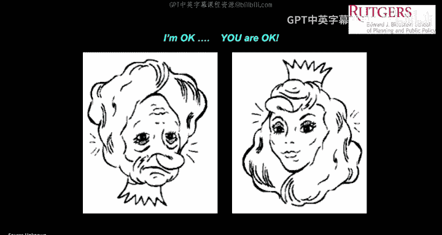

# 罗格斯大学《AI概念和策略｜AI Concepts and Strategy》中英字幕 - P16：15_AI伦理理解.zh_en - GPT中英字幕课程资源 - BV1nZjCznE7k

Welcome to artificial intelligence and overview of critical principles and strategy In this presentation。

 we're going to talk about AI ethics。 Both aspects of this topic are slippery。

 looking at artificial intelligence from an ethics perspective and just the whole idea of ethics itself。

 as we will see in a few minutes。 But our goal will be to motivate an interest in this topic。

 and while this talk is not aimed at providing solutions for AI ethics。

 it is rather oriented towards。

Stimulating additional thoughts on AI ethics it's an evolving field and so what we want to do by the end of today's session is to gain an understanding of some of the challenges in AI ethics gain an understanding of what are the different segments or what are the different ways in which we can look at this topic of AI ethics and what is the way ahead。

 if we are able to stimulate thought in that direction then this session will have served its purpose I'm going to spend a few minutes on some introductory thoughts on AI and ethics and just the idea of ethics itself then there's something that I'm going to bring in which is based on some research that we have been doing on human intelligence and artificial intelligence interaction and we look at the three dimensions of ethical AI then we look at some current challenges in ethical AI we will look at the foundation。

Of ethical AI and what's missing specifically my argument for some time has been that over the past few years we have seen an acceleration in in the development and implementation of AI applications so we see the science growing but we also see that the philosophical foundations that are required for artificial intelligence in general and especially the societal aspect。

 the ethical and moral side of AI， there is a need for establishing philosophical foundations and that is largely missing there have been some very good efforts。

 but on the whole as of now it seems to be missing in this discussion on ethical AI so I'll speak more about it towards the end of today's presentation and finally close with a concluding challenge and a few。

ComFirst， a set of introductory thoughts needless to say。

 artificial intelligence is evolving fast in the sense that it is changing as a cluster of technologies。

 individual modules within this larger cluster of AI technologies is changing and just to restate based on what my viewers have stated in the past just to recap what artificial intelligence is artificial intelligence is a cluster of technologies that mimic human intelligence。

 specifically in cognition and in logic， which means it can see just like human intelligence has sight not exactly the same。

 but it mimics that function of sight， it mimics the function of speech。

 it mimics the function of sound so that's the cognitive side of it。

 and then there's also the mimicking of logical functions。 So for example， when we speak about。

Solving a logical problem， such as in the game of go are in other illustrations where artificial intelligence has to solve a problem。

 This is seen an excellent real life example of this is an optimization。 So when we have。

Transportation problems， and we need to find the best mix of variables to solve a transportation problem。

 It could be the reduction of transportation costs。

 It could be shipping the maximum number of units from point A to point B。

 These are all logical functions。And artificial intelligence is able to play the game of Go better。

 artificial intelligence is able to optimize a large number of variables。

 which would be beyond the capability of human intelligence at least within a limited period of time to solve。

So artificial intelligence can mimic both the cognitive functions and the logical functions of the human brain that does not mean that artificial intelligence as of now is able to match the capability of the human brain to manage complex problems。

 however， in wellbound well definedfin deterministic problems。

 artificial intelligence is able to perform vastly better than human intelligence。

In the context of such artificial intelligences which are able to mimic and very often outperform human intelligence。

 it's important to understand the ethical implications of such intellectual power with machines and there are various angles from which AI ethics needs to be looked at one it is extremely critical since this series of talks is primarily aimed not at computer scientists。

 not at training computer scientists，But is aimed at informing future leaders and managers to better understand the conceptual dimensions of AI ethics so the talk is today's talk is largely conceptual in nature and hopefully leaders and managers will gain some ideas when we'll be better informed by the end of today's session and better performing their responsibilities in an environment where we are seeing an increasing adoption of artificial intelligences at this point of time I also want to say that there's a vast amount of AI ethics research。

And at the same time， most of the experts agree that in spite of such a large amount of research on AI ethics。

 which has already been done and which continues to be done。

 yet there remains a need to solve some of the most compelling challenges associated with AI ethics。

This session is not specifically going to touch upon AI ethics as it applies to specific domains or finance or healthcare or law or things of that nature。

 but it's going to talk about the concepts which can be applied to any or all of these domains it's always going to be good to refer to scholarly papers on these topics to reinforce the language and to reinforce the concepts in a very grounded manner this presentation as with previous presentations。

 it's conversational in nature I used。Technical terms only to the extent that it's absolutely necessary。

 otherwise I will try to keep it conversational。At the end of today's session there should be at least two things that you new things that you will take away one is a perspective which views AI ethics as a three dimensionmenional framework and the other is an understanding that when we speak about ethics it is ethics is fundamentally philosophical in nature there is an objective side to that and AI ethics and there's object there is a subjective side to AI ethics but the ultimate goal should be to use artificial intelligence and to apply AI ethics for human good as we move along so let's take a break from all that text and let's go through an exercise your task is to think for yourself what is figure A what is figure B and what is figure C。

え？Think for yourself。 What is it， B， think for yourself what it is and hold it and see what is it。

 And now。

This is an enlarged picture of what a is some of you may have been with super eyesight may have been able to see this even in the small image。

 but for most people the response is that figure a is a skull， but when we look closer。

 we realize it's not a skull， it's simply a lady looking into a mirror。And I like this quote。

 which says finally one cannot live by the charm of illusion， but by the power of reality。

So when we look at scenarios， when we look at events。

 when we look at artificial intelligence and this whole topic of artificial intelligence is what we perceive initially might not be what it really is and we will need to look at these we will need to look at this topic and we will need to look at these concepts in greater depth before we can conclude what AI ethics is all about so here's the second picture once again of the。

Those who are just looking at it。 The small figure for the first time would probably conclude it's a skull。

 It's not。 It's a sketch of a couple sitting on a。Dining table of some sort。

And another interesting quote， which says it's not who is right。

 but what is right that is of importance， So it's not illusion。

 it's not matter of who says what it's a matter of what reality is。

 it's a matter of what is right that is important and when we speak about ethics。

 these principles are very important and here's the figure C。

 what you saw was figure C as you see and most people interpret that as the as being the sketch of an older lady。

 And when that is flipped upside down， you see that it's the figure of a young lady。

 what is illustrated out here。 what I use this illustration to say that sometimes there are multiple perspectives on a scenario or or on an ethical evaluation and both are correct。

So if one person looks at it from one side and says hey。

 this is a sketch of an older lady and another person looks at it from another angle and says hey。

 this is the sketch of a younger lady， then the reality is that both are correct。

 for example I like to often refer back to the story of six blind men and the elephant。

And I like that story as a kid because it taught me a very important lesson。

 it taught me that in a complex environment where our ability to sense reality。

 our ability to evaluate facts is limited and that is exactly where we are in this age of big data。

 information overload， knowledge overload， logic overload。

 we are exactly at that point where the blind six blind men where the。

6ix blind men were one person men and car caught one part of the elephant and said the elephant is like a wall。

 another person caught the leg and said the elephant is like a tree， another person caught the tusk。

And another person caught the tail and each person had a different interpretation of what the elephant is。

 and each person was very sure because based on their own cognitive。Caapbilities。

 they thought they had figured out what the elephant is。

 but the elephant was far more complex and each one was right in part。

Let's say conceptually each one got one sixth of it， correct。

 but sometimes it's necessary to try and see from the other person's perspective。

 it's important to accommodate multiple。Perspectives to ultimately and objectively。

 wherever possible， figure out the nature of reality。

And here's one last slide with images of this kind。 There are two tasks that you need to do。

 One is look at this figure that and you see A B and C。

 and most of you have probably already figured this out because it's a common visual illusion which has been widely discussed。

 if you were to take a scale and measure the height of soldier A or let's say the length of the figure of soldier A and soldier B and soldier C。

 they are exactly the same in literal length on the screen in the image。 However， when we view it。

 it appears as though soldier C is far taller than soldier A that is because of the way in which our brain is strained we are used to seeing things in perspective right since childhood from the time we are born。

 we see things in perspective So a child standing on a long road sees that the road is broader at the point where she or。

He is standing and then it narrows as the child looks down this straight street。

 but the child also learns that as the child walks。The child finds out that it's the same length。

 so though it appears to be narrow it's actually the same length。

 the child also learns that if the trees look smaller at a distance。

 but once the child gets closer the child learns that the trees of the same height as the tree at point a so our brains are trained to think in perspective。

 so if we see something that is of the same height。

 but at a distance then our brain naturally tends to think of that as a larger object。

 so here in spite of C being。Of the same length as a that is the figure of soldier C。

 we still think we still get the feeling， we still get the sense we our brain interprets soldier C as being the tallest because the figure is in perspective so our past programming of our brains and intelligences kicks in and the immediate interpretation is C is taller and if all of our brains of our functioning properly。

 that is the way it's going to remain till we objectively use the scale and say okay C and A are exactly the same in length。

So this is a reflection or the takeaway from this figure。

 from this visual illusion and from other visual illusions that you can find on the internet is that our brains are pre programmegrammed。

 our intelligences are preprogrammed and that pre programminggramm very often limits our ability to understand and interpret reality。

 and that influences our the way we look at ethics。

The other thing that I the other challenge that I want you to try and on a computer screen。

 it should be easy as compared in a real room is to find the word lift。

 where on the screen do you find the word lift？Some of you have already probably seen it it's on the top part of the screen Once again the programming there is that our brain is used to looking for letters in black on white or in dark or light so since the word lift is formed between the black shapes in the lighter color it's slightly difficult for some persons to spot but most of you should be able to see it and it's another way of recognizing that yes we have our minds are programmed our minds tend to think with a certain amount of inertia we like to see perceive and interpret things in the way we have been doing it in the past and when we are faced with new scenarios then there is a little bit of a cognitive challenge and there's a little bit of a additional cognitive effort that is required for us to objectively interpret and understand the scenario at this point of time。

I also want to bring in the idea of objective versus subject objective is we face we can evaluate scenarios objectively when there are when it's deterministic in nature so for example if it's mathematical if it's two plus2 is equal to four under normal circumstances that two plus2 is objectively equal to four subjective is the preference of colors a person A may prefer blue person B may prefer red person C may prefer green and that subjective in nature as to what one may consider as being a good color。

 same goes with taste and the same goes with， for example。

 even in some aspects of what is legally correct in one country it is legally correct to drive on the left side of the road in another country it is legally correct to drive on the opposite side of the road and if you were to drive in country B where the rule is different。

then you would get arrested， it would be considered unethical and illegal for you to drive on the wrong side of the road。

 so it's subjective depending on geography and there are many other examples of subjectivity and objectivity of course is very easy to understand。

