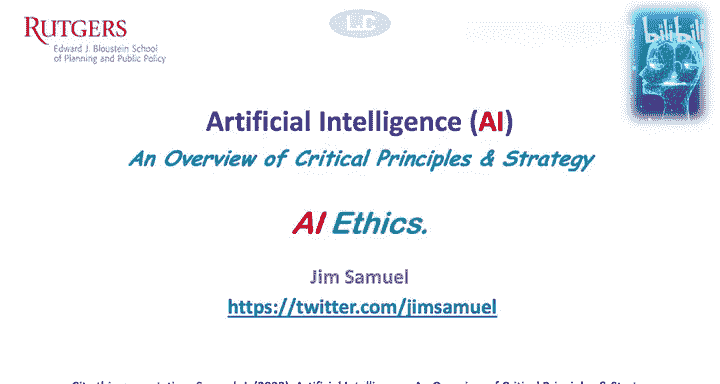
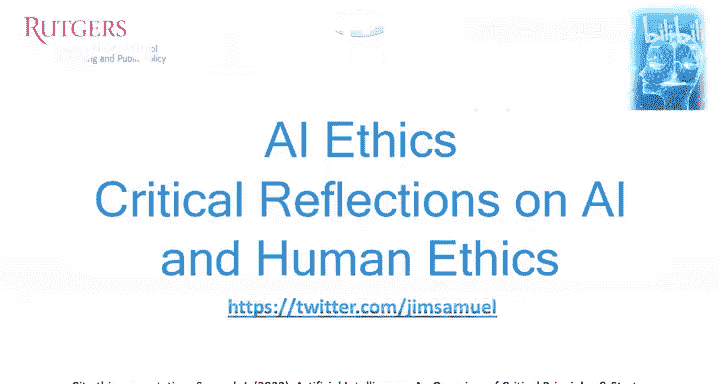

# 罗格斯大学《AI概念和策略｜AI Concepts and Strategy》中英字幕 - P17：16_AI伦理批判性反思.zh_en - GPT中英字幕课程资源 - BV1nZjCznE7k

That brings us with that background， with that kind of foundation about the limitations of the human mind。

 our own programming， which constrain us from readily interpreting what is right and what is wrong and what is what is moral and what is immoral based on our own past programming。

 we need to look at scenarios。 sometimes， of course， anyway。

 let me get not get too far away from this slide and focus on this slide for now。 So AI ethics。

 What is it First， lets let's think about the word ethics itself sociologist。

 Raymond Bomart once asked what is ethics mean to you。 And he got multiple responses。

 Here are a few of them ethics has to do with what my feelings tell me what is right or wrong。

 So if I feel it is right， it is right， If I feel it is wrong， it is wrong。

 If I'm walking along a street and I see a dog on the street， which looks。

Like it's in need of some food and if a person doesn't help then I feel that that person is being unethical。

 immoral because that person didn't help a needy animal。

 if a person helps then the person is being ethical and if a person doesn't help but still calls for help puts in an email or person then that person is somewhere close to being ethical but not as ethical as a person who first and immediately helped the dog and so on and so forth so that that's based on feelings for many people around the world。

 ethics is very strongly associated with their religious beliefs for some people ethics is something very mechanical which means they say ethics is doing what the law requires so as long as I follow the law and being ethical and there will be many people who disagree with that because for some people doing what the law requires is simply a way of keeping out of trouble but they are ethical standard。

maybe may further qualify the requirement of the law and in some rare cases。

 maybe in direct conflict with the law of the land ethics consists of a standard of behavior that our society accepts that's like a normative kind of an approach to ethics where we take the perspective that if everybody does it。

 it must be correct and therefore it must be ethical and therefore it's fine for me to do it too and then there are those who take the approach I really don't understand what the word ethics means。

 I just follow the rules and I really don't care what ethics means。

 you know what difference does it make and and probably and in finite number of other views with finer perspectives So what we can see from this quick exercise and the reason I quote this is to further emphasize that it is not easy for us to agree on what ethics is completely and entirely。

It is difficult to quickly find common ground and agreement on the Constitution of AI ethics。

 simply because we may not be in perfect agreement on what constitutes ethics itself。

And given the absence of a very clear definition of what intelligence is and further extending that what artificial intelligence is。

 it becomes difficult to find a foundational definition which everyone can agree on on what AI ethics is and yet it's very important。

 so what we will try to do is while acknowledging these challenges while acknowledging the difficulty in defining ethics itself while acknowledging that there are different perspectives to ethics that there's an objective side to ethics associated with the law and associated with certain other fixed points of morality and then there are subjective sides to ethics with this background。

 we can now look at the topic of AI ethics and try to segment it。

 understand it better and see how we can ultimately use this knowledge and use this understanding and use this dialogue use this body of knowledge on AI ethics to use。

to ensure that we use AI for human good， we use AI sustainably， we we develop， we configure。

 we apply AI sustainably and just to wrap up thoughts on this slide。

 AI ethics can be a set of values believed in ethics can also be treated to be an acceptable societal code of conduct ethics is really not by itself religion but the abstracted principles and value systems associated with religion can form ethical code or can be used to inform ethical convictions ethics is not law。

 but it can be associated with it because in many cases it would be synonymous it would be concurrent that if you break the law you are being unethical but it's not a perfect match because there's always going to be scenarios where for example。

 if you' are trying to save a person's life the law says that，You cannot go beyond 25 miles per hour。

 but you know that if you are a few seconds late to the emergency room at the hospital。

 the person may die， so you may break the law that is the speed limit so as to save the person's life so ethically you would be correct because you are prioritizing a human life。

But at the same time， ethically， that is assuming that it's nighttime， the roads are clear。

 there's no risk to any other human being and you drive past the speed limit to save a human life。

 you're being ethical but you're breaking the law that's one simple example and there may be many other examples that you can think of。

So that brings us to the challenge if AI could learn ethics。

 if we could either program ethics into AI as a form of an expert system or a layer of expert。

Input or if AI could learn from data what ethics is then the question arises what ethics should AI follow。

 should ethics should AI follow the ethics associated with religion which is what some countries would prefer people in some countries would prefer or should AI follow the ethics associated with law。

 should AI should AI be trained to follow ethics associated with the feelings of individual users or feelings associated with with segments of society。

 should be artificial intelligences based on American ethics。

 but even within America even within even within the West。

 there's a significant disagreement on what constitutes ethics。

 there's a significant polarization on many core issues on the very foundations and on the philosophical nature of ethics itself so it's a challenge and with the understanding that it's a real challenge we still need to find a way to make progress to。

Ensure that on the objective side of ethics， on the areas that we can agree upon。

 we do understand and implement AI ethics to ensure human good and sustainability。A quick note。

 so you know， though I mentioned that we are not going to go into any specific domain applications in depth。

 I just want to quickly give a view and a feel for the applied side within the use of AI in law and in courts and the purpose of doing that in this talk is to emphasize that we are there we are at the point where artificial intelligence is already influencing how justice is。

How the law is applied， it's making it more efficient to apply the law it's improving it's reduce it is capable of reducing costs and helping this process it's also being adopted by courts it's reached a point where we have。

Systems in place which can handle smaller offenses human without the intervention of a human judge so a few quick things。

 for example electronic discovery it uses predictive modeling for the classification of legal text。

 this document assembly software which prepares to a certain extent。

 variations of documents that reduces human effort in preparing a legal document so if a lawyer were to use the software the lawyer could do the work perhaps in about 10 hours as compared to 20 hours that it would take without the artificial intelligence。

AIs are able to also perform more complex natural language processing tasks such as reviewing court decisions and also reviewing associated data。

 which will help generate predictions about the behavior of legal practitioners artificial intelligences support legal research in places like Singapore and in China。

 artificial intelligences are being used and in other countries too。

 artificial intelligences are being used to support court processes。

 they're being used to help judges， they're also being used in some places where it's a matter of small misdemeanors and small offenses to directly address those issues without human intervention。

Why are we using artificial intelligence in the justice system， why are lawyers using it。

 why are judges using it， why are judges becoming more open to the use of artificial intelligence in courts。

 it reduces the likelihood of human error there are some things so for example。

 if you want to account a set of keywords or key phrases associated with a history of a particular category of cases and perform certain kind of linguistic analysis。

The artificial intelligence is simply going to do it far more accurately and far more faster than a human person。

 There is an argument that sure the artificial intelligence can perform certain NLP tasks that's natural language processing task better than the human intelligence。

 but it introduces the risk of AI error， which means there are some obvious things which a human intelligence would never miss。

 but an artificial intelligence may miss the process。

To accommodate that is such that usually there is a layer of low effort human intervention。

 this human review after the artificial intelligence is applied and is completed bulk of the work。

See the overall effect of using artificial intelligence in the justice system is that there's cost savings and there's efficiency would also I should probably emphasize that there is also the likelihood of increasing accuracy but I don't want to overemphasize that because that's a two-sided that's a twosided sword sort to say because when we use AI to increase effectiveness that AI is based on natural language processing。

 then it depends on the data if we have high quality data which is well structured and matches and is compatible and supports the algorithm and the algorithms that are have been trained have been tweaked to accommodate the kind of data that's coming in then it should work well however。

 if there is a shift in the quality of data if there's a shift in the use of words or in the semantic implications。

of words and the artificial intelligence is not able to capture it。

 it could lead to significant error， so the overall cost savings and the efficiency would still be vital but I think at this point of time based on my understanding of natural language processing based artificial intelligences I think there should be a human layer and human intervention for final decisions human review is necessary lawyers and courts are increasingly adopting artificial intelligences it is necessary to be cautious。

And and the reason for caution is very evident， one is。

What I've just been emphasizing that is NLP natural language processing technologies have repeatedly demonstrated gender and racial bias。

 racial bias and other challenges and。Though there are systems and are there are we can use methods to mitigate such bias。

 but。Then the question arises as to who is tweaking these algorithms as long as it is data and all data flowing into a transparent NLP system AI system。

 it's fine， but the moment we say。The the input is coming in the AI is going to do its work。

 but then we' are going to tweak it so that we get a range of acceptable output Then the question arises that who's doing the tweaking and who's going to determine what is right versus what is wrong So that kind of a layer of manipulation is undesirable it's necessary in some current situations but it's undesirable and we need more work before we can accept that in the context of our courts using it to meet out justice。

Also we are extremelyre very far away from vesting any artificial intelligence or a set of artificial intelligences with judicial power over human beings as of this point of time。

 I would say that there is nothing in the visible future that I can see based on the existing AI technologies。

 the existing NLP NLU that's natural language understanding and natural language generation work that I have seen there is nothing in it that inspires any confidence in me that we can have autonomous artificial intelligences with judicial power over humans。

 we are far from that we should not entertain it， I could probably do a separate talk on arguments against any move in that direction。

