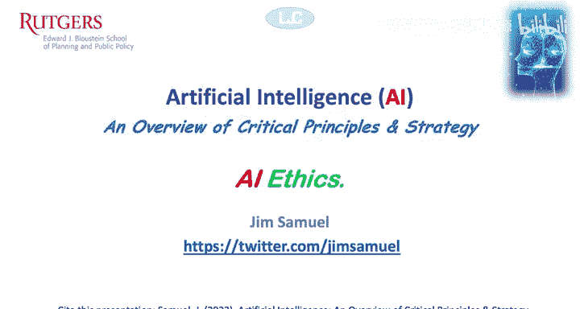
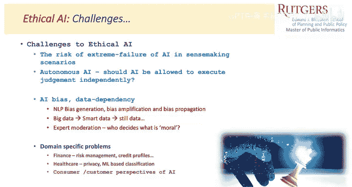

# 罗格斯大学《AI概念和策略｜AI Concepts and Strategy》中英字幕 - P18：17_AI伦理的三个维度.zh_en - GPT中英字幕课程资源 - BV1nZjCznE7k

Which brings us to having looked at the challenges， having looked at the fact that AI is here。

 it's being used to manage ethics across domains， it's being used in healthcare。

 to manage healthcare associated ethics and laws and regulations。

 we have AI being AI ethics in finance in a broad range of domains。Having looked at the challenges。

 having understood that AI is here and is being adopted across domains。

 that brings us to the point to say， conceptually how do we view this topic of AI ethics so that we can make some progress so that we can further articulate or develop mechanisms to mitigate this risks。

 take steps to ensure individual and collective human good so one way to do this is by taking a three dimensionmensional perspective of ethical AI。

The first one is what I call is human on top， which means artificial intelligences function within human ethical frameworks。

It is human beings who。Establish these frameworks and at any given point of time。

 the human entity is the final decision making entity。

 controlling entity when it comes to any ethical decision or any ethical scenario。

When we speak about AI augmented human， it is quite close。

 at least at this stage to the human and top model。

 the difference is we are simply not talking about the human intelligence being completely separate from the artificial intelligence on the issue of AI ethics or on an ethical issue。

 but we are talking about artificial intelligence， so this is like multiple layers or multiple artificial it is best viewed as a scenario with multiple artificial intelligences。

 So if you have human intelligence one or more human intelligences which need to manage a scenario and take decisions which are ethical and which govern the functioning of one or more AIs in that scenario then。

Those human intelligences can take help from additional artificial intelligence。

 which will augment and support the human intelligence or intelligences in taking ethical decisions in an environment which involves other artificial intelligences。

 performing business functions or governance functions。

Now this is probably where we will see most of the future efforts move towards as outlined in our paper on adaptive cognitive fit I think that's a must read for you if you want to understand the idea of how human performance can be improved by the use of artificial intelligence in complex information scenarios。

 that research paper on adaptive cognitive fit ACF is critical to kind of clarify our understanding on how this is possible。

I would highly recommend that you read it this is probably going to be the biggest emphasis in the future。

 we still want to retain the ultimate and final human decision making layer over all the support and all the input provided by the AI when it comes to AI ethics。

So in some， in some senses， it is better than purely having the human on top because the human and top model would still be impacted by the limitations of the human intelligence while in the AI augmented。

AF applied AI augmented human dimension。 What we have is the best of human intelligence。

 human control over the situation when it comes to AI ethics。

 and yet we have all the power of artificial intelligence of optimization of machine learning backing up and supporting human intelligence to make ethical decisions。

 So I think when。As this matures， as this dimension matures。

 we should see the best results from the AI augmented human scenario。

 the AI augmented human dimension also is less riskier than the AI on top model。

Based on all that I've seen and studied to date， AI on top is a highly risky model。

 it is possible that companies maybe even governments in some segments use the AI on top model maybe it's used in places where governments feel that these are misdemeanors。

 these are small issues we don't have the resources to allocate。

 we don't have the human resources to manage these scenarios。

 cases are piling up or the situation is just complex and the consequences are very small。

 so it's better we use the AI on top model， I can see that being I can see that happening。

 but my emphasis would be that artificial intelligence does not possess intrinsic meaning and therefore AI on top model should be avoided or in the very least it should be minimized we always want to have the human on top。

And ideally， the AI augmented human on talk， the risk of extreme failure of artificial intelligences in sense making scenarios。

Now， when we are using artificial intelligences for any purpose， could be a self-driving car。

 could be artificial intelligence for fraud detection。

 for identifying the likelihood of crime associated with a particular set of variables。

 could be for credit scoring based on digital profiles。

There are a number of challenges One is we could simply have biased evaluations by artificial intelligence as has already been seen happening in the cases of the best of AIs by the largest and the best of corporations and yet their AIs have gone wrong there have been cases where the AIs have simply been wrong so there is the risk of extreme failure now here's the catch AIs are when it comes to deterministic scenarios we all know it AIis are able to store more information process more information optimize better and faster than human intelligence and they simply outperform human beings in so many ways。

 but the other aspect of artificial intelligences is that since they have no intrinsic meaning they have no intrinsic sense of meaning and I'll dwell upon that idea of intrinsic meaning in a few minutes and elaborate upon it but since they have no intrinsic sense of intrinsic meaning when they fail it's a complete failure it's a disastrous failure it's an unimaginably wild failure off the kind。

That a human intelligence probably would never do what that means is that we have to be careful about the AI taking surprisingly extreme decisions and surprisingly extreme output。

Then there's a challenge of autonomous AI should artificial intelligences be allowed to。

Make independent judgments。Classic cases of weaponized drones weaponized drones use computer vision to identify a target and when identified if it is autonomous the artificial intelligence will it take a decision on its own on the likelihood of the strike succeeding on the likelihood of that person really being the target that is supposed to be targeted。

 and then it takes a decision without any additional human input so is that fair is that just that we are giving we are kind of delegating such autonomy to artificially intelligent weapon systems all questions in ethics and and there are arguments to both sides but once again。

 I think when it comes to allowing machines arming weapon systems with autonomous capabilities that could lead to the loss of human life I think it is better to err on the side of。

It is better to invest the necessary resources and have that final layer of human control and human decision making so that we can bring in the ability of the human mind to consider a vast range of possibilities to manage the complexities of difficult information scenarios and and take the final decision。

AI bias is another challenge to ethical AI AI is today's artificial intelligences are highly data dependent。

 which means the performance of the artificial intelligence very often depends upon the quality of the data that's being fed into the system so we have we have mood from expert systems to machine learning and we have simulated data and we have gone from big data to in 2022 there's a huge emphasis on smart data that's high quality data smaller size data is compared to big data but still helping artificial intelligences to perform with the highest levels of accuracy possible。

 and yet it is still data dependent， which means any anomaly in the data， any weakness， any gaps。

 any loss of quality in the data would have an adverse impact on the performance of the artificial intelligence and then there is the argument that we can bring an expert moderation whether it's in the form of that expert is being encoded into。

あ。Algorithms that manipulate the final outcome when the algorithms sense the presence of bias。

 the question still remains， who decides what is moral。

 who decides by what is biased and what is not biased and the extent to which it is biased and what the rectification mechanism should be in case bias is identified。

 I would prefer to have systems which flag output but let the output be as is and not manipulated by black box expertise so for example。

 if a system produces output which is biased， which has gender bias and the AI is able to identify it。

 rather than have black boxbased expertise coded into even more black box algorithms which we cannot fully see and understand it may be better if we have a flagging mechanism whereby the artificial。

Intelligence system simply flags this as being potentially biased and then it leaves it to the user and the user learns over a period of time that AIs are not perfect and the users learn that artificial intelligences may demonstrate bias and that particular output may need to be discounted。

 discarded and I think that's a better way because the human still remains on top the human still receives augmentation from the artificial intelligence and allows the human to choose except or reject rather than have a black box expertise algorithm codeed algorithm decide what the manipulated outcome should be。

There are domainspec challenges， so apart from some general technology level challenges or policy level challenges or philosophical challenges to AI ethics。

 there are domainspec problems in finance such as the idea of using AI and risk management AI and credit profiles there are privacy challenges and machine learningbased classification challenges in healthcare。

 then there's the whole idea of how do consumers and customers perceive AI what is their perspective of AI if if they are ill informed about what AI is they may not be able to gain the best benefits if they are afraid of AI reasonable or unreasonable。

 they may again not be able to appreciate or use a product or service driven by AI so there are a number of AI ethics issues which are very domainspec and these need to be thought about and addressed as well。

