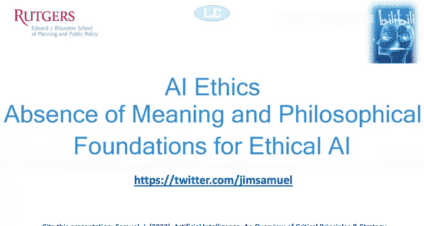

# 罗格斯大学《AI概念和策略｜AI Concepts and Strategy》中英字幕 - P19：18_AI伦理中意义的缺失.zh_en - GPT中英字幕课程资源 - BV1nZjCznE7k

Given the scope of this talk， rather than getting into the specifics and the nuts and bolts of AI ethics in specific domains。

 what I want to do is highlight some of the root problems which associated with AI ethics and the first one is that ethics is essentially defined as a branch of philosophy。

 dealing with values dealing with morals dealing with separating right from wrong so on and so forth。

 if ethics is philosophical in nature， then ethical AI needs to have philosophical foundations for artificial intelligence itself。

But neither of we agreed on the definition of ethics nor have we agreed on a common understanding of what intelligence is let alone what artificial intelligence is and in some senses I think because of the limited because of the nature of machines and because of the nature of electronics in general。

 it may be easier to talk about artificial intelligence as a phrase than to come to an agreement of what about what intelligence itself is philosophically。

 however， the main point is，We are missing the philosophical foundations for artificial intelligence。

 we are missing the philosophical foundations for ethical AI。There's an overempha。

On applications and the development of AI solutions， there's an overemphas on coding。

 every person wants to code the next great machine learning algorithm。

 every person wants to develop the next mathematical model for a slightly improved optimization mechanism or an optimization algorithm。

 but we are missing the philosophical foundations， which should actually be foremost。

 and then those philosophical foundations should guide the development of the applications and the science side of artificial intelligence。

So here's one fundamental problem that I've been speaking about for some time that many developers of artificial intelligence。

 many corporations forget many government leaders forget this， or they're just not aware of it。

 it's not a matter of them forgetting they were never aware of it。

Artificial intelligence is like an emperor without clothes。

It is so not because artificial intelligence itself has declared itself to be an emperor。

 but it has been made emperor， or it has been perceived as being emperor or a future emperor by ill informed people。

And so called self declared experts who do not have a philosophical grasp of intelligence or artificial intelligence。

 The missing component is human meaning artificial intelligence does not have human meaning。

 So in some senses， it is okay to say artificial intelligence is meaningless once again it's。

There's no pun there， It does not mean that artificial intelligence has no value。

 but it means that it does not possess human like meaning。

What artificial can hold is a synthetic form of meaning。

I repeat artificial intelligence cannot possess the current technologies that we have the current。

Algorithms， optimization mechanisms and the current input of data。

 smart data and this whole cluster of technologies and everything that goes into constitute artificial intelligence。

It cannot。 It does not， and it cannot possess human like meaning making capabilities。

 What it can do is hold synthetic meaning。 What a synthetic meaning by synthetic meaning。

 I mean a probabilistic association of between digital bundles of bits and bytes。

 anything that we are calling as artificial intelligences， whether it is text to text。

 text to sentiment， text to image， image to text， and any variation， sound to text， text to sound。

 sound to image， whatever configuration we want to make。Ultimately， for the AI， every image。

 every sound， every piece of text gets reduced to bundles of bits and bytes。

And what we are doing is developing probabilistic associations between these bundles of bits and bytes。

 and then whatever new input comes in， we are matching it with stored models and then based on that it's providing outputs。

Based on the power of probabilistic associations， let me give an illustration。

If a particular configuration of variables leads to a victory。

 another configuration of variables leads to a loss。

 and artificial intelligence may be able to correctly classify when a team is going to win。

 but it does not understand the meaning of victory nor does it understand the meaning of the variables。

 It senses no joy， It senses no grief both the victory and the laws are the same。

 It is just a mechanical association of probabilities between bundles of bits and bites。

 Art intelligence， therefore cannot have an intrinsic sense of justice or fairness。

 the way human intelligence can。 Art intelligence also has no intrinsic sense of moral compass or identity。

 the way human intelligence can。 and what I have stated in just a matter of maybe a couple of minutes over the past few minutes。

 It has taken years。 It has taken decades， in fact， it。

Study some of these concepts and to get to this point where this can be articulated。

 But if these philosophical foundations are missing。

 then it is very easy to get swept away by what we see happening on the science side of things we are able to see some of the amazing developments。

 for example， with generative adversarial networks are some of the newer technologies where we can go from text to images which means you provide text Google has come out with stuff and there are others I believe Da to and others who have mechanisms。

 artificially intelligent mechanisms AIs which can。

If you provide a certain text such as yellow umbrella。

 it will produce a yellow umbrella in the form of an image。

 So it looks like the AI understood what you said， but not really it did not possess humanlike meaning capabilities。

 What it did is it converted that text into bundles of bits and bytes and found the associated bundles of bits and bys。

 probablybabilistically associated bundles of bits and bys。

 which were associated with the yellow umbrella。 So there is the absence of a moral compass in artificial intelligence。

 It does not exist the way it does in humans。 It once again。

 I emphasize you still can have synthetic meaning， but we must understand that it's vastly different from human sense making capabilities。

 I have a question， how do you teach an AI that it is fair if the quote below applies human to human。

 probably even AI to human in a limited sense， but perhaps not human to AI。

So there is this court in the Bible which says do unto others。

 as you would have them do unto you When we read it， we are able， it is rich and filled with meaning。

 it evokes imagination， it evokes meaning it evokes reason。

 it evokes ethical behavior in human intelligence because we are able to make sense of the text。

 we are able to think about ourselves。 we are able to think about others。 It makes sense。

And it also makes sense that we is that it is fair for us to do unto other others。

 as we would like to be treated ourselves。 we also understand the distinction between man and machine。

 man and animals， so on and so forth。So the question that would arises。Can a sentence like this？

Makes sense to an artificial intelligence in the same way that it makes sense to。😰。

A human intelligence to one or more human intelligences。 It will be possible， of course。

 to impart or to train synthetic a synthetic form of this two robots， but。

The complexity and the depth of understanding would be absent。

 and I'm not saying that it is impossible to some day reach a point whereby artificial intelligences possess such a vast。

Intensity and vast array of synthetic meanings that it parallels the human capability of sense making and reasoning I'm not saying that's impossible。

 All I'm saying that the nature is completely different。

 even if we were to have synthetic meaning hypothetically someday with singularity or sentient AI or self-conscious AI。

 if we were to get to that point where we someday hypothetically have those things in place。

 it would still be very different from。A human understanding of ethics from a human understanding of morality because philosophically the very foundations of meaning making in an AI are different。

 One is based on probabilistic association between bundles of bits and bytes and the other is based on experiential and existential truths it may be in part it may be it may vary from person to person community to community country to country but still human sense making is based on experiential reality。

 we experience pain， we have joy when we win and we face some grief when we lose the sense making and the meaning making is involved and it's real。

 so it's philosophically fundamentally different and hence and therefore the concluding comment here should be we need to work on AI ethics for human good。

 we need to understand the limitations of AI when it comes to AI ethics and we need to ensure。

It's human on top and ideally the AI augmented human on top when it comes to AI ethics and all ethics decision making scenarios and hopefully the session has been helpful on clarifying and stimulating some additional thought on AI ethics I would highly recommend that you read the adaptive cognitive fit paper that kind of。

Gives you an idea of how artificial intelligence can be used to augment human intelligence to improve performance in complex information scenarios I shall see you in the next talk thank you。

