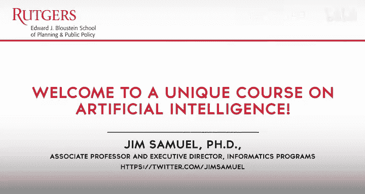
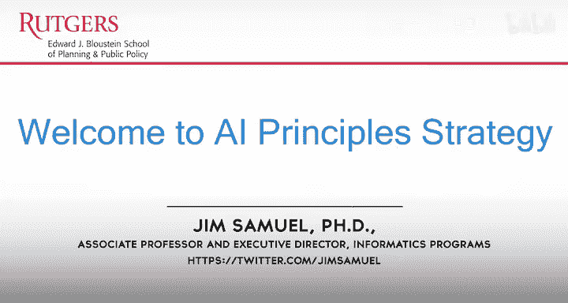

# 罗格斯大学《AI概念和策略｜AI Concepts and Strategy》中英字幕 - P1：0_AI简介.zh_en - GPT中英字幕课程资源 - BV1nZjCznE7k

Welcome to artificialific intelligencetelence。An overview of critical principles and strategy。

In this session， I'm going to provide you with a brief overview of what this course is about and also what it's not about。

So essentially， this is a course which is aimed at imparting。

A deep understanding of the concepts of artificial intelligence for managers and leaders this is not a programming course。

 this is not a course which emphasizes studying different kinds of ways to implement machine learning or deep learning algorithms。

 rather it's a course that discusses in depth， the concepts， the philosophy， the science。

 the principles and the strategy behind and the trends in artificial intelligence。

So we're going to start off with talking about objectives， what are the course objectives。

 what do we expect to accomplish over the session we also will talk about the specific topics that will be covered in each module。

 hopefully that will give every person a clear overview and you'll also be able to plan in advance so that you can pace out your readings and also aim to complete the main research project。

De grading is fairly straightforward， there's going to be practice work on a weekly basis associated with each module。

 and then you'll have one big project at the end of the course。

 which is essentially a research project which summarizes your views and your thoughts on certain aspects of artificial intelligence and artificial intelligence trendss。

We will also spend a few minutes summarizing the course highlights one of the unique aspects of this course is that it's research driven which means there are so many artificial intelligence courses out there and I have myself looked at a number of them I have myself learned a lot from a number of those online courses and you very good courses at Stanford and MID and there are courses which have been offered other courses at coursesera and on other platforms and then the question arises why another course in AI and the answer to that is this course is unique it is research driven it's based on research that has focused on the interaction between human intelligence and artificial intelligence I'm going to explain a few more thoughts about that part of how this course is unique at least some aspects some aspects are going to be common because when we're introducing artificial intelligence you speak about the basics you speak about what everyone talks about but hopefully from a unique perspective。

Then we have a fair amount of unique content or and unique perspective on AI that this course will provide towards the end of the session。

 I'll provide you with some tips for this course and of course。

 a few concluding comments so artificial intelligence is。One of those areas。

 which is evolving and changing very quickly and。Part of the reason is。

Artificial intelligence is not one。Pure。Silloed science。Artificial intelligence is multidisciplinary。

 transdisciplinary， it's a multidimensional paradigm。

 which has very significant implications for individuals， for communities， for organizations。

 and for the world at large。It's very important to understand so there's the implementation side。

 which we are all familiar with different kinds of artificial intelligence apps that we all use on our phones。

 on our computers， and for those who are in certain domains。

 you may be working with robots that use AI， so on and so forth。

This course will help you understand two critical aspects。

 one is the principles that drive artificial intelligence and the other is the strategy side of artificial intelligence。

 which is more。Which is more oriented towards you understanding how do you use artificial intelligence as a manager。

 how do you use artificial intelligence as a leader？This is very important because。

You may be able to code the best machine learning algorithms， however。

 if you do not have a clear strategy in terms of how those algorithms may help your governance。

 how those algorithms may help your business may help your return on investment may help if you're in a public entity and you are trying to use machine learning for social good。

 you need a strategy without a strategy。You will get the thrill of creating the next great machine learning model or a unique way to move from big data to smart data。

 but it does not ultimately lead to the most optimal results。

 So strategy is critical to understanding artificial intelligence strategy is critical to move towards optimality。

This course is introductory in nature at the same time。

 so in the first one or two sessions it starts off slow by talking about artificial intelligence。

 it lays down the basic concepts of artificial intelligence。

 but from a unique perspective and then it moves on towards some much deeper research drivenve thoughts and research drivenven lessons another unique aspect of discourse is that towards the end。

 hopefully you will begin to appreciate a philosophical view of AI as opposed to an applied view of AI which focuses on coding and creating AI applications in a philosophical view of AI。

 you try to think in terms of what is artificial intelligence and for that matter what is intelligence defining just the word intelligence has been a tough task defining intelligence from an ontological perspective。

 what is the nature of intelligence because。A view of intelligence。

 purely in terms of the outward expressions of intelligence is a very limited view of intelligence。

 It really does not serve the purpose。 And yet， that is primarily the dominant view that has been taken when it comes to dealing with artificial intelligence。

 And we'll speak more about that later on in this course。Also just a quick note。

 this course is essentially a subset of the artificial intelligencelig course from the Master of Public Informatics program at the Blausstein School at Rutgers University。

 so if you want more information you can go to that link and it provides you with additional details about the entire set of courses and even the full version of the course Artificial Intelligence Prae Principles and strategy。

