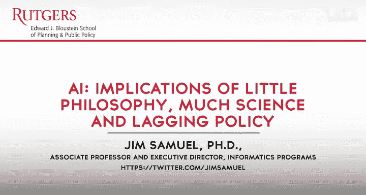
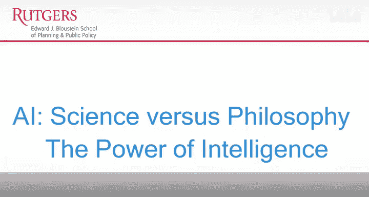

# 罗格斯大学《AI概念和策略｜AI Concepts and Strategy》中英字幕 - P20：19_AI科学vs哲学：智能的力量.zh_en - GPT中英字幕课程资源 - BV1nZjCznE7k

Welcome to today's session on artificial intelligencetel implications of little philosophy。

 much science and lagging policy。In today's session， we are going to talk about。

The state of artificial intelligence。As we see it now。We have a scenario where。

There is a significant emphasis， or if I may say over emphasis on coding applications。And。

There is relatively。Limited understanding by most of the folks who are creating these artificial intelligences。

 including apparently at major artificial intelligence companies。

A limited understanding of the philosophy and the ontological nature of artificial intelligence。

 and we also have a policy scenario which is lagging。

Which means it's playing catch up as it was dealing with technological innovations in the past。

 it's trying to use the same speed and the same approach。

 but trying to broaden its scope and is that going to work？Probably not。

 and I'm going to share my thoughts on these issues in greater depth over the next few minutes。

Briefly， but still hopefully in greater depth。So we start off by talking about artificial intelligence and there's been a jungle of definitions of artificial intelligence。

Starting in the 1950s where McCarthy coined the term artificial intelligence。

 and then he went on to clarify that artificial intelligence on one， on one hand。

 the the the foundational notion was that we are talking about。

TheThe computer's ability to perform some of the tasks and to display a human like intelligence output or deliverables。

And then on the other side， you have McCarthy stating later on that artificial intelligence is not expected to be a simulation of human intelligence。

 so fast forward to more recent definitions， we have some definitions which are technical in nature。

 some definitions which focus entirely on the computational ability of what we call as artificial intelligence to produce the results or the functions of human cognition such as the human ability to hear and interpret audio。

 the human ability to see and interpret images and videos and real life scenarios。

One ofOne of the more what I would call is interesting definitions。

 a couple of them I've listed on these slides。One is by Arry and others from the field of information systems where it says artificial intelligence refers to the ability of a machine to perform cognitive functions that we usually associate with human intelligences and then list them as perceiving reasoning。

 learning， interacting with the environment， problem solving。

 which has been a part of the classical definition of artificial intelligence。

 whereby the understanding for a couple of decades has been that if we can get a machine to solve problems just as human intelligence would。

 just as the human mind would， then we're kind of getting better at this business of creating artificial intelligence。

And finally we are at a point where we have technologies that are actually demonstrating creativity。

 which means you have got AIs which can support at this point of time。

 I would like to say it supports or it augments human musicians AIs can be used to create art in some senses it's a modification process because you have to feed in a lot of training images to get a particular kind of creative painting done by an artificial intelligence then we have a paper which I myself fled and its forthcoming where AI is defined I would not say that we defined it。

 but rather we described artificial intelligence as being a collection of technologies。

 mathematical and statistical models and a vast array of diverse types of data so in this perspective artificial intelligence is like。

The sense it is human perception of intelligence associated with a system that contains multiple technologies such as if it's running in a factory then we are talking about robotic arms and robotic devices if it's in the context of a self-driving car and autonomous vehicle。

 then it's the components of the car those the associated technologies and all of these artificial intelligences are foundationally running on mathematical and statistical models。

 it's running on optimization models and the huge leap。

 the way we got past the previous artificial intelligence winter is based on the fact that we developed capabilities to acquire store and process vast quantities of catch the phrase big data。

 so essentially we've become much better at that， we had the hardware。We have the juice。

 we have the capability to do inmemory processing for vast quantities of data。

 so this technological improvement along with our ability to acquire store and process vast quantities of diverse types of data has really given a boost to AI capabilities。

 the second part of the definition speaks about the purpose that seek to model or exceed human intelligence functions or human intelligence capabilities。

 which means an artificial intelligence which is specifically designed for a specific purpose。

 such as highs speed stock trading within certain parameters。

The AI would be able to perform high speed stock trading。

 algorithmic high speed stock trading would work better than a human being trying to manually implement that AI has the benefit of speed。

 AI has the benefit of consistency and from a technology perspective it is。

Completely beyond human capability， for example， to trade 100 times within one second or even 1。

000 times within one seconds， while that is something that an algorithm would have the capacity to do。

So what does that leave us with， That leaves us with an environment whereby we are still。

Trying to define artificial intelligence and simultaneously we realize that classical questions such as the question posed by S in his question number 18 in his quite famous paper where he speaks about the limits of intelligence and he he kind of points out that we have not clearly。

Described intelligence in terms of understanding the identity。

 the nature and the constitution of it just plain intelligence and yet that's generally associated with human intelligence。

 though some people and some experts like to just speak about intelligence generally and then speak about human intelligence separately and machine intelligence or artificial intelligence separately。

 but the fact is that the question of what is intelligence remains unsolved for the most part。

 we have multiple definitions， it's not that there's been a dearth of definitions。

 but we do not have persuasive and conclusive definitions that can be applied across scenarios so that remains a work in progress。

Now， when we look at the definition that I have used or R has used or others have used。

 there are words that we are compelled to use such as。Aceed human intelligence functions。

But human intelligence functions itself is an area of study， we have not concluded。

 so when we speak about artificial intelligence， developing artificial intelligences which model or exceed human intelligence functions。

 we are talking about we are talking about developing artificial intelligences which will perform better than an abstract standard。

The artificial intelligences that we are developing just by the nature of computation。

 it's very specific， we are able to measure the time。

 we are able to measure the computational resources that's required。

 the we are able to measure the extent of degree of calculations involved。

But the benchmark that you're comparing it that is human intelligence， it's an abstraction。

Aificial intelligences work in a siloed manner， which means we are yet very far away from an artificial general intelligence AGI。

 or we are quite far away from an artificial superin that is even more distant。

What we have are narrow artificial intelligences and artificial intelligence which can specifically play the game of go and play better than a human intelligence。

 we can have another artificial intelligence which performs another function better than a human intelligence。

 but we do not but when we compare these artificial intelligences with a human intelligence， it's。

The human side of it is an abstraction because the human side of it processes multiple things simultaneously。

 and it does this integration in a far superior manner than we can ever get AI to with our current set of technologies in the current stage of the development of artificial intelligences。

When we look at the first definition on this slide， we have similar problems because we speak about。

Perception， reasoning， learning and interacting with the environment。

 But when we speak of perception。Human perception is vastly different。

 even animal perception is vastly different from the perception that we associate with artificial intelligence same thing goes with reasoning。

 though we use the word reasoning， for example， in the game of chess or in the game of go。

Human minds use a combination of reasoning and intuition to play a game。Sometimes， of course。

 people wing it。Which means they're just trying their luck。 but that's all part of。

Human intelligence， when we speak about a machine playing chess， it is not。

Reasoning in the abstract sense of reasoning， it is computation。

 the AA chess program or an artificial intelligence that plays chess。Essentially follows。

Certain rules。And it explores possibilities。 the initial set of programs were completely。

 if I may use the word very loosely mechanical in nature。

 which means it just listed all the permutations and combinations at each stage and selected the moves that led to the best outcomes fast forward today's programs of course。

 are based on machine learning methods， which means the computer learns can learn to play a game the AI can learn to play a game like chess。

 but it still does that on now it's not just a matter of rules。

 but it's got probabilistic models which enable the artificial intelligence to learn。And still。

 so it is， if the first stage was， like I said， loosely said， mechanical in nature。

 whereby it just considered all the computationutations and combinations in the second stage。

 it is still mechanical part 2， in the sense that it's using a different。Method。

 but it is still using the same approach of a mathematical base。

 So instead sort of using a deterministic logic， it's using a probabilistic logic to learn and play the game and win。

 which is very different from the way human reasoning works for the human entity So I I conclude this point with this part。

 And that is for the human entity。 There is joy associated with winning and losing for the computer winning or losing。

 There' is the there's no meaning to winning or losing。 It's just a digital process which it is。

Programmed to achieve。So when we speak about reasoning， when we speak about learning。

 when we speak about perceiving， the artificial intelligences do that。

 but in a very different sense from the way the human intelligence does it in the early stages of deploying artificial intelligences。

 these are not big issues， but subsequently these become big issues when we speak about how we expect artificial intelligence to interact with human intelligence。

 how does what should be the position of human intelligence in an AI intense environment。

 so that's some of the challenges that remain to be addressed。

