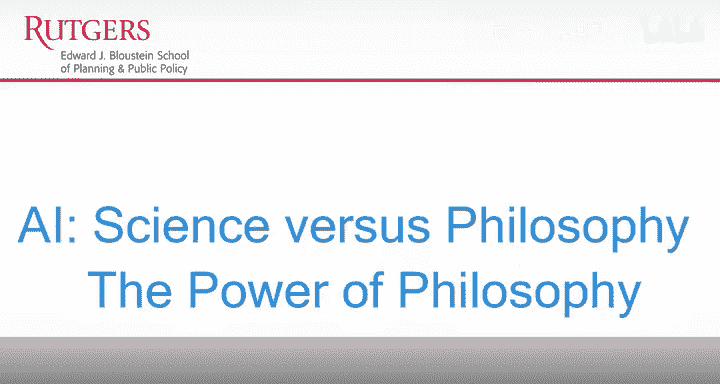
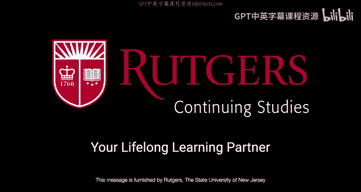

# 罗格斯大学《AI概念和策略｜AI Concepts and Strategy》中英字幕 - P21：20_AI科学vs哲学：哲学的力量.zh_en - GPT中英字幕课程资源 - BV1nZjCznE7k

And here's a more colorful slide and a set of thoughts which could take a few hours to explain。

 but let's see if I can put this into a nutshell and get the key concepts across first。

 a classical example by one of the faculty at Stanford where approximately the story goes as you enter the sentence。

 the spirit is willing， but the flesh is weak， which is a scripture verse from the Bible。

 and so when the human intelligence reads it， there's a certain context as a certain understanding and it's supposed to evoke a good and spiritual sense and you telling you that the meaning is that even if you have spiritual values and even if you have spiritual inclination。

 a desire to do good， but the flesh is weak， you have certain human rap in cities and you don't always wind up doing all the good that you want to and you often wind up doing some of the bad that you are trying to avoid。

But when we speak about artificial intelligence， this， this was an exercise whereby the sentence。

 the spirit is willing was fed into an NLP system。 The NLP system converted it to Russian。

 and then back to English。 When it came back to English。 the for the same sentence。

 the output came as the what is good， but the meat is Raja。呃。

And we kind of see the connections we see， we can kind of connect to the fact that this is how the NLP system may have arrived at this conclusion。

 we can make that we can go into the models， we can study it and we can kind of draw those conclusions。

😊，But。The meeting is totally different。From a probabilistic modeling perspective。

 from an you know NLP optimization perspective， yes。

 the computer did the artificial intelligence did it and it's probably quite it's probably got good probability scores with this output。

 but from a meaning perspective。The AI system has essentially failed。

 and that is where we see that there is a need for us to understand AI better。

Some of the claims by leading companies。s as some time ago。

 I heard a claim and there was this fascination， at least in the media， hey。

 we got one NLP system and artificial intelligence to talk to another artificial intelligence and guess what they created their own language。

Of course I didn't get a chance to study it in depth but from the little that I could decipher and then I lost interest in it because I have myself run NG that's natural language generation models and generated text and when I see gibbish come out I call it gibbish but in this case the gibbberish that came out had was glorified into a language between machine A and machine B or AI1 and AI2 that is not the case because。

What we need to understand is that for the human intelligence。

 language is a representation of meaning， while for the artificial intelligence。

 there is an absence of intrinsic meaning and therefore when we find an exchange of words between artificial intelligence one and artificial intelligence2。

We cannot conclude that they are conversing with each other unless we see a purposefulness in it。

And when we see such purposefulness。Emerging， then we would be able to。

Investate further into the meanings that the AIs are associating。

 but in this particular example that I was stating where there was this claim that machines are talking to each other and they have developed their own language。

 I could decipher no such purpose。It was output from artificial intelligence1。

 you can get even even a school kid could use one of the energy models， run it on a computer。

 generate gibbberish and set it to feed another artificial intelligence which would then take that gibbish and produce more gibbish This is nothing to be excited about This is something to be concerned about。

 So it's very interesting that instead of being concerned about output like this。

 we actually saw this being glorified， at least in the media and it being promoted as some kind of a development in AI。

 No it's demonstrated that in that particular instance， at least to the best of my current knowledge。

 it appears that there's a problem there that needs to be fixed。

So with that I'm going to with those examples， I'm going to try to segue into some of the conceptual and theoretical points that I'm trying to make in the process of developing artificial intelligences and in the process of overemphasizing coding and you know methods such as machine learning。

 we seem to have lost sight of the more fundamental and the more important aspects。

 that is we need an ontological understanding， we need a deeper。Foundation in AI philosophy。

 and especially in the philosophy of human interaction with artificial intelligences。

 that will enable us to understand the substance and nature of intelligence and interaction between intelligences。

 It will also enable us to understand issues such as meaning。In intelligence。

 meaning in human intelligence， meaning in artificial intelligence。

 what are the sense making processes employed by human intelligence。

 how are beliefs developed in human intelligence， and how does it contrast with what we see as we being able to do in the development of artificial intelligences？

It will also help us interpret the influence of artificial intelligences on social ecosystems。

Society is being transformed by artificial intelligence。

 and there's no doubt that that transformation is going to continue。 It's going to be significant。

 Lives are going to be impacted。But。Currently， we don't even have siloed in depth。Understandings。

 commonly established understandings of AI philosophy and a philosophy for HI's interaction with AIs。

 That is， when I say HI amm referring to human intelligence and AIs。So what's the problem。

 let's say we call the philosophical foundations as XA， we call the impact of using AIs as XB。

 where we have issues such as ethics， dignity， identity， and the corresponding visible effect， as YB。

 where we speak about effectiveness of input， logic and output， data， technology models。

 so on and so forth。We speak about Y as being the input logic where we speak about what is it that goes into AI and YD as being the final implications such as we see bias。

 So once we have issues on once we see that。Ethics， dignity and identity are being impacted。

 Then we are able to draw the implications。 post hoc saying that there's bias。

 So we ran an NLP system and the NLP system display gender bias。 So there was an impact on ethics。

 there was an impact on dignity based on gender and the final conclusion is。

 we observe bias in some cases， like， for example， in the use of artificial intelligence systems to manipulate election results。

 once it's。Complete then post hoc we say such and such election was manipulated using disinformation which was propagated by artificially intelligent technologies。

 disinformation or misinformation is bad enough when it's done without using AI。

 but it becomes super powerful， the effects of misinformation， the effects of fake news。

 it's amplified when we use artificial intelligence。So we are deploying。

 we are developing and deploying these AI technologies and we are expecting so we are in some senses。

 we are trying to develop and adapt whyA that is the input and logic and the technologies that are being used to create AI applications。

And our expectation is that we will tweak or change YB， which means we will change the NLP models。

 If the NLP model is displaying bias， we're going to change those models。

 we're going to debias or unbias or take the bias out of those models。

 which is essentially saying you're going to manipulate the data from one perspective。

 that could be the conclusion。But the question is， do you have the basis to do so or not。

 do you have the justification to do so or not， and we are using， therefore going from Y A to Yb。

To YC and YD to address problems in Xb， for which really the solutions exist in X A。

If the solutions exist in Xa， whichs。Philosophical foundation， understanding the nature of AI。

 understanding the limitations of AI if we cannot understand the limitations of artificial intelligences。

The actual， the abstracted limitations of artificial intelligences。

Unless we understand AI philosophy better， we can understand the limitation of artificial intelligences in terms of what is it that an app can do。

 You we know， for example， a computer vision app cannot hear or play chess and and and we can also establish within the within the aspect of computer vision itself。

 we can establish certain boundaries， but that is。That is trivial that is a trivial issue。

 we are simply talking about measuring and establishing capability boundaries。

That's not what I'm talking about。 I'm talking about fundamentally， from an abstracted view。

 What are the limits of artificial intelligence， For example， if we were to conclude。

 if we were to conclude that artificial intelligence is incapable of。

Intrinsic meaning of developing intrinsic meaning and therefore incapable of holding human like beliefs then。

By definition。Artificial intelligences cannot and should not be used for judicial processes。

 except for basic tasks like search and find or something of that nature。

 but it cannot be used as a recommender system if we were to philosophically establish that AIs are incapable of human-like meaning Why should we use something to influence human judicial thinking and human judicial decisions or even granted autonomy as some have suggested。

 when it is incapable of creating and holding meaning and beliefs the way the human mind does so yes。

 there are efficiency advantages we have a backlog in courts and there is a need to process it。

 but that does not that does not justify the kind of risks that are produced by using applications without a strong philosophical foundation。

Most of the emphasis。In AI， it's like a gold rush， everyone is madly rushing into artificial intelligence。

 but most of the emphasis， unfortunately， is on coding。 And I don't say that we should stop coding。

 all the more， we should code， and there should be more people getting into coding。 But my point is。

 we need to give。 We need to foster。 We need to cultivate serious attention to AI philosophy。

 There should be a balance。Those philosophical foundations will then help us to generate better applications。

 we will be able to set better goals for the AI applications。

 we'll be able to set better expectations， it will be more sustainable and it will result in greater good。

One of the key aspects of this whole thing is policy。

 how how do governments deal with the development and deployment of artificial intelligences and then there's also how do lawmakers work on this at the micro and macro level I think at the macro level there's in some regions especially there seems to be some feverish activity that's picking up whereby people are saying you know AIs are powerful。

 AIs are invasive and one of the concerns is privacy and we are still using the information systems。

 the information age mindset to deal with artificial intelligence that's not going to work。

The technologies of the internet era， the technologies of the information age。

Are significantly different。From artificial intelligence。

 artificial intelligence is a different paradigm in terms of。Technology。

And the reason I say so is because in the information age。

 we had a whole lot of information and human intelligence essentially became more valuable in the information age。

Human information， sorry， human intelligence became more valuable。But。

Fast forward a decade and we have the we have the we are at the cusp of an AI revolution。

 some experts say it's already here， some experts say that we are entering into it。

 some experts say we are just about to enter into it。

 whatever it is the general feel is that we have reached that tipping point。

The difference with artificial intelligence is that artificial intelligence replaces human intelligence。

It's not about you need more human intelligence to use artificial intelligences， but in the AI。

Let's say we look into the future a decades ahead， a couple of decades ahead。

We are talking about a technology or a cluster of technologies that will replace a significant percentage of human intelligences in terms of their economic functions in particular。

And then power will tend to be more concentrated with those who create。Control。

 maintain and develop these artificial intelligences。 And what is going to safeguard us is policy。

And policy， which is grounded in AI philosophy， policy， which is not grounded in AI philosophy。

 will not lead to sustainable human good policies which are looking at a technology or there is or there is a computer vision。

Application that's come out。 let's regulate it。 and here' is some other machine learning algorithm that's grabbing information from people and learning to manipulate them and let's regulate that that approach。

Some of those rules are needed， and I think that that's good and useful。

 but it's not sustainable because those technologies keep changing and there is no way that these policies can keep up with the rate of change of technology。

 So the old strategy that we used with previous era technologies is not going to work with artificial intelligence。

 It misses the point completely。You need proactive policies。

 policies which go ahead of the technology applications。

 policies which are based on AI philosophy and have the capability to serve as an umbrella policy as an umbrella set of rules。

 I'm not in favor of overregulating Well I'm talking I'm not talking about the quantity of regulations。

 in fact， using AI philosophy to drive policy may lead to fewer rules and regulations。

 but something that's more sustainable， something that more more accurately covers a trajectory of AI applications rather than individual applications by。

Different AI giants。It is very important to have a philosophical understanding of artificial intelligence and for that you have to go back and also first study the intelligence itself and the nature of intelligence and in particular human intelligence。

And that then forms the basis once you have a clear understanding of human intelligence。

 then that is the best。Resource for you to manage artificial intelligence。An absence。

 a poverty of an understanding of human intelligence then leads to a weak siloed。

 unsustainable approach to developing and using artificial intelligences So if we have listened to this and come to this point you are on a journey of learning and engaging artificial intelligences and I wish you the best in that process and I wish you the best in your learning journey and hope that you will take it upon yourselves to dive deeper into artificial intelligence philosophy and its implications for human society Thank you。

