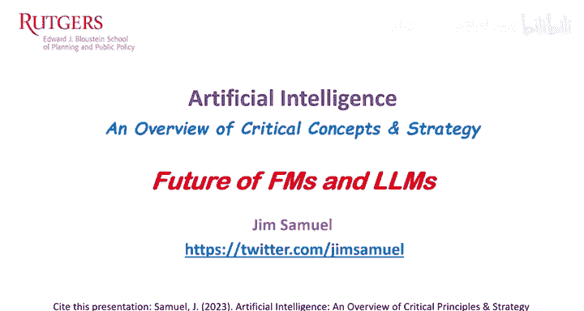
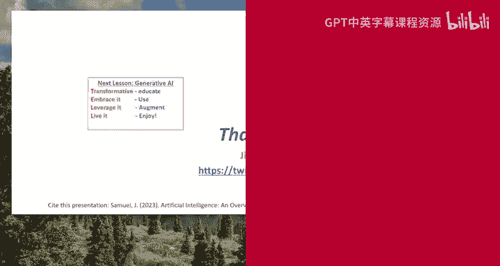
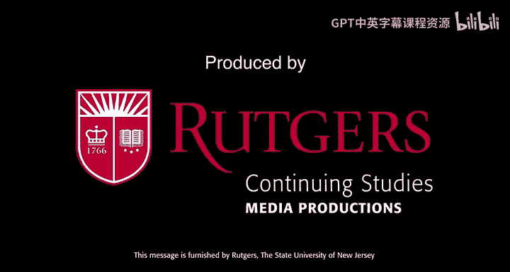

# 罗格斯大学《AI概念和策略｜AI Concepts and Strategy》中英字幕 - P24：23_基础模型与大语言模型的未来.zh_en - GPT中英字幕课程资源 - BV1nZjCznE7k

What's the path ahead for foundation models and large language models current scenarios what I see is extreme competition in the FM and LLM development space。

 I mean consider this a number of very respectable and extremely intelligent people called for a pause in the development of artificial intelligence models。

One of them was Elon Musk， again， extremely intelligent， very respectable individual。Thelon Musk。

 after leading and becoming quite well known for signing on the Do not develop foundation models。

Let that was signed and publicized， let's pause the development of AI for six months after that。

 within the next few months， just recently， his company， XAI， has released its own foundation model。

 which means in those months that he called for a pause， his company， his newly started company。

 developed its own large language model。Suchuch as the nature of competition。

 I believed that all those who called for a pause in AI were sincere。

 but I disagree with that call and I've put out an article out there。

 I think at some place on the course I've provided a link to that article and what I find fascinating is that even those who called。

Such is the nature of competitive pressure in the development of foundation models and other AI technologies that even those who believe that this is no good。

 we should not do it， those who signed public statements， even they went ahead to develop。

More of the technologies that they called that the world should pause developing。

There's an there's a hyperactive gold rush also in the end user level AI apps。

 which means we have the foundation models which are expensive。

 it's a huge exercise computationally and from a resource perspective it's expensive and that's happening many companies are investing into it there's a lot of money available that's gone into artificial intelligence so it's being developed but when we but it's still few because of the resource limitations and requirements it's fewer in number however。

 when you look at the。When you look at the end user level AI apps that are being developed。

 that space is completely crazy。 It's like a gold rush again， I track。

A few hundred pretty decent AI applications that were built on the applications built on the large language models and then I gave up because it was too tough to keep up with everything that's going on in that space especially with generative AI very fascinating so we're going to see that kind of we're going to see that kind of a jungle effect and I hope that good companies don't fail because when we have that kind of a hyperactive gold rush。

 some good companies will survive， most are all bad companies and bad products。

 bad inventions it's going to be a survival of the fittest they will drop by the side。

 but sometimes even good ideas die out because the timing was not right or they didn't have sufficient investmentss or didn't get sufficient visibility I hope that doesn't happen。

The current scenario is extremely fascinating and very engaging。

 so if you are in this space I would say it's good to be fascinated but disengage when you find that fascination to be counterproductive if you're not getting things like sufficient sleep if you are your team working on AI is just not able to enjoy life then it's time to rethink。

 disengage and say okay let's focus because there's so much happening one of the key strategic aspects in your pursuit of artificial intelligence space competitive advantage is focus you need to be very clear about what is it that you want AI to do for you and then you have to develop the art of excluding everything that is not required for the meeting for excluding everything that you don't need to meet your goal。

The problem with artificial intelligence is for those of us who are in this space we find everything fascinating。

 we find what's happening with large language models fascinating。

 we find the space of reinforcement learning and robotics extremely fascinating we find what's happening with computer vision very fascinating and and N number of other areas and then there are experts are saying we are kind of stretching we have reached a point where where we are seeing diminishing returns with our investments into foundation models and LLNs and we can only go horizontal。

 we're kind of hitting a block with the depth that we can achieve so there's other there's other attempts by companies to even do things like create GAI or general artificial intelligence I don't think we are quite there yet but that's not going to stop companies from kind of muclling their way into creating some form or resemblance to GAI so we'll see how those things develop so all of this is going to come along with quality issues risks and regulations。

Quality issues we should expect at the early stage of any industrial revolution at the early stage of any technological revolution and this is definitely a revolution it's a beginning of the fourth wave fourth industrial revolution it's a good kind of a paradigm it's a good way to define this paradigm or to describe this paradigm we are going to face quality issues we're going to see new risks emerge that's to be expected。

Regulationss。It's good to say regulations are good and in 20202021 I even wrote an article on scholar strategy Network。

Saying we need regulation but。What I called for and what is currently happening， there's a huge gap。

 What I was expecting。 and what I was hoping is we would see regulations which mandate open source。

 which would compel companies making these foundation models to declare 100% of the data that's gone into it。

 I want to know if。Papers I've written or other notes that I've made maybe on social media have gone into the development of these foundation models today I don't know because there is no law protecting the public ownership of data so these so the companies who have made these foundation models some of them have declared some of the data they have used and I think very few have made it completely open source in fact openAI which was founded on the principle of open source artificial intelligence has led the way to creating black box solutions and in that sense on one side it has rendered great service by creating one of the excellent and one of the best LLM applications and on the other side by taking a black box I think it has done the scientific community some amount of。

And long term harm， because now what will happen is prior to。

Open AI and Microsoft teaming up to create black box AI technologies prior to that。

 the trend was quite Democratic in nature。 Everybody loved open source research was freely published。

 The research community was able to see the latest and greatest that's happening in AI technologies。

 but now things have changed so。Coming back to my point on regulations， what we need is。

Not just regulations， but the question is who's framing these regulations and what's the end goal of these regulations？

Fair enough the nature and the power of AI is so great that we need regulations。

 but we really need regulations that support open source and that transfer the power of control over artificial intelligence to the people。

Not regulations that help concentrate power with corporations with certain limited government agencies。

And make it tough for people and small startups to survive in this environment。 Unfortunately。

 the traditional approach to technology regulation does exactly that。

 And it' will be a great tragedy if we allow AI regulations to go the same route。

 helping the big companies， giving an appearance that they are being regulated while in reality。

 we are allowing them to set up。Almost monopolies， and we are blocking smaller players from getting into that space。

 we are blocking the people from having full access。

 full knowledge of the technologies that will so strongly influence their lives。

Foundation models and LLM speculation on the future。

I think the competition will taper out over time and part of this。

 the reason is companies will focus on specialized foundation models and LLMs。

 the cost for maintaining and updating broad generic foundation models and LLMs will be much higher than the cost of developing purpose specific domain specific that's domain specific can function specific models and applications。

呃。I think foundation models and large language model apps will replace human beginners。

 human workers from the beginner to the intermediate level straightforward replacement。

 we need to accept that fact and maybe need to figure out what do we do with those what do we do with people who would have。

You know， kind of gotten those jobs as beginner to just about intermediate level foundation models and large language model applications will augment human workers at the intermediate level and towards the expert level workers at the expert level when the work that you're doing is highly specialized highly complex so on and so forth then。

Foundation models and large language models will serve a kind of an auxiliary support role maybe in some cases we could call it that it's reaching augmentation levels。

 but it's mainly primarily I foresee being at the support levels I also see that regulation unfortunately will continue to increase。

I would say that it is fortunate that regulation will increase if the regulations。

As we see more regulations， if the directionality of those regulations is such that it gives power to the people。

 power over artificial intelligence technologies， the GPTs， the general purpose technologies。

 and power over artificial intelligence applications if it's transferred to the people。

Then it's helpful。 I don't say that companies should not be for profit。

 companies should be for profit， but there should be a balance between the open source aspect and the proprietary aspect。

 and that balance should not be decided by the companies who are capitalizing on these technologies。

 that balance should be decided by the people and genuine representatives of the people。

 representatives were sincerely concerned about giving power over AI to the people。

Then more regulations， if that is a directionality， then more regulations would be good。

 I think at some place I'm not sure if it's in this deck。

 but at some place I've mentioned that if we want to do a conceptual split。

 it should be like 80 to 90% should be open source and 10 to 20% is sufficient should be sufficient to。

To allow proprietary technologies layer onto the open source items and develop proprietary solutions which you then provide as production services on a for profit basis。

Yeah。Yes。Another important comment on foundation models and LLms， unfortunately， another。

False narrative that has been created and spread around for whatever purposes by completely uninformed folks。

 I think and obviously this is my subjective opinion is that artificial intelligence will somehow lead to the extinction of humans it's it's that narrative can only serve。

Ved interests so to say， which means I don't know。It just doesn't make logical sense。

 and I will explain my thoughts over the next few minutes， but first and foremost。

 this is my opinion based on my current research， based on everything that I've seen so far。

 that artificial intelligences， foundation models and large language models and the like by themselves of itself。

Will not destroy humans。 It cannot destroy humans。 It's like a computer。 It's like wood。

 It's like metal。 It's like any other general purpose technology。

 It's what you do with it that will make the difference。

 So is it possible that artificial intelligence could be used by a powerful decision maker who has control over these As to do something wrong。

 yes。It's possible and especially it is especially more likely if you allow a tiny group of powerful rich people。

 I'm not against powerful rich people， I'm just illustrating， I'm just stating this as a concept。

 trying to demonstrate my point， that we need to give power to the people， that's my point。

So with all respect to the powerful rich people who control the AIs。

 but the potential for one of them or a few of them to cause maximum damage to humanity is high when they have unchecked unfettered control。

When it comes to artificial intelligence， the adage knowledge is power holds true。

F power over artificial intelligence。To be balanced。

Most of the general purpose AI technologies must be open source。

The same problem will arise if we say， but governments are regulating it once again。

 if there's a tiny group of powerful government persons or entities， then it's。

It's not power to the people。Its power to specific government entities and power to corporations。

 and that could be as bad as no regulations， from an implementation perspective。

 from a perspective of power and benefit to the people。

And my point is there is no there is really no sustainable argument against open source。

 I was very surprised with some of these strange arguments that came out of open AI when they kind of try to justify their reasoning for making GPT3 source and then subsequently chat GT as a black box technology。

 the reason is billions of dollars。I would challenge these companies if money is not the only motivation。

 then donate all those proceeds and stay true to the fact that you。

Did go black box only for the sake of protecting planet Earth and the illiterate people who cannot handle AI from becoming extinct。

 No， that's not the reason。 The reason is。That every person who studies AI seriously knows that artificial intelligence by itself will not destroy humans。

It's the people who control this technology。Who have the power to direct in direct artificial intelligence in whatever。

Direction they wanted to move。Hence and therefore it's very important to democratize artificial intelligence technologies and I could kind of systematically go through logical arguments which I'm currently working on it for a research article but it's out of scope for this particular class so I think I'm going to leave this session with these kind of motivational thoughts sprinkled with a bit of logic but mostly the force of highlevel arguments and then at some point of time I'll make when it's ready I'll make the research paper available for readings which will show the specific logical arguments which support the ideas that Ive just stated。

 so the solution for the future of artificial intelligences driven mainly for the next visible few years by foundation models and large language models。

Reinforcement learning and associated technologies is open source AI， both data and methods。

 approximately 90% open source， 80 to 90% open source and 20 to 10% proprietary layers on it。

Individuals must have ownership rights over their data data that goes into artificial intelligences must be declared when I make my writings。

 when any person makes their writings available。It is。Not with we do not。

 We are giving it with the expectation that those articles and those products of our public human intelligence are not going to be taken and leveraged for private profit。

 That is not the purpose of us sharing our data publicly， just because data is out there to grab。

 It doesn't mean that it is morally correct to do so。 So I， I myself and many others like me。

 We would not want the products of our intelligence to be converted to artificial intelligence without us explicitly。

Being informed that it is being done so， but that maybe be， maybe that is what's happening now。 So。

 for example， those who contributed to Wikipedia， they knew that they were contributing to Wikipedia。

 but。Many who contributed to Wikipedia may have thought about their contributions and may or may not have granted authorization for that to be used to create representations of human intelligence。

Just as a thought， I think that could be argued against it so probably a weak argument in the way that I've currently stated it。

 but just as a line of thought which could be extended further and argued better。

So we need open source， we need ownership rights over data， we need extensive AI education。

 I've not seen a regulation which says here's a billion dollars。

 we're going to educate the people right from school to college to current employees on what is artificial intelligence。

 what's the philosophy of artificial intelligence， what's the demystify artificial intelligence。

 get people to recognize it's a technology and allow them to understand how is it that they can allow artificial intelligence to augment them allow them allow the educate the people so that they will know how to prepare themselves for a future which is going to be filled with artificial intelligence technologies future regulations must have a dominating philosophy that is power to the people。

The litmus test for artificial intelligence regulations should be does this regulation give power to the people。

 does this safeguard people， does this ensure transparency。

 does this give people knowledge about the technologies？And maximize transparency。

And that's all for this topic on foundation models， the next lesson。

 which is the final lesson in this。Course is going to be on generative AI just a few again conceptual thoughts we're not going to look at code conceptual thoughts on what is generative AI and how is it going to shape our future you know I don't usually do this but once in a while when it just happens by itself it's good so next in the next video we're going to talk about what is generative AI how it can be transformative embrace it leverage it and live it Okay thank you for listening to this session and I look forward to talking with you over the next session Thank you。

