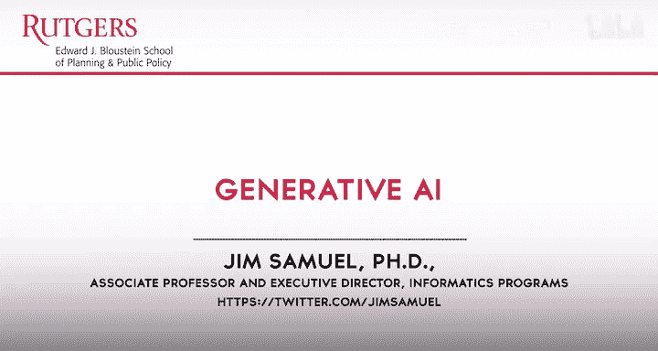

# 罗格斯大学《AI概念和策略｜AI Concepts and Strategy》中英字幕 - P25：24_生成式AI简介.zh_en - GPT中英字幕课程资源 - BV1nZjCznE7k

Hello and welcome to the final video， that's the final lesson today on generative AI。In fact。

 when I started preparing the course module， I was not expecting to do this particular session。

But given where we are at this point of time in 2023。

 I think it's essential that we talk about generative AI and it's kind of the capstone point for thinking about AI strategy for the present and for the next visible decade。

So the outline for today's。Lesson is we're going to talk about the concept of generative AI in the previous session we about we spoke about foundation models。

 the essence of foundation models， what's a large language model and kind of spend some time also talking about what the future is going to look like and how regulation will play an important role in the landscape。

In the AI landscape。We want to talk about how does generative AI work so what is generative AI is the constitution of generative AI and then how does it work then we want to look at we will talk about generative AI model types。

 generative AI applications I didn't have time to actually prepare snapshots I thought I'll do that maybe for a future aterationtion get down to actually taking snapshots of the products and the output of some of the AI applications。

Why do we need generative AI and that's a fair question given the high level of resources that are required to create。

 maintain and run generative AI it's a fair question why do we need generative AI and the answer in some certain business scenarios maybe we don't need generative AI。

 we don't need it as a part of our competitive strategy， we need it in areas A B and C。

 but we don't need it in areas Pq and R that's quite possible we don't need generative AI everywhere doing everything we may have other forms of AI which we could use in PQR and not Gen AI and finally concluding comments on generative AI and that's kind of an overview of where we will be it's quite important that you。

Watch the lesson on foundation models and large language models before watching today's session。

This current session。So what is generative AI？The concept。

Grative AI is a class of artificial intelligences that produces as output， text， images， videos。

 code。Applications， speech， even decisions and actions， and a combination of these。

So we are used to artificial intelligences giving us data point in the past。

 giving us output as data points， artificial intelligences doing things like playing chess。

 and using reinforcement learning they' are able to use artificial intelligence to make a robot。

 do a lot more things than it could do previously， but what's happened over the past couple of years is that we have a new breed。

 a new category of artificial intelligences which are able to churn out huge quantities of text that's up to us we can find you in the quantity of text it produces。

 but it has a capacity to produce huge quantities of text。

 which for the most part when when correctly done when humans look at it， it looks meaningful。

The same goes with videos， images， code， I think one of the strongest applications of generative AIs is in the area of writing code and I'll talk about that elaborate a bit more on that as we move along。

 but that's it that's the idea of generative AI we have we have spoken about what is artificial intelligence and the whole idea of technologies that mimic human functions。

 cognition logic learning and now we are using these technologies that we are created to mimic human intelligence to an extent that it produces。

Very interesting and creative images that did not exist before。

 very interesting text could be social media messages could be an entire email。

 we could get AI to write a chapter maybe a couple of chapters and combine it into a book。

 and it makes sense for the most part with some depending upon the topic on which you're asking the AI to write for you。

 you will also have to be careful about a couple of things but the concept is simple you have crossed a threshold in output and once you crossed that threshold。

 since the 1940s AI has been providing output In fact。

 one of the very first definitions or the test for artificial intelligence is that the output that AI produces was pegged against human output。

 which means if a human being is able to identify the output as being that of a robot。

 then it fails that during test if an artificial intelligence，Produces an output。

 and it's presented to a fair human intelligence。And the human intelligence cannot distinguish that output from the output of human intelligence then that's said to have passed the tu test。

 So the idea of artificial intelligence producing output has always existed。

 So that's not the point The point is over the past two to three years it's crossed the threshold in terms of quantity。

 complexity and continuity of output and that crossing the threshold is what has created this。

Wave of this phenomenon of generative AI and that's led to a wave of applications。

 a wave of inventions， and we are in a very interesting point in the development of artificial intelligence。

So I also want to highlight this figure， I think that's about as one of the objectives in this course。

 one of my objectives has been to simplify artificial intelligence provided in as。

There are there are so many places where you can look at artificial intelligence from a technology perspective my own early stage education about artificial intelligence was through the world of computer science I studied coding。

 did the coding and then I realized that，That world is incomplete。

 we need to be able to abstract it out if we want artificial intelligence as a for the people phenomenon as a for people paradigm。

 then we need to be able to abstract out the principles of artificial intelligence。

 and we should be able to understand it， explain it， and live it out。

So this image is about as simple a representation of generative AI that I could figure out。

 maybe in the future， I'll figure out ways to simplify it even further。

So what is generative AI recapping it from the graphics perspective we have got foundation models which we covered in the previous lesson。

 based on those foundation models， we are developing artificial intelligence applications。

These AI applications， they take in human input， that's what's commonly called as the prompt。

The prompt serves as the input。The input is piped into the applications and through the applications。

 it's piped into some fine- tuned version of the foundation model。

 the model generates output in the form of a series of tokens numbers and that's decoded and presented to us in the form of text or images as AI output。

Generative in terms of input， you can have text， image， video， you can provide anything as input。

 the most common is text and speech， you either type into bard or chat GT and you get stuff as output。

But you could also feed in images， you could also feed in code videos there's no restriction from a conceptual perspective from an application and usefulness perspective。

 we may have limitations or we may choose for more of one over the other the reason why you see that human slash or input is right now we are talking about human intelligences providing input to。

Artificial intelligence applications， but I'm putting it as human forward slash oh because as we move into the future。

 it's not just human intelligence that will be interacting with artificial intelligence applications it could be human and。

Or a augmented human Or a human who has set up an artificial intelligence to interact and provide。

Input to another artificial intelligence。 And that is where the human forward slash or that's。

 that's the logic behind that。 So think of the future in the future。

 a person may provide input to bard or child G or a person may set up an intelligent agent on their computing systems or on their cell phone or whatever it may be。

 And that intelligent agent when a particular point is triggered may provide。

Input to an artificial intelligence like ChanyP or Bard。So that's the forward slash O。嗯。

In terms of so you could have anything as input and you could also have anything as output。

 which means you could provide text as input， so one of the most famous applications out there is Open AIs DE。

 I think Open AI has really done a great job with some of these applications and really brought it brought out such an easy to use production grade tool that it's fun and it's powerful。

I've used， for example， Dal E， I used to have trouble finding good images for my some of the opinion articles that I've written and off late I simply use dial E because I'm very peculiar and particular about what I would like to see in those images and my own experience has been that I have better results。

 not just in terms of efficiency and speed of results。

 but just in terms of pure quality of images the images being closer to what I have envisioned working with。

A text to image artificial intelligence like Di， than I've had with working with at least a couple of human intelligences for the record。

If I were to read the best， the best would still remain a human intelligence。

 but if I were to average it out as to what would I rush to for a small opinion article。

 I would probably rush to a suitable artificial intelligence。

 which is into which I can provide some text input and as an output。

 the artificial intelligence would provide a brand new or a newly created image which matches or which is associated with the words that I have provided as input。

