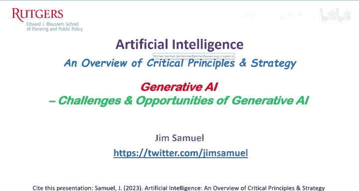

# 罗格斯大学《AI概念和策略｜AI Concepts and Strategy》中英字幕 - P29：28_生成式AI的挑战与机遇.zh_en - GPT中英字幕课程资源 - BV1nZjCznE7k

What are the challenges as we go through this generative AI phase。

 I think one of the big challenges are one of the big drawbacks we need to we need to be aware we need to be educated about。

What is the nature of the output that generative AI provides。

 which is why I emphasized in my previous lesson， you must understand that any digitized input that goes into a foundation model based。

Application and artificial intelligence application AI thinks differently AI is not thinking AI does not have an intrinsic sense of meaning as the human being。

When AI produces an output， it's producing an output purely based on the most appropriate probabilistic associations。

As a result of which。Generative AIs can produce a category of output。

 which I call as generative AI based stealth deception。

This is the kind of output that appears to be convincingly legitimate。

 which means when an intermediate level human manager looks at that output， looks right。

It looks legit， it looks solid， in fact， it looks nice。

 and now such a person who's impressed with the AI output may take a decision or perform an action which could lead to pretty serious consequences for that person or for that company or for that entity。

So this is very dangerous where AI output is misleading but looks very real and legit。

 and this should be distinguished from generative AI based hallucinations where the output obviously looks like it's gibbish。

Garbage when I was in school we had this you knowies to enjoy reading a segment of poetry if one may call it poetry at all。

 that's limes， limemerricks is very strange sequence of words。

 you usually get a good laugh out of it。But generative AIs， the hallucinations。

 maybe you get a laugh out of it， but it can be very annoying。

 it can be irritating as you deal with hallucination output from artificial intelligence。

But here's the good news。呃。It'll irritate you， but the likelihood of hallucinations causing serious damage is very low because you know that it's obviously it's not legit。

So it's not as dangerous as stealth deception。Haucinations are a reality。

 Some people try to justify the concept of AI hallucinations by saying that's very meaningful to the AI。

 Sure it is meaningful to the AI， but our。The reason we are creating artificial intelligence is not so that artificial intelligence can create output that makes sense to itself。

We are creating and using artificial intelligences as the human race so that the output of artificial intelligence should make sense to human intelligence and it should be useful for human beings so what happens with hallucinations。

 irrespective of the arguments that may happen in favor of hallucinations is that it's a failure of artificial intelligence。

Simply because it does not。Past the litmus test of making sense to human beings and being useful to human beings。

 apart from something esoteric like I'm doing research on AI I'm not saying that I am。

 but if a researcher were to claim that she or he is doing research on AI hallucinations and now AI hallucinations certainly become very useful to that person。

 that's a separate category but。It is not useful when the AI fails to perform the task that it was developed for。

 so hallucinations less dangerous but irritating。Low quality and high quantity of output general purpose foundation models and LLMs can sometimes lead。

 especially if the prompt engineering or the or the prompts are not appropriate。

 It could lead to low quality high quantity output。 you can get。Pages upon pages。

 hundreds of pages of output from a generative AI high quantity。

 but the content within it is not entirely wrong， it's not deceptive like in stealth deception。

 it's not hallucinating it's just poor quality， it's just interspersed with band logic or it's just interspersed with slightly inaccurate information which happens very often with generative AI output this can be a burden for any organization for any government entity using generative AI it can be quite cumbersome and quite damaging in the long run for businesses so we have to be careful to avoid the scenario for a number of reasons and one of them just being cognitive overload for human workers in this space where they are facing low quality and high quantity the high quantity part of it will drain out human capacity to moderate or regulate AI output。

sometime human beings will be able to moderate the low quality part of it， edit it， smooth it out。

 and keep the quality level going， but as the quantity of output AI output increases。

 human capacity to regulate and adjust the quality of output will decrease。

Counterproductive regulations so so far we have spoken about stth deception hallucinations。

 low quality and high quantity， all of this is describing the impacts or the effects of AI output。

 the negative that's the challenge side of it or the negative side of it。

 we've already spoken about how it can be very useful。

Another category of generative AI challenge is counterproductive regulations。

Regulations are necessary but we need regulations， the idea of regulations in a peoplecented society should be that these regulations are by the people and for the people a review of past regulations or technology have shown that they have not only been they have not been proactive in other words the regulations have not managed to capture and be sensitive to potential future changes in technologies。

 but also they have tend to they led to concentrations of power with large corporations so we need to rethink our approach to regulations。

 regulations are good and needed provided those regulations benefit people at large。The other aspect。

 you know there's a whole lot of other issues and challenges with generative AI。

 some of these are not specific to generative AI for example and it's common it' just it's just a common problem when we deal with large quantities of data when we deal with big data and when we deal with AI technologies。

 that is high performance computing resources， fatigue with generative AI。

 ultimately when we speak about using geneative AI。

 it requires human intelligences to interact with generative AI as generative AIs around us。

 create large volumes of text， large quantities of music， large quantities of images and videos。

 what will happen is that we will begin to experience。

AI fatigue and specifically generative AI fatigue。Information overload。

Very simply cognitive overload will begin to set in and we will begin to experience fatigue with generative AI and that。

It is difficult for I have not thought through all the consequences of fatigue with generative AIs but。

Based on past research on cognitive overload， I could see this leading to significant individual level and societal level challenges。

Increasing volumes of generative AI data may corrupt future foundation models what that means is that when we take a look at the current foundation models。

 they have been built largely on output on knowledge digitized knowledge which were human generated Wikipedia written by largely written by human beings and then we built the foundations based on data which were created and generated by human beings。

 in other words that knowledge，Was a digitized or is a digitized representation of human intelligence as we go ahead with the large volumes of text。

 for example， being created by AI applications， future foundation models。When we feed data into it。

 it's going to contain humangene knowledge， it's also going to contain AI generatedrated text and it is not yet clear as to how this will impact the behavior of future foundation models and large language models。

 even if we were to make efforts using watermarks and different kinds of mechanisms to exclude AI generated output from being fed back into the creation or the updating of foundation models。

 the fact remains that many people are many， many vast numbers of people are using AI for augmentation of their writing。

 which means they are not just allowing the AI to write it and then take it and posted on their website or put it into the report。

 they are depending on AI to write certain segments and then they' are paraphrasing it or they。

Editing it and that could disturb or escape watermark attention detection mechanisms and such other mechanisms so it's going to be challenging and it's something that we'll have to wait and see what happens then there's the same old thing that I mentioned as with other AI technologies generated AI is also going to go through its gold rush phase where everyone's rushing to use gene AI technologies。

 create applications， create services and they're going to get into a highly competitive mode and at that point of time it's going to generate new risks。

Generrative AI presents a whole lot of opportunities。

 there's opportunities for innovations and breakthroughs just as we spoke previously a few minutes ago ago our foundation models and their property of。

Hmogenization， so also we have this， we have this opportunity to use the other feature of foundation models the。

The ability of foundation models to lead to new discoveries， The ability of foundation models to。

Generate new。Yeah。Previously unthought of solutions， previously untought of capabilities。Emergence。

 the whole concept of emergence comes in and it's a powerful opportunity and I repeat what what I stated in the previous lesson。

 this is a great。Part this should be a strong part of any AI strategy that is within the domain that you're interested in。

 within your strategic business goals or institutional goals or government goals or even your individual personal level goals when you are working with foundation models。

 you must recognize that hidden within those large models。

 or capabilities that we have not yet discovered， and that should be systematic ways to search for to experiment with and identify if you can uncover those capabilities and that should lead to a wave of innovations。

 a steady wave of innovations and breakthroughs。There's a simple strategy for creating new businesses for startups and also。

For currently running businesses to update their businesses and to go the AI route。

 that is to ask a question。What business are we in， what have we been doing？

In terms of creating value for our stakeholders， and now the question is。

 how can you use artificial intelligence to create that value and more specifically in the context of this lesson。

 how can you use generative AI to create value？It's the same its the same it could be the same product。

 it could be the same line of service that you were delivering before。

 but now you asked the question how can I use generative AI to do or to provide the value that I was providing before and ideas for new businesses could emerge as you seek answers to this question there's also I believe the idea of AI augmented experts。

 AI augmented managers， AI augmented leaders。These are going to be a class of people who recognize the opportunity。

 the individual level opportunity with artificial intelligence。

They will enlist their time into understanding their own strengths and the strengths of artificial intelligence and then upon identifying the right AI applications that complement their own expertise。

 there will be a class of AI augmented experts who will appear to function at superhuman levels。

 that means as compared to the era when people were not using artificial intelligences to increase to boost their own personal level productivity。

It's also we are also entering the age of personalized personalizedization through the use of extreme adaptive mechanisms。

 so it is possible to use machine learning， neural nets along with generative AI to provide a level of adaptivity and personalization that we have not seen before。

There's another。Opportunity that I think a lot of people have not explicitly identified。

The age of artificial intelligence。Is going to give small players and small companies a powerful and probably short lived opportunity to compete with the largest of companies。

So artificial intelligence in some way， as long as it stays as long as it is democratized or from some perspectives。

 as long as the open source AI movement remains strong enough。

 there's going to be opportunity for small companies and small players to do something and this could be a real threat to some of the large corporations so for example。

 it is possible for a small company to use。Artificial intelligence technologies and specifically generative AI technologies to create a product or a service that could cause a real dent in the product or a service of an established company like Microsoft。

And this is also another reason why I emphasize that it is important that regulations give power to the people。

 otherwise regulations could place such a heavy， such a heavy burden that itll be fantastic for the large companies who are the resources to meet these burdens。

 but it will crush individuals， common people and small startups。Generrative AI driven apps。

 smart devices， all of the all of these are common knowledge and you as a student of artificial intelligence you have probably already read about or thought about these things smart cars。

 smart homes， smart cities， smart everything and all of these things will have a significant generative AI component embedded into it and the question remains are we going to move on from。

AI augmentation， such as generative AI based augmentation of humans to transhumanism。

 where there is a greater level of embodiment of the artificial intelligence technologies that we are creating。

And with that， this is the last lesson so that I'm recording for this course。

 so thank you for taking this course on AI strategy and in conclusion I want to leave these four words or these four ideas with you artificial intelligence is here to say one of the most powerful aspects of artificial intelligence is generative artificial intelligence where you can get artificial intelligence to create text images。

 videos called and a whole range of solutions for you。

there is no point trying to fight the wave of generative AIs， for example。

 if you are a website designer， you cannot you do not stand a chance if you say。

I'm going to improve my website designing skills in Python coding and I'm going to stand against the artificial intelligence and I will not use AI。

Unless you have a range of blindly dedicated clients who will work with you irrespective of what happens。

 an open market， if you were to use that with an open market strategy。

The likelihood of failure would be very high the right thing to do is to recognize the transformative power of artificial intelligence and generative artificial intelligences and then to embrace it so the first step the the the recognition of the transformative power of artificial intelligence happened with education so if you want to move ahead。

The first word is。Transformation or transformationative power。

 and that is associated with an action from your part。 educate yourself and all who you care for。

 whether they are children or adults， educate them on artificial intelligence。

 The second is embrace artificial intelligence。 So if you embrace artificial intelligence without being educated you could misuse it you could be overwhelmed by the power of artificial intelligence on and so forth。

 we have spoken about， I've spoken about it at length when I spoke about the intelligence between artificial intelligence and human intelligence。

 but。If you are educated， then you are able to use it in a powerful way。

 you are able to use it by recognizing it's another technology。And you're able to leverage it。

 so the difference that I make between you embracing it and leveraging it。

 embracing it is where you use it。You use it as in you use it for your daily activities。

Leveraging it goes beyond using it using it and now you are partnering with leveraging it is a form of partnership your perspective changes。

 you see yourself as partnering with artificial intelligence technologies with generative AIs and it augments your performance。

 it improves your output， it augments your human intelligence capabilities So that's the idea of leveraging artificial intelligence and generative AI technologies and finally you live it that's the point where you reach and you begin to enjoy this artificially intelligence ecosystem that's taking shape all around you right now it may look like a jungle but over a period of time as good apps make it to the top and you also develop your set of favorite apps that work the best for you as a person。

 you as an individual， you're going to begin to live it。

 you're going to begin to enjoy this artificially intelligent ecosystem So once again。

 thank you for taking this course。B wishes as you proceed with your journey and artificial intelligence strategy。

Thank you and care， bye。

