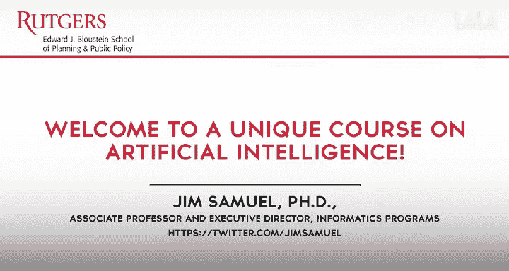
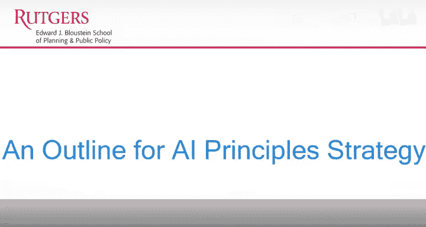

# 罗格斯大学《AI概念和策略｜AI Concepts and Strategy》中英字幕 - P2：1_AI原则与策略.zh_en - GPT中英字幕课程资源 - BV1nZjCznE7k

Hopefully， the conceptual direction of the course is clear。

What I also want to do is provide a systematic set of objectives so that we when we go through this journey through this course。

 we are kind of in agreement as to what we hope you accomplish so this course hopes to impart a partial understanding of the substance and capabilities of artificial intelligence。

When we say substance of artificial intelligence， it speaks about the nature of artificial intelligence。

 so it speaks about it and that understanding is very important。

To get a grasp of how artificial intelligence interacts with human intelligence。

As opposed to capabilities where we are speaking about what is it that AI can do？

An example of capabilities would be。Artificial intelligence being used for natural language processing。

 artificial intelligence being used for real-time translation， so you go to a foreign country。

 you have an artificial intelligence application or a robot that accompanies you and that robot is able to listen to people speaking in the local language and is able to translate it to your language that's an application。

The substance of artificial intelligence would address issues like what is the extent to which the robot has a an understanding of the language。

 for example， does the robot understand the meaning。

 does the artificial intelligence understand the meaning of what is said because if the robot does not understand the meaning of what is said。

 the risk of failure is high so it's very important to understand both the substance that's the nature of artificial intelligence and also the capabilities of artificial intelligence。

I use the phrase partialial understanding because understanding artificial intelligence is a long journey。

 so hopefully this course will help move you ahead。

The course also aims at improving your abilities to relate to AI concepts and the use of AI applications。

To understand the direction in which AI is moving， so we agree， most of us agree。

 all the experts are in agreement that artificial intelligence is moving ahead very rapidly。

 We are seeing new invention new inventions， new ideations of applications so on and so forth。

However， there is a trajectory， not everything is completely unpredictable。

 we understand that there are certain trends in computer vision。

 there are certain trends in autonomous vehicles， so we need to have a grasp of the direction in which AI is moving。

The course will also provide。Unique insights。At least I would like to think that they are unique on artificial intelligence ethics and risks The reason we call this as unique is because we all understand some of the basic issues associated with AI ethics。

 but some of the more significant issues like for example。

 it is commonly agreed that when we implement artificial intelligence。

 for example in a judicial setting or in a setting where human resources need to be evaluated。

 then we understand the importance of ensuring that the AI system does not contain bias。

 does not contain racial bias does not contain gender bias so on and so forth。However。

 what is not addressed is。How does this work and is the AI system capable of doing this sustainably The challenge there is that if there is a risk of failure in AI。

 then that risk can lead to extremely bizarre or extreme results as opposed to human failure which may follow some kind of a bell curve distribution but with artificial intelligence you could have extreme fat tails。

 which means you could have very， very extreme events happening if we allow AI to operate autonomously so we want to understand both the ethic side of it and the risks side of it。

We will also encourage the development of AI strategy and strategic thinking on artificial intelligence applications towardsward the end of this course。

 we will encourage all participants to think in terms of in your given scenario what could be potential AI strategies。

 So it's it's one of the great ways to start a new business today is to think in terms of is there an existing business which has been traditionally successful and。

If that business or that。Area of or that that domain has not yet deployed artificial intelligence。

 so one of the great business models is to take such an area and ask yourself the question how do I apply artificial intelligence and make this business or the deliverables of this business more effective。

 how do I make it more efficient using machine learning or artificial intelligence in the in the development process of the product or in the rollout of the services so on and so forth now let's talk a bit about the specific topics within the modules。

In module1， we are going to look at introduction to artificial intelligence concepts that's laying the foundation we need there are certain basics that every person needs to know。

 and I'm of the firm belief that these concepts need to be taught across the board。

 it should not be reserved for computer scientists or AI professionals or those in informatics or analytics。

The understanding of basic artificial intelligence concepts should be taught to all。

 So this course will introduce some of the those basic concepts。 And right from the start。

 it will try to encourage critical thinking on the nature of artificial intelligence。

every module will also be accompanied by a couple of very light activities such as a set of readings and probably a Jupiter notebook or an R based modeling exercise but remember these are only practice assignments which means what we want students to do is while studying artificial intelligence concepts while studying the theory while gaining a managerial and leadership perspective we also want every participant to have some exposure to house this actually implemented so for example in session one we might do something as simple as implementing a goalse model in a goalse model is it's a very simple mathematical structure that we have in mind we have a mathematical goal that's a numerical goal such as let's say $10 million and we have a set of variables or a business scenario or some kind of a government scenario and the goal is to get a minimum revenue。

Of $10 million dollars。And。The Gold seek model will adjust one of those variables。

 will adjust different parts of the model to ensure that your decision variable is identified such that you get the revenue of exactly $10 million。

In module 2， we have got， we are going to talk about AI capabilities。

 we're going to emphasize the fact that when we say artificial intelligence， we are talking about。

A generic term when we implement it and when we are talking about specific AI capabilities such as computer vision。

 then when we will soon realize that we are talking about multiple artificial intelligences。

 not one large artificial intelligence， so we have an artificial intelligence that will that that is very good at computer vision。

 it can read Xray images and medical images as good as some of the expert technicians you will have another artificial intelligence which is very good at playing chess and it can even beat the world's best chess players。

 but the artificial intelligence that is able to defeat the world's best chess grand master is not able to see because computer vision is a separate artificial intelligence。

 It's a separate algorithm and it's a separate system that provides us with computer vision when it comes to human。

ligence we see and we play chess and we hear and it's integrated and so we have the concept of a general intelligence but when it comes to artificial intelligence it's siloed so in module2 we look at this concept of the multiplicity of artificial intelligences and we also talk about we introduce the concept of optimization which is very critical I think there's an overemphas generally on machine learning when it comes to studying artificial intelligence what is often forgotten is that most of the machine learning really works in practice based on optimization principles。

In module 3， we will cover the topic of AI risks。Both those which are obvious。

 those which are imminent， those which we know exist and we have a pretty good pretty good grip on those aspects and then there are also risks that we can imagine risks sometimes that's part of conjecture。

 but the consequences are so severe that we need to we need to give serious thought to even the imagined risks of AI so I often think of my days in business school when I heard of a story I'm not sure but I believe it was Warren Buffett who been asked a question about whether he would invest in a certain。

As a class or in a certain kind of a company or entity， he mentioned that even if， for example。

 if he were given a gun and it had a thousand slots and within the thousand slots。

 only one of those slots had one bullet in it。And so so the likelihood that when you fire the gun once the likelihood that it's going to actually get the bullet is one out of 1000。

 but he said it doesn't matter whether it's one out of 1000 or one out of 10000 That's not a risk he' is willing to take when the gun is against his head。

 The implication is that when we speak about certain risks。

If if they're extremely unlikely and the consequences are。Not so significant then。It's fine。

 The likelihood is low。 The consequences are not so significant。

 we may not need to give it serious attention， but if it's。An extremely unlikely event。

 which means the probability of such an event occurring is low， but。

The consequence is very significant， such as it could affect millions of lives。 It could。

 it could up affect the food supply chain， or it could just shut down the electric grid across many regions。

 and it could affect。Liives or there could be a loss of lives due to people in hospitals not getting power or something going wrong on the energy grid。

 then those are extreme kinds of risks which。Are too significant to be ignored even if the likelihood of them occurring is low。

 so it's very important when we study artificial intelligence and when we move towards a business and government ecosystem at the individual level at the business level at the government level and at the societal level as we engage more of artificial intelligence applications and we grant artificial intelligence autonomy。

 which means a number of these systems will be functioning based on what the artificial intelligence decides is best then in those scenarios。

 we must consider even the most unlikely。Even the very， very low probability events。

 if the consequences are significant。In the fourth module we will speak about the principles of AI ethics what is at the root of understanding artificial intelligence ethics we all know the common stories such as a few years ago there's this tool called compass and it was supposed to I'm just providing a simplified and quick version of the story where compass recommends the likelihood of a person's a chances of committing an offense again。

 which means what's the likelihood that the person is going to get out of prison and then go out there into the real world and commit that crime or similar crimes again and this was an AI system which predicted that likelihood based on the person answering a certain set of questions and probably some of the profile variables or details that kind of system。

じん。LED to racial bias。It singled out or it identified people of a certain color as being more likely and when we looked at some of the responses。

 when we looked at some of the variables， we found out that that was quite an unjustified conclusion。

So。It's one thing to deal with such instances of bias。 There have been many other cases， for example。

 where artificial intelligence systems， N LP systems have demonstrated gender bias。

 It has associated。Maes with certain profics and females with certain profics。

 and it does not matter which way it moves， the fact is that it displayed this kind of dichotomy based on gender and these are not easy things to address because。

On one hand， if we say that we are going to follow a data- drivenrin approach。

 then we must allow the algorithms to impartially reflect what the data says because ultimately that's the logic here that we are going to be data- drivenri our insights are going to be driven by data but sometimes the data itself contains bias。

 then we are saying that we are not going to listen to the data and we need to develop algorithms which will give us certain kinds of results。

 not based on data but in spite of the data and that's a gray area because who decides whether what the data says is right or wrong。

 so we are moving away from the principle where we agreed that the data is going to be right and all we need to do is mine the data work with the data and discover insights from the data and we are looking at another area where we are saying these AIs need to do better it's not just about data drivenrin insights。

But certain ethical principles need to be followed。

 and AI also needs to understand that the kind of data that's being fed into AI could contain inherent bias。

 could contain inherent social。Ills or social problems， and artificial intelligence could amplify it。

 So this module will try to get at the core of these problems。And in the final module。

 we're going to look at strategy and value creation with artificial intelligence。

 I will try to provide my reflections based on my own research as to how is it that you can use artificial intelligence to create value。

 How is it that you can use artificial intelligence to create value sustainably。

 So one simple aspect is when we speak about natural language processing。

 And we are in awe at some of the results that we see with these very large language models。

 It's amazing。 And it looks like AI is working and AI is able to give us some results。

 but that's an expensive， that's an expensive process。What that means is。That we need to be able to。

Understand the cost benefit ratio。The computational side of processing these very large language models so that we have artificially intelligent language capabilities is very high。

 So do the millions of dollars。That go that are invested into such projects， are they justified。

 do they produce a sufficient return on investment， and these are some of the thoughts。

 at least I would like to encourage that mindset。Because when we move artificial intelligence from university labs and from university research centers and we want to deploy it in government and we want to deploy it in business。

 the moment we speak about deploying these artificial intelligences to scale。

 then the cost and the return on those investment become very important factors。

 so any artificial intelligence strategy must look at the value creations side of it and must also look at the sustainability side of things。

And the course will conclude with a final research project。

 let's also look at the a few highlights that this course will。

Provide before I go on to the next slide I must also emphasize that some of the details that I've just mentioned in terms of the specifics such as the grading schema or the nature of the final project or the nature of the weekly assignments that may change The reason is that this video is being recorded as a one time introduction while every time the course is implemented some of the assignments and some of the specific details would be updated so for the specific details related to the assignments and things like that。

 please make sure that you are looking at your course syllabus because the course syllabus will contain the latest details。

