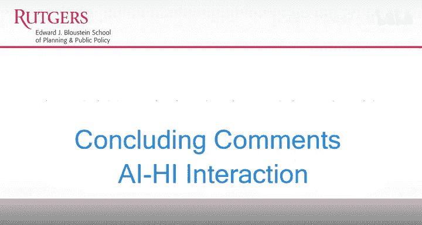
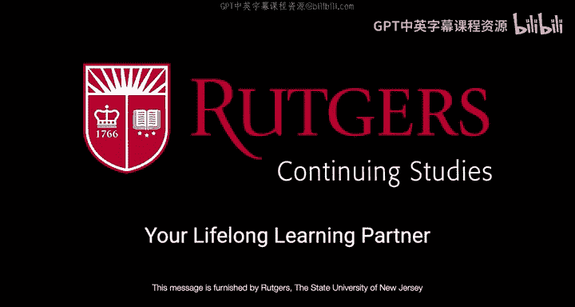

# 罗格斯大学《AI概念和策略｜AI Concepts and Strategy》中英字幕 - P3：2_总结评论.zh_en - GPT中英字幕课程资源 - BV1nZjCznE7k

A few highlights， I gave you some warnings and some insights and in a nutshell touched upon some of the topics。

 now a few highlights of the course， one， this is a graduate level discourse。

 which means it's a subset of a graduate course at the EJ Blalowstein School at Rutgers University and it's a part of the masters of public Inmatic program out there。

So it's a graduate when we participants who participate in this course must expect graduate level thinking。

 we're not going to be talking about basic statistical models。

 so on and so forth which are very important， it's very important for example for you to understand regression。

 it's very important for you to understand a normal distribution so on and so forth。

 but that's not what thiscourse is about this course assumes a certain level of understanding of those things it also assumes a certain level of that participants will understand how to use Python and other AI languages。

The content is unique and research driven， which also means when we say it's research driven。

 which means some of it is proven， some of it is theoretical。

 some of it is a work in progress and so you're welcome to form your own views we do not present our research findings as the absolute truth but rather as perspectives on artificial intelligence the course is forward looking like with every other course we talk about the past。

 we talk about the 1940s， 50s， MaAthti so on and so forth。

 but the course is designed every session what we will try to do is we'll try to look ahead into the future。

The course demolishes the overemphas on coding， so any AI course today most of them it's about coding this course is not about coding。

 this course is not about studying how how to split a data set into training development test so on and so forth。

 that's extremely important but that's not what this course is about。This course is about talking。

 This course essentially emphasizes。An understanding of artificial intelligence such that it makes you ask the question。

 why are you using machine learning， Can you do this problem or can you solve this problem without machine learning。

 I've seen environments in which people are so fascinated with machine learning thats something that could be resolved very efficiently by using simple regression they're now talking about using regression with machine learning。

 but there is no data pipeline。 It's data that that's cross- sectional that's available periodically every quarter or annually It does not deserve to be given the machine learning tag or treatment。

 it should be just plain classical statistics that should be used to address certain scenarios。

The course will also encourage independent thinking so from my side I'm going to provide my independent thoughts about artificial intelligences。

 artificial intelligence and artificial intelligences to you as participants and the expectation will be that you will form your own thoughts。

 hopefully you will agree with a lot of what I say。

 but my expectation will be through your writings and through your thinking。

 you may disagree with some of the thoughts and that is how we ensure progress in our understanding of artificial intelligence。

The course will teach students， or at least will try to encourage students to lead working in the domain of artificial intelligence based on an understanding of AI principles and AI strategy。

So my philosophy here is if you lead using appropriate and reasonably well understood。

Principles and a clear AI strategy， then the technology will follow。

If you front end your decision making， if you front end your thinking and your planning and your business approach with technology。

 then。You may miss out on strategy， on the other hand， if you lead with AI strategy。

Technology will follow， you will know when you need to use deep learning models。

 you will know when you need to use optimization or reinforcement learning or whatever the AI technology needs to be bought and that' will come in。

First， get the AI strategy right， and the rest will follow。 And finally， I think the most important。

Dimenssion of artificial intelligence implementation today is artificial intelligence and human intelligence interaction。

 There's been a fair amount of emphasis。 There are a lot of studies。

 There are a number of research centers， which are focusing on this。

 And yet I feel that that's insufficient。 There needs to be a broader discourse。

 There needs to be a more。Grassroots level， thinking and interaction and talking about this whole area of how does artificial intelligence interact with human intelligence？

Because unlike past technologies where human intelligence used the internet。

 human intelligence used different kinds of applications and tools and so on and so forth。

 in this case it's different， human intelligence is going to be interacting with a technology that surpasses human intelligence capabilities in many areas。

 so a chess player will be interacting with the technology which the chess player knows can play chess better。

So what impact does that have on the human psyche on the individual human psyche and as individuals are impacted through their interaction with artificial intelligences。

 how is that going to impact society at large how is that going to shape our future are we going to see a loss of confidence on a mass level and will that transfer too much of power to those who create and control and deploy these artificial intelligences。

 I think these are very， very important questions and it will take us a long time to conclude and hopefully it does take a long time to conclude because these are very significant problems and any quick conclusions or solutions would be very suspect？

An example of research driven content So one of the one of our main research projects which we have worked on for a couple of years is this whole idea of how does human intelligence perceive information in a same scenario such as in a stock trading environment where you're trying to make profits by buying and selling stock。

It's not just what information you get， but the facet associated with that information。

 so you might get stock price information， but if the equiocality is greater in one scenario and the equiocality associated with the information is less in another scenario。

 then it impacts the way we deal with information， How is the information presented。

 What is the source of the information is the information presented in a particular format as opposed to another format。

 these also affect human perception and human performance。

What we have worked on is to demonstrate that you can actually use artificial intelligence。

 You can use machine learning to improve and to support and improve human performance。

So this is what we call as the adaptive cognitive framework that you see on the slide where we speak about the influence of information facets such as equiocity and complexity。

And we speak about AI generated information representations。

 which could be a form of a data visualization or a tabular data representation。

 and we speak about the capability of AI modules to monitor the performance against certain。

Information facet conditions and against certain information representation conditions and then based on the based on a continuous observation of such performance。

 the artificial intelligence would be able to select or assign。

Or you can have the AI make suggestions and then the human intelligence or the person who's using this AI decides whether to accept AI's recommendation or not。

 and very often it's going to be a matter of for example， if it's a gaming application。

 the gamer might initially only take recommendations from the AI。

 but as the AI proves itself to be effective and gains the trust of the gamer。

 the gamer might then choose to switch on the automated AI selection mode whereby AI automatically selects the best information representation that needs to be displayed to the gamer。

And finally， a few tips。The scores to summarize， the course provides unique leadership perspectives on artificial intelligence。

 It's not a according course， but。What it does is it encourages critical thinking about artificial intelligence。

 It encourages managers and leaders to ask questions about artificial intelligence。

 which must be asked for effective and sustainable implementation of artificial intelligence。

 It focuses on the concepts。Such that participants will gain improved managerial understanding of how to use artificial intelligence for whatever purposes they need to use it for。

right now， the expectation is that this course will have only one project。

 but as I mentioned a few minutes ago。Each time these courses run。

 the assignments or the project requirements might change depending upon what's happening in the industry。

 depending upon our research findings， depending upon the feedback that we collect from our participants。

 so on and so forth， so when it comes to assignments and projects whether it's one or whether it's going to be multiple projects happening on a per module or weekly basis for those details。

Please refer to the syllabus Right now， the plan is for the current implementation to use only one final project as a graded assignment。

 so you can focus on the learning。 you can focus on the concepts。

 You don't have to worry about setting aside many hours for coding every week。

 but you're focused on developing your understanding。 And as you do that， it should lead to a final。

Deliverable， which would be a form of a research project a paper that you would write based on some of the guidelines and rubrics that we will provide hopefully you will also be able to post your final project onto some research dissemination forums。

 maybe conferences on and so forth so when you participate in this course come please do join in with the mindset that you're going to take all that you're learning you're going to take all the readings you're going to do your own thinking and then create an original paper not too long more in the form of an op ed or an opinion article。

 maybe even a stronger mini research paper so that should be your mindset when you join this course and on the screen is my Twitter ID for any person who wants to connect with me on Twitter Sometimes it's erratic you might find me missing from Twitter for a long time but very often I do tweet about artificial intelligence and provide。

Research updates through my Twitter account。 So that's the link out there。

 Please feel free to visit it once in a while。And usually I take questions， but this being a video。

 I'm just going to conclude by saying。This is a very important course。

 I wish someone had taught this course and that I myself could have learned it many years ago when I started studying artificial intelligence and its applications。

 Im I will be trying to impart。Years of understanding on the concepts of artificial intelligence through this course。

 so I want to thank you for your choice to listen into this session and hopefully you will participate in the full course and I wish you all the best in your journey and as you study artificial intelligence and you learn how you can use artificial intelligence for the benefit of human society and for greater good。

 Thank you。

