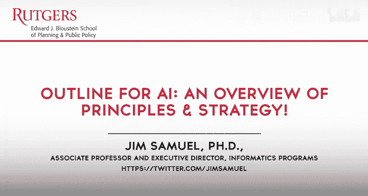
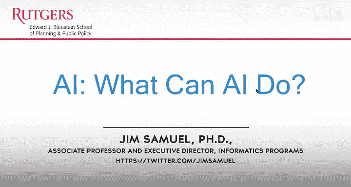

# 罗格斯大学《AI概念和策略｜AI Concepts and Strategy》中英字幕 - P4：3_AI能做什么.zh_en - GPT中英字幕课程资源 - BV1nZjCznE7k

Hello and welcome to artificial intelligenceligence and overview of critical principles and strategy Today we will be covering moduleule1。

 which is an introduction to artificial intelligence concepts and just gaining a deeper perspective on the nature of artificial intelligence。

An overview today， we want to talk about understanding what is an applied perspective of AI。

And we also when we speak about artificial intelligences。

 I think it's also important in the current environment to discuss what is not AI because everybody and everything seems to be AI these days。

 anyone who starts a new business if it's remotely touching a statistical model。

 they prefer to call it machine learning and before you know it it's categorized as AI。

 so it's important to be clear about what is not artificial intelligence。

A theoretical perspective on artificial intelligence。 And finally。

 we conclude with talking about artificial the current and future directions that we see in artificial intelligence。

 when we speak about applied artificial intelligence， we go back to McCarthy's position in the 1950s。

 where he said， you know， since it's difficult for us to define and。

Understand and articulate how a machine thinks or for that matter。

 even how human intelligence thinks， therefore we can be concerned with the output so if we feed if we provide a computer or a computing machine with certain stimuli that is certain input then if it can logically process it and produce produce some output。

 then that logical output is what we should be concerned with。

 so using that perspective helps us to understand the applied side of artificial intelligence very well also bulk of the emphasis these days is on the applied side where where companies and individual businesses and small businesses and large businesses and just about anyone and everyone who can code is into some aspect of AI application development that's the gold rush these days。

So in the context of applied artificial intelligences， for example。

 we have artificial intelligences that can see those are AI algorithms which can look at images that can look at real world scenarios。

 identify objects， classify objects into certain categories and depending upon what it's trained for an AI algorithm would be able to see in many senses just as a human intelligence would。

 so during the pandemic， for example， in many places access was restricted using face recognition technologies。

 these face recognition technologies would look at the person in front of them match it to the record to the images on record and identify the person as an employee or a faculty member or a student or an officer。

 so on and so forth。That capability of an artificial intelligence to。Ci。

Is quite aligned with the human ability to see。However， once again。

 as mentioned in some of my previous sessions， when human beings see it is integrated with other dimensions of human intelligence。

 however， when we speak about an artificial intelligence that can see that is at present in the future be expected to be integrated with other artificial intelligences or other artificial intelligence components or modules。

 but currently it's a siloed artificial intelligence， which can only see。The applications are many。

 so for example， an AI that can see can be used can be weaponized and can be used in a drone to target certain objects。

 certain kinds of facilities or unfortunately certain people。

 specific people AI can think logically now the word think has to be used with caution when it comes to artificial intelligences。

 because when we borrow terms， we have already done that in terms of using the word intelligence and sometimes I wonder if should we should be using the word intelligence but it's too late to call that it's been established in the 1950s so we have artificial intelligence as is but。

We should be careful to not use words indiscriminately。

And let me rephrase that or let me add to it words which we associate with human intelligence。

 such as thinking and reasoning when we use it within in the context of artificial intelligence or artificial intelligences。

 then it needs to be carefully used。 So when we say an AI can think logically。

 it means that we are able to。Develop technologies which use mathematical and system rules to process certain information and produce certain kinds of output。

And in that sense， it differs from human thought processes and human thinking。

 which employ far more complex processes， while AI uses a defined set of processes to process information。

Given this capability， artificial intelligences can play chess。

 it can play other sophisticated games， it could run a shopping center， it could run a factory。

 it could run a railway station in terms of managing the flow of traffic。

 it could also identify it could also do fuzzier things like identify zones of COVID-19 transmission。

 identify the likelihood of certain kinds of calamities in certain regions， so on and so forth。

 depending upon what the AI is trained for。Artificial intelligences can also feel and monitor。

 so for example， you have artificial intelligences which detect human temperature and built environment variables。

 so whether it's the whole idea of smart buildings or smart cities。

 we are using technologies that are able to sense and optimize for example。

 energy usage in the built environment。So。Just the fact that sensors exist do not constitute artificial intelligence。

 but when we use those sensors and data that comes in from sensors。

With algorithms that can learn from that data and other variables with change and then optimize those variables so as to lead to optimal energy usage or some such other optimal output。

 then we say that artificial intelligence that then we would call that as an artificially intelligent built environment。

 and that would be an artificial intelligence， which can feel monitor and optimize。

So also artificial intelligences can hear， listen， and I should put that understand and inver it in courts because just like the word think understand is also a word which we use in the context of human intelligences and at present artificial intelligences do not understand。

Information in the same way that humans do。So when we say AI can hear， yes， it hears in fact。

 and artificial intelligence can capture more sounds than the human ear and the reason for that is the human ear is able to listen to a limited range of frequencies while artificial intelligences you can use more sensitive sensors。

 sensors with multiple sensors with capabilities to pick multiple sounds and therefore you could also claim that an artificial intelligence can actually hear better than then any human intelligence and that would be that would be difficult to argue against the idea of listening and understanding is more nuanced。

 it's more complex。That's where in spite of being able to hear less the human intelligence would have far superior understanding even with limited information so that's an important dynamic at play but right now we are talking about artificial intelligences from an applied perspective and so the important thing is to understand that yes you can have AIs which can hear so when you talk about chatbots such as Siri and Alexa these are examples of artificial intelligences which listen to your talk or Bixby they listen to your talk。

 they study your voice over a period of time they understand your accent。

 they understand the way you pronounce words and they get better at interpreting what is it that you're trying to say and then based on the machine learning and the artificially intelligent learning processes that they go through and the information that they have access to through the internet they are able to respond to your。

They're able to hear what you're saying and learn over a period of time and get better at responding。

 following instructions and also finding additional information for you so artificial intelligences are becoming very good from an applied perspective at doing a performing a variety of tasks now those were some of the qualities I kind of in the previous slide I emphasize things like vision hearing and you know even NLP。

 which I did not elaborate upon these are all capabilities of artificial intelligence and we'll be talking more about these capabilities and individual artificial intelligences in module too but for now let's talk about the domains we have artificial intelligence being used for stock trading artificial intelligence in stock trading is faster and we can call it in some senses smarter because it's not only more consistent but it's able to quickly。

Process sophisticated algorithms repeatedly and selectively so as to achieve the。

Best set of returns for a given level of risk that a trader chooses to adopt so if you are talking about AI versus humans in stock trading eventually I think humans will do better。

 but if you're talking about a third team as of now， AI versus humans versus AI plus humans。

 then the AI plus humans would be the winning team in the context of the current technologies and everything else being equal ceterparvis。

So right now， the augmented human intelligence， which means the scenarios where artificial intelligence is used to augment and support human intelligence seems to provide the best possible results。

 So for the immediate future， the best strategy is to in any domain is to look at tech when it comes to the。

Understanding and decision making side of it when it comes to simple cognitive capabilities。

 simple capabilities of storage， then the computer is definitely the computer is ahead。

 the computer is superior， the artificial intelligence is superior to human intelligence when it comes to the purely cognitive aspect of seeing or hearing and storing those objects or those scenarios or those features in memory。

 but when it comes to reasoning， understanding， interpreting human intelligence is way ahead and we have still not figured out ways to consistently and satisfactorily build AIs which are able to interpret and understand and generate meaning the way human intelligence does。

We have artificial intelligences which advise and manage personal investment portfolios。

 so it kind of replaces human financial advisors， but once again。

 the best equation is where you have expert human advisors being supported by artificial intelligence tools and agents and I think that leads to the best possible results。

So a quick segue comment on job loss， when we speak about augmented human intelligence。

 what we are saying is if there were a stock trading desk which had 20 traders with one chief trader and you have others helping him that one desk can be replaced by artificial one chief trader。

 plus artificial intelligence and a handful of staff。

 so we are talking about 50 to 75% of job loss in that kind of a scenario and that's been seen。

 it's not just theoretical， it's been seen in Japan it's been seen in a number of countries around the world where artificial intelligences were adopted the size of the。

The number of people that the team required went down significantly because AI was doing performing a vast array of tasks and doing it in a manner superior to human intelligence in those contexts。

 so the team sizes had to go down， but we have yet not seen AIs in those complex scenarios which can function autonomously。

 which means zero humans。So we are not yet there we have also seen and recommendations from leading consulting firms like McKinzey and recommendations and predictions about the use of artificial extensive use of artificial intelligence across business domains for example。

 artificial intelligence can be used to structure pricing and promotions and overall there's hundreds of billions of global market value that remains to be tapped into with the use of artificial intelligence。

 and that's why the use of artificial intelligence and business across industries across disciplines and across stages of the business lifecycle there's so much potential out there that it is fascinating and hopefully its value creation that leads to societal good。

 hopefully it leads to the general improvement of human living conditions and human quality of human life across the board。

Rather than just profits for a few who control these artificial intelligences or own these artificial intelligences are in some way direct stakeholders of the companies that own these technologies。

Artificial intelligences can be used for global revenue generation and profitability improvement artificial intelligences can be used to increase revenues another famous consulting firm。

 Boston Coning group has emphasized this and described methods which can be used which AI artificially intelligence methods that can be used to increase revenues。

 artificial intelligence is also being used for risk management for scoring how creditworth a person or an individual is and similar functions。

