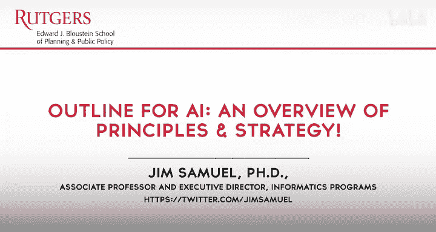
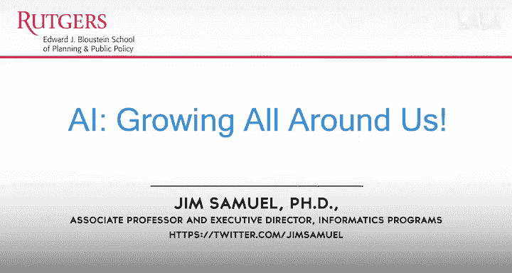

# 罗格斯大学《AI概念和策略｜AI Concepts and Strategy》中英字幕 - P5：4_AI在我们周围不断增长.zh_en - GPT中英字幕课程资源 - BV1nZjCznE7k

Additional thoughts on the applied side。 What we are seeing today is an artificial intelligence apps invasion。

 which means there is a huge， huge array of artificially intelligent technologies。

 artificially intelligent applications that are being developed。 I mean。

 just think about your smartphone。 first and foremost， most people recognize this。

 but there are still many who don't， and that is our phones。 if you are using a smartphone。

You are using artificial intelligence。Your phone in fact。

 consists most likely of multiple artificial intelligences。

 but there exists at least a few on every smartphone。

Your smartphone most of the smartphones today have a capability to listen to you and to learn by listening to you in the form of some or the other kind of a chatbot。

There are other AIs whereby such as when you are typing text into your chat。

The algorithms are learning， what words do you use frequently so that it gets better at suggesting autofill options for you？

Some of those are very simple algorithms， but collectively。😊。

Your phone is an example of artificial intelligence Art intelligence is all around you we are increasingly sometimes we are unaware of it。

 but we are increasingly interacting with artificial intelligence and artificial intelligence technologies so if you are watching movies on one of the streaming platforms。

 How do those streaming platforms make recommendations for you。

 How do companies like Amazon and others make product recommendations， How do they select their ads。

 all of these are now using artificially intelligence technologies。

 a variety of machine learning models so on and so forth。

Artificial VC artificialific intelligences in self-driving cars from one perspective we can call it as one artificial intelligence from another perspective。

 we find that there are various sensors and various kinds of it's a cluster of algorithms so it's a cluster of AI technologies that we see in a connected and autonomous vehicle which could be a car or self-driving car or something like even an aircraft these days a lot of aircraft a bulk of the time for 80 to 90% of the time they're running on autopilot So some of it is classical technology while some of it is increasingly relying on artificial intelligence technologies such as reinforcement learning we have artificial intelligence in our homes not restricted to our cell phones but we have artificially intelligent refrigerators。

 washing machines， dryers and all kinds of electronic equipment I heard of a company which also wanted to put an AI chip。

Essentially an analytics data collection chip which learns from people's usage of footwear and also tracking where is it that they walk at what speed for what amount of time and thereby making multiple recommendations from that kind of information we have artificial intelligences in homes and in smart cities。

 we have artificial intelligences which can answer phone calls personally and we have artificial intelligences which are used for surveillance monitoring and tracking。

I' have spoken recently also about autonomous drones and the use of artificial intelligence in military warfare as over the next few years。

 over the next decade or two， we are going to see most of the world's。

Militaries relying quite heavily on artificial intelligence。

 both for managing their tools and their weaponry， but also for studying and understanding the warfare environment so so as to generate insights AI is everywhere we see it in robotics。

 we see it in healthcare， we see AI in supply chains。

 AI is also used in agriculture in music and the arts So today if you want to if you want to write music or if you want to compose music。

 you no longer need to go out and look for a band of people to join you you could。

Do that or you could work with lesser number of people and you can add AI as a member of your team or you could just do it between you and artificial and an appropriate artificial intelligence which is able to support your music or art interests artificial intelligence is extensively used in education So on one side there is a need to educate people about artificial intelligence such as what this video is all about and the other dimension is where artificial intelligence is being used to boost education。

 such as through adaptive learning processes artificial intelligence， of course。

 is gradually moving making an attempt to move from big data to smart data so as to ensure efficiency of computational costs however。

 in some domains and in some ways it just remains critical to process all the data and so big data is here to stay for some time simultaneously some in some areas and in some application。

It's been observed that you do not need to spend all those computational resources processing the whole lot of big data。

 but it is sufficient for you to process extracts intelligent， carefully structured。

 extracts from big data， and that high quality data， which can lead to quicker and better results。

 with artificially intelligent technologies that's being called as smart data。

