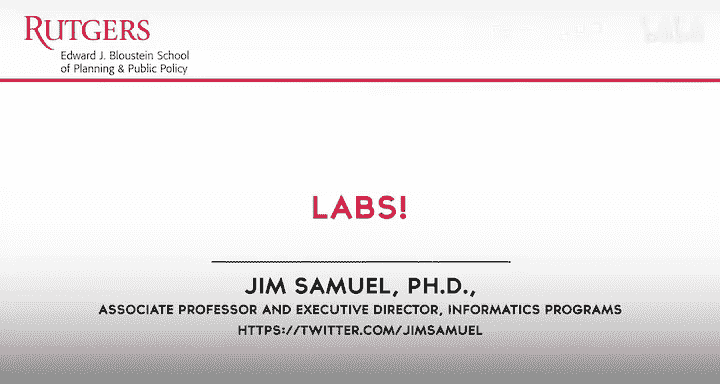
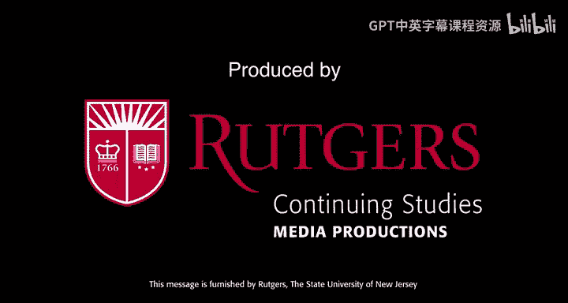

# 罗格斯大学《AI概念和策略｜AI Concepts and Strategy》中英字幕 - P6：5_实验室介绍.zh_en - GPT中英字幕课程资源 - BV1nZjCznE7k

Hello and welcome to the Labs for the AI Str Cour。These labs are for demos only。

 which means it's optional for you to run them the main emphasis in this course remains on you learning the concepts for artificial intelligence strategy。

 the emphasis of the course as stated in the introductory parts remains on you learning the fundamental foundations and concepts of artificial intelligence。

 however， it is also useful， not necessary but useful for you to run some ch for yourself and gain some experience。

In running the code many of you who are taking this course may already have had some past experience with computer science running machine learning models。

 coding out or fine-tning large language models so on and so forth So for you you're going to find these labs as a very simple exercise Some of you may have never worked on Jupyter notebooks or with Python running artificial intelligence models you might find some parts of the lab challenging remember it's optional but it's also designed in such a way that a person who has had no prior coding experience should also with limited effort be able to run all of the notebooks。

There are no graded exercises in the labs， so there's nothing to worry about from a grading perspective or passing the course perspective。

 this is designed to give you exposure to the nuts and bolts of how AI works。

Each lab is designed to give students a peak into what goes into AI models。

This will allow you to look inside some of them some of the notebooks contain handcoed exercises。

 some of them simply use existing Python libraries。

 so what I've tried to do is I've tried to give you a fair balance of labs， there are five labs。

 some of them are very fundamental very simple things like how do you run a linear regression model and just a view of what separates a plain vanilla linear regression model。

 which is statistics and not artificial intelligence from something that would be artificial intelligence when linear regression is one part of the system not just a model by itself。

 so when you go from the statistical model to a system which uses statistical model。

 then you travel from math and stats to having something like a micro artificial intelligence module。

Some of the labs are slightly advanced， I believe we have set up a notebook for machine translation。

 it is possible that students might some students might find a couple of the labs a little challenging I would advise you to try to run these labs there are no problems to solve it's all completely implemented code。

 you just need to click through。Run each of the cells and try to reflect on how is it that these models are working。

 Try to review what goes into the model what's the process and what is the output Also keep in mind that these notebooks and these labs have been developed from an academic framework for the purpose of education and they are not production or industry grade labs or demonstrations of AI applications So finally as promised at the beginning of the course there is no need for you to code just enjoy the labs and hopefully you will enjoy running these labs as much as I and my RAs enjoyed creating them one thing to keep in mind is that there are some I try to get my team to add some notes and at the point of the recording of this video I have not had a chance to review all the notes so as you run through the labs please pardon any typos or any。

Gramatical errors and just hopefully enjoy the learning process， Thank you。

