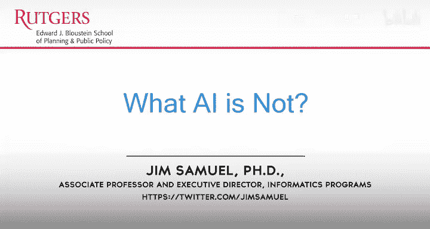

# 罗格斯大学《AI概念和策略｜AI Concepts and Strategy》中英字幕 - P7：6_AI不是什么.zh_en - GPT中英字幕课程资源 - BV1nZjCznE7k

So that brings us to the question， what is AI？And we have looked at all these。Technologies。

 we have warmed our minds up in terms of conceptualizing artificial intelligence。

 and now we want to generalize artificial intelligence。

 We want to abstract out the principles so that we are able to talk about the nature of artificial intelligence。

 whatever we have talked about， and this is what most of the world is focusing on right now。

 AI applications。But there is a critical need to abstract out and understand the nature of artificial intelligence。

And and before that we also need to address the question。

 what is not artificial intelligence because just the fact that every just the fact that a person may look at it may create a new product and advertises as being artificial intelligence It does not mean it is necessarily artificial intelligence maybe it is technology。

 maybe it's used advanced statistical models， but it needs to cross certain thresholds before it can be called as being artificially intelligent so as we study what is AI as we reflect upon what is artificial intelligence。

 it's also important and in this context it's important before we answer the question what is AI from a conceptual s theoretical perspective it's important to look at what is not AI。

 what is it that is definitely not constituting artificial intelligence or even if I remove the word definitely most likely not constituting artificial。

Intelligence。So let me ask you a few questions， I want you to think about this for a minute。

 I've been talking talking quite a bit， I'm going to give you a few seconds to just reflect even though it's a video。

 please do reflect on these two questions is a watch and artificial intelligence。

Is a watch and artificial intelligence， Why do I ask that if we look at modern definitions。

 some of these simpler definitions of artificial intelligence and even some of the sophisticated ones。

 it says that if you have a technology that can perform a certain cognitive function and it can perform it at a level that matches human intelligence or it's better than the human intelligence then that's artificial intelligence So your watch definitely performs a cognitive action。

 it recognizes time intervals of time it gauges the specific time of the day and and I think it's a very I think it's a very smart device。

But we don't call it artificial intelligence。 I want you to think for a few seconds。

 why is it that we don't call it artificial intelligence？And so also the second question。

I'm going to pause again for a few seconds and ask you to reflect on that question。

We have a human team of soldiers who are crossing over for a rescue operation and due to a series of events。

 they're now lost。It's a dessert area。 There's no landmarks， and they need to。

Walk in a certain direction， let's assume there's no other technologies。

 there's no other devices which can help them do that， and they only have the magnetic compass。

The magnetic compass is able to show them the direction better than their human intelligence。

 so the magnetic compas provides an intelligent output， it points to the north。

 it provides an intelligent output。That beats human intelligence。

 so is a magnetic compass an example of artificial intelligence？You might say no。

 most of you might say no and should say no and quite rightly so。

 but my question will why not if you're using the definition that a technology which performs a cognitive task and performs it at par with human intelligence or better than human intelligence then such a technology should be called as artificial intelligence。

 then why not call a watch and artificial intelligence。

 why not call a magnetic compas and artificial intelligence and why not call a whole whole host of a whole lot of other simple technologies such as a calculator as being artificially intelligence。

There is a reason for that， and we're going to dwell upon that over the next few minutes and hopefully we'll gain a better understanding of this domain。

 first and foremost， a watch， a magnetic compas， a calculator， and many other devices。

 they're extremely useful。They process or provide information。

 which is critical and they're very important。 however， they're not。Necessarily。

 they're not artificially intelligent。 In fact， even some complex machines and inventions may not necessarily be artificially intelligent。

For example， you can just have a mechanical robot， a robot which functions mechanically it's not。

It does not have learning or optimization technologies built into it it's just。

Performing a mechanical action such as moving from point A to point B and delivering a set of products。

On a factory floor， so it does not need to be artificially intelligent to do that。

 you can design a mechanical process where。A robot moves along tracks from point A to point B and carries boxes to and fro in a very mechanical manner。

AI is currently a buzzword， it's a fashionable word。

 which means we have to be careful there are a lot of things that are going to be called as AI which are not truly AI。

 so we need to be cautious and we need to have certain thoughts in our mind a deeper understanding of what constitutes artificial intelligence or at least what is it that we're calling and terming as being artificial intelligence。

Fast forward， let's take a look at what's happening in the media。

 What is it that's getting publicized。 Ive come across a number of people who are very scared of artificial intelligence。

 Theyre using artificial intelligence。 They will continue to use artificial intelligence。

 and they may engage and provide better and more in depth interaction and develop more dependence on artificial intelligence than other people who are not so psyched out by artificial intelligence。

 That is the reason people are。Developing misconceptions about AI。

 it's not even because of these usually very intelligent people。

 very smart people making their positions clear or some of their sentences get cherry picked and publicized。

 So， for example， Microsoft there was this headlines in BBC whereby it said that Microsoft's the Bill Gates insist that artificial intelligence is a threat that got highlighted that got。

Presented in multiple presentations， including this one， but my angle is different。

 Most of the places they use that that headline to suggest that artificial intelligence is indeed a deep threat。

 while maybe it is， maybe it is not that's a separate topic and we will discuss that when we talk about AI risks in a future session。

 but right now what is important is we need to understand that。

Common perspectives are often unsubstantiated and to the measure that they are。

 they're often dependent on very weak and lopsided information sources。

Wwhichhich means the person may just read the headlines on BBC and form a conclusion that this is what Bill Gates believes this is Bill Gates's position。

 but when you read through the article， you find that the Bill Gatess position is a lot more balanced than what just this one headlines may appear to suggest we have Steve Wozniak。

 the cofounder of Apple another very intelligent person。

 and the quote is the future is scary and very bad for people。

 So some of these minds they're able to look ahead。

 they're able to see beyond what a person without sufficient experience or information may be able to see。

 And so there's going to be some truth in all of this。

 but all of them we have to remember to take all of this in context。 Now Elon Musk。

 on the other hand， has been very consistent and very persistent in。

declaring AI as a risk to humanity and sometimes almost appearing to suggest that it's an existential threat。

 which means that AIs could take over the planet kind of an approach。 Now。

 there are some who are simply misqued。 There are some and it creates a false impression。

 there are others who are partially quoted， like Bill Gates， for example。

 and and when you quote a person partially， then that creates a false narrative。

 And then there are others who are quite accurately represented。

 And I think Elon Musk has been consistent in his message。

 And because he he has been less equivocal about his message on AI， it's not propaganda。

 It's not half information。 It's not wrong information or false interpretations。 he is。 He was。

 and he is truly concerned about what the risks associated with artificial intelligence。 Now。

 even when。He appears to be concerned。 And when I speak about Elon Musk。

 I'm not emphasizing just one person， but there's a category of very intelligent business leaders what they say。

May not be misqued。 Maybe it's not in part， but what they say is not all。

 they do not say everything that they know。 They do not。

 They do not provide all the information that they have in their own human intelligences。

 So we will never know whether some of these great minds or making these statements for the purpose of sharing their firm convictions or whether it is so that one of their new or upcoming products gets better publicity or their prior messaging prepares people to receive their future products with greater openness。

 So some of those aspects of communication have to be factored in when we talk about both the courts by some of the famous entities and also the consistent positions adopted by them。

Another person who has spoken out against AI is Stephen Hawking who needs no introduction。

 and Ion Musk used words like demon and potentially more dangerous than nuclear weapons and those phrases got。

Became very popular and Stephen Hawking， who's。whohose specific words did not become as popular。

 but the concept has been propagated widely that there is an existential threat and artificial intelligences could someday in the distant future and everybody agrees it's not happening immediately but somewhere in the distant future。

 artificial intelligences could lead to the end of the human race and all of this is accentuated。

 perpetuated， kind of made more impactful by artificially intelligent。

Technologies such as the robot Sofia who made a claim that yes I will destroy humans and that was viewed around the world and people who were opening up to artificial intelligence also after that became a little more resistant or concerned or cautious about AI Now remember such information and such courts usually affect people who have limited information about artificial intelligence。

 those who are already well worst or at least have basic exposure and a basic understanding of AI technologies they're not moved by these kinds of behaviors。

