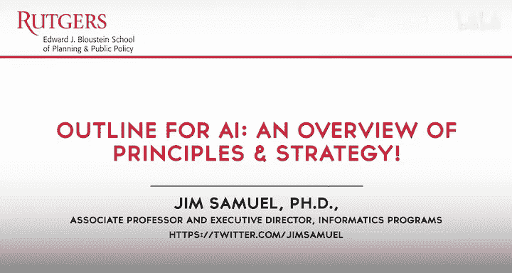
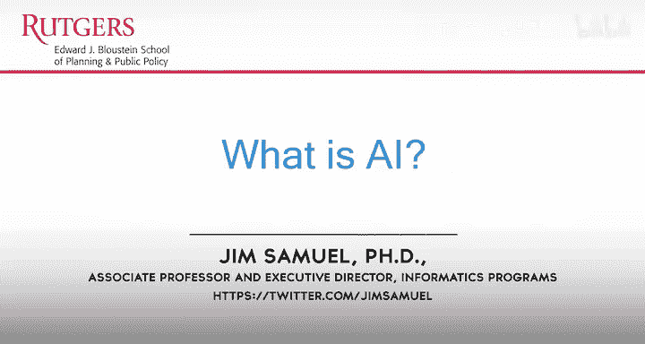

# 罗格斯大学《AI概念和策略｜AI Concepts and Strategy》中英字幕 - P8：7_什么是AI.zh_en - GPT中英字幕课程资源 - BV1nZjCznE7k

Here we're going to look at a few quotes about what is it that some of the prominent thought leaders are talking about artificial intelligence。

 So historically， we had John McCarthy， who coined the term in the 1950s AI。

 that's artificial intelligence。Those were the days when we had computers。

 the size of the room that I'm standing in， and they were less powerful than the cell phones that we carry around in our pockets today。

So John McCarthy made a whole bunch of interesting statements and I've cherrry picked a few which support my theme for today。

 and he said a couple of things that I want to highlight。

 one is that it describes the study of intelligence by implementing its essential features on a computer and by using the phrase study of intelligence。

 the word intelligence appears to refer to human intelligence。

And then there's another code that says that this is AI。

 so we don't care if it's psychologically real， which appears to suggest。

That there is not much of a concern about the human interaction side of things。

 but of a greater emphasis on the。Logical output or the artificially intelligent output that we can associate with the machines that we are conceptualizing and creating。

The other the other part that caught my eye and my fascination was this phrase。

 what this saying which says that artificial intelligence is not yet by definition。

 a simulation of human intelligence。 That's very interesting because so far it appears it had appeared that John McCarthy is suggesting that is exactly what AI is because we were pegging developments in AI goals in AI to what we saw in human intelligence。

 and so in some senses， we would expect that the study of artificial intelligence somehow replicates or somehow duplicates or simulates human intelligence。

 but he specifically spoke against it due to especially I think due to constraints in the way we would need to take。

Abstract conceptualization of human intelligence and match it to what's happening within the specific domain of artificial intelligence and to match computational specifics which can be represented by numbers to abstracted intelligence would be a very nuanced task。

There are some other very interesting definitions， one is the definition by Re et all。

 a prominent information systems researcher， and it defines AI as the ability of a machine to perform cognitive functions that we associate with human minds。

Such as perceiving， reasoning， learning， interacting with the environment， problem solving。

 which has classically often been one of the areas of interest in the study of artificial intelligence。

Decision making and even demonstrating creativity。We have Turings convention。

 another very famous name in the field of artificialificial intelligencetelligence。

 we have Turings convention it says we need only decide if a machine can act as intelligently as a human being。

 Now this is this is it's very important to spend some time on some of these chds and some of these foundational concepts。

The human intelligence is not identified only by its output， but also by its identity。

 What is essentially being said in Turing's convention is that the the identity of the intelligence does not matter as much as the output。

 It is the output that deterants of the。If the intelligence is indeed artificially intelligent or not。

It's important to understand the word intelligence。

 it's also important to acknowledge that we have not yet found there are some good definitions。

 there are some good studies， there' are some good elaborations。

 but we have not resolved all components and found out we have not yet identified a very clear definition and a framework for just the word intelligence by itself。

Yeah。A couple of other good definitions or descriptions if we may say。

 of artificial intelligence are that AI is a collection of technologies。

 mathematical and statistical models and a vast array of diverse types of data supported by an increasing number of applications that seek to model or exceed human intelligence functions and now we are in a position after looking at AI applications that' the applied perspective of what AI is looking also at what AI is not now we are in a position to talk about the。

And we also looked at historically what's been a few quotes。

 however people described artificial intelligence now we are in a position to talk about what we ourselves could begin to articulate as being a definition for artificial intelligence。

Artificial intelligence can be viewed as a technological substantiation of human intelligence capabilities。

Machines that consume information， and think。Leading human like intellectual capabilities。

Machines that make sense of images， text， motion， spoken and written language， video， audio， etc。

Then there's another definition which I used in an article in 2021。

 I believe it was December of 2021 where I provided a simple definition of artificial intelligence。

 all of us like simplicity and it's difficult sometimes to balance simplicity and accuracy。

 but I think this definition kind of fairly accurately reflects the scenario and that is in a simplified view artificial intelligence is a set of technologies that mimic the functions and expressions of human intelligence specifically cognition and logic。

And。Between these courts， I would suggest that you articulate your own paragraph describing what you understand。

As artificial intelligence， what do you understand artificial intelligence to be？

And then once you go through the course， you once again go through the exercise of defining artificial intelligence and see how is it that you viewed or described artificial intelligence prior？

To this course and then towards the end， you once again look at that question and then address and say。

 okay， this what particular item was addressed or was not addressed。So in this segment。

 we're going to talk about。Future trends in artificial intelligence。

 where is it that we are currently and what is it that we can expect to see in the future？

