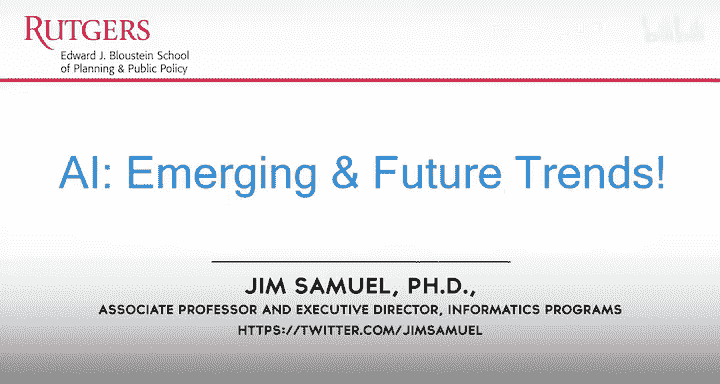
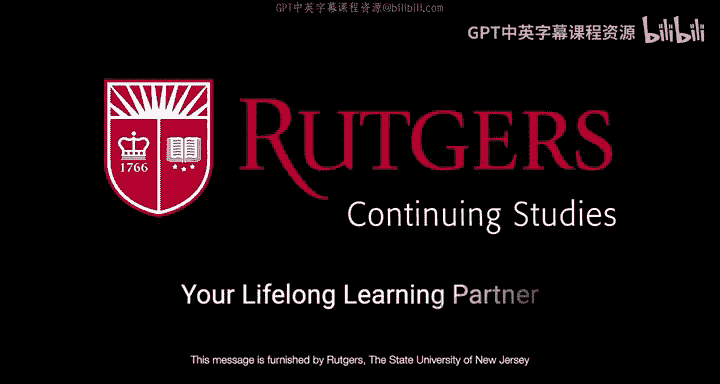

# 罗格斯大学《AI概念和策略｜AI Concepts and Strategy》中英字幕 - P9：8_新兴与未来趋势.zh_en - GPT中英字幕课程资源 - BV1nZjCznE7k

So in this segment， we're going to talk about。Future trends in artificial intelligence。

 where is it that we are currently and what is it that we can expect to see in the future？

At the core of understanding the trajectory of artificial intelligence applications and its impact on the individual。

 human and human society at the core of it is a key idea。 And that key idea is that。

Artificial intelligence applications。Technologies and artificially intelligent systems。

They have a different kind of power from previous technologies and previous generation technological developments。

In the past technological revolutions， it was human muscle power that was replaced。

And in the information age revolution， we saw some aspects of human intelligence。

were surpassed by those technologies， but only in such a manner that it made human intelligence more important in the equation because you needed other aspects of human intelligence such as human intelligences。

 information processing， interpretation， understanding， meaning making。

 sense making capabilities were in even greater demand in the information age。

Fast forward currently and looking into the future。Now。We have artificial intelligence。

Combined with past technologies。Creating a scenario whereby human。

 it is easy now to replace human intelligences in many domains。There is also the argument that if。

 just like in the past revolutions， if a technology。Results in job loss。

 then that technology will also lead to job creation。

Which is true and that's always been the way things are when cars came in。

 horses got out and industries related to horses went down。

 but you had a whole lot of jobs being created with the automobile technologies and the automobile in the automobile industry。

 so on and so forth。However， here is the thing， with artificial intelligence。

 you are taking away the final value creation4K of the human identity。

Artificial when some of these other technologies came， human intelligence could still any person。

 a skilled person could say， okay， I'm going to reskill because though the technology or the information age has displaced me for my original job of record keeping。

 because now we have databases and other systems which do that better than the human individual yet I have become more important now because we need people to understand interpret and apply the。

The output from those databases， so I can retool a bit， reposition myself。

 and I will be even more valuable in the workplace。But。

You cannot say that with artificial intelligence， because the artificial intelligence by definition。

Is more intelligent in that specific area of work than the human intelligence is the artificial intelligence is more accurate。

 the artificial intelligence is more granular， the artificial intelligence can store more information and process that information must much faster than the human intelligence the artificial intelligence agent contains sophisticated internal mathematical optimization algorithms which is able to process a vast array of variables and come out with optimal numbers come out with optimal results。

And so the human intelligence can be completely overwhelmed by the artificial intelligence。

 and that is the key to understanding the future。So in one of our research studies。

 we have theorized， and we have called it as IH AHIIT。

 artificial and human intelligences interaction theory。

And we demonstrate out there as to how in the coming age。

 artificial intelligences are going to dominate human intelligences。

Now there is a way out of this for the human intelligence。And that is through。

Education in artificial intelligence and a combination of education education in artificial intelligence。

 which means studying and understanding how AI functions。 What are the strengths of AI。

 What are the limitations of AI， having a clear philosophical understanding of AI that sets people that will set a human intelligence and human intelligence in society in a position of power if it is combined with the intention of developing a specific area of expertise for human intelligences。

 which means one of one of the human intelligences might be extremely good and focused on interpreting medical images to such an extent that。

Even the best of AIs are。Fun best as an augmenting system for human intelligence rather than as a complete replacement of human intelligence now that's very mechanical and sometimes we might get to a point where that argument that I just stated fails in that particular example。

 but consider other aspects such as human to human interaction such as running like one of the jokes that we often have in our research circles is an artificial intelligence can run the most sophisticated factory or factories but but we don't have an artificial intelligence that can run a kindergarten efficiently and keep kids happy。

So there is the human interaction side of it， there is the human to human category。

 there is the human to human domain that artificial intelligence will find difficult to navigate in the way and create the levels of satisfaction that one human intelligence or a group of human intelligences can create in their personal interaction with another or another group of human intelligences。

So in the past， technology largely replaced human muscle power in the information age。

 information systems assisted and augmented human intelligence。

 now human intelligences are at a cusp。We have artificial intelligences which can completely replace us。

 therefore we need to number one have a clear philosophical understanding of artificial intelligence。

 it's almost like we have found a competing entity。

 human intelligence as a competing entity that is artificial intelligence and so going back to some of the old conceptualizations from the art of war and other strategies we have to almost in some senses and I tell this to my students at my graduate program at Redger University that you know you have to sometimes treat artificial intelligence as your competitor and if you are going to wage competition or wage war against AI。

 it's conceptual it's in a light sense， I don't mean it in the sense that Elon Musk or some others talk about AI becoming an existential threat。

 I don't take that approach， I'm simply talking about job loss and AI replacing human intelligence。

And if you are going to treat AI as your competitor。

 first thing is you need to get a philosophical understanding of artificial intelligence。

 what is artificial intelligence， what is the ontological nature of artificial intelligence when you understand that you will be able to clearly see what are the strengths of artificial intelligences and what are the limitations。

Once you understand the strengths。Even in those areas。

 it's not that you give up on those areas or those are we don't say the approach is not that or the strategy is not that those are AI strengths and therefore we cannot touch it。

 but rather those are AI's strengths， those are artificial intelligence capabilities。

 it's amazing and now how do we leverage that to become successful。

 how do we leverage that as individuals， how do we leverage that as a company。

 how do we leverage that as a government or as human society to improve common good。

Then we look at the weaknesses of AI and we recognize what is it that artificial intelligences cannot do successfully。

 and those are the areas that we need to improve our expertise in。

So general education in artificial intelligence。Combined with a philosophy in AI。Which。

Leads to a human intelligence， gaining specific expertise based on areas which we believe can be best addressed by human intelligence as complex scenarios。

 adaptive scenarios。That will make human intelligences valuable。

 which is why we have governments and companies and some of the famous tech leaders talking about UBI or universal basic income because they know there's going to be job loss if they roll out all the AI technologies。

So what's the alternative， you give free money？You tell people you're out of job， but guess what。

 you're still going to get money。So you can create music， you can create other things。

 but there is something about the human identity， there is a loss of human identity because by nature。

 if we look at the anthropological perspective if we look at human history， we like to compete。

 we like to create value。 free food is good free money maybe good， I don't know。

 but that does not that I personally from a philosophical perspective。

 I do not expect that to satisfy the human identity for the human identity it is necessary to be important to be relevant。

 it's not just about getting the next package of food and a few dollars or a few bucks being dropped into your pocket。

 it's about creating value， it's about being relevant， it's about competing。

 it's about knowing that you are valuable in the human societal ecosystem。

And so any solution which does not address those aspects of。Human identity needs。

When they implement artificial intelligence at scale in human society。

 across companies and across governments and across the world。

 then I don't think that will be a sustainable implementation thatll cause more harm and the way out of it is to understand。

AI philosophy improve and expand AI education and help human intelligences develop areas of expertise built upon a foundational understanding of artificial intelligences。

 strengths and weaknesses。And with that I think I'm ready to conclude this segment of today's session it's important a lot of what I discussed in future trends is very conceptual in nature。

 it's also important to look at specific technologies and their trajectories。

 but there's plenty of information on that from a variety of research。Labbs， universitiesrsities。

 companies like Google and Facebook and others regularly share their latest developments and findings。

 so please do look up on those specific things due to positive of time I've not spoken about for example in NLP transformers have been found to be very effective so on and so forth I've not spoken about all those things in terms of future trends because if you get the philosophy right。

 if you get the concept right then you'll be able to easily search online find out the most relevant technologies that you are interested in and look at the technology trend in that specific artificial intelligence module that you're interested in so I would highly encourage you to study both the philosophical side。

 the conceptual side that I've emphasized and also just do online searches bookmark a few of the important labs。

 Stanford MI look at what some of。leaading researchers and corporations are doing and saying and match your philosophical understanding。

 your conceptual understanding that you can gain from a course like this with what is happening in the real world。

 what's happening in the real world will change quite quickly and quite fast what I'm teaching you will be will stay with you for a long time because their principles and their strategies those principles and strategies are not expected to change very quickly。

 I'm constantly refining and improving the ways in which that can be expressed and communicated。

 but the principles and strategies are more stable。

 So if you get a hold of that and then through your personal research also understand what's happening on the granular level with the applications themselves I think you'll be in a very powerful squad So thank you for listening and I wish you the best in your journey as you study artificial intelligence in the context of augmenting and helping human intelligence and improving。

Common good， thank you。

